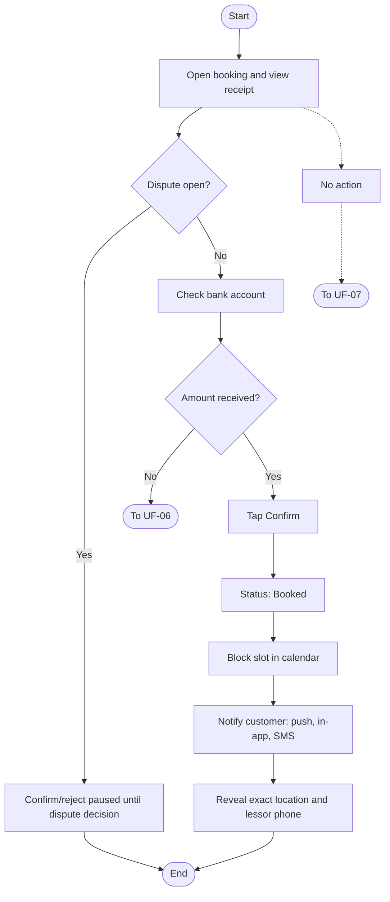
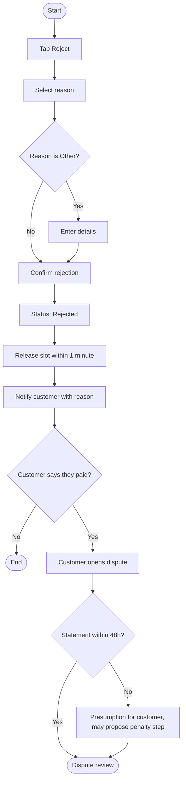
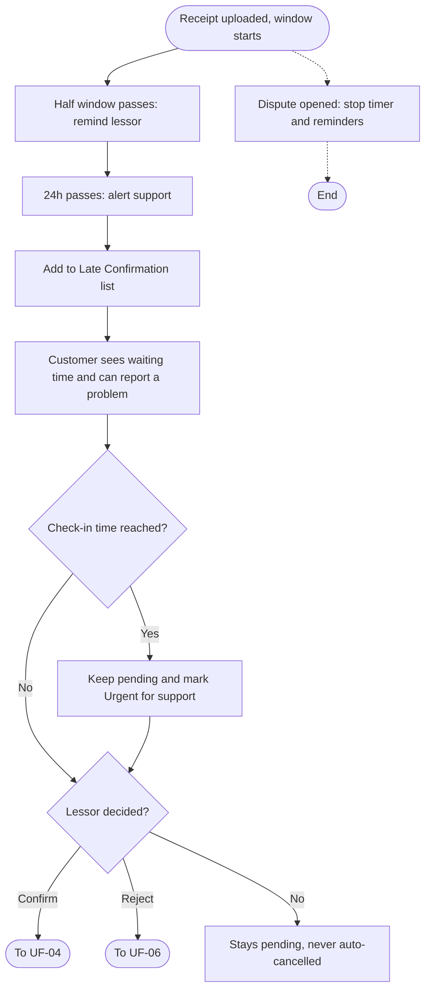

# User Flows: Booking Confirmation or Rejection Cycle

| ID | Flow | Actor | Status |
|----|------|-------|--------|
| UF-04 | Lessor Confirms Booking | Lessor | **Replaces previous UF-04** |
| UF-06 | Lessor Rejects Booking | Lessor | New |
| UF-07 | Lessor Delays the Decision | System / Support | New |

---

# UF-04: Lessor Confirms Booking

**Actor:** Lessor
**Goal:** Confirm that the payment arrived and secure the booking for the customer
**Entry Point:** Notification from UF-02 (customer uploaded a receipt)
**Preconditions:** Booking status is "Awaiting Lessor Confirmation" and no dispute is open on the booking
**Postconditions:** Status is **"Booked"**, the slot is blocked in the calendar, the customer is notified, and the exact location and lessor phone number are revealed to the customer

## Main Flow

| # | User Action | System Response |
|---|-------------|-----------------|
| 1 | Opens the booking | Shows booking details and the receipt (view only, no sharing or download) |
| 2 | Checks their bank account for the amount | n/a (outside the platform) |
| 3 | Taps **"Confirm"** | Sets status to **"Booked"** |
| 4 | n/a | Blocks the slot in the calendar immediately |
| 5 | n/a | Sends the customer an instant push, an in-app notification, and an SMS confirming the booking |
| 6 | n/a | Reveals the exact place location and the lessor's phone number to the customer (only after confirmation) |

## Alternative / Error Flows

| ID | At Step | Condition | Result |
|----|---------|-----------|--------|
| A1 | 1-3 | Lessor's subscription has expired | Lessor can still confirm the pending booking |
| A2 | 3 | Lessor decides not to confirm | Goes to UF-06 |
| E1 | 1-3 | A dispute is open on the booking | Confirm and reject are paused until the dispute decision. Timeout and reminders are paused |
| E2 | 1-3 | Lessor takes no action | Booking stays pending and is never cancelled automatically. Goes to UF-07 |

## Diagram

## Notes
- Related requirements: [[الحجوزات#دورة تأكيد الحجز أو رفضه]]
- Location and phone are hidden before this point. They appear only after confirmation.

---

# UF-06: Lessor Rejects Booking

**Actor:** Lessor (customer is notified)
**Goal:** Reject a booking when the payment cannot be verified, with a mandatory reason
**Entry Point:** Lessor reviews a booking in "Awaiting Lessor Confirmation" (from UF-04)
**Preconditions:** Booking status is "Awaiting Lessor Confirmation" and no dispute is open
**Postconditions:** Status is **"Rejected"**, the slot is released within 1 minute, and the customer is notified with the reason

## Main Flow

| # | User Action | System Response |
|---|-------------|-----------------|
| 1 | Taps **"Reject"** | Shows the reason list |
| 2 | Selects a reason: amount not received, amount insufficient, receipt unclear, or other | n/a |
| 3 | If "Other", enters the details | Requires the details text |
| 4 | Confirms the rejection | Sets status to **"Rejected"** |
| 5 | n/a | Releases the slot within 1 minute |
| 6 | n/a | Notifies the customer with the rejection reason |
| 7 | Customer may tap **"Report a Problem"** | Allows opening a dispute (see Notes) |

## Alternative / Error Flows

| ID | At Step | Condition | Result |
|----|---------|-----------|--------|
| A1 | 7 | Customer confirms they did transfer the amount | Customer opens a dispute. Lessor must provide the account statement within 48 hours |
| A2 | 7 | Lessor does not provide the statement within 48 hours | Treated as a presumption in the customer's favor. A step on the penalty ladder may be proposed |
| E1 | 2 | No reason selected | Rejection blocked, reason is mandatory |
| E2 | 3 | "Other" selected with empty details | Rejection blocked |
| E3 | 1-4 | A dispute is already open | Rejection is paused until the dispute decision |

## Diagram

## Notes
- Related requirements: [[الحجوزات#دورة تأكيد الحجز أو رفضه]]
- Rejection applies to bookings awaiting confirmation. The slot is released, so another customer may book it.

---

# UF-07: Lessor Delays the Decision

**Actor:** System (lessor, support team, and customer are notified)
**Goal:** Push the lessor to decide without cancelling a booking the customer may have already paid for
**Entry Point:** Receipt uploaded and the confirmation window starts (default 24 hours)
**Preconditions:** Booking is "Awaiting Lessor Confirmation", no decision has been made, and no dispute is open
**Postconditions:** Booking stays pending until the lessor decides, and support is aware of the delay

## Main Flow

| # | User Action | System Response |
|---|-------------|-----------------|
| 1 | n/a (half of the window passes, 12 hours by default) | Sends the lessor a reminder to confirm |
| 2 | n/a (24 hours pass) | Alerts the support team |
| 3 | n/a | Adds the booking to the **"Late Confirmation"** list |
| 4 | Customer opens the booking | Shows a message stating how long they have been waiting |
| 5 | Customer may tap **"Report a Problem"** | Allows reporting the problem (see Notes) |
| 6 | n/a (check-in time arrives with no decision) | Keeps the booking pending and marks it **"Urgent"** for support |

## Alternative / Error Flows

| ID | At Step | Condition | Result |
|----|---------|-----------|--------|
| A1 | 1-6 | Lessor confirms or rejects at any point | Goes to UF-04 or UF-06 and reminders stop |
| A2 | 1-6 | Lessor's subscription has expired | Lessor can still decide, and reminders continue |
| A3 | 1 | Admin changed the window (allowed range: 1 to 72 hours) | Window and reminder timing follow the new value |
| E1 | 1-6 | A dispute is opened | Timeout and reminders stop until the dispute decision |
| E2 | 2 | Window ends with no decision | Booking is **not** cancelled automatically (the customer may have paid) |

## Diagram

## Notes
- Related requirements: [[الحجوزات#دورة تأكيد الحجز أو رفضه]]
- The window is counted from the receipt upload time, not from booking creation.

