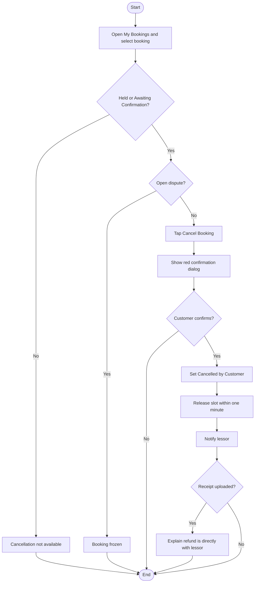
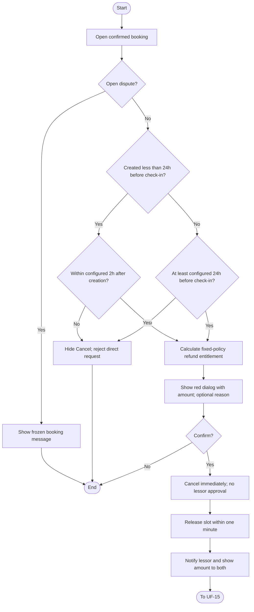
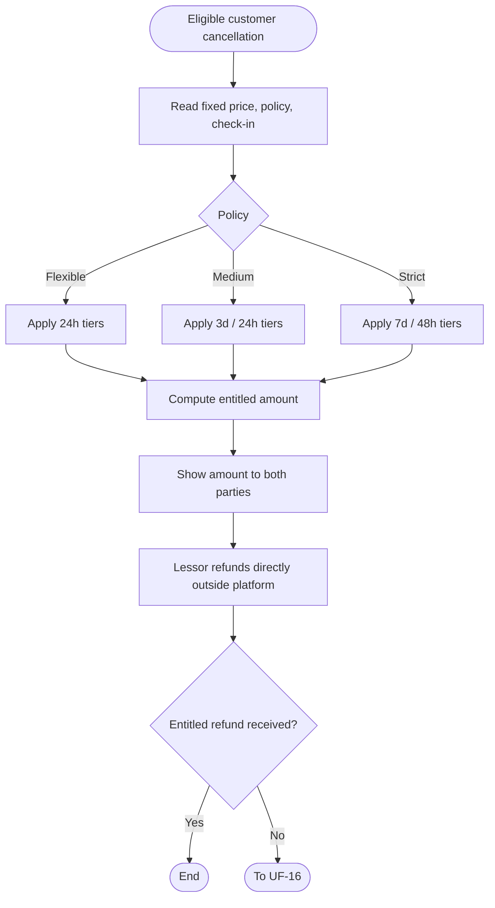
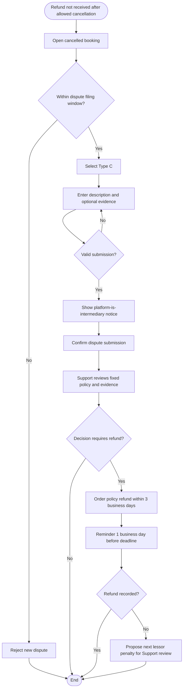

# User Flows: Customer Booking Cancellation Cycle

| ID | Flow | Actor | Status |
|----|------|-------|--------|
| UF-13 | Customer Cancels an Unconfirmed Booking | Customer / System / Lessor | New |
| UF-14 | Customer Cancels a Confirmed Booking | Customer / System / Lessor | New |
| UF-15 | Customer Refund Entitlement and Follow-up | Customer / Lessor | New |
| UF-16 | Customer Opens a Type (C) Refund Dispute | Customer / Support / Lessor | New |

---

# UF-13: Customer Cancels an Unconfirmed Booking

**Actor:** Customer (system processes; lessor notified)  
**Goal:** Cancel a temporary-hold or awaiting-confirmation booking without lessor approval  
**Entry Point:** **Cancel Booking** in booking details  
**Preconditions:** Customer owns booking; booking is **Held** or **Awaiting Lessor Confirmation**; no open dispute freezes it  
**Postconditions:** Booking is **Cancelled by Customer** (final); slot is released within one minute; lessor is notified

## Main Flow

| # | User Action | System Response |
|---|-------------|-----------------|
| 1 | Opens **My Bookings** and selects a booking in Held or Awaiting Lessor Confirmation | Shows booking details and **Cancel Booking** |
| 2 | Taps **Cancel Booking** | Shows red dialog: «إلغاء الحجز؟ سيُحرر الموعد لغيرك. إن كنت حوّلت مبلغًا فاسترداده يتم مباشرة مع المؤجّر» |
| 3 | Confirms cancellation | Changes status to **Cancelled by Customer** without lessor approval |
| 4 | n/a | Releases reserved slot within **one minute** |
| 5 | n/a | Notifies lessor: «ألغى {العميل} حجزه في {المكان} {التاريخ}» |
| 6 | n/a | Shows cancelled booking in **Cancelled / Rejected / Expired** tab; it cannot be reactivated |

## Alternative / Error Flows

| ID | At Step | Condition | Result |
|----|---------|-----------|--------|
| A1 | 3 | Customer dismisses red confirmation dialog | Booking and slot remain unchanged |
| A2 | 3 | Receipt has already been uploaded | Booking is cancelled; shows «أُلغي الحجز. إن كنت حوّلت مبلغًا فاسترداده يتم مباشرة مع المؤجّر» |
| A3 | 1–3 | Held booking expires before cancellation is processed | Expired booking is not cancelled again; system returns current status |
| E1 | 1–3 | Booking has an open dispute | Cancellation blocked; booking remains frozen |
| E2 | 3 | Another user attempts cancellation | Request denied; booking unchanged |
| E3 | 3 | Booking state changes concurrently | System prevents conflicting final states |

## Diagram

## Notes
- Source: PRD **§11 Customer Cancellation**, **§7 Temporary Booking**, **§10 My Bookings**.
- Unconfirmed booking can be cancelled any time **before confirmation**, subject to its current state.
- Platform does not handle money; the customer and lessor arrange any refund directly.
- Customer-cancelled holds must **not** count as expired holds for expiry-related penalties.
- The exact handling of an already-expired hold follows its current final status; do not treat it as a successful cancellation.

---

# UF-14: Customer Cancels a Confirmed Booking

**Actor:** Customer (system processes; lessor notified)  
**Goal:** Cancel a confirmed booking immediately during the allowed window and display the amount owed under its fixed cancellation policy  
**Entry Point:** **Cancel Booking** in confirmed booking details  
**Preconditions:** Booking status **Booked**, owned by customer; no open dispute; cancellation window is still open  
**Postconditions:** Booking becomes **Cancelled by Customer** (final), slot released within one minute, both parties see refund entitlement

## Main Flow

| # | User Action | System Response |
|---|-------------|-----------------|
| 1 | Opens a confirmed booking | Shows the **fixed** booking price, check-in time, cancellation policy and available actions |
| 2 | Taps **Cancel Booking** before the allowed deadline | Calculates refund entitlement from **fixed booking price × fixed policy percentage** at cancellation time |
| 3 | Reviews red dialog | Shows «إلغاء الحجز الآن؟ يُلغى فورًا ويُحرر الموعد. حسب السياسة المعروضة يرد لك المؤجّر {المبلغ} ر.س خارج المنصة»; cancellation reason is optional |
| 4 | Optionally enters a reason and confirms | Cancels **immediately**, with **no lessor approval** |
| 5 | n/a | Changes status to **Cancelled by Customer** and releases slot within **one minute** |
| 6 | n/a | Notifies lessor: «ألغى {العميل} الحجز BKG-… ويستحق {المبلغ} حسب سياستك» |
| 7 | n/a | Both parties see «حسب السياسة المعروضة يستحق العميل {المبلغ} ر.س يردها المؤجّر خارج المنصة» |
| 8 | n/a | Booking appears in cancelled history; customer can pursue refund directly or open Type (C) dispute if unpaid (UF-16) |

## Alternative / Error Flows

| ID | At Step | Condition | Result |
|----|---------|-----------|--------|
| A1 | 3–4 | Customer closes dialog | Booking remains Booked; slot remains reserved |
| A2 | 2 | Standard booking at least **24 hours** before check-in (default) | Cancellation permitted |
| A3 | 2 | Booking was **created less than 24 hours before check-in** | Special cancellation window: **2 hours after booking creation** (default) |
| A4 | 2 | Admin configured different standard or near-term windows | Current configured limits apply |
| E1 | 2 | Standard cancellation deadline has passed | Button hidden; «انتهت مهلة الإلغاء المسموحة لهذا الحجز»; direct API request rejected |
| E2 | 2 | Near-term booking's two-hour window has elapsed | Cancellation unavailable; direct API request rejected |
| E3 | 1–4 | Open dispute freezes booking | Shows «الحجز مجمّد حتى صدور قرار النزاع DSP-…»; cancellation blocked |
| E4 | 4 | Booking has already been cancelled or otherwise reached a final state | Second cancellation not applied |
| E5 | 4 | Non-owner or unauthenticated caller sends cancellation request | Request denied; booking unchanged |

## Diagram

## Notes
- Source: PRD **§11 Customer Cancellation**, **§10 My Bookings**, **§4-12 Bookings API**.
- The **24-hour** standard cutoff and **2-hour** near-term window are defaults and are admin-configurable.
- Eligibility and refund percentage are **different decisions**. A refund tier does not itself authorize a cancellation after the cancellation window closes.
- The PRD gives a medium-policy example at **exactly three days** showing **50%**, despite the general table saying **100% until three days**. Exact boundary precedence requires business confirmation; do not silently resolve this conflict.

---

# UF-15: Customer Refund Entitlement and Follow-up

**Actor:** System (calculates), Customer (requests refund), Lessor (pays outside platform)  
**Goal:** Display the amount owed after an eligible customer cancellation using the policy fixed to that booking  
**Entry Point:** Refund amount in UF-14 / cancelled booking details  
**Preconditions:** Customer cancellation was allowed and processed; booking's original price, check-in time and policy are available  
**Postconditions:** Both parties see the same entitlement; any actual refund is handled directly between them

## Main Flow

| # | User Action | System Response |
|---|-------------|-----------------|
| 1 | Customer initiates eligible cancellation | Reads fixed price, check-in time, and policy attached to that booking |
| 2 | n/a | Computes hours remaining from cancellation to fixed check-in and selects matching policy tier |
| 3 | n/a | Calculates amount = **fixed booking price × refund percentage** |
| 4 | Customer confirms cancellation | Displays exact amount owed to both customer and lessor; no platform payment is made |
| 5 | Customer contacts lessor to obtain the amount owed | Refund is transferred **outside the platform** |
| 6 | Customer receives the refund | Refund issue is resolved; if not received, proceeds to UF-16 |

## Alternative / Error Flows

| ID | At Step | Condition | Result |
|----|---------|-----------|--------|
| A1 | 2 | **Flexible** policy: at least 24h before check-in | **100%** entitlement; otherwise policy tier is 0% |
| A2 | 2 | **Medium** policy: 3+ days / 3 days to 24h / under 24h | **100% / 50% / 0%** respectively, subject to exact 3-day boundary clarification |
| A3 | 2 | **Strict** policy: 7+ days / 7 days to 48h / under 48h | **100% / 50% / 0%** respectively |
| A4 | 2 | Lessor or admin changes policy after booking was created | Uses the **original fixed policy**; later changes apply only to new bookings |
| A5 | 2 | Price changes after booking | Uses the **fixed booking price**, not the current listing price |
| A6 | 3 | Entitlement is 0% | Shows zero owed; does not imply platform will refund |
| E1 | 5–6 | Lessor does not pay the entitled amount | Customer may open **Type (C)** dispute within the dispute window (UF-16) |

## Diagram

## Notes
- Source: PRD **§11 Customer Cancellation**, listing cancellation-policy rules, **§10 My Bookings**.
- Policies: **Flexible** 100% at 24h+; **Medium** 100% at 3d+, 50% from 3d to 24h, 0% in last 24h; **Strict** 100% at 7d+, 50% from 7d to 48h, 0% in last 48h.
- Example expressly given: **SAR 1,000** medium policy cancelled **two days** before check-in ⇒ **SAR 500.00** entitlement.
- **Needs Business Confirmation:** Medium-policy **exactly 3-day** boundary conflicts between the table and explicit example in PRD.
- A refund tier is a calculation rule, not permission to cancel outside the configured eligibility window.

---

# UF-16: Customer Opens a Type (C) Refund Dispute

**Actor:** Customer (files), Lessor (responds/refunds), Support (reviews)  
**Goal:** Escalate non-payment of the refund owed after an eligible customer cancellation  
**Entry Point:** **Open Dispute** in cancelled booking details  
**Preconditions:** Customer cancelled within the allowed window; entitled amount has not been refunded; dispute submission is within permitted period  
**Postconditions:** Type **(C)** dispute is opened and reviewed; if decided for customer, lessor is instructed to refund according to the fixed policy

## Main Flow

| # | User Action | System Response |
|---|-------------|-----------------|
| 1 | Opens cancelled booking and taps **Open Dispute** | Shows available dispute types within the configured filing window |
| 2 | Selects Type **(C):** «ألغيت ضمن المسموح ولم أُسترد» | Shows dispute form |
| 3 | Enters description of **20–2000 characters** and optionally adds evidence (up to **10 files**; video up to **200 MB**) | Validates description and attachment limits |
| 4 | Reviews disclosure | Shows «المنصة وسيط لا ضامن، ولا تستطيع تحويل أو حجز أي مبلغ» |
| 5 | Taps **Submit Dispute** | Shows confirmation: «سيصل للطرف الآخر وفريق الدعم» |
| 6 | Confirms | Opens dispute for review; booking remains in its cancelled state |
| 7 | Support reviews booking, fixed cancellation policy and evidence | If decision favors customer, orders lessor to refund **the policy-entitled amount within 3 business days** |
| 8 | n/a | Sends lessor a reminder **one business day before** the deadline |
| 9 | Lessor records refund | Refund obligation can be closed according to dispute workflow |

## Alternative / Error Flows

| ID | At Step | Condition | Result |
|----|---------|-----------|--------|
| A1 | 1 | Dispute opened after cancellation but within **7 days after check-out** (default) | Filing permitted, subject to configured window |
| E1 | 1 | Dispute filing window has ended | New dispute rejected |
| E2 | 3 | Description shorter than 20 or longer than 2000 characters | Submission blocked |
| E3 | 3 | More than 10 files or video over 200 MB | Attachment validation error |
| E4 | 6 | Another dispute is already open for the booking | Duplicate open dispute not created |
| E5 | 9 | Lessor misses the decision's refund deadline without recording payment | System proposes next lessor-penalty ladder step for Support review |

## Diagram

## Notes
- Source: PRD **§11 Customer Cancellation**, **§13 Disputes**, administrative dispute settings.
- Default dispute window: from receipt upload to **7 days after check-out**; admin-configurable.
- The PRD specifies **Type (C)** for customer cancellation within the allowed window where the entitled refund was not received.
- The platform does **not** transfer, hold or guarantee the refund.
- This flow intentionally stops at the lessor-penalty proposal. Detailed penalty and appeal steps are covered in the supplied **UF-11** and **UF-12**.

---

# Coverage and Clarifications

| Area | Covered by |
|------|------------|
| Held and awaiting-confirmation cancellation | UF-13 |
| Red dialog and user cancellation of dialog | UF-13, UF-14 |
| Confirmed cancellation and allowed time windows | UF-14 |
| Near-term booking special two-hour window | UF-14 |
| Frozen booking, expired window, direct API refusal | UF-14 |
| Fixed refund calculation and three policies | UF-15 |
| Refund outside platform | UF-13, UF-14, UF-15 |
| Refund not received and Type (C) dispute | UF-16 |
| Penalty escalation after missed dispute decision | UF-16 → supplied UF-11 |

**Business clarification:** The PRD's medium-policy refund table and its example disagree about the exact **three-day** boundary. This flow deliberately flags the conflict rather than choosing one interpretation.

**Scope boundary:** Customer acceptance or rejection of a **lessor-initiated** cancellation is already covered in the supplied **UF-09**, not repeated as customer-initiated cancellation here.
