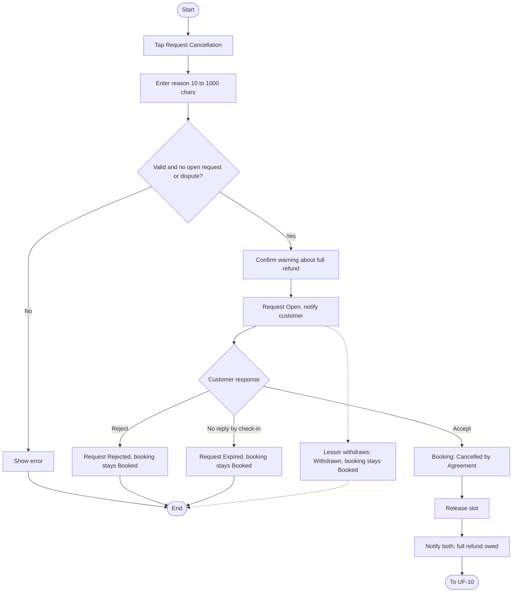
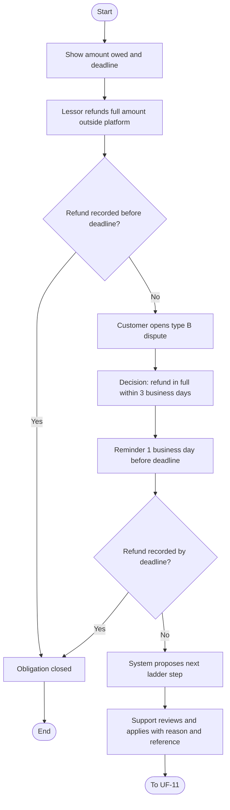
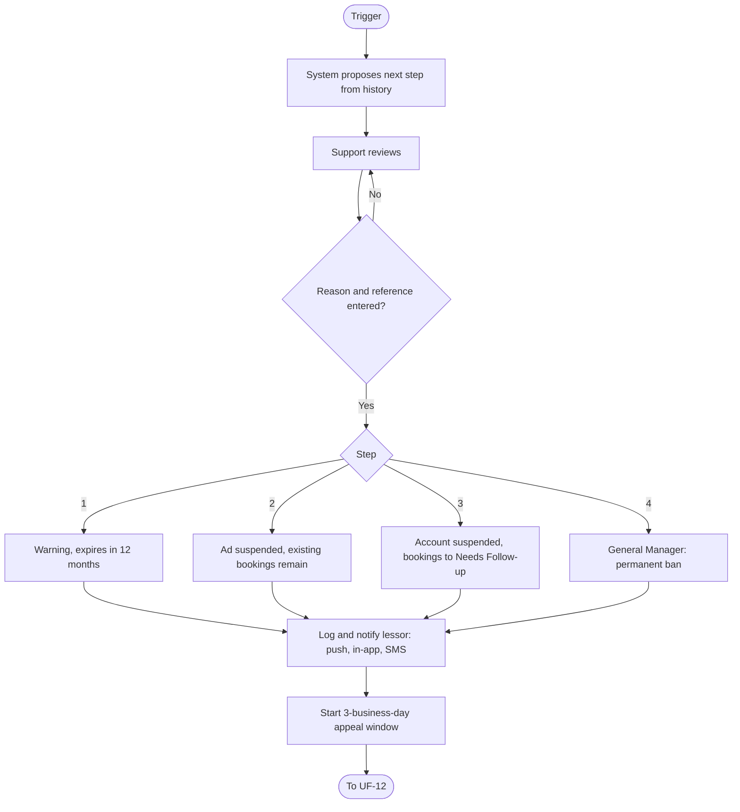
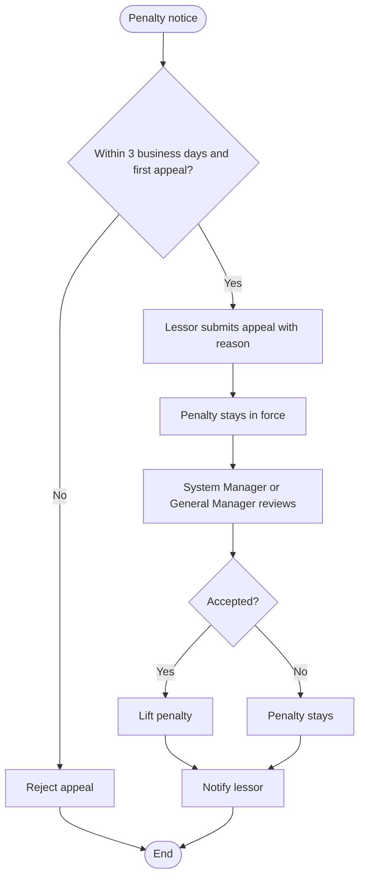

# User Flows: Lessor Cancellation Cycle

| ID | Flow | Actor | Status |
|----|------|-------|--------|
| UF-09 | Lessor Requests Booking Cancellation | Lessor / Customer | New |
| UF-10 | Refund After Agreed Cancellation | Lessor / Customer / Support | New |
| UF-11 | Lessor Penalty Applied | System / Support / General Manager | New |
| UF-12 | Lessor Appeals a Penalty | Lessor / Reviewer | New |

---

# UF-09: Lessor Requests Booking Cancellation

**Actor:** Lessor (the customer responds)
**Goal:** Cancel a confirmed booking by agreement, since the lessor cannot cancel it directly
**Entry Point:** "Request Cancellation" button in the booking details
**Preconditions:** Booking status is "Booked", no open cancellation request exists on it, and no dispute is open
**Postconditions:** Request is Accepted and the booking is "Cancelled by Agreement", the slot is released, and the refund deadline has started

## Main Flow

| # | User Action | System Response |
|---|-------------|-----------------|
| 1 | Opens a Booked booking and taps **"Request Cancellation"** | Shows the reason field |
| 2 | Enters the cancellation reason (10 to 1000 characters) | Validates the length |
| 3 | Taps Send | Shows: «طلب إلغاء الحجز؟ يُلغى إن وافق العميل، وعليك حينها رد المبلغ كاملًا.» |
| 4 | Confirms | Creates the request with status **Open**. The booking stays "Booked" |
| 5 | n/a | Notifies the customer with the booking number and the reason, with **[Accept] [Reject]** |
| 6 | Customer taps **Accept** | Sets the request to Accepted and the booking to **"Cancelled by Agreement"** |
| 7 | n/a | Releases the slot so it can be booked again |
| 8 | n/a | Shows both parties «على المؤجّر رد {المبلغ كاملًا} للعميل». Notifies the lessor: «قبل العميل الإلغاء — عليك رد {المبلغ كاملًا}» |
| 9 | n/a | Starts the refund deadline (3 business days by default). Continues to UF-10 |

## Alternative / Error Flows

| ID | At Step | Condition | Result |
|----|---------|-----------|--------|
| A1 | 6 | Customer taps **Reject** | Request becomes Rejected. The booking stays "Booked" and binding on the lessor |
| A2 | 6 | Customer does not respond by check-in time | System closes the request as Expired. The booking stays confirmed and binding |
| A3 | 5-6 | Lessor withdraws the request while it is Open | Request becomes Withdrawn. The booking stays "Booked" |
| E1 | 2 | Reason is empty | Shows: «اكتب سبب الإلغاء» |
| E2 | 2 | Reason is shorter than 10 or longer than 1000 characters | Send is blocked |
| E3 | 1-4 | An open request already exists on this booking | Shows: «يوجد طلب إلغاء قيد الرد على هذا الحجز» |
| E4 | 1-4 | A dispute is open on the booking | Request cannot be created |

## Diagram

## Notes
- Related requirements: [[الحجوزات#دورة إلغاء الحجز من المؤجّر]]
- Request statuses: **Open** (waiting for customer), **Accepted**, **Rejected**, **Withdrawn**, **Expired**.
- Only one open request is allowed per booking.
- Only an accepted request cancels the booking. Every other outcome leaves it confirmed.

---

# UF-10: Refund After Agreed Cancellation

**Actor:** Lessor (refunds), Customer (disputes if unpaid), Support (reviews)
**Goal:** Make sure the customer gets the full amount back after an agreed cancellation
**Entry Point:** Refund deadline started in UF-09
**Preconditions:** Booking is "Cancelled by Agreement"
**Postconditions:** Full refund is recorded and the obligation is closed

## Main Flow

| # | User Action | System Response |
|---|-------------|-----------------|
| 1 | n/a | Shows both parties the full amount the lessor owes and the remaining time |
| 2 | Lessor transfers the **full** amount to the customer (outside the platform) | n/a. The platform does not receive or transfer money |
| 3 | Refund is recorded | Marks the refund as completed and closes the obligation |

## Alternative / Error Flows

| ID | At Step | Condition | Result |
|----|---------|-----------|--------|
| E1 | 3 | Deadline ends (3 business days) without a full refund | Customer can open a type **(B)** dispute |
| E2 | After E1 | Dispute is opened | A decision obliges the lessor to refund in full within 3 business days |
| E3 | After E2 | One business day before the new deadline | Lessor receives a reminder |
| E4 | After E2 | New deadline ends with no recorded refund | System proposes the next ladder step based on the lessor's history |
| E5 | After E4 | Support reviews the proposal | Support applies it with a reason and reference. Continues to UF-11 |
| A1 | 1-3 | Admin changed the refund window or the holidays list | Deadline follows the new settings |

## Diagram

## Notes
- Related requirements: [[الحجوزات#دورة إلغاء الحجز من المؤجّر]]
- Business days are Sunday to Thursday. Friday and Saturday are always excluded.
- The holidays list is empty by default. The manager adds dates every year.
- Admin can change the number of refund days.
- The platform only shows the amount owed and obliges the lessor to refund. It never handles the money.

---

# UF-11: Lessor Penalty Applied

**Actor:** System (proposes), Support (applies), General Manager (permanent ban only)
**Goal:** Apply the next penalty step with a recorded reason and reference
**Entry Point:** A trigger: refund missed after a dispute decision (UF-10), or two lessor cancellations within 90 days
**Preconditions:** A trigger exists and the system has proposed a step from the lessor's history
**Postconditions:** The step is applied and logged, the lessor is notified, and the appeal window has started. The subscription is **not** refunded

## Main Flow

| # | User Action | System Response |
|---|-------------|-----------------|
| 1 | n/a | Proposes the next ladder step based on the lessor's penalty history |
| 2 | Support reviews the proposal | Shows the history, the proposed step, and the reference |
| 3 | Applies the step with a reason and reference | Applies the step's effects and records it in the penalty log |
| 4 | n/a | Notifies the lessor by instant push, in-app, and SMS with the step, reason, reference, and right to appeal |
| 5 | n/a | Starts the 3-business-day appeal window from the notice. Continues to UF-12 |

## Alternative / Error Flows

| ID | At Step | Condition | Result |
|----|---------|-----------|--------|
| A1 | 3 | Step 1: **Warning** | Logged. Expires after 12 months with no violations and shows as "Expired" |
| A2 | 3 | Step 2: **Ad Suspension** | Ad is hidden, contact and new bookings stop. Shows «الإعلان موقوف من الإدارة: {السبب}». Lessor cannot re-show it. Existing bookings remain |
| A3 | 3 | Step 3: **Account Suspension** | Sessions end and login is blocked. Ads are suspended administratively. Existing bookings go to support under "Needs Follow-up" for a decision on each booking |
| A4 | 3 | Step 4: **Permanent Ban** | Only the General Manager applies it. Ads are archived and disabled. The same national ID or commercial registration cannot re-apply. The lessor's number can log in as a customer only |
| A5 | 3 | Support cancels an existing booking because of the decision | Customer is notified: «ألغت الإدارة الحجز: {السبب}» |
| A6 | Any | Admin lifts any step manually | Lifted with the reason recorded. Lifting an account suspension restores previously published ads if the subscription is still valid |
| E1 | 3 | Reason or reference is missing | Cannot be applied, both are mandatory |
| E2 | 3 | A support employee tries to apply a permanent ban | Not allowed, General Manager only |

## Diagram

## Notes
- Related requirements: [[الحجوزات#دورة إلغاء الحجز من المؤجّر]]
- **Triggers by phase:**
  - Phase 1: a customer accepting a cancellation is **not** counted automatically. The penalty comes from not refunding.
  - Phase 2: two lessor cancellations within 90 days trigger the next step.
- The subscription is not refunded when any penalty is applied.
- The lessor's identity is shown to no one. If the lessor refuses to comply after a ban, identity is handed over only on an official request recorded by the General Manager.

---

# UF-12: Lessor Appeals a Penalty

**Actor:** Lessor (reviewer: System Manager or General Manager)
**Goal:** Challenge a penalty or administrative suspension
**Entry Point:** Penalty notice (push, in-app, SMS)
**Preconditions:** A penalty or administrative suspension was applied, the appeal is within 3 business days of the notice, and no appeal was made for this penalty
**Postconditions:** Penalty is lifted if accepted, or stays in force if rejected

## Main Flow

| # | User Action | System Response |
|---|-------------|-----------------|
| 1 | Opens the notice and taps **"Appeal"** in the app | Shows the reason field |
| 2 | Writes the reason and submits | Registers the appeal. The penalty **stays in force** during review |
| 3 | n/a | Routes it to a System Manager or General Manager, never the employee who imposed the penalty |
| 4 | Reviewer decides | Records the decision |
| 5 | n/a | Notifies the lessor of the decision |

## Alternative / Error Flows

| ID | At Step | Condition | Result |
|----|---------|-----------|--------|
| A1 | 4 | Appeal accepted | Penalty is lifted. Lifting an account suspension restores published ads if the subscription is valid |
| A2 | 4 | Appeal rejected | Penalty stays in force |
| A3 | 1 | Administrative suspension of an ad or account, for any reason (including a valid report) | The same appeal rule applies. The notice states the reason and the right to appeal |
| E1 | 2 | Second appeal on the same penalty | Rejected, one appeal per penalty |
| E2 | 2 | Submitted after 3 business days from the notice | Rejected as late |
| E3 | 2 | Reason is empty | Submission blocked, a written reason is required |
| E4 | 3 | Reviewer is the employee who imposed the penalty | Not allowed |

## Diagram

## Notes
- Related requirements: [[الحجوزات#دورة إلغاء الحجز من المؤجّر]]
- The 3-day window starts from the notice (push, in-app, SMS), not from the penalty date.
- This mirrors UF-05 (customer appeal), with the same rules.