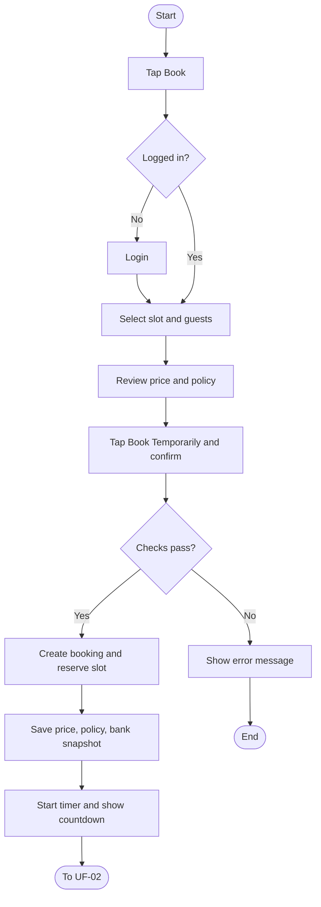
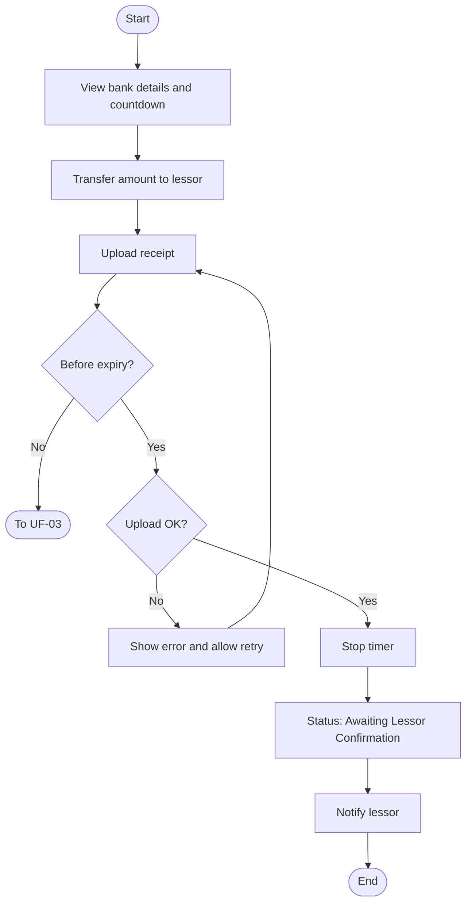
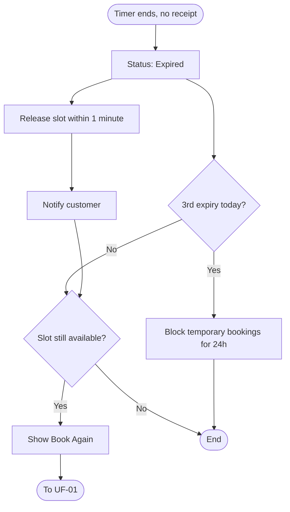

# User Flows: Temporary Booking Cycle

| ID | Flow | Actor |
|----|------|-------|
| UF-01 | Create a Temporary Booking | Customer |
| UF-02 | Transfer Payment and Upload Receipt | Customer |
| UF-03 | Temporary Booking Expires | System / Customer |

---

# UF-01: Create a Temporary Booking

**Actor:** Customer
**Goal:** Reserve a date or time slot temporarily until payment is made
**Entry Point:** "Book" button on the place details screen
**Preconditions:** The place has an available slot
**Postconditions:** A temporary booking (e.g. `BKG-2026-000001`) exists, the slot is reserved for the customer, and the countdown has started

## Main Flow

| # | User Action | System Response |
|---|-------------|-----------------|
| 1 | Taps **"Book"** | Opens the booking screen (user is already logged in) |
| 2 | Selects full day or time period, and number of guests | Calculates and displays the price |
| 3 | Reviews prices, total, check-in/check-out times, and cancellation policy | Displays the details |
| 4 | Taps **"Book Temporarily"** and confirms | Validates availability, active-booking limit, and temporary ban |
| 5 | n/a | Creates the booking with a unique number and reserves the slot within 2 seconds |
| 6 | n/a | Stores a snapshot of the price, cancellation policy, and lessor bank details as of creation time |
| 7 | n/a | Starts the timer (default 2 hours) and shows the countdown. Continues to UF-02 |

## Alternative / Error Flows

| ID | At Step | Condition | Result |
|----|---------|-----------|--------|
| A1 | 1 | Customer is not logged in | Redirects to login, then returns to the booking screen |
| E1 | 4 | Slot is already temporarily held by another customer (simultaneous attempt) | Only one booking succeeds. The other sees: «هذا الموعد محجوز مؤقتًا لعميل آخر. جرّب لاحقًا أو اختر موعدًا آخر» |
| E2 | 4 | Slot overlaps an existing booking (full day vs. time period, any status: temporary, pending, confirmed) | Booking rejected, slot shown as unavailable |
| E3 | 4 | Customer already has 2 active temporary bookings (default limit) | Rejected with: «لديك حجزان مؤقتان نشطان. أكمل أحدهما أو ألغه أولًا» |
| E4 | 4 | Customer is under a temporary ban (3 expiries in one calendar day) | Rejected, temporary booking is blocked for 24 hours from the last qualifying expiry |
| E5 | 4 | Connection lost after tapping "Book Temporarily" | System checks the booking outcome and returns it. No duplicate is created |
| E6 | 4 | Abuse pattern detected (repeated book-then-cancel to block other customers) | Booking blocked or flagged by the anti-abuse rule |

## Diagram

## Notes
- Related requirements: [[الحجوزات#دورة الحجز المؤقت]]
- Same customer may book the same place multiple times if there is no time overlap.
- A previous booking does not block a new one once its period has ended.

---

# UF-02: Transfer Payment and Upload Receipt

**Actor:** Customer
**Goal:** Prove payment so the lessor can confirm the booking
**Entry Point:** Temporary booking screen with the active countdown
**Preconditions:** Booking status is temporary and the timer has not expired
**Postconditions:** Timer is stopped, status is **"Awaiting Lessor Confirmation"**, lessor is notified

## Main Flow

| # | User Action | System Response |
|---|-------------|-----------------|
| 1 | Views the lessor's bank details | Displays the details saved at booking time |
| 2 | Transfers the amount directly to the lessor (outside the app) | n/a |
| 3 | Uploads the transfer receipt before the timer ends | Validates and stores the receipt |
| 4 | n/a | Stops the timer and sets status to "Awaiting Lessor Confirmation" |
| 5 | n/a | Notifies the lessor |

## Alternative / Error Flows

| ID | At Step | Condition | Result |
|----|---------|-----------|--------|
| A1 | 1-3 | Customer closes the app | Booking stays active and timer keeps running. Reminder sent 15 minutes before expiry (default) |
| A2 | 1-3 | Customer cancels the booking | Status becomes cancelled, slot is released, and it is **not** counted as an expiry |
| E1 | 3 | Receipt upload fails | Error shown, timer keeps running, customer can retry |
| E2 | 3 | Timer ends before upload completes | Goes to UF-03 |

## Diagram

## Notes
- Related requirements: [[الحجوزات#دورة الحجز المؤقت]]
- "Awaiting Lessor Confirmation" does **not** mean the booking is confirmed.

---

# UF-03: Temporary Booking Expires

**Actor:** System (customer is notified)
**Goal:** Release the slot when no receipt is uploaded in time
**Entry Point:** Timer reaches zero with no receipt uploaded
**Preconditions:** Booking status is temporary and no receipt exists
**Postconditions:** Status is "Expired" and the slot is available again

## Main Flow

| # | User Action | System Response |
|---|-------------|-----------------|
| 1 | n/a (timer ends) | Sets booking status to **"Expired"** |
| 2 | n/a | Releases the slot within 1 minute |
| 3 | n/a | Notifies the customer that the booking expired |
| 4 | Taps **"Book Again"** (if shown) | Starts UF-01 for the same slot |

## Alternative / Error Flows

| ID | At Step | Condition | Result |
|----|---------|-----------|--------|
| A1 | 4 | Slot was taken by another customer | "Book Again" is not shown |
| A2 | 1 | This is the customer's 3rd expiry in the same calendar day | Customer is blocked from temporary bookings for 24 hours from the last qualifying expiry |
| A3 | 1 | Booking was cancelled by the customer earlier | Not counted toward the 3-expiry limit |

## Diagram

## Notes
- Related requirements: [[الحجوزات#دورة الحجز المؤقت]]
