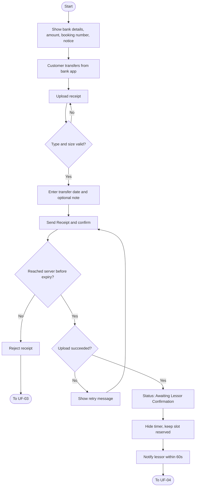
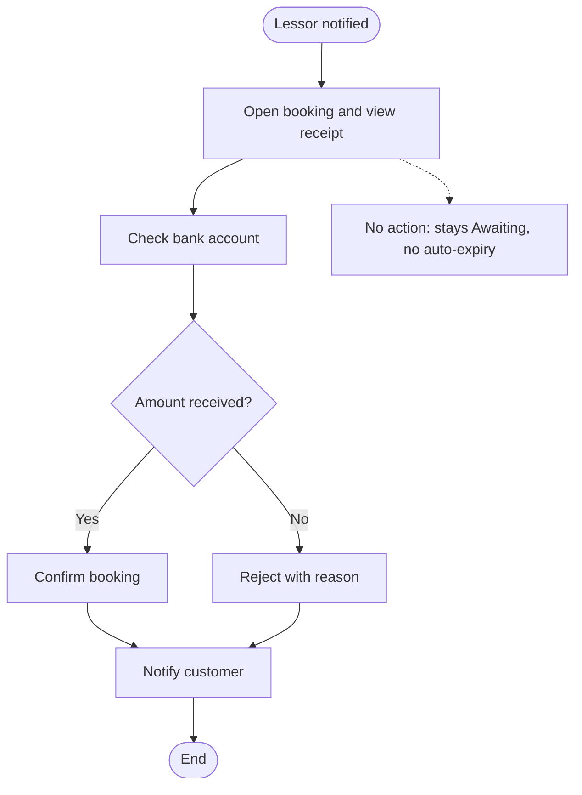
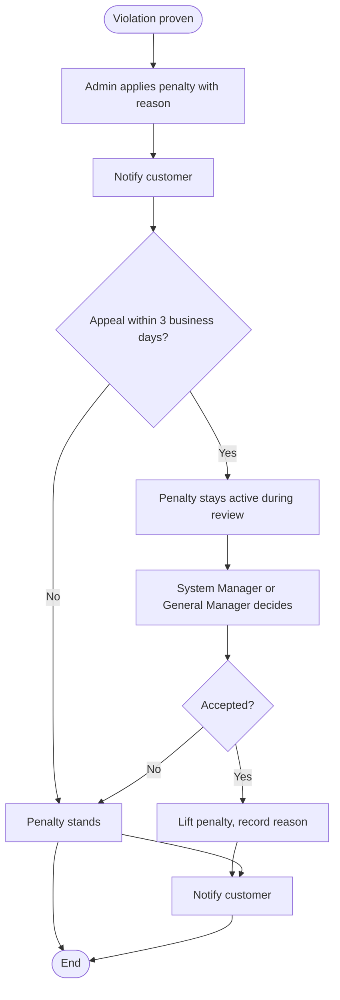

# User Flows: Transfer and Receipt Cycle

| ID    | Flow                                | Actor            | Status                      |
| ----- | ----------------------------------- | ---------------- | --------------------------- |
| UF-02 | Transfer Payment and Upload Receipt | Customer         | **Replaces previous UF-02** |
| UF-04 | Lessor Confirms or Rejects Booking  | Lessor           | New                         |
| UF-05 | Customer Penalty and Appeal         | Admin / Customer | New                         |
|       |                                     |                  |                             |

---

# UF-02: Transfer Payment and Upload Receipt

**Actor:** Customer
**Goal:** Prove the bank transfer so the lessor (مُؤَجِّر) can confirm the booking
**Entry Point:** Temporary booking screen, right after [[Temporary-Booking#UF-01 Create a Temporary Booking]]
**Preconditions:** Booking status is temporary and the timer has not expired
**Postconditions:** Receipt stored, timer stopped, status is **"Awaiting Lessor Confirmation"**, slot still reserved, lessor notified within 60 seconds

## Main Flow

| # | User Action | System Response |
|---|-------------|-----------------|
| 1 | Opens the temporary booking | Shows the lessor's bank details (beneficiary name, bank, IBAN) |
| 2 | n/a | Shows the required amount and the booking number to use in the transfer description |
| 3 | Reads the notice | Shows: transfer goes directly to the lessor, the platform is not a party to payment or refund |
| 4 | Transfers the amount from their bank app | n/a (outside the platform) |
| 5 | Uploads the receipt (JPG, PNG, or PDF, max 10 MB) | Validates file type and size |
| 6 | Enters the transfer date and an optional note | n/a |
| 7 | Taps **"Send Receipt"** and confirms | Checks the receipt reached the server before the timer expired |
| 8 | n/a | Sets status to "Awaiting Lessor Confirmation" and hides the countdown |
| 9 | n/a | Keeps the slot reserved for the customer and blocked for others |
| 10 | n/a | Notifies the lessor within 60 seconds with customer, place, date, and amount |

## Alternative / Error Flows

| ID | At Step | Condition | Result |
|----|---------|-----------|--------|
| A1 | 1-7 | Customer closes the app | Booking stays active and the timer keeps running. Reminder 15 minutes before expiry (default) |
| A2 | 1-7 | Lessor changed the price after the booking was created | Required amount stays as the price saved at creation |
| E1 | 5 | File type is not allowed or size exceeds 10 MB | Upload rejected with a message, customer can pick another file |
| E2 | 7 | Upload fails (network or server) | Message asks to check the connection and retry. Timer keeps running |
| E3 | 7 | Receipt reaches the server after the timer expired | Receipt rejected. Goes to UF-03. Customer may book again if the slot is available |
| E4 | 6 | Transfer date is missing | "Send Receipt" is blocked until the date is entered |

## Diagram

## Notes
- Related requirements: [[الحجوزات#3. التحويل ورفع الإيصال]]
- Receipt privacy: 
	- Visible only to the uploading customer and the lessor. 
	- Admin can view it only when a dispute is open on the booking, and every view is logged. 
	- The lessor cannot share or download it externally.
- Retention: 1 year after the booking ends or the last dispute closes (whichever is later), then auto-deleted, unless the General Manager places a legal hold.

---

# UF-04: Lessor Confirms or Rejects Booking

**Actor:** Lessor
**Goal:** Verify the payment arrived and decide on the booking
**Entry Point:** Notification: "{Customer} booked {Place} {Date} and uploaded a receipt for {Amount}. Verify it arrived, then confirm."
**Preconditions:** Booking status is "Awaiting Lessor Confirmation"
**Postconditions:** Booking is **Confirmed** or **Rejected** with a reason

## Main Flow

| # | User Action | System Response |
|---|-------------|-----------------|
| 1 | Opens the notification | Shows booking details and the uploaded receipt (view only, no sharing or download) |
| 2 | Checks their bank account for the amount | n/a (outside the platform) |
| 3 | Taps **"Confirm"** | Sets status to Confirmed |
| 4 | n/a | Notifies the customer |

## Alternative / Error Flows

| ID | At Step | Condition | Result |
|----|---------|-----------|--------|
| A1 | 3 | Lessor taps **"Reject"** and enters a reason | Status becomes Rejected, customer is notified with the reason |
| A2 | 1-3 | Lessor does not respond | Status stays "Awaiting Lessor Confirmation". It never expires automatically and the slot stays reserved |
| E1 | 3 | Reject attempted without a reason | Blocked, reason is mandatory |

## Diagram

## Notes
- Related requirements: [[الحجوزات#3. التحويل ورفع الإيصال]]

---

# UF-05: Customer Penalty and Appeal (استئناف)

**Actor:** Admin (imposes), Customer (appeals), System Manager / General Manager (decides)
**Goal:** Penalize proven abuse and give the customer one fair appeal
**Entry Point:** Admin finds a forged receipt or repeated false disputes
**Preconditions:** Proven receipt forgery, or repeated false disputes judged by Admin with a mandatory reason
**Postconditions:** Penalty is applied, kept, or lifted, with the reason recorded

## Main Flow

| # | User Action | System Response |
|---|-------------|-----------------|
| 1 | Admin applies a penalty with a mandatory reason | Records it and notifies the customer |
| 2 | Customer submits one appeal within 3 business days of the notice | Registers the appeal. The penalty stays in force |
| 3 | System Manager or General Manager reviews (not the employee who imposed it) | Records the decision |
| 4 | n/a | Notifies the customer of the decision |

## Alternative / Error Flows

| ID | At Step | Condition | Result |
|----|---------|-----------|--------|
| A1 | 1 | First penalty | **Warning**. Expires after 12 months with no violations |
| A2 | 1 | Customer already has a warning and violates again | **Account suspension**. Never expires with time |
| A3 | 1 | Forged receipt proven | Penalty applies from the very first proven case |
| A4 | 3 | Appeal accepted | Penalty lifted manually with the reason recorded |
| E1 | 2 | Customer submits a second appeal for the same penalty | Rejected, only one appeal is allowed |
| E2 | 2 | Appeal submitted after 3 business days | Rejected as late |
| E3 | 3 | Reviewer is the same person who imposed the penalty | Not allowed |

## Diagram

## Notes
- Related requirements: [[الحجوزات#3. التحويل ورفع الإيصال]]