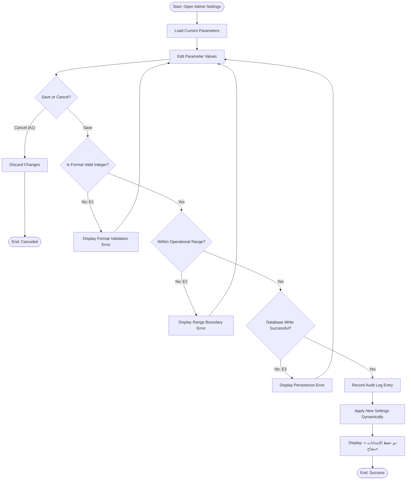

## Main Flow

| # | Actor Action | System Response | Ref |
|---|--------------|-----------------|-----|
| 1 | Navigates to "Contact Reveal & Inspection Settings" in the Admin Panel. | Loads and displays the operational settings table with current values: Interested Customer Duplicate Window (default: 24 hours) and Customer Daily Reveal Limit (default: 30 listings). | SCR-ADM-SET-01, FR-INSP-04 |
| 2 | Modifies the parameter values (e.g., changes duplicate window hours or customer daily reveal count). | Dynamically validates input formats (positive whole numbers). | SCR-ADM-SET-01, FR-INSP-04 |
| 3 | Clicks «حفظ الإعدادات» (Save Settings). | Validates parameters against system boundary constraints (e.g., duplicate window > 0 hours, daily limit > 0). | SCR-ADM-SET-01, FR-INSP-04, BR-INSP-04, BR-INSP-05 |
| 4 | Awaits persistence. | Updates configuration store, logs administrative action in the audit trail (capturing admin user, previous values, new values, timestamp), and applies new settings immediately. | SCR-ADM-SET-01, FR-INSP-04 |
| 5 | Awaits confirmation. | Displays success alert: «تم حفظ الإعدادات بنجاح» (Settings saved successfully). | SCR-ADM-SET-01, FR-INSP-04 |

## Alternatives & Errors

| ID | At Step | Condition | System Behavior | Resumes At |
|----|---------|-----------|-----------------|------------|
| A1 | 2 | Administrator cancels modifications | Reverts uncommitted inputs to previously saved values and displays notification that changes were discarded. | End (canceled) |
| E1 | 3 | Parameter value is blank, non-numeric, or non-integer | Displays inline validation error: "Please enter a valid positive integer." Save action is blocked. | Step 2 |
| E2 | 3 | Parameter value falls outside allowed operational thresholds *(Assumption: window between 1-168 hours; daily limit between 1-500)* | Displays boundary validation message: "Value out of allowable range." Save action is blocked. | Step 2 |
| E3 | 4 | System database failure or connection error during persistence | Reverts transaction, preserves entered form values, and displays error: «تعذر حفظ الإعدادات، يرجى المحاولة مرة أخرى» (Unable to save settings. Please try again). | Step 3 |

## Diagram (optional: only if 3+ branches)

## Notes & Assumptions

- **Traceability:**
  - `FR-INSP-04`: Administrative interface and persistence for engagement and reveal settings.
  - `BR-INSP-04`: Enforcement of `حد الإظهار اليومي للعميل` (Customer Daily Contact Reveal / Inspection Limit, default: 30).
  - `BR-INSP-05`: Enforcement of `نافذة تكرار المهتم` (Interested Customer Duplicate Window, default: 24 hours).
- **Default System Parameters (from approved requirements):**
  - Duplicate Window (`نافذة تكرار المهتم`): 24 hours (Unit: hours).
  - Daily Reveal Limit (`حد الإظهار اليومي للعميل`): 30 listings (Unit: count).
- **Assumptions Requiring Clarification:**
  - *In-Flight Counter Effect:* Changes to the daily limit take effect immediately for remaining requests in the active calendar day without retroactively blocking users who already exceeded the new threshold.
  - *Audit Logging:* Assumed every modification to administrative settings must generate an uneditable audit trail record with user ID, IP address, and old/new values.
