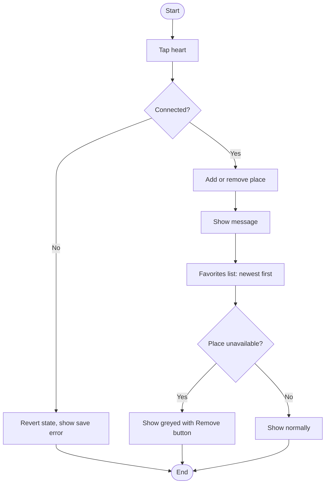
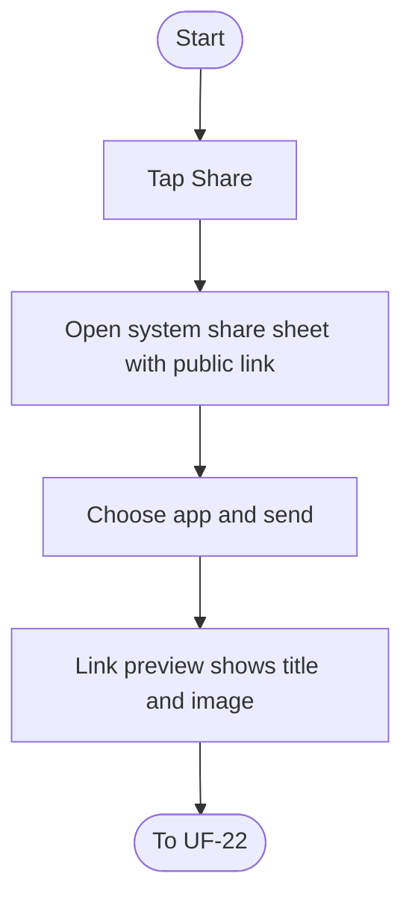
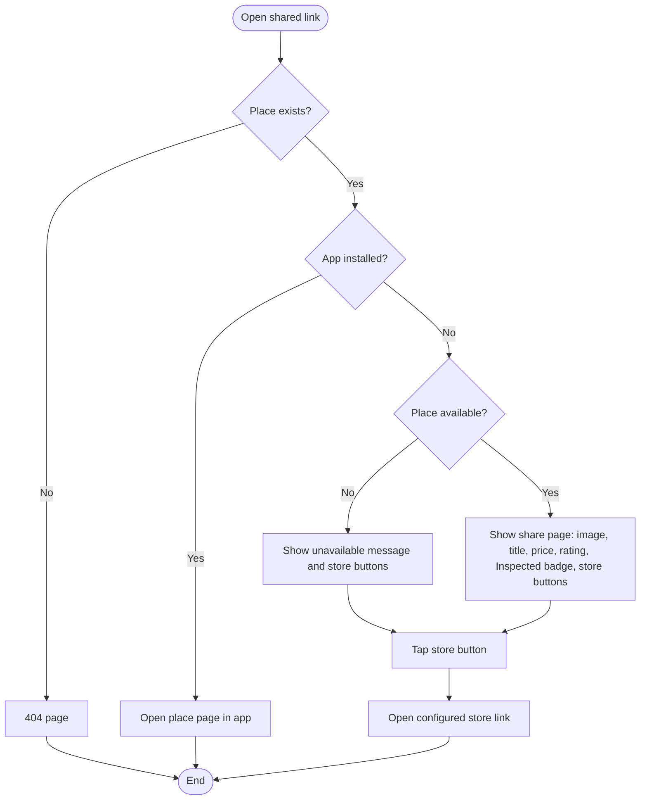

# User Flows: Favorites and Sharing Cycle

| ID    | Flow               | Actor                               | Status |
| ----- | ------------------ | ----------------------------------- | ------ |
| UF-20 | Manage Favorites   | Customer                            | New    |
| UF-21 | Share a Place      | Customer                            | New    |
| UF-22 | Open a Shared Link | Recipient (with or without the app) | New    |

---

# UF-20: Manage Favorites

**Actor:** Customer
**Goal:** Save places to a personal list and remove them later
**Entry Point:** Heart icon on a place card or on the place page, or the "Favorites" screen
**Preconditions:** The place is shown to the customer
**Postconditions:** The place is added to or removed from Favorites, and the heart state matches the saved state

## Main Flow

| #   | User Action                             | System Response                                |
| --- | --------------------------------------- | ---------------------------------------------- |
| 1   | Taps the heart on a card or place page  | Adds the place and shows «أُضيف إلى المفضلة»   |
| 2   | Taps the heart again                    | Removes the place and shows «أُزيل من المفضلة» |
| 3   | Opens "Favorites"                       | Lists places sorted by newest first            |
| 4   | Taps **Remove** on an unavailable place | Removes it from the list                       |

## Alternative / Error Flows

| ID  | At Step | Condition                                 | Result                                                                            |
| --- | ------- | ----------------------------------------- | --------------------------------------------------------------------------------- |
| A2  | 3       | A favorite place is currently unavailable | It stays in the list, greyed out, labeled «غير متاح حاليًا», with a Remove button |
| E1  | 1-2     | No connection                             | The heart state reverts and shows «تعذر الحفظ، تحقق من الاتصال»                   |

## Diagram

## Notes
- Related requirements: [[متطلبات مشروع تنفيذ# ١٦. المفضلة والمشاركة]]
- Favorites are sorted by the time they were added (newest first).
- Closed questions:
  - Is login required to favorite? YES 
  - What happens for a visitor who taps the heart? Navigate to login screen
  - What happens to a favorite when the ad is suspended administratively or deleted (shown as unavailable, or removed)? Say as it was But became unchangeable 
  - Is there a limit on the number of favorites? NO

---

# UF-21: Share a Place

**Actor:** Customer
**Goal:** Send a place to someone through a public web link
**Entry Point:** "Share" button on the place page
**Preconditions:** The place is displayed to the customer
**Postconditions:** The system share sheet is opened with the public link, and the link preview shows the title and image in messaging apps

## Main Flow

| # | User Action | System Response |
|---|-------------|-----------------|
| 1 | Taps **"Share"** | Opens the system share sheet with a public web link |
| 2 | Selects a messaging app and sends | Sends the link |
| 3 | n/a (recipient's app shows the link) | The preview shows the place title and image |

## Alternative / Error Flows

| ID | At Step | Condition | Result |
|----|---------|-----------|--------|
| A1 | 1 | Customer closes the share sheet | Nothing is sent |

## Diagram

## Notes
- Related requirements: FR-xx
- The link uses a random ID, not a sequential number.
- Open questions:
  - Can a visitor (not logged in) share?
  - What if the place is unavailable at the time of sharing: is the Share button still shown?

---

# UF-22: Open a Shared Link

**Actor:** Recipient (with or without the app)
**Goal:** See the shared place, and reach the app or store
**Entry Point:** The shared web link
**Preconditions:** The link exists
**Postconditions:** The recipient sees the place in the app, or the share page with store buttons

## Main Flow

| #   | User Action                                    | System Response                                                                                                                                                 |
| --- | ---------------------------------------------- | --------------------------------------------------------------------------------------------------------------------------------------------------------------- |
| 1   | Opens the link on a device **with** the app    | Opens the place page inside the app directly                                                                                                                    |
| 2   | Opens the link on a device **without** the app | Shows the share page: image, title with the type word («شاليه سعف — الريان، بريدة»), today's price, rating (or «جديد» if no ratings), and the "Inspected" badge |
| 3   | Taps **App Store** or **Google Play**          | Opens the store link configured in the settings                                                                                                                 |

## Alternative / Error Flows

| ID | At Step | Condition | Result |
|----|---------|-----------|--------|
| A1 | 2 | The place has no ratings | Shows «جديد» instead of a rating |
| A2 | 2 | The ad is unavailable | Shows «هذا الشاليه غير متاح حاليًا» with both store buttons |
| E1 | 2 | The ad does not exist | Shows a 404 page |

## Diagram

## Notes
- Related requirements: [[متطلبات مشروع تنفيذ# ١٦. المفضلة والمشاركة]]
- The share page has **no booking and no contact data**: no lessor number and no exact location.
- The page is not indexed by search engines.
- Store links come from the admin settings (two links, set before launch).
- Closed questions:
  - What if the store links are not configured yet? Show 404 page
  - Is the "Inspected" badge shown only when the place was actually inspected? YES
  - Does the link keep working after the place becomes unavailable and then available again? It should work