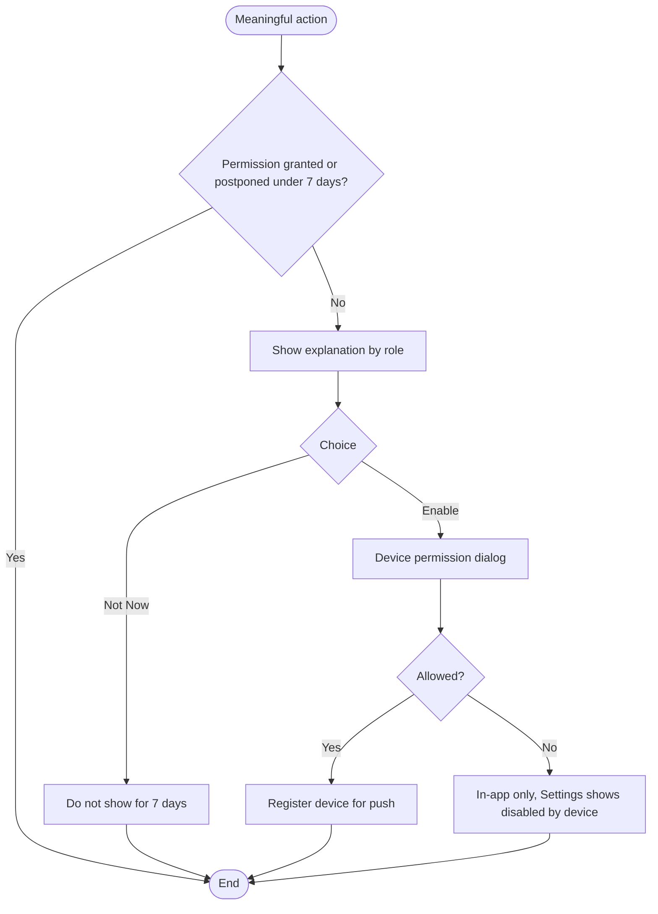
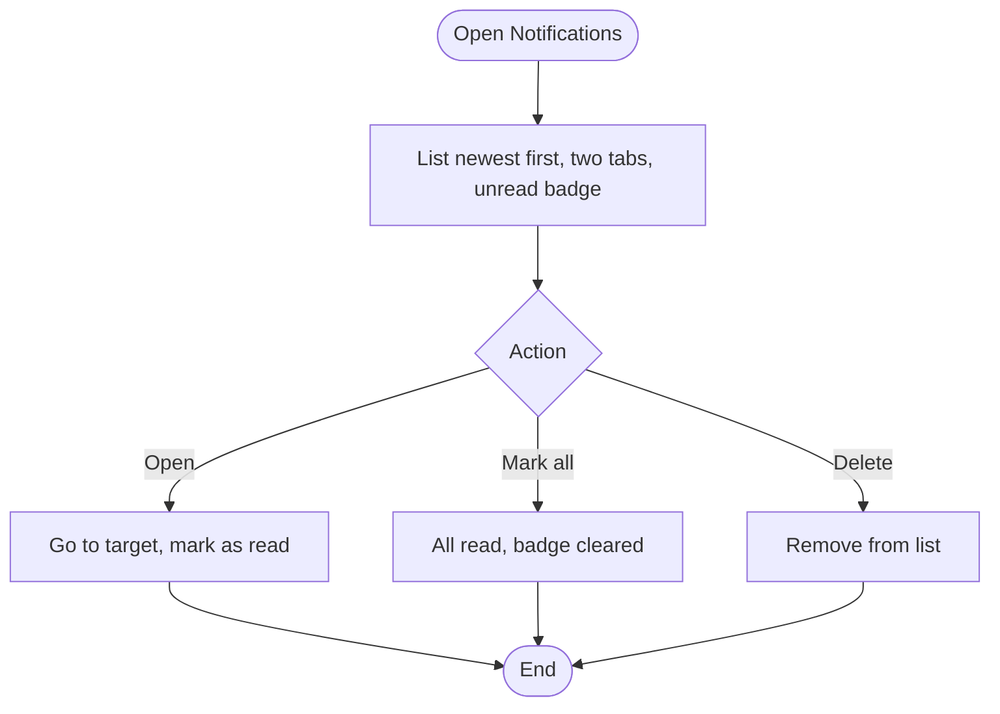
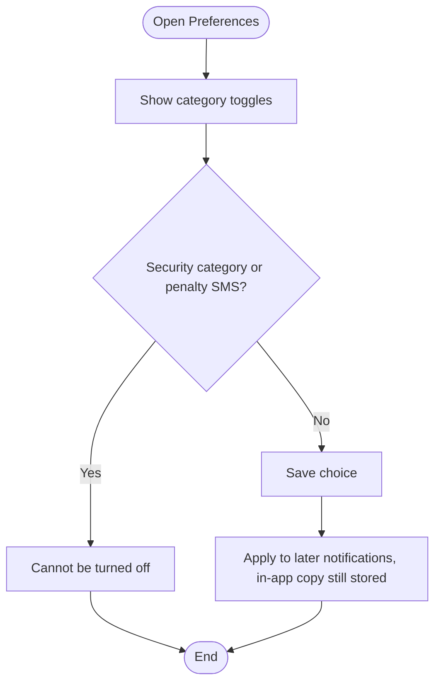
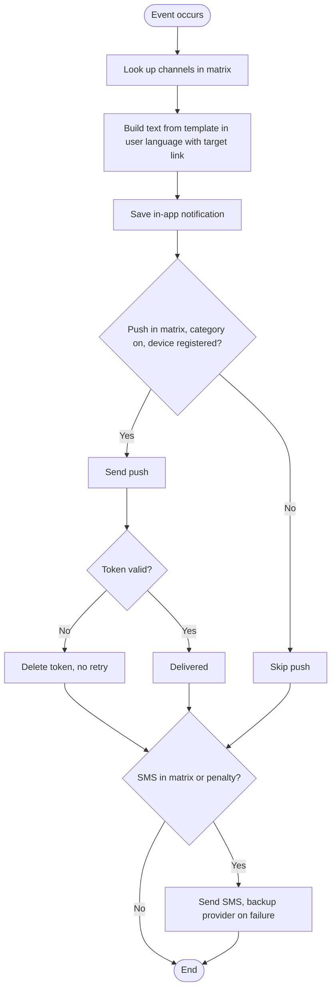
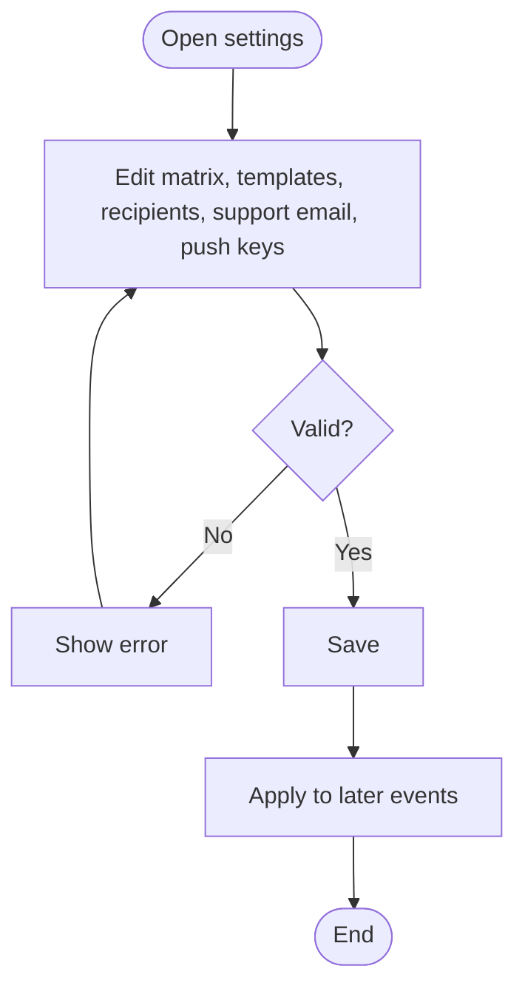

# User Flows: Notifications Cycle

| ID | Flow | Actor | Status |
|----|------|-------|--------|
| UF-23 | Notification Permission Prompt | Customer / Lessor | New |
| UF-24 | View and Manage Notifications | Customer / Lessor | New |
| UF-25 | Set Notification Preferences | Customer / Lessor | New |
| UF-26 | Deliver a Notification | System | New |
| UF-27 | Configure Notification Settings | Admin | New |

## Channel Reference (from the approved table)

| Recipient | Channel | Events |
|-----------|---------|--------|
| Customer | SMS only | Login code. Alert to the old number when the number is changed |
| Customer | In-app (+ push for the reminder) | Temporary booking created. Reminder 15 minutes before it ends |
| Customer | Push + in-app | Timed out. Lessor rejection. Reminder 24 hours before check-in. Lessor cancellation request. Admin cancel or force-confirm. Dispute events (opened against them, decision, refund recorded, appeal). Dispute closure is **in-app only** |
| Customer | Push + in-app + SMS | Booking confirmation with exact location and lessor phone. Penalty or its lifting. Administrative suspension or lifting (account or ad, including direct ones) with the reason, right to grieve, and deadline. Grievance decision |
| Customer | Push + in-app, or in-app only | Rating invitation. Rating hidden. Report closed. Support reply. Copy of their data |
| Customer | In-app, then SMS | Account deletion request (in-app). Its execution (SMS) |
| Lessor | Push + in-app | Onboarding, inspection, and data-update stages. Ad decisions. Subscription events (approved, rejected, 7/3/1 days, expiry, manual extension or cancellation). New interested customer. Calendar reminder. Receipt uploaded. Mid-window confirmation reminder. Customer cancellation with amount due. Customer reply to a cancellation request. Dispute opened and its decision. New rating. Reminder before check-in |
| Lessor | **+ SMS** | Any change to bank accounts. Statement request. Refund due-date reminder. Penalty |

---

# UF-23: Notification Permission Prompt

**Actor:** Customer or Lessor
**Goal:** Allow push notifications after understanding why they are needed
**Entry Point:** The first meaningful action: first contact reveal, first join request sent, or first activation of lessor mode
**Preconditions:** Device permission has not been granted yet, and the prompt was not postponed within the last 7 days
**Postconditions:** Permission is granted, or the user continues with in-app notifications only

## Main Flow

| # | User Action | System Response |
|---|-------------|-----------------|
| 1 | Performs a meaningful action (first contact reveal, first join request, first lessor-mode activation) | Completes the action, then shows the explanation (not at first launch) |
| 2 | n/a | Customer text: «نبلغك عند الرد على رسائلك وعند دعوتك لتقييم إقامتك». Lessor text: «نبلغك فورًا عند وصول مهتم جديد وقبل انتهاء اشتراكك» |
| 3 | Taps **"Enable Notifications"** | Opens the device permission dialog |
| 4 | Allows | Registers the device for push notifications |

## Alternative / Error Flows

| ID  | At Step | Condition                    | Result                                                                                               |
| --- | ------- | ---------------------------- | ---------------------------------------------------------------------------------------------------- |
| A1  | 3       | Taps **"Not Now"**           | Prompt closes and is not shown again for 7 days                                                      |
| A2  | 4       | Denies the device permission | Notifications arrive in-app only. Settings show «الإشعارات معطلة من الجهاز» with **[Open Settings]** |
| A3  | Any     | Permission already granted   | Prompt is not shown                                                                                  |

## Diagram

## Notes
- Related requirements: [[متطلبات مشروع تنفيذ#١٨. الإشعارات]]
- The prompt must not appear at first launch.
- Open questions:
  - Which action counts as the "first" if the user is both a customer and a lessor? Lessor
  - After the 7 days, is the prompt shown on the next meaningful action or on any app open?
  - Can the prompt appear again after the user denies the device permission? No

---

# UF-24: View and Manage Notifications

**Actor:** Customer or Lessor
**Goal:** Read notifications and reach the related screen
**Entry Point:** "Notifications" screen
**Preconditions:** The user is logged in
**Postconditions:** The notification is read, deleted, or the user is on its target screen. The unread badge is updated

## Main Flow

| # | User Action | System Response |
|---|-------------|-----------------|
| 1 | Opens "Notifications" | Lists notifications newest first, with an unread badge and two tabs: customer mode and lessor mode |
| 2 | Taps a notification | Opens its target screen and marks it as read |
| 3 | Taps **"Mark All as Read"** | Marks all notifications as read and clears the badge |
| 4 | Deletes a notification | Removes it from the list |

## Alternative / Error Flows

| ID | At Step | Condition | Result |
|----|---------|-----------|--------|
| A1 | 1 | User taps the push notification from outside the app | Opens the target screen directly and marks it as read |
| A2 | 1 | Push is off or denied | The in-app list still contains every notification |
| E1 | 2 | The target no longer exists (for example a deleted rating or a closed request) | See open questions |

## Diagram

## Notes
- Related requirements: [[متطلبات مشروع تنفيذ#١٨. الإشعارات]]
- Every notification carries a link to its target.
- The in-app copy is always stored, even when push is off.
- Closed questions:
  - What does the user see when the target is no longer available? No available screen  
  - Does deleting remove the notification permanently? Yes
  - What is the retention period for in-app notifications? For ever 
  - Does the badge count both tabs together, or each tab separately? Count new 

---

# UF-25: Set Notification Preferences

**Actor:** Customer or Lessor
**Goal:** Choose which notification categories to receive as push
**Entry Point:** "Notification Preferences" in Settings
**Preconditions:** The user is logged in
**Postconditions:** The category toggles are saved and applied to later notifications

## Main Flow

| # | User Action | System Response |
|---|-------------|-----------------|
| 1 | Opens "Notification Preferences" | Shows toggles for: Interested customers, Account and subscription, Ads, Ratings |
| 2 | Turns a category on or off | Saves the choice |
| 3 | n/a | Applies it to later notifications. The in-app copy is still stored |

## Alternative / Error Flows

| ID | At Step | Condition | Result |
|----|---------|-----------|--------|
| A1 | 1 | Device permission is off | Shows «الإشعارات معطلة من الجهاز» with **[Open Settings]** |
| E1 | 2 | User tries to turn off the **Security** category | Not allowed, it cannot be turned off |
| E2 | 2 | User tries to turn off penalty SMS | Not allowed, it always arrives |

## Diagram

## Notes
- Related requirements: [[متطلبات مشروع تنفيذ#١٨. الإشعارات]]
- Open questions:
  - Which events belong to each category? Booking, dispute, and penalty events do not appear in the four toggles.
  - Does turning a category off also stop its SMS, or push only?
  - Which events are in the Security category?
  - Are preferences kept per mode (customer and lessor) or per account?

---

# UF-26: Deliver a Notification

**Actor:** System (the recipient is a customer or lessor)
**Goal:** Deliver each event to the right person, on the right channels, in time
**Entry Point:** A business event with a notification (for example a receipt uploaded, a booking confirmed, a penalty applied)
**Preconditions:** The event exists in the event × channel matrix
**Postconditions:** The notification is stored in-app and sent on the configured channels with a link to its target

## Main Flow

| #   | User Action        | System Response                                                                                         |
| --- | ------------------ | ------------------------------------------------------------------------------------------------------- |
| 1   | n/a (event occurs) | Looks up the event's channels in the matrix                                                             |
| 2   | n/a                | Builds the text from the admin-managed template, in the recipient's language, with a link to the target |
| 3   | n/a                | Saves the **in-app** notification (always)                                                              |
| 4   | n/a                | Sends **push** if the matrix includes it, the category is on, and the device is registered              |
| 5   | n/a                | Sends **SMS** if the matrix includes it                                                                 |
| 6   | n/a                | Delivers within the time targets (login code 30 seconds, push 60 seconds, for 95% of cases)             |

## Alternative / Error Flows

| ID | At Step | Condition | Result |
|----|---------|-----------|--------|
| A1 | 4 | User turned off the category | Push is skipped, in-app copy is still stored |
| A2 | 4 | Device permission denied | In-app only |
| A3 | 5 | Event is a penalty | SMS always sent, cannot be turned off |
| A4 | 5 | Primary SMS provider fails | Sends through the backup provider |
| A5 | 2 | Recipient is a customer | No email is requested or sent. Email is for staff and the support mailbox only |
| E1 | 4 | Provider reports the device token is invalid | Token is deleted after the provider's response and is not retried |
| E2 | 5 | SMS delivery rate for login codes falls below 97% | See open questions |

## Diagram

## Notes
- Related requirements: [[متطلبات مشروع تنفيذ#١٨. الإشعارات]]
- Time targets: login code within 30 seconds, push within 60 seconds of the event, both for 95% of cases. SMS delivery rate for login codes is at least 97%.
- Penalty notices always go by SMS.
- Closed question:
	- How is a user who has both modes (customer and lessor) targeted when the event belongs to one mode? Sent to current mode
	- If push and SMS both fail, is there any retry or escalation? No
- Open questions:
  - Where is a notification stored if it is sent to a staff role, and is email used there?

---

# UF-27: Configure Notification Settings

**Actor:** Admin
**Goal:** Control channels, texts, and recipients without a code change
**Entry Point:** Admin panel, "Notification Settings"
**Preconditions:** Admin has permission to manage settings
**Postconditions:** The new settings apply to later events

## Main Flow

| #   | User Action                                              | System Response                                                       |
| --- | -------------------------------------------------------- | --------------------------------------------------------------------- |
| 1   | Opens "Notification Settings"                            | Shows the event × channel matrix (push, in-app, SMS, email per event) |
| 2   | Changes the channels of an event                         | Validates and saves                                                   |
| 3   | Edits a template text for each enabled language          | Checks the mandatory variables are present                            |
| 4   | Sets staff alert recipients (roles, employees, or email) | Saves                                                                 |
| 5   | Sets the support email and the email sender              | Saves                                                                 |
| 6   | Enters the Apple and Google push keys                    | Saves. Required before launch                                         |

## Alternative / Error Flows

| ID | At Step | Condition | Result |
|----|---------|-----------|--------|
| E1 | 3 | A mandatory variable was removed from the template | Save blocked |
| E2 | 2 | Admin removes SMS from the penalty event | Not allowed, penalty SMS is fixed |
| E3 | 6 | Push keys are empty | Push is not sent, in-app is still stored |

## Diagram

## Notes
- Related requirements: [[متطلبات مشروع تنفيذ#١٨. الإشعارات]]
- Defaults: matrix per the approved table. Templates use the approved texts. Support email and sender are empty. Push keys are set before launch.
- Closed question:
	- Do template changes affect notifications already sent? No
	- Can an admin turn off in-app storage for an event? The policy says it is always stored.
- Open questions:
  - Is every change to the matrix or templates audit-logged?
