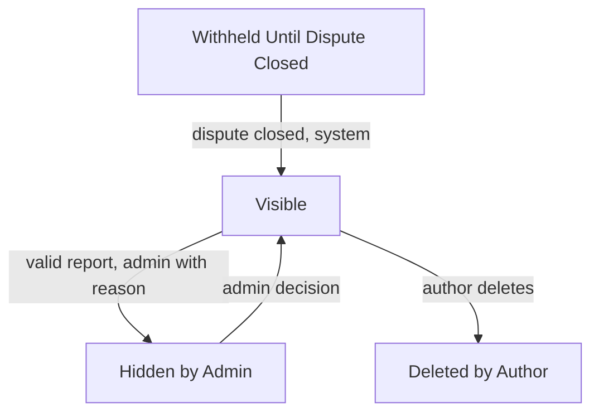
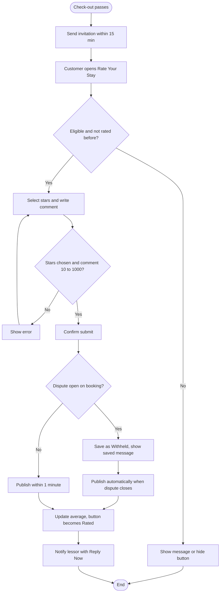
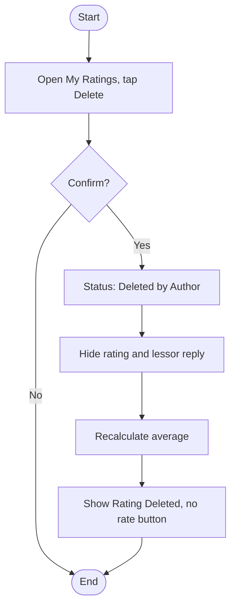
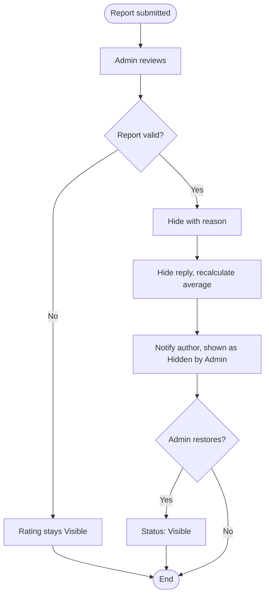

# User Flows: Post-Stay Rating Cycle

| ID | Flow | Actor | Status |
|----|------|-------|--------|
| UF-14 | Submit a Post-Stay Rating | System / Customer | New |
| UF-18 | Delete Own Rating | Customer | New |
| UF-19 | Admin Hides a Reported Rating | Reporter / Admin | New |

## Rating Status Lifecycle

---

# UF-14: Submit a Post-Stay Rating

**Actor:** System (invites), Customer (rates)
**Goal:** Let a customer who actually stayed rate the place once
**Entry Point:** Invitation notification, "Rate Your Stay" button in booking details (app booking), or "My Stays and Rating Invitations" (external stay)
**Preconditions:** The booking is confirmed and its check-out time has passed, or it is an external stay recorded by the lessor under the customer's phone number. The source has no rating yet, including a deleted one. The customer is not the lessor of this place
**Postconditions:** The rating is **Visible** on the place page within 1 minute, the average is updated, the button shows "Rated", and the lessor is notified

## Main Flow

| # | User Action | System Response |
|---|-------------|-----------------|
| 1 | n/a (check-out time passes) | Within 15 minutes sends: «كيف كانت إقامتك في {المكان}؟ قيّمها الآن» |
| 2 | Opens the booking and taps **"Rate Your Stay"** (or opens the stay from "My Stays and Rating Invitations") | Opens the rating form |
| 3 | n/a | Shows the notice: «يظهر تقييمك باسمك الأول ولا يمكن تعديله بعد الإرسال» |
| 4 | Selects stars (1 to 5) and writes a comment (10 to 1000 characters) | Validates both |
| 5 | Taps **"Submit Rating"** | Shows: «إرسال التقييم؟ لا يمكن تعديله بعد الإرسال، ويمكنك حذفه لاحقًا» |
| 6 | Confirms | Saves the rating and shows «شكرًا! نُشر تقييمك» |
| 7 | n/a | Shows the rating on the place page within 1 minute and recalculates the average |
| 8 | n/a | Changes the button to **"Rated"** |
| 9 | n/a | Notifies the lessor: «تقييم جديد ({النجوم}★) على {المكان}» with a **"Reply Now"** button |

## Alternative / Error Flows

| ID | At Step | Condition | Result |
|----|---------|-----------|--------|
| A1 | 2 | External stay recorded by the lessor with the customer's number | Appears in "My Stays and Rating Invitations" until rated |
| A2 | 2 | The phone owner created the account after the stay | Still eligible |
| A3 | 2 | A year or more has passed with no rating | Button still shown, there is no time limit |
| A4 | 6 | A dispute is open on the booking | Rating is saved as **Withheld Until Dispute Closed** and the customer sees «حُفظ تقييمك وسيُنشر بعد إغلاق النزاع». When the dispute closes, the system publishes it automatically |
| E1 | 4 | No stars selected | Blocked with «اختر عدد النجوم» |
| E2 | 4 | Comment shorter than 10 or longer than 1000 characters | Submit blocked |
| E3 | 5 | This source was already rated | Rejected with «قيّمت هذه الإقامة من قبل» |
| E4 | 1 | Booking is cancelled or rejected | No invitation and no rating button |
| E5 | 2 | The customer is the lessor of this place | Not allowed to rate |
| E6 | 2 | The customer deleted a previous rating of this source (see UF-18) | Cannot rate this source again |

## Diagram

## Notes
- Related requirements: FR-xx
- One rating per confirmed booking after check-out, or per external stay recorded by the lessor.
- A rating cannot be edited after submission. Deleting is allowed (UF-18).
- Displayed name is the first name plus one letter of the family name.
- Average: calculated over visible ratings only, one decimal place, updated on every add, delete, or hide.
- Admin setting: minimum number of ratings before the average is shown (default 1).
- The booking moves to the "Completed" status at check-out, which makes it eligible for rating.
- Open questions:
  - The info message says "first name" but the policy says first name plus one letter of the family name. Which is correct?
  - Is the invitation reminded again if the customer ignores it?
  - Example 50 says a rating added before a dispute opens is "saved but not published". Does an already visible rating become Withheld when a dispute is opened later?
  - Does the lessor get the "New Rating" notification when a withheld rating is published?
  - The lessor reply ("Reply Now") has no rules in the source: length, one reply only, edit or delete. Needs its own flow once defined.

---

# UF-18: Delete Own Rating

**Actor:** Customer
**Goal:** Remove a rating the customer previously published
**Entry Point:** "My Ratings" screen
**Preconditions:** The customer has a rating with status Visible
**Postconditions:** Status is **Deleted by Author** (final), the rating and the lessor's reply disappear, the average is recalculated, and the stay shows "Rating Deleted" with no rate button

## Main Flow

| # | User Action | System Response |
|---|-------------|-----------------|
| 1 | Opens "My Ratings" and taps **Delete** on a rating | Asks for confirmation |
| 2 | Confirms | Sets status to **Deleted by Author** |
| 3 | n/a | Hides the rating together with the lessor's reply |
| 4 | n/a | Recalculates the average (visible ratings only) |
| 5 | n/a | Shows "Rating Deleted" on the stay and does not offer a rate button |

## Alternative / Error Flows

| ID | At Step | Condition | Result |
|----|---------|-----------|--------|
| A1 | 1 | Customer cancels the confirmation | Nothing changes |
| E1 | 5 | Customer tries to rate the same source again | Not allowed, deletion is final |
| E2 | 1 | Rating is Hidden by Admin | Delete is not offered, the customer sees «مخفي من الإدارة» (see UF-19) |

## Diagram

## Notes
- Related requirements: FR-xx
- Deletion is final and cannot be undone.
- Open questions:
  - Can the customer delete a Withheld rating while the dispute is open?
  - Is the lessor notified when a rating is deleted?
  - Is E2 correct? The source says a hidden rating stays visible to its author but does not say whether the author can delete it.

---

# UF-19: Admin Hides a Reported Rating

**Actor:** Reporter, Admin (the author is notified)
**Goal:** Remove a violating rating from public view
**Entry Point:** A report on a rating
**Preconditions:** The rating is Visible and a report was submitted
**Postconditions:** Rating is **Hidden by Admin** with a recorded reason, its reply is hidden, the average is recalculated, and the author is notified

## Main Flow

| # | User Action | System Response |
|---|-------------|-----------------|
| 1 | Reporter reports a violating rating | Registers the report |
| 2 | Admin reviews the report and classifies it as **valid** | Records the classification |
| 3 | Admin hides the rating and enters a reason | Sets status to **Hidden by Admin** |
| 4 | n/a | Hides the rating together with the lessor's reply and blocks replies to it |
| 5 | n/a | Recalculates the average |
| 6 | n/a | Notifies the author. The author still sees the rating marked «مخفي من الإدارة» |

## Alternative / Error Flows

| ID | At Step | Condition | Result |
|----|---------|-----------|--------|
| A1 | 2 | Report is not classified valid | Rating stays Visible |
| A2 | After 6 | Admin decides to restore it | Status returns to **Visible**, the average is recalculated again |
| E1 | 3 | Reason is missing | Cannot hide, a reason is mandatory |

## Diagram

## Notes
- Related requirements: FR-xx
- Hiding a rating is **not** part of the penalty ladder.
- Open questions:
  - Who can report a rating (the lessor, any user, or both)?
  - Is a reason or category required when reporting?
  - Can the author appeal the hiding? No appeal rule is defined for it.
  - Is the reason shown to the author in the notification?