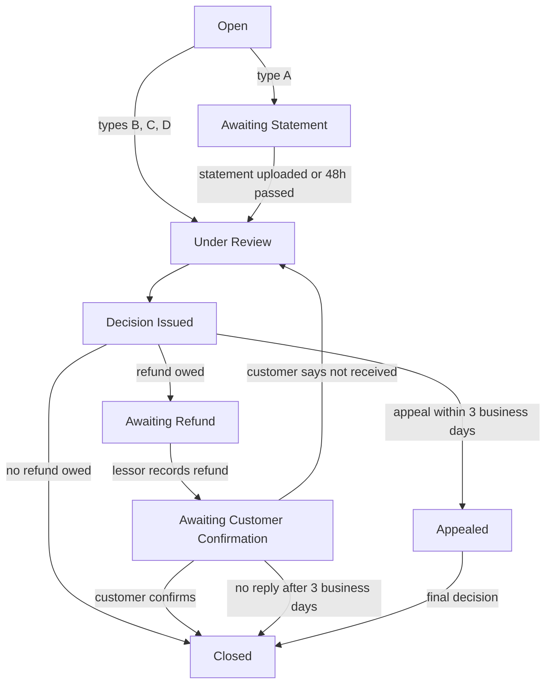
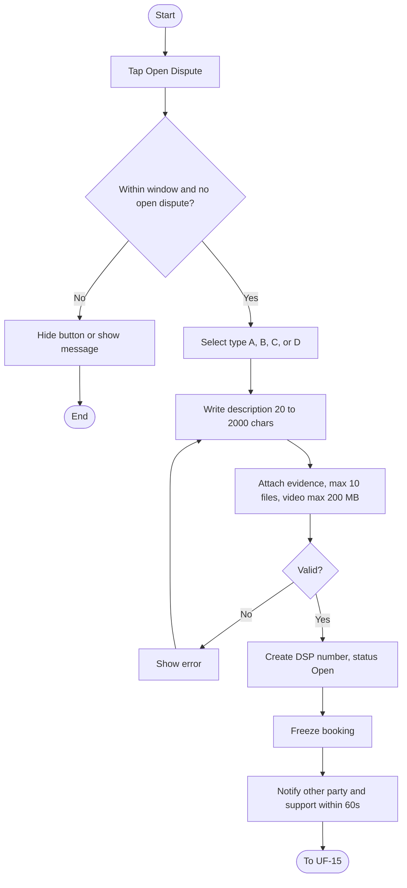
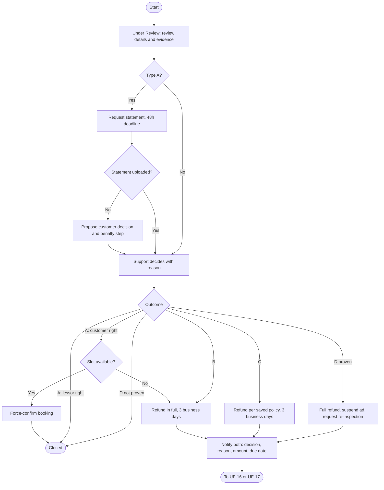
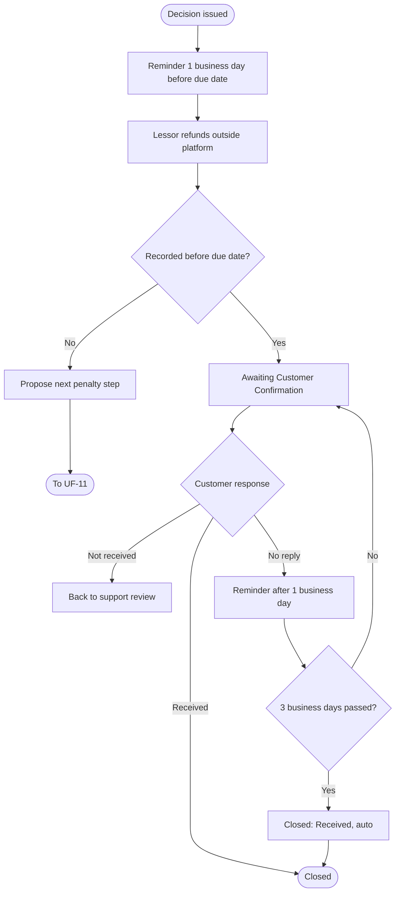
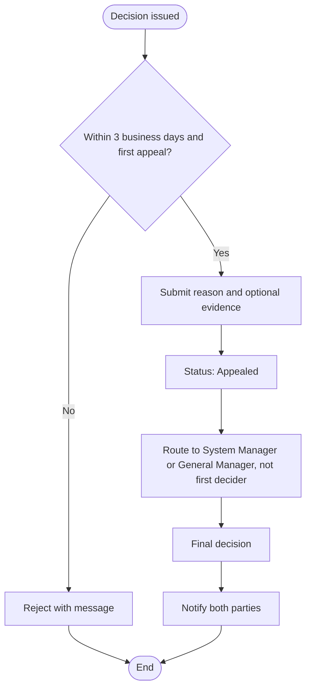

# User Flows: Disputes Cycle

| ID | Flow | Actor | Status |
|----|------|-------|--------|
| UF-08 | Open a Dispute | Customer / Lessor | New |
| UF-15 | Support Reviews and Decides a Dispute | Support / Lessor | New |
| UF-16 | Refund Recording and Customer Confirmation | Lessor / Customer | New |
| UF-17 | Appeal a Dispute Decision | Customer / Lessor / Reviewer | New |

## Dispute Types

| Type | Meaning                                                                                   |
| ---- | ----------------------------------------------------------------------------------------- |
| A    | Transfer not acknowledged (أ) تحويل لم يُعترف به.                                         |
| B    | Lessor cancelled a confirmed booking (ب) إلغاء المؤجّر للحجز المؤكد.                      |
| C    | No refund after customer cancellation (ج) عدم استرداد المبلغ بعد إلغاء العميل.            |
| D    | Place does not match, is unavailable, or other (د) المكان غير مطابق أو غير متاح، أو أخرى. |

## Dispute Status Lifecycle

---

# UF-08: Open a Dispute

**Actor:** Customer or Lessor
**Goal:** Report a problem with a booking and have support decide
**Entry Point:** "Open Dispute" button in the booking details
**Preconditions:** A receipt was uploaded, no more than 7 days have passed since check-out, no other dispute is open on the booking, and the booking is not "Timed Out"
**Postconditions:** Dispute `DSP-YYYY-NNNNN` exists with status **Open**, the booking is frozen, and the other party and support are notified within 60 seconds

## Main Flow

| # | User Action | System Response |
|---|-------------|-----------------|
| 1 | Opens the booking and taps **"Open Dispute"** | Shows the dispute form |
| 2 | Selects the dispute type (A, B, C, or D) | n/a |
| 3 | Writes the description (20 to 2000 characters) | Validates the length |
| 4 | Attaches evidence (optional, up to 10 files, video up to 200 MB) | Validates count and size |
| 5 | Taps Submit | Creates the dispute with a unique number and status **Open** |
| 6 | n/a | Freezes the booking: only a support decision can change its status |
| 7 | n/a | Notifies the other party and support within 60 seconds |
| 8 | n/a | Shows the other party only a notice of how many evidence items were uploaded (they cannot open them). Continues to UF-15 |

## Alternative / Error Flows

| ID  | At Step | Condition                                                                     | Result                                                                                                       |
| --- | ------- | ----------------------------------------------------------------------------- | ------------------------------------------------------------------------------------------------------------ |
| A1  | 1       | Booking is "Cancelled by Agreement" and the lessor did not refund             | Dispute is allowed within the window                                                                         |
| A2  | 1       | Booking was rejected but the customer confirms they transferred               | Customer opens a type A dispute                                                                              |
| A3  | 6       | Lessor tries to confirm or reject during the freeze                           | Blocked. Only support can change the status                                                                  |
| A4  | 6       | Either party tries to cancel or send a cancellation request during the freeze | Blocked for the whole freeze                                                                                 |
| A5  | 6       | Booking is "Awaiting Lessor Confirmation"                                     | Confirmation timer and reminders stop (see UF-07)                                                            |
| A6  | 6       | A rating already exists on the booking                                        | Rating is saved but not published until the dispute is closed                                                |
| E1  | 1       | More than 7 days after check-out                                              | "Open Dispute" is hidden. A direct request shows: «انتهت مهلة فتح النزاع لهذا الحجز. يمكنك التواصل مع الدعم» |
| E2  | 5       | A dispute is already open on the booking                                      | Rejected with «يوجد نزاع مفتوح على هذا الحجز». The existing dispute opens instead                            |
| E3  | 5       | Description is shorter than 20 characters                                     | Blocked with «اكتب وصف المشكلة (20 حرفًا على الأقل)». Customer can edit and resend                           |
| E4  | 4       | More than 10 files, or a video over 200 MB                                    | Blocked with «الحد الأقصى 10 ملفات، والفيديو 200 ميجابايت»                                                   |
| E5  | 1       | Booking status is "Timed Out"                                                 | Dispute is not allowed                                                                                       |

## Diagram

---

# UF-15: Support Reviews and Decides a Dispute

**Actor:** Support employee (the lessor supplies the statement)
**Goal:** Decide the dispute with a clear outcome and reason
**Entry Point:** Dispute notification from UF-08
**Preconditions:** Dispute is Open
**Postconditions:** Decision recorded in the audit log, status is **Decision Issued**, both parties notified, due date stored

## Main Flow

| # | User Action | System Response |
|---|-------------|-----------------|
| 1 | Support opens the dispute | Shows details, evidence, and the booking snapshot (price and cancellation policy at booking time). Status **Under Review** |
| 2 | Reviews evidence, including the receipt | Allows receipt viewing only because a dispute is open, and logs every view |
| 3 | Type A only: requests an account statement covering the transfer date | Status **Awaiting Statement**. Notifies the lessor with a 48-hour deadline |
| 4 | Lessor uploads the statement within 48 hours | Stores it, visible to support only. Status returns to Under Review |
| 5 | Support picks an outcome and writes the reason | Requires outcome and reason |
| 6 | n/a | Records the decision in the audit log. Status **Decision Issued** |
| 7 | n/a | Notifies both parties with the decision, reason, amount due, and due date. The due date is calculated and stored now |
| 8 | n/a | If a refund is owed, continues to UF-16. Otherwise closes the dispute |

## Alternative / Error Flows

| ID | At Step | Condition | Result |
|----|---------|-----------|--------|
| A1 | 5 | Type A, customer is right, slot is still available | Support force-confirms the booking. Both parties are notified with the reason |
| A2 | 5 | Type A, customer is right, slot is booked by another customer | Force-confirm blocked: «لا يمكن التأكيد: الموعد محجوز لحجز آخر». Lessor must refund in full within 3 business days |
| A3 | 5 | Type A, statement supports the lessor | Dispute closed with no action |
| A4 | 5 | Type B | Lessor must refund in full within 3 business days |
| A5 | 5 | Type C | Refund per the cancellation policy **saved in the booking**. Example: 2,000 SAR at 50% = 1,000 SAR. A newer policy is not applied |
| A6 | 5 | Type C, saved policy gives no refund | No automatic outcome. Support issues a reasoned decision from the review |
| A7 | 5 | Type D proven | Full refund in 3 business days, ad suspended administratively, re-inspection requested automatically citing "DSP-…", both parties notified with the reason |
| A8 | 5 | Type D not proven | Reasoned decision based on the evidence |
| A9 | 4 | Lessor does not upload the statement within 48 hours | Staff sees «لم يرفع المؤجّر الكشف». System proposes a decision for the customer and the next penalty step. Support reviews and applies both. Continues to UF-11 |
| A10 | 7 | Admin changes the refund days after the decision | Stored due date does not change |
| E1 | 5 | Reason is missing | Decision cannot be saved |
| E2 | 2 | Support tries to view a receipt with no open dispute | Not allowed |
| E3 | Any | Customer tries to open the lessor's statement | Not allowed, support only |
| E4 | Any | Lessor tries to open the customer's evidence | Not allowed. Lessor sees only the count of items |

## Diagram

---

# UF-16: Refund Recording and Customer Confirmation

**Actor:** Lessor (refunds), Customer (confirms)
**Goal:** Close the dispute after the customer confirms receiving the refund
**Entry Point:** Decision from UF-15 that obliges the lessor to refund
**Preconditions:** Dispute status is **Awaiting Refund** and the due date is stored
**Postconditions:** Dispute is **Closed**

## Main Flow

| # | User Action | System Response |
|---|-------------|-----------------|
| 1 | n/a | One business day before the due date, sends the lessor a push, in-app, and SMS: «يستحق رد {المبلغ} ريال للعميل قبل {التاريخ}» |
| 2 | Lessor transfers the amount directly to the customer (outside the platform) | n/a |
| 3 | Taps **"Refunded"** and enters the amount and the refund date. Transfer reference (max 100 characters) and proof are optional | Validates the fields |
| 4 | n/a | Status **Awaiting Customer Confirmation**. Notifies the customer |
| 5 | Customer taps **"I received the amount"** | Closes the dispute |

## Alternative / Error Flows

| ID | At Step | Condition | Result |
|----|---------|-----------|--------|
| A1 | 5 | Customer taps **"Not received"** | Dispute returns to support for review, not closed |
| A2 | 5 | Customer does not reply after 1 business day | Reminder sent to the customer |
| A3 | 5 | Customer does not reply within 3 business days of the lessor's record | Dispute closes automatically as **"Received (Auto-closed)"** |
| E1 | 3 | Refund date is in the future | Rejected, the date cannot be after today |
| E2 | 3 | Amount or date is empty | Form blocked until filled |
| E3 | 3 | Transfer reference is over 100 characters | Rejected |
| E4 | 3 | Due date passes with no "Refunded" record | System proposes the next lessor penalty step. Support applies it with reason and reference. Continues to UF-11 |

## Diagram

---

# UF-17: Appeal a Dispute Decision

**Actor:** Customer or Lessor (reviewer: System Manager or General Manager)
**Goal:** Challenge the support decision once
**Entry Point:** Decision notification from UF-15
**Preconditions:** A decision was issued, no more than 3 business days have passed, and this party has not appealed this dispute
**Postconditions:** Final decision recorded and both parties notified

## Main Flow

| # | User Action | System Response |
|---|-------------|-----------------|
| 1 | Opens the decision and taps **"Appeal"** | Shows the appeal form |
| 2 | Writes the reason (10 to 1000 characters) and optionally adds evidence | Validates the reason length |
| 3 | Submits | Status **Appealed** |
| 4 | n/a | Routes to a System Manager or General Manager who did not issue the first decision |
| 5 | Reviewer decides | Records the final decision |
| 6 | n/a | Notifies both parties. The appeal decision is final |

## Alternative / Error Flows

| ID | At Step | Condition | Result |
|----|---------|-----------|--------|
| E1 | 3 | This party already appealed this dispute | Rejected: «استخدمت حقك في الاستئناف لهذا النزاع» |
| E2 | 3 | More than 3 business days since the decision | Rejected: «انتهت مهلة الاستئناف» |
| E3 | 2 | Reason is shorter than 10 or longer than 1000 characters | Submission blocked |
| E4 | 4 | The person who issued the first decision is chosen as reviewer | System blocks it and assigns another authorized reviewer |

## Diagram

