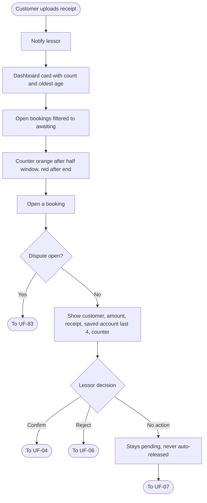
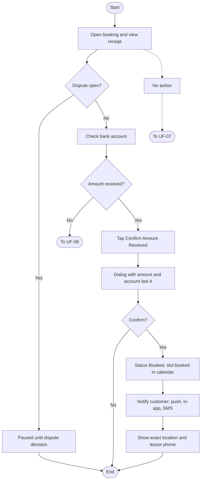
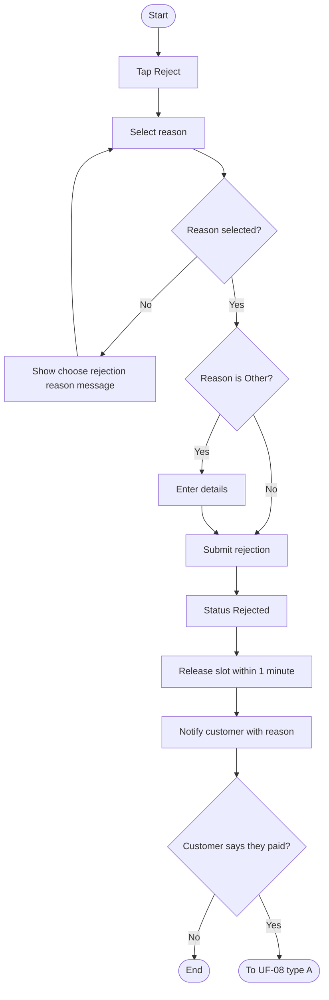
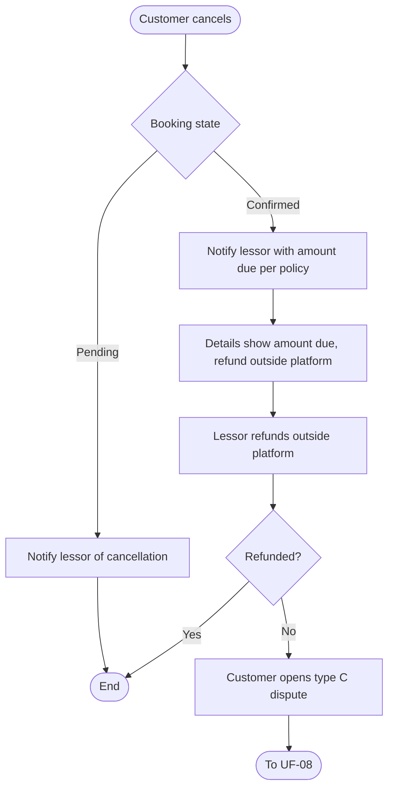
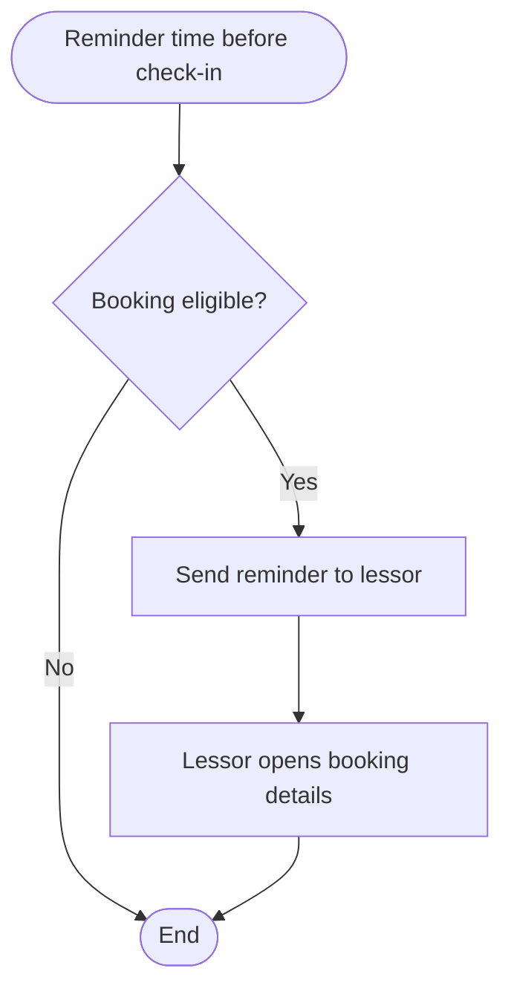
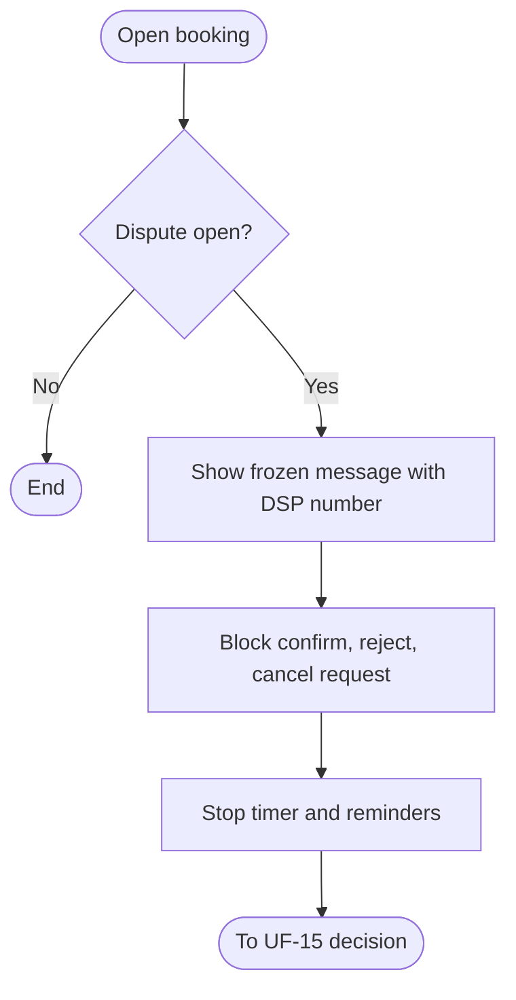
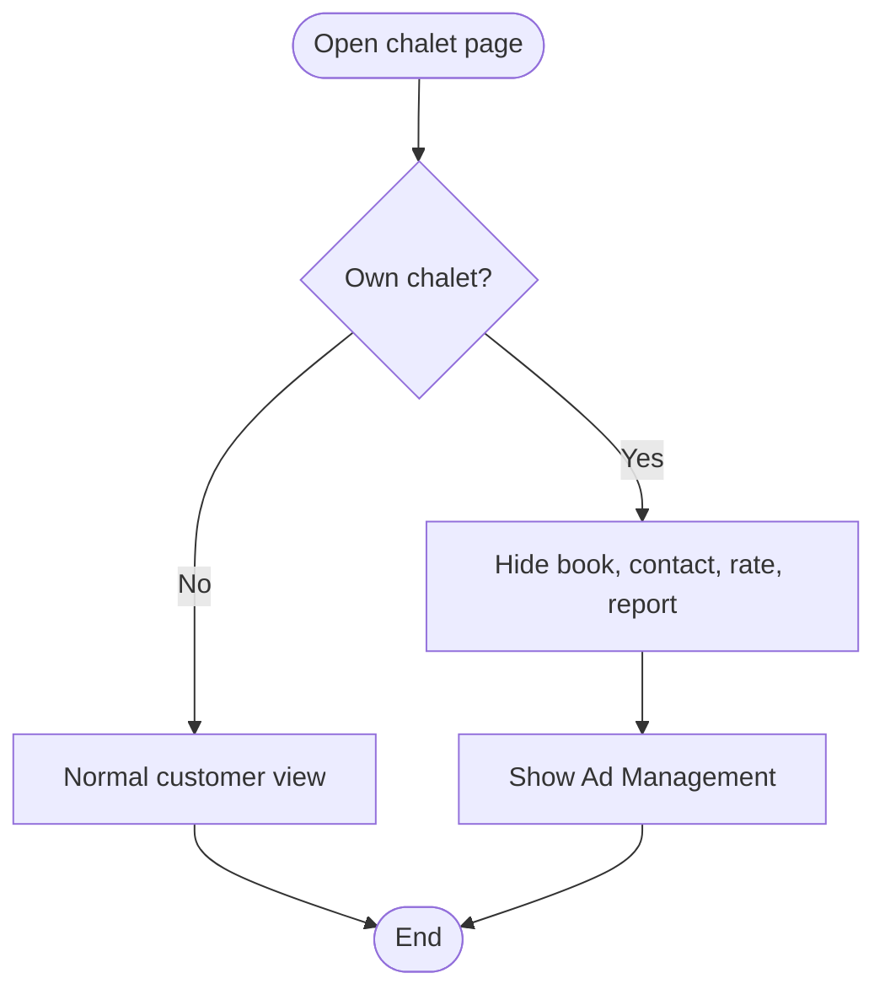
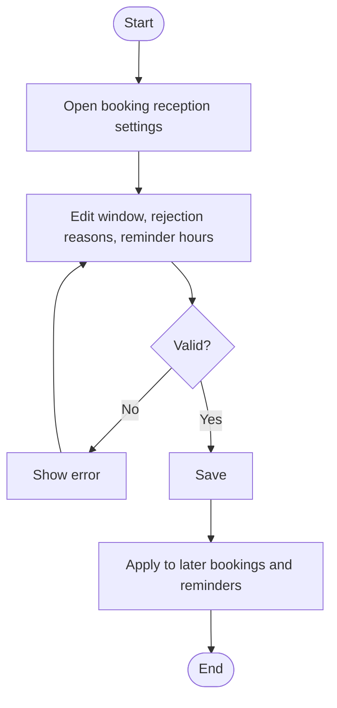

# UF-80: Find and Open Bookings Awaiting Confirmation

**Actor:** Lessor (accepted)
**Goal:** Find bookings waiting for the lessor's decision and open one to review
**Entry Point:** The receipt-uploaded notification, the dashboard card «حجوزات بانتظار تأكيدك», or "My Places' Bookings"
**Preconditions:** The lessor is accepted and a customer uploaded a receipt (UF-02)
**Postconditions:** The lessor sees the booking details with the receipt and the confirmation counter, and continues to UF-04 or UF-06

## Main Flow

| #   | User Action                                                 | System Response                                                                                                                                    |
| --- | ----------------------------------------------------------- | -------------------------------------------------------------------------------------------------------------------------------------------------- |
| 1   | n/a (customer uploads the receipt)                          | Notifies the lessor:  «{العميل} حجز {المكان} {التاريخ} ورفع إيصال {المبلغ}. تحقق من وصوله ثم أكّد»                                              |
| 2   | Opens the dashboard                                         | Shows the card «حجوزات بانتظار تأكيدك» with the count and the age of the oldest booking                                                            |
| 3   | Taps the card                                               | Opens "My Places' Bookings" filtered to bookings awaiting confirmation                                                                             |
| 4   | Views the tabs "Awaiting Your Confirmation" and "Cancelled" | Lists the bookings. The confirmation counter is orange after half the window and red after it ends                                                 |
| 5   | Opens a booking                                             | Shows the customer name, the customer number, the amount, the receipt (with zoom), the saved account (last 4 digits), and the confirmation counter |
| 6   | Continues                                                   | Goes to UF-04 (confirm) or UF-06 (reject)                                                                                                          |

## Alternative / Error Flows

| ID  | At Step | Condition                                          | Result                                                                                       |
| --- | ------- | -------------------------------------------------- | -------------------------------------------------------------------------------------------- |
| A1  | 5       | A dispute is open on the booking                   | Shows «الحجز مجمّد حتى صدور قرار النزاع DSP-…» (UF-83)                                       |
| A2  | 4       | The confirmation window ended with no decision     | The counter turns red. The booking stays pending and is never released automatically (UF-07) |
| A3  | 1-5     | Subscription expired, ad disabled, or ad suspended | The lessor still sees and follows the existing bookings                                      |
| E1  | 5       | Lessor tries to share or download the receipt      | Not allowed.  The receipt is private                                                      |
| E2  | 2       | No booking is awaiting confirmation                | Not defined                                                                                  |

## Diagram

## Notes
- Related requirements: [[متطلبات مشروع تنفيذ#٢٧. استقبال الحجوزات]], policy (private receipt, existing bookings stay manageable), UF-02, UF-07
- The saved account is the copy stored on the booking at creation (UF-78).
- Closed question:
	- Item 4 says "his number" (رقمه). Is it the customer's phone number or the booking number? This also answers the open question in UF-04 about sharing the customer's number.
	- The counter line sits in the same list. Where are Booked, Rejected, Timed Out, and Completed bookings shown? That is RIGHT (Booked, Rejected, Timed Out, and Completed bookings ) 
	- Does the counter stop or show a different state while a dispute freezes the booking? Stop 
- Open questions:
  - Does the "Cancelled" tab include cancelled by customer, by agreement, and administratively?  ALL status and distinct them by badges.

---

# UF-04: Lessor Confirms Booking

**Actor:** Lessor
**Goal:** Confirm that the payment arrived and secure the booking for the customer
**Entry Point:** Booking details (UF-80)
**Preconditions:** Booking status is "Awaiting Lessor Confirmation" and no dispute is open
**Postconditions:** Status is **"Booked"**, the slot is booked in the calendar immediately, the customer is notified, and the exact location and lessor phone number are shown to the customer

## Main Flow

| #   | User Action                              | System Response                                                                                     |
| --- | ---------------------------------------- | --------------------------------------------------------------------------------------------------- |
| 1   | Opens the booking                        | Shows the details and the receipt (view only, no sharing or download)                               |
| 2   | Checks their bank account for the amount | n/a (outside the platform)                                                                          |
| 3   | Taps **"Confirm Amount Received"**       | Shows «هل وصلك {المبلغ} ر.س في حسابك {آخر 4}؟ بعد التأكيد يُحجز الموعد للعميل»                      |
| 4   | Confirms                                 | Sets status to **"Booked"** and books the slot in the calendar immediately                          |
| 5   | n/a                                      | Sends the customer an instant push, an in-app notification, and an SMS confirming the booking       |
| 6   | n/a                                      | Shows the customer the exact place location and the lessor's phone number (only after confirmation) |

## Alternative / Error Flows

| ID | At Step | Condition | Result |
|----|---------|-----------|--------|
| A1 | 1-4 | Subscription expired, ad disabled, or ad suspended | The lessor can still confirm the pending booking |
| A2 | 3 | Lessor closes the dialog | Nothing changes |
| A3 | 3 | Lessor decides not to confirm | Goes to UF-06 |
| E1 | 1-4 | A dispute is open on the booking | Confirm and reject are paused until the dispute decision, and the timer and reminders stop (UF-83) |
| E2 | 1-4 | Lessor takes no action | The booking stays pending and is never cancelled or released automatically. Goes to UF-07 |

## Diagram

## Notes
- Related requirements: §27-4, §27-5, policy (confirmation window, existing bookings stay manageable, private receipt), UF-80, UF-83
- Reissues the earlier UF-04. The dialog and the details screen come from §27.
- Location and phone are hidden before this point.
- Closed questions:
  - Is the customer's phone number shared with the lessor at confirmation? Yes
  - The dialog says the slot is booked "after confirmation", but the slot was already reserved while awaiting. I read it as the calendar state changing from "awaiting your confirmation" to "booked via app". Is that correct? Yes

---

# UF-06: Lessor Rejects Booking

**Actor:** Lessor (the customer is notified)
**Goal:** Reject a booking when the payment cannot be verified, with a mandatory reason
**Entry Point:** Booking details (UF-80)
**Preconditions:** Booking status is "Awaiting Lessor Confirmation" and no dispute is open
**Postconditions:** Status is **"Rejected"**, the slot is released within 1 minute, and the customer is notified with the reason

## Main Flow

| # | User Action | System Response |
|---|-------------|-----------------|
| 1 | Taps **"Reject"** | Shows the reason list |
| 2 | Selects a reason: amount not received, amount insufficient, receipt unclear, or other | n/a |
| 3 | If "Other", enters the details | Requires the details text |
| 4 | Submits the rejection | Sets status to **"Rejected"** |
| 5 | n/a | Releases the slot within 1 minute |
| 6 | n/a | Notifies the customer with the rejection reason |
| 7 | Customer may tap **"Report a Problem"** | Allows opening a dispute (UF-08) |

## Alternative / Error Flows

| ID | At Step | Condition | Result |
|----|---------|-----------|--------|
| A1 | 7 | Customer confirms they did transfer the amount | Customer opens a type A dispute (UF-08). Support may request the lessor's account statement within 48 hours (UF-15). If it is not uploaded, the decision is proposed for the customer and the next penalty step is proposed (UF-11) |
| A2 | 1-4 | Subscription expired, ad disabled, or ad suspended | The lessor can still reject |
| E1 | 2 | No reason selected | «اختر سبب الرفض» |
| E2 | 3 | "Other" selected with empty details | Rejection blocked (message not defined) |
| E3 | 1-4 | A dispute is open | Rejection is paused until the dispute decision |

## Diagram

## Notes
- Related requirements: §27-6, policy (existing bookings stay manageable), penalties block (rejection with a transfer leads to type A), settings table (reasons), UF-08, UF-15, UF-11
- Reissues the earlier UF-06. The message «اختر سبب الرفض» comes from §27.
- Closed questions:
  - Is there a confirmation dialog before the rejection is submitted, as there is for confirming? Yes
   

---

# UF-81: Customer Cancels a Booking and the Lessor Handles the Amount Due

**Actor:** Customer (cancels), System (notifies), Lessor (refunds outside the platform)
**Goal:** Tell the lessor about the cancellation and the amount due under the booking's cancellation policy
**Entry Point:** The customer cancels a pending or a confirmed booking (the cancellation rules are not defined yet, see UF-13)
**Preconditions:** The booking is "Awaiting Lessor Confirmation" or "Booked"
**Postconditions:** The lessor is notified. For a confirmed booking the amount due is shown to the lessor, who refunds it outside the platform

## Main Flow

| # | User Action | System Response |
|---|-------------|-----------------|
| 1 | Customer cancels a **pending** booking | Notifies the lessor: «ألغى {العميل} حجزه في {المكان} {التاريخ}» |
| 2 | Customer cancels a **confirmed** booking | Notifies the lessor: «ألغى {العميل} الحجز BKG-… ويستحق {المبلغ} حسب سياستك» |
| 3 | Lessor opens the booking | Shows «يستحق العميل {المبلغ} ر.س حسب سياستك — ردّه خارج المنصة» |
| 4 | Lessor refunds the amount directly to the customer | n/a (the platform does not hold or transfer money) |

## Alternative / Error Flows

| ID | At Step | Condition | Result |
|----|---------|-----------|--------|
| A1 | 3 | Amount due is calculated | It follows the cancellation policy saved on the booking at temporary booking time. The platform shows it for information |
| A2 | 4 | The lessor does not refund the amount due | Customer opens a type C dispute (UF-08). A decision obliges the refund per the policy within 3 business days (UF-15, UF-16). Missing that deadline triggers the next lessor penalty step (UF-11) |
| E1 | 1-2 | A dispute is open on the booking | Cancellation is blocked during the freeze (UF-83) |

## Diagram

## Notes
- Related requirements: §27-8, policy (bound by the saved cancellation policy, platform shows the amount for information), penalties block (type C), UF-08, UF-15, UF-16, UF-11, UF-13 (planned)
- This flow covers the lessor side only. The customer's cancellation (rules, screen, status "Cancelled by Customer") is UF-13, which is still undefined.
- Open questions:
  - The pending-booking message has no amount due, although the customer already uploaded a receipt. Is anything refunded in that case, and who handles it?
  - Where does the lessor record that the refund was made before any dispute exists? "Refunded" appears only after a decision (UF-16).
  - Is there a refund deadline in this path, or only after a dispute decision?
  - Is the lessor reminded to refund?

---

# UF-82: Lessor Reminder Before Check-in

**Actor:** System (the lessor is notified)
**Goal:** Remind the lessor of an upcoming stay
**Entry Point:** The reminder time before check-in is reached (default 24 hours)
**Preconditions:** The booking is within the reminder time before check-in
**Postconditions:** The lessor received the reminder

## Main Flow

| # | User Action | System Response |
|---|-------------|-----------------|
| 1 | n/a (24 hours before check-in) | Sends the lessor a reminder (push and in-app, per UF-26) |
| 2 | Opens the notification | Opens the booking details |

## Alternative / Error Flows

| ID | At Step | Condition | Result |
|----|---------|-----------|--------|
| A1 | 1 | Admin changed the reminder hours | The new value is used |
| E1 | 1 | Booking is frozen by a dispute | Not defined |

## Diagram

## Notes
- Related requirements: §27-9, settings table, UF-26 (reminder before check-in is a lessor push and in-app event)
- Open questions:
  - Which booking statuses get the reminder: only "Booked", or also bookings awaiting confirmation?
  - Is the reminder sent for a booking frozen by a dispute?
  - Does the customer's own 24-hour reminder (UF-26) share the same setting?

---

# UF-83: View a Booking Frozen by a Dispute

**Actor:** Lessor
**Goal:** Understand why a booking cannot be changed while a dispute is open
**Entry Point:** Booking details of a booking with an open dispute
**Preconditions:** A dispute is open on the booking (UF-08)
**Postconditions:** The lessor sees the freeze message and cannot change the booking status

## Main Flow

| # | User Action | System Response |
|---|-------------|-----------------|
| 1 | Opens the booking | Shows «الحجز مجمّد حتى صدور قرار النزاع DSP-…» |
| 2 | Tries to confirm, reject, or request cancellation | Blocks the action |
| 3 | n/a | Keeps the confirmation timer and reminders stopped |

## Alternative / Error Flows

| ID | At Step | Condition | Result |
|----|---------|-----------|--------|
| A1 | Any | Support issues the decision | The booking changes only through the support decision (UF-15) |
| A2 | 3 | Booking was awaiting confirmation | The timer and reminders stop until the dispute decision (UF-07) |
| E1 | 2 | Customer tries to cancel during the freeze | Blocked (UF-81 E1) |

## Diagram

## Notes
- Related requirements: §27-10, UF-08 (A3, A4, A5), UF-04, UF-06, UF-07, UF-09, UF-15
- Open questions:
  - Does the confirmation window resume or restart after the dispute (carried from earlier questions)?
  - Does the lessor see the customer's evidence count in this screen? (UF-08 says only the count)

---

# UF-84: Lessor Opens Their Own Chalet as a Customer

**Actor:** Lessor
**Goal:** See their own chalet without any customer action on it
**Entry Point:** The lessor opens their own chalet page (for example from search or a shared link)
**Preconditions:** The chalet belongs to the logged-in lessor
**Postconditions:** The lessor sees «Ad Management» and cannot book, contact, rate, or report the chalet

## Main Flow

| # | User Action | System Response |
|---|-------------|-----------------|
| 1 | Opens their own chalet page | Recognizes the chalet as the lessor's own |
| 2 | n/a | Hides booking, contact, rating, and report actions |
| 3 | n/a | Shows «Ad Management» («إدارة الإعلان») instead |

## Alternative / Error Flows

| ID | At Step | Condition | Result |
|----|---------|-----------|--------|
| A1 | 3 | Lessor taps «إدارة الإعلان» | Destination is not defined |
| E1 | 2 | Lessor tries to rate their own stay | Not allowed (UF-14 E5) |
| E2 | 2 | Lessor tries to book or contact through a direct request | Not defined |

## Diagram

## Notes
- Related requirements: §27 policy (no customer actions on own chalets), UF-14 E5, UF-49
- Open questions:
  - Does «إدارة الإعلان» open "Place and Ad Details" (UF-49)?
  - Does the rule also apply to a lessor's chalets for the shared link page (UF-22)?
  - Does favoriting and sharing own chalet stay allowed?

---

# UF-85: Configure Booking Reception Settings

**Actor:** Admin
**Goal:** Control the confirmation window, rejection reasons, and the pre-check-in reminder
**Entry Point:** Admin panel, booking reception settings
**Preconditions:** The admin has permission to manage settings
**Postconditions:** The new values apply to later bookings and reminders

## Main Flow

| # | User Action | System Response |
|---|-------------|-----------------|
| 1 | Opens the settings | Shows the confirmation window (default 24 hours), the rejection reasons, and the reminder hours (default 24) |
| 2 | Changes the confirmation window (1 to 72 hours) | Validates the range |
| 3 | Edits the rejection reasons (translated list; defaults: amount not received, amount insufficient, receipt unclear, other) | Saves |
| 4 | Changes the reminder hours before check-in | Validates |
| 5 | Saves | Applies the values |

## Alternative / Error Flows

| ID | At Step | Condition | Result |
|----|---------|-----------|--------|
| E1 | 2 | Window is outside 1 to 72 hours | Not accepted (message not defined) |
| E2 | 4 | Reminder hours value is not valid | Not defined |

## Diagram

## Notes
- Related requirements: §27 settings table, UF-07, UF-85
- The rejection reasons here are for **bookings**. The payment receipt reasons in §22 (UF-44, UF-48) are a separate list.
- Open questions:
  - Do changed values affect bookings already waiting for confirmation?
  - Is the list of reasons mandatory to keep "Other"?
  - Is every settings change audit-logged?