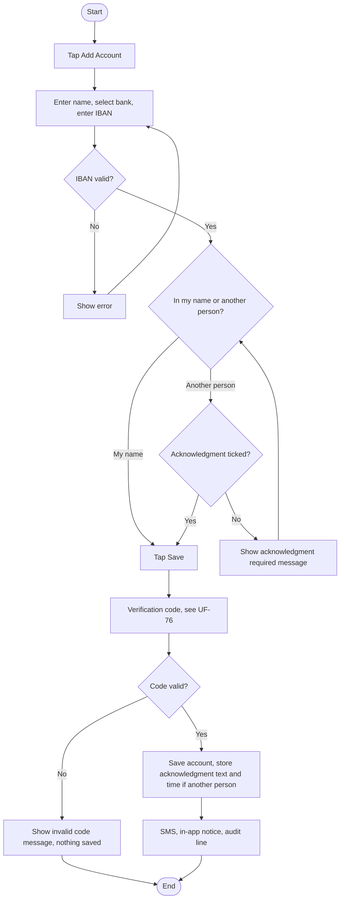
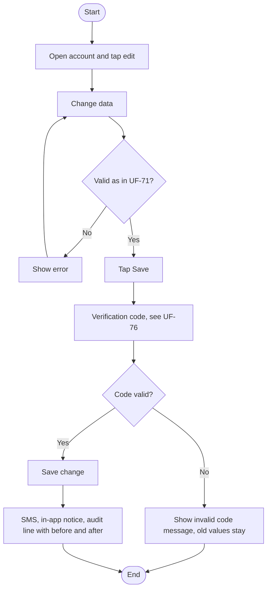
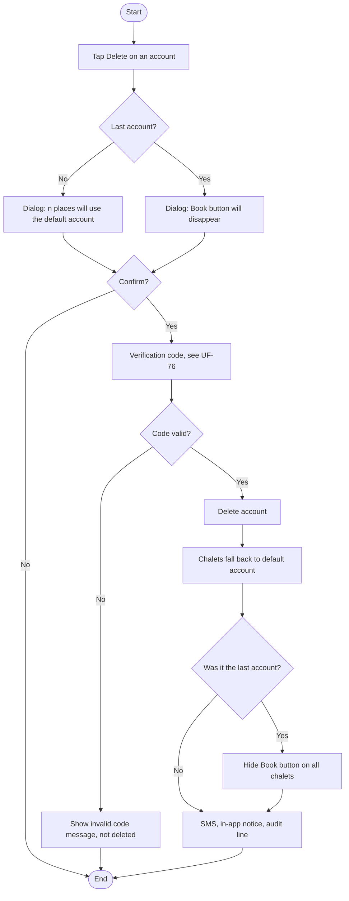
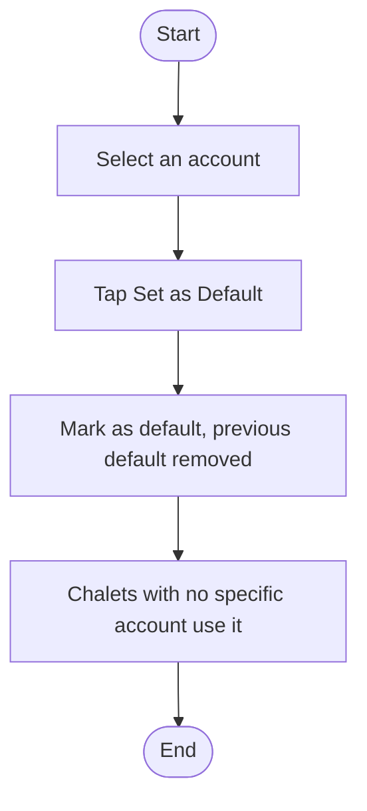
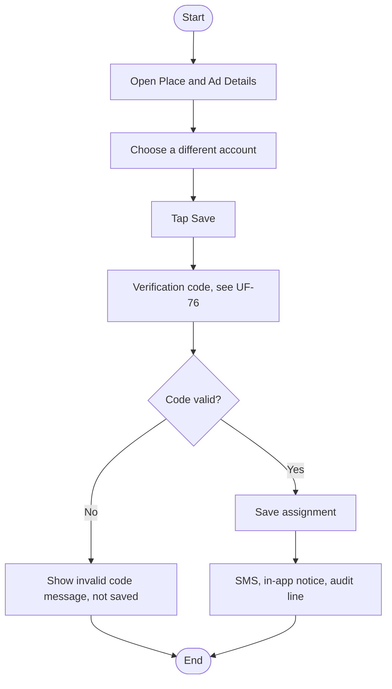
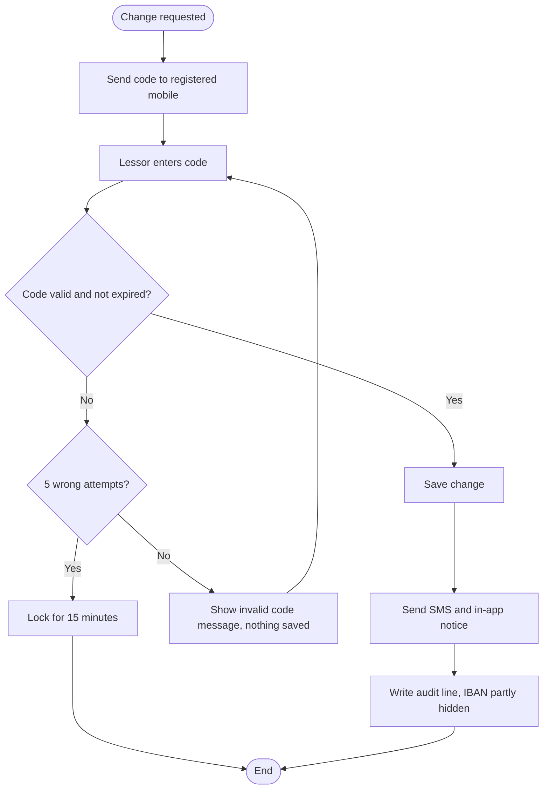
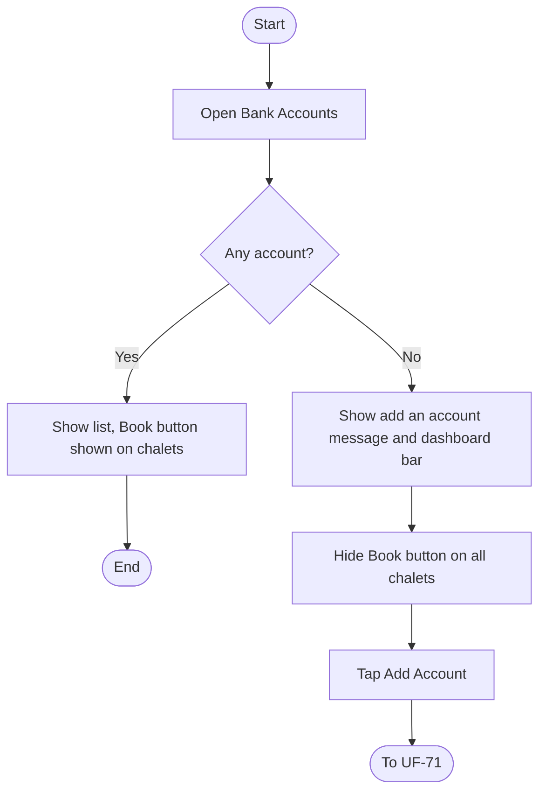
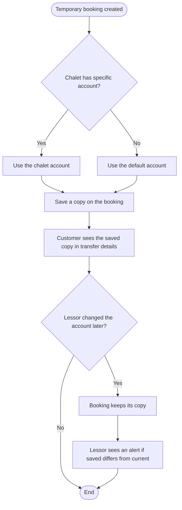
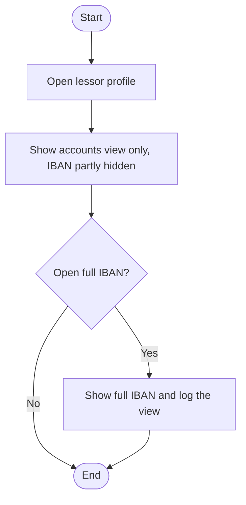

# UF-71: Add a Bank Account

**Actor:** Lessor (accepted)
**Goal:** Add a bank account so customers can transfer the booking amount to the lessor
**Entry Point:** "Bank Accounts", then "Add Account"
**Preconditions:** The lessor is accepted and logged in, and has a registered mobile number
**Postconditions:** The account is saved (IBAN stored without spaces and encrypted), the change is recorded (UF-76), and the lessor's chalets can show the Book button

## Main Flow

| #   | User Action                                                                                              | System Response                                                                |
| --- | -------------------------------------------------------------------------------------------------------- | ------------------------------------------------------------------------------ |
| 1   | Taps **"Add Account"**                                                                                   | Opens the form                                                                 |
| 2   | Enters the beneficiary name (2 to 100 characters)                                                        | Validates the length                                                           |
| 3   | Selects the bank from the Saudi banks list OR Just enter the Bank name.                                  | Saves the selection in the form                                                |
| 4   | Enters the IBAN (SA followed by 22 digits)                                                               | Validates the format and the remainder check (mod 97)                          |
| 5   | Selects **"In my name"** or **"In another person's name"**                                               | For another person, shows the mandatory acknowledgment                         |
| 6   | Another person only: ticks «أقر بأن صاحب الحساب موافق على استقبال المبالغ وعرض بياناته وأتحمل المسؤولية» | Accepts the acknowledgment                                                     |
| 7   | Taps **"Save"**                                                                                          | Sends a verification code to the registered mobile (UF-76)                     |
| 8   | Enters the code                                                                                          | Saves the account. For another person, stores the acknowledgment text and time |
| 9   | n/a                                                                                                      | Sends the SMS and the in-app notice and writes the audit line (UF-76)          |

## Alternative / Error Flows

| ID | At Step | Condition | Result |
|----|---------|-----------|--------|
| A1 | 5 | "In my name" selected | No acknowledgment is needed |
| A2 | 4 | Beneficiary name differs from the lessor's name | Allowed. Name matching is not required (many lessors manage chalets owned by others) |
| E1 | 7 | Another person selected and the acknowledgment is not ticked | «يجب الإقرار بموافقة صاحب الحساب» |
| E2 | 8 | Code is wrong or expired | «الرمز غير صحيح. لم يُحفظ التغيير». Nothing is saved (UF-76) |
| E3 | 4 | IBAN fails the format or remainder check | Not accepted (message not defined) |
| E4 | 2-3 | Name length is out of range, or no bank is selected | Not accepted (message not defined) |

## Diagram

## Notes
- Related requirements: [[متطلبات مشروع تنفيذ#٢٦. الحسابات البنكية]], policy (name match not required, acknowledgment stored, IBAN check and encryption, no Finance pre-verification)
- The IBAN is stored without spaces and encrypted. Finance does not verify the IBAN in advance.
- This is the lessor's own account list. Platform accounts for packages are separate (UF-43, UF-48).
- Closed questions:
  - Is the first account set as the default automatically? Yes
  - Is there a maximum number of accounts? Yes 100
  - Can the same IBAN be added twice by one lessor, or used by another lessor? Yes
  - Is the selected bank checked against the bank code inside the IBAN? No
  - Is the acknowledgment text editable, translated, or fixed? Fixed

---

# UF-72: Edit a Bank Account

**Actor:** Lessor (accepted)
**Goal:** Change the data of an existing bank account
**Entry Point:** An account in "Bank Accounts"
**Preconditions:** The lessor has at least one account
**Postconditions:** The account shows the new values, existing bookings keep their own copy of the old account, and the change is recorded (UF-76)

## Main Flow

| # | User Action | System Response |
|---|-------------|-----------------|
| 1 | Opens an account and taps edit | Opens the form with the saved values |
| 2 | Changes the data | Validates it with the same rules as UF-71 |
| 3 | Taps **"Save"** | Sends a verification code to the registered mobile (UF-76) |
| 4 | Enters the code | Saves the change |
| 5 | n/a | Sends the SMS and the in-app notice and writes the audit line with before and after values (UF-76) |

## Alternative / Error Flows

| ID | At Step | Condition | Result |
|----|---------|-----------|--------|
| A1 | 4 | Existing bookings used the old account | They keep their saved copy. The lessor sees an alert if the saved account differs from the current one (UF-78) |
| E1 | 4 | Code is wrong or expired | «الرمز غير صحيح. لم يُحفظ التغيير». The old values stay |
| E2 | 2 | A field breaks the rules of UF-71 (IBAN, name, bank, acknowledgment) | Same messages as UF-71 |

## Diagram

## Notes
- Related requirements: policy (edit needs a code, booking copy, audit before and after), UF-76, UF-78
- Closed questions:
  - The numbered items do not describe editing. Which fields can be edited, and can the IBAN change? Yes
  - If the account switches from "In my name" to "In another person's name", is the acknowledgment required again? No
  - Does editing a chalet's assigned account follow this flow or UF-75? 

---

# UF-73: Delete a Bank Account

**Actor:** Lessor (accepted)
**Goal:** Remove a bank account the lessor no longer uses
**Entry Point:** An account in "Bank Accounts"
**Preconditions:** The lessor has at least one account
**Postconditions:** The account is deleted, chalets that used it fall back to the default account, and the change is recorded (UF-76). If it was the last account, the Book button disappears from the lessor's chalets

## Main Flow

| # | User Action | System Response |
|---|-------------|-----------------|
| 1 | Taps **Delete** on an account | Shows «حذف الحساب {آخر 4}؟ {n} أماكن ستستخدم الحساب الافتراضي» |
| 2 | Confirms | Sends a verification code to the registered mobile (UF-76) |
| 3 | Enters the code | Deletes the account |
| 4 | n/a | Chalets that used this account use the default account |
| 5 | n/a | Sends the SMS and the in-app notice and writes the audit line (UF-76) |

## Alternative / Error Flows

| ID | At Step | Condition | Result |
|----|---------|-----------|--------|
| A1 | 1 | It is the last account | The dialog says «سيختفي زر الحجز من أماكنك». After deletion the Book button is hidden on all the lessor's chalets (UF-77) |
| A2 | 1 | Lessor cancels the dialog | Nothing is deleted |
| A3 | 3 | Existing bookings used this account | They keep their saved copy of it (UF-78) |
| E1 | 3 | Code is wrong or expired | «الرمز غير صحيح. لم يُحفظ التغيير». The account is not deleted |

## Diagram

## Notes
- Related requirements: §26-7, policy (code for delete, booking copy), UF-76, UF-77, UF-78
- Closed questions:
  - If the deleted account is the **default** and other accounts remain, which account becomes the default? Default can not be deleted MUST switch it first. 
  - Is the dialog order (confirm, then code) correct ? The source does not say when the code is requested for delete.
  - What does the dialog show when no chalet uses the account ({n} = 0)? Nothing Just delete the account
  - ==🟢Can an account be deleted while a booking is waiting for its transfer? No==

---

# UF-74: Set the Default Bank Account

**Actor:** Lessor (accepted)
**Goal:** Choose the account that chalets use when they have no specific account
**Entry Point:** An account in "Bank Accounts"
**Preconditions:** The lessor has at least one account
**Postconditions:** The chosen account is the default. Chalets with no specific account show it to customers for new bookings

## Main Flow

| # | User Action | System Response |
|---|-------------|-----------------|
| 1 | Opens "Bank Accounts" and selects an account | Shows its data |
| 2 | Taps **"Set as Default"** | Marks it as the default account |
| 3 | n/a | Chalets with no specific account use it from now on |

## Alternative / Error Flows

| ID | At Step | Condition | Result |
|----|---------|-----------|--------|
| A1 | 2 | Another account was the default | It stops being the default |
| A2 | 3 | Existing bookings | Keep their saved copy of the account (UF-78) |
| E1 | 2 | The verification code is required and is wrong | Not defined for this action (see Notes) |

## Diagram

## Notes
- Related requirements: §26-6, policy (account shown to the customer), UF-78
- Closed questions:
  - Does setting the default need a verification code? The policy lists add, edit, delete, and "assign to a chalet", but not "set default"? No, choose default NOT need a verification code
  - Is there exactly one default account at any time? Yes only one.

---

# UF-75: Assign a Different Bank Account to a Chalet V2

**Actor:** Lessor (accepted)
**Goal:** Make one chalet use a specific account instead of the default
**Entry Point:** "Place and Ad Details" of the chalet (UF-49)
**Preconditions:** The lessor has at least two accounts, or one account different from the chalet's current one
**Postconditions:** The chalet shows the chosen account to customers for new bookings, and the change is recorded (UF-76)

## Main Flow

| # | User Action | System Response |
|---|-------------|-----------------|
| 1 | Opens the chalet's "Place and Ad Details" | Shows the bank account used by this chalet |
| 2 | Chooses a different account | Shows the selection |
| 3 | Taps **"Save"** | Sends a verification code to the registered mobile (UF-76) |
| 4 | Enters the code | Saves the assignment |
| 5 | n/a | Sends the SMS and the in-app notice and writes the audit line (UF-76) |

## Alternative / Error Flows

| ID | At Step | Condition | Result |
|----|---------|-----------|--------|
| A1 | 1 | No specific account was set | The chalet shows the default account |
| A2 | 4 | Existing bookings | Keep their saved copy of the account (UF-78) |
| E1 | 4 | Code is wrong or expired | «الرمز غير صحيح. لم يُحفظ التغيير». The assignment is not saved |

## Diagram

## Notes
- Related requirements: §26-6, policy (account shown to the customer, code for assign), UF-49, UF-76
- This answers the earlier UF-49 question: the chalet's bank account is set from "Place and Ad Details".
- Closed questions:
  - Can the lessor remove the specific account and go back to the default? Yes
  - Can one account be assigned to many chalets? Yes
  - Is the assignment available for a chalet that has no published ad? Yes

---

# UF-76: Verify and Record a Bank Account Change

**Actor:** Lessor (the system sends the code and records the change)
**Goal:** Confirm every bank account change with a code, then notify and record it
**Entry Point:** Save or confirm in UF-71, UF-72, UF-73, or UF-75 (UF-74 is an open question)
**Preconditions:** The lessor has a registered mobile number
**Postconditions:** The change is saved, the lessor received the SMS and the in-app notice, and an audit line exists

## Main Flow

| # | User Action | System Response |
|---|-------------|-----------------|
| 1 | n/a (lessor saves or confirms a change) | Sends a verification code to the registered mobile |
| 2 | Enters the code | Validates it with the login code rules (4 digits, valid for 5 minutes) |
| 3 | n/a | Saves the change |
| 4 | n/a | Sends the SMS «تم تغيير حساب بنكي في حسابك على تنفيذ» |
| 5 | n/a | Sends an in-app notification |
| 6 | n/a | Writes an audit line with the values before and after, with the IBAN partially hidden |

## Alternative / Error Flows

| ID | At Step | Condition | Result |
|----|---------|-----------|--------|
| A1 | 2 | Code is entered correctly | Continues to step 3 |
| E1 | 2 | Code is wrong or expired | «الرمز غير صحيح. لم يُحفظ التغيير». Nothing is saved, and no SMS is sent |
| E2 | 2 | 5 wrong attempts | Locked for 15 minutes (login rules). The message is not defined |

## Diagram

## Notes
- Related requirements: §26-4, §26-5, policy (code for every change, notice and audit), settings (code rules come from the login settings), UF-26 (any change to bank accounts: SMS for the lessor)
- Closed questions:
  - Can the lessor request a new code, and how often? As same RULES as login cycle
  - Does the 15-minute lock apply only to bank changes, or also to login? Yes
  - Is the audit line also written when the code fails? Yes
  - Does the SMS name which account changed, or is the text fixed?

---

# UF-77: View Bank Accounts and Handle a Missing Account

**Actor:** Lessor (accepted)
**Goal:** See the saved accounts, and know that customers cannot book without one
**Entry Point:** "Bank Accounts", or the dashboard
**Preconditions:** The user is an accepted lessor
**Postconditions:** The lessor sees the list, or the prompt to add an account. Without an account, the Book button is hidden on all the lessor's chalets

## Main Flow

| # | User Action | System Response |
|---|-------------|-----------------|
| 1 | Opens "Bank Accounts" | Shows the list of saved accounts |
| 2 | n/a (no account exists) | Shows «أضف حسابًا ليظهر للعملاء عند الحجز. بدون حساب لا يظهر زر الحجز» |
| 3 | n/a | Shows a dashboard bar «أضف حسابًا بنكيًا ليتمكن العملاء من الحجز» |
| 4 | n/a | Hides the **Book** button on all the lessor's chalets |
| 5 | Taps **"Add Account"** | Opens the add form (UF-71) |

## Alternative / Error Flows

| ID | At Step | Condition | Result |
|----|---------|-----------|--------|
| A1 | 1 | The lessor has at least one account | No empty message and no bar. The Book button is shown |
| A2 | 1 | The last account was just deleted (UF-73) | The empty message and the bar appear, and the Book button is hidden |
| E1 | 4 | A customer opens a chalet of a lessor with no account | The Book button is not shown (what the customer sees instead is not defined) |

## Diagram

## Notes
- Related requirements: §26-1, §26-7, policy (no account, no Book button), UF-71, UF-73
- Closed question:
  - Which fields does the list show for each account (beneficiary, bank, last 4 of the IBAN, default marker)? Any field 
  - Does a chalet with no account stay published and visible, with only the Book button hidden? Use default bank account
- Closed questions:
  - The ad submission conditions (UF-51) do not include a bank account. Can an ad be published with no account? No
  - Does the dashboard bar disappear immediately after the first account is saved? Yes

---

# UF-78: Show the Lessor Account at Booking and Keep a Copy

**Actor:** System (the customer sees the account, the lessor sees the alert)
**Goal:** Show the right account to the customer, and keep each booking's account unchanged
**Entry Point:** Customer creates a temporary booking (UF-01)
**Preconditions:** The lessor has at least one account, so the Book button is shown
**Postconditions:** The booking holds a copy of the account as it was at creation, and the lessor is alerted if it differs from the current account

## Main Flow

| # | User Action | System Response |
|---|-------------|-----------------|
| 1 | Customer taps **"Book Temporarily"** (UF-01) | Chooses the account: the chalet's specific account if set, otherwise the default |
| 2 | n/a | Saves a copy of that account on the booking at creation time |
| 3 | Customer opens the transfer details (UF-02) | Shows the saved copy |
| 4 | n/a (lessor later changes, deletes, or reassigns an account) | The existing booking keeps its saved copy |
| 5 | Lessor opens that booking | Shows an alert if the saved account differs from the current one |

## Alternative / Error Flows

| ID | At Step | Condition | Result |
|----|---------|-----------|--------|
| A1 | 1 | The chalet has no specific account | The default account is used |
| A2 | 5 | The saved account matches the current one | No alert |
| E1 | 1 | The lessor has no account | The Book button is not shown, so no booking starts (UF-77) |

## Diagram

## Notes
- Related requirements: policy (account shown to the customer, booking copy, alert), UF-01, UF-02, UF-04
- Closed questions:
  - Where is the alert shown (booking details, booking list, notification), and what does it say? On add & edit bank details page 
  - Can the lessor dismiss the alert, or see the saved account from it? No
  - The customer pays the account saved at creation. If the lessor deleted it later, is the customer told? No
  - Is the customer notified if the account changes before they transfer? Yes it should be notified

---

# UF-79: Admin Views a Lessor's Bank Accounts

**Actor:** Admin
**Goal:** Review a lessor's bank accounts, view only
**Entry Point:** The lessor's profile in the admin panel
**Preconditions:** The admin has permission to view lessor profiles
**Postconditions:** The admin has seen the accounts. Nothing was changed, and any full IBAN view is logged

## Main Flow

| # | User Action | System Response |
|---|-------------|-----------------|
| 1 | Opens the lessor's profile | Shows the bank accounts in view only mode, with the IBAN partially hidden |
| 2 | Opens the full IBAN of an account | Shows the full IBAN and logs the view |

## Alternative / Error Flows

| ID | At Step | Condition | Result |
|----|---------|-----------|--------|
| E1 | 1 | Admin tries to add, edit, delete, or assign an account | Not allowed. The admin cannot edit |
| E2 | 2 | Admin lacks permission to open the full IBAN | Not defined |

## Diagram

## Notes
- Related requirements: policy (admin view only, partial IBAN, full view logged, no admin edit, no Finance pre-verification)
- Closed questions:
  - Which admin roles can open the full IBAN? Any

