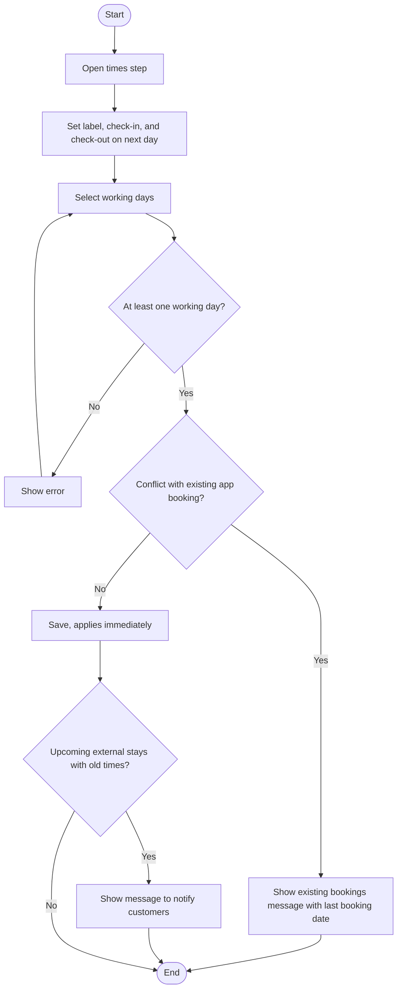
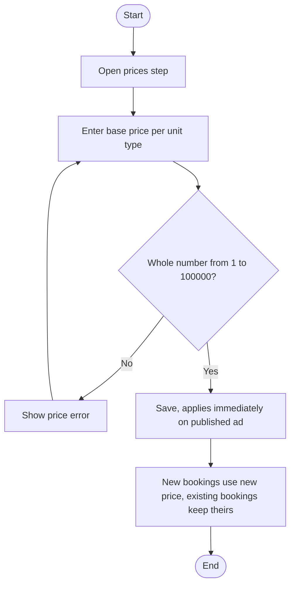
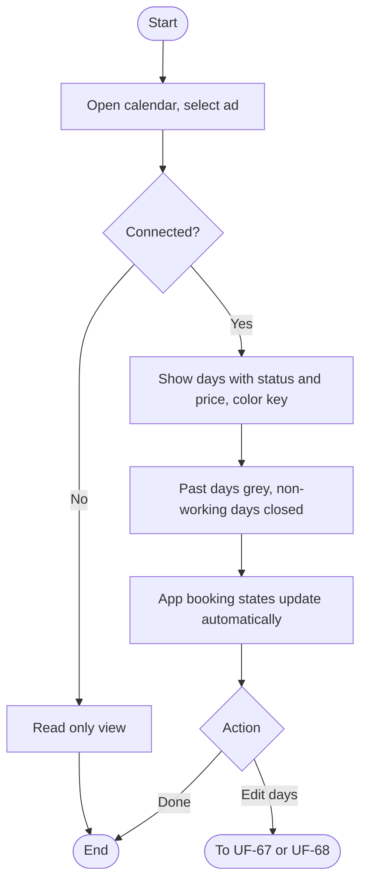
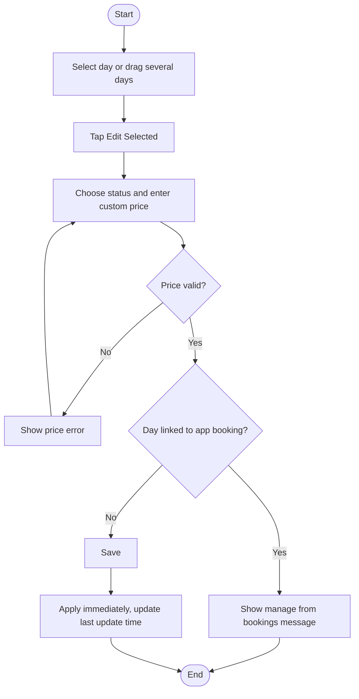
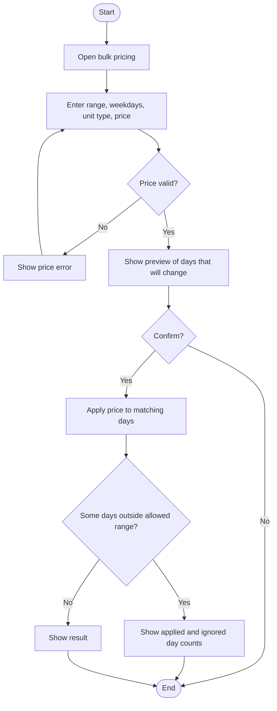
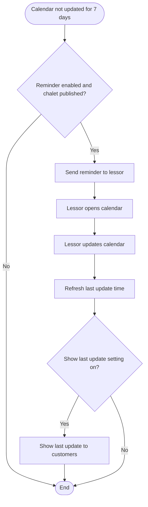
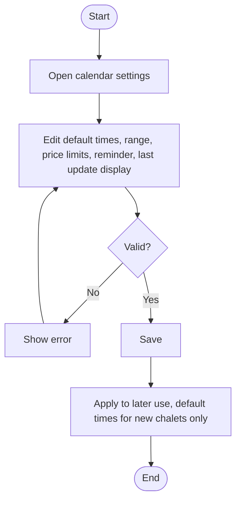

# UF-64: Set Full Day Times and Working Days

**Actor:** Lessor (accepted)
**Goal:** Define the Full Day label, the check-in and check-out times, and the working days of the chalet
**Entry Point:** Step 5 of the ad editor (UF-50), or the times settings of a published ad (UF-54)
**Preconditions:** An ad exists (draft or published)
**Postconditions:** The Full Day times and working days are saved. On a published ad they apply immediately with no review

## Main Flow

| # | User Action | System Response |
|---|-------------|-----------------|
| 1 | Opens the times step | Shows the Full Day settings and the working days |
| 2 | Sets the label (day/night), the check-in time, and the check-out time on the next day | Saves the times (default 4:00 PM to 12:00 PM next day) |
| 3 | Selects the working days of the week | Saves (all days by default, at least one) |
| 4 | Saves | Applies the settings. A published ad changes immediately with no review |

## Alternative / Error Flows

| ID | At Step | Condition | Result |
|----|---------|-----------|--------|
| A1 | 2 | The chalet is new | Starts with the admin default times, which the lessor can edit per chalet |
| E1 | 3 | No working day is selected | Not allowed (message not defined) |
| E2 | 4 | Change to times or working days conflicts with an existing app booking | «لا يمكن تغيير الأوقات لوجود حجوزات قائمة. يسري التغيير بعد {آخر تاريخ حجز}» |
| E3 | 4 | Upcoming external stays exist with the old times | «لديك {n} إقامات مسجلة قادمة بالأوقات القديمة. أبلغ عملاءك بالتغيير» |

## Diagram

## Notes
- Related requirements: [[متطلبات مشروع تنفيذ#٢٥. التقويم والأسعار والأوقات]], policy (full day definition), settings table (default times), UF-50, UF-54
- A full day for date D runs from check-in on D to check-out on D+1.
- Default times come from the admin setting and apply to new chalets only.
- Open questions:
  - With Full Day as the only option, does the ad editor still show a "rental system" step, or only times and working days (affects UF-50 steps 5 and 6)?
  - E2 starts with "cannot change" but ends with "takes effect after {date}". Is the change blocked, or saved and applied after that date?
  - Does the "at least one working day" rule (E1) have a message?

---

# UF-65: Set Base Prices

**Actor:** Lessor (accepted)
**Goal:** Set the base price for each unit type
**Entry Point:** Step 6 of the ad editor (UF-50), or the prices of a published ad (UF-54)
**Preconditions:** The Full Day times are defined (UF-64)
**Postconditions:** Base prices are saved. A published ad changes immediately with no review, and customers see exactly what the lessor entered

## Main Flow

| # | User Action | System Response |
|---|-------------|-----------------|
| 1 | Opens the prices step | Shows a base price field for each unit type |
| 2 | Enters a whole-number price in SAR (1 to 100,000) | Validates the value |
| 3 | Saves | Saves the base price. A published ad changes immediately |

## Alternative / Error Flows

| ID | At Step | Condition | Result |
|----|---------|-----------|--------|
| A1 | 3 | A custom price exists for a date | The custom price overrides the base price (UF-67, UF-68) |
| A2 | 3 | The price is changed while bookings exist | Existing bookings keep the price fixed at temporary booking. The new price applies to new bookings only |
| E1 | 2 | Price is 0, negative, fractional, or above the limit | «السعر بالريال من 1 إلى 100,000 بدون كسور» |

## Diagram

## Notes
- Related requirements: §25-2, §25-6, policy (price rules, total, price fixed on booking), settings table (price limits), UF-01
- Total = sum of the unit prices. A full day from check-in on D1 to check-out on D2 covers the units from D1 to D2−1. It is shown like «1,900 ر.س».
- Open questions:
  - With only Full Day, is there still more than one "unit type"? If not, should the field be hidden?
  - Is a base price required before the ad can be submitted (UF-51), and what message appears if it is missing?

---

# UF-66: View the Calendar

**Actor:** Lessor (accepted)
**Goal:** See the status and price of every day of a chalet
**Entry Point:** "Calendar"
**Preconditions:** The lessor has at least one ad
**Postconditions:** The lessor sees each day's status and price. Nothing changes

## Main Flow

| # | User Action | System Response |
|---|-------------|-----------------|
| 1 | Opens the calendar and selects an ad | Shows the calendar of that ad |
| 2 | Moves forward through the days (up to 365 days ahead) | Shows each day's status and price with a color key: available, manually booked, external stay, closed |
| 3 | n/a | Shows past days in grey, read only |
| 4 | n/a | Shows a non-working day as «مغلق (يوم غير عامل)» |
| 5 | n/a | Shows app booking states automatically: temporarily booked, awaiting your confirmation, booked via app |

## Alternative / Error Flows

| ID | At Step | Condition | Result |
|----|---------|-----------|--------|
| A1 | 1 | No connection | The calendar is read only |
| A2 | 5 | An app booking changes status (for example confirmed, rejected, or timed out) | The unit state follows the booking automatically |
| E1 | 2 | Lessor tries to go beyond the calendar range | Not defined |

## Diagram

## Notes
- Related requirements: §25-3, policy (manual calendar, app booking states are automatic, last update shown), status table, settings table (range 365 days)
- The calendar is managed by the lessor by hand. App booking states cannot be changed manually.
- Open questions:
  - The color key lists four states, but the status table has seven. What color do the three app booking states use?
  - Can the calendar be opened for an ad that is not published, or hidden or suspended?
  - Can the lessor open an external stay from the calendar?

---

# UF-67: Edit Selected Days

**Actor:** Lessor (accepted)
**Goal:** Change the status and the custom price of one or more days
**Entry Point:** The calendar (UF-66)
**Preconditions:** The selected days are not in the past and not linked to an app booking
**Postconditions:** The new status and custom price apply immediately with no review. The calendar's last update time is refreshed

## Main Flow

| # | User Action | System Response |
|---|-------------|-----------------|
| 1 | Touches a day, or drags across several days | Highlights the selection |
| 2 | Taps **"Edit Selected"** | Opens the edit form |
| 3 | Selects the status: available, manually booked, or closed with a reason (maintenance, private use, external booking, other), and enters the custom price | Validates the price |
| 4 | Saves | Applies the change immediately and updates the calendar |

## Alternative / Error Flows

| ID | At Step | Condition | Result |
|----|---------|-----------|--------|
| A1 | 3 | A custom price is set for a date | It overrides the base price (UF-65) |
| A2 | 1 | Lessor selects a past day | Not editable (message not defined) |
| E1 | 3 | Price is 0, negative, fractional, or above the limit | «السعر بالريال من 1 إلى 100,000 بدون كسور» |
| E2 | 4 | The day is linked to an app booking | «هذا اليوم مرتبط بحجز. أدِره من الحجوزات» |
| E3 | 2 | No connection | The calendar is read only, so editing is not possible |

## Diagram

## Notes
- Related requirements: §25-4, §25-6, policy (manual calendar, instant edits, no past edits, app booking states are automatic), status table
- Open questions:
  - "Closed because: external booking" and the status "Booked (external stay)" look alike. Does a closure with that reason create an external stay?
  - The status table moves an external stay to available only by cancelling the stay with "Yes". Can the lessor set such a day to available from this form?
  - Can the lessor change a non-working day to available?
  - Can the status or the price be left empty, so that only one changes?
  - Which section defines recording and cancelling an external stay, and its "Yes" confirmation?

---

# UF-68: Bulk Pricing

**Actor:** Lessor (accepted)
**Goal:** Apply one price to many days at once
**Entry Point:** "Bulk Pricing" in the calendar
**Preconditions:** The lessor selected an ad and is connected
**Postconditions:** Custom prices are applied to the matching days immediately

## Main Flow

| # | User Action | System Response |
|---|-------------|-----------------|
| 1 | Opens bulk pricing | Shows the form |
| 2 | Enters a date range, weekdays, unit type, and price | Validates the price |
| 3 | Requests a preview | Shows the effect, for example «سيتغير سعر 13 يومًا» |
| 4 | Confirms | Applies the price to the matching days immediately |
| 5 | n/a | Shows the result |

## Alternative / Error Flows

| ID | At Step | Condition | Result |
|----|---------|-----------|--------|
| A1 | 5 | Part of the date range is outside the allowed range | «طُبق السعر على {n} يومًا. تجاهلنا {m} يومًا خارج المدى المسموح» |
| A2 | 3 | Lessor does not confirm after the preview | Not defined |
| E1 | 2 | Price is 0, negative, fractional, or above the limit | «السعر بالريال من 1 إلى 100,000 بدون كسور» |
| E2 | 4 | Some days are linked to an app booking | Not defined for bulk pricing (UF-67 E2 applies to single edits) |

## Diagram

## Notes
- Related requirements: §25-5, §25-6, policy (price rules, instant edits, no past edits), settings table (calendar range)
- Open questions:
  - With only Full Day, is "unit type" still a field in this form, or fixed?
  - What is the "allowed range": the calendar range (365 days), or also excluding past days?
  - Are days linked to an app booking skipped, blocked, or counted in the preview?
  - Does the preview count non-working days?
  - Can the lessor undo a bulk change?

---

# UF-69: Calendar Update Reminder

**Actor:** System (the lessor is notified)
**Goal:** Keep the calendar of a published chalet current so customers see correct availability
**Entry Point:** The calendar of a published chalet has not been updated for 7 days (default)
**Preconditions:** The chalet is published and the reminder setting is not 0
**Postconditions:** The lessor is reminded. After an update, the "last calendar update" time is refreshed

## Main Flow

| # | User Action | System Response |
|---|-------------|-----------------|
| 1 | n/a (7 days pass without an update) | Sends «حدّث تقويم {المكان} حتى يرى العملاء التوافر الصحيح» |
| 2 | Opens the notification | Opens the calendar of that chalet (UF-66) |
| 3 | Updates the calendar (UF-67 or UF-68) | Refreshes the "last calendar update" time |
| 4 | n/a | Shows the "last calendar update" time to customers |

## Alternative / Error Flows

| ID | At Step | Condition | Result |
|----|---------|-----------|--------|
| A1 | 1 | Reminder days are set to 0 | No reminder is sent |
| A2 | 4 | "Show last calendar update" is set to No | The time is not shown to customers |

## Diagram

## Notes
- Related requirements: §25-7, policy (last update shown to customers), settings table, UF-26 (calendar reminder is push and in-app for the lessor)
- Open questions:
  - What counts as an "update": any edit, or only status changes?
  - Is the reminder repeated every 7 days until the lessor updates?
  - Does an app booking changing the calendar automatically count as an update?
  - Does the reminder stop while the ad is disabled, hidden for expiry, or suspended?

---

# UF-70: Configure Calendar Settings

**Actor:** Admin
**Goal:** Control the default times, calendar range, price limits, reminder, and last update display
**Entry Point:** Admin panel, calendar settings
**Preconditions:** The admin has permission to manage settings
**Postconditions:** The new values apply to later use. The default times apply to new chalets only

## Main Flow

| # | User Action | System Response |
|---|-------------|-----------------|
| 1 | Opens the calendar settings | Shows the defaults: check-in 4:00 PM, check-out 12:00 PM, range 365 days, price limits 1 and 100,000, reminder 7 days, show last update Yes |
| 2 | Changes the default check-in and check-out times | Validates |
| 3 | Changes the calendar range in days | Validates |
| 4 | Changes the lowest and highest unit price | Validates |
| 5 | Changes the reminder days (0 turns it off) and "Show last calendar update" | Validates |
| 6 | Saves | Applies the values. The default times affect only new chalets |

## Alternative / Error Flows

| ID | At Step | Condition | Result |
|----|---------|-----------|--------|
| A1 | 5 | Reminder days are set to 0 | The calendar reminder (UF-69) is turned off |
| E1 | 2-5 | A value is not valid | Not defined |

## Diagram

## Notes
- Related requirements: §25 settings table
- Open questions:
  - Do new price limits affect existing prices that fall outside them?
  - Does lowering the calendar range affect days already edited or booked beyond it?
  - The price error message shows fixed numbers (1 to 100,000), but the limits are configurable. Should the message use the current limits?
  - Is every settings change audit-logged?