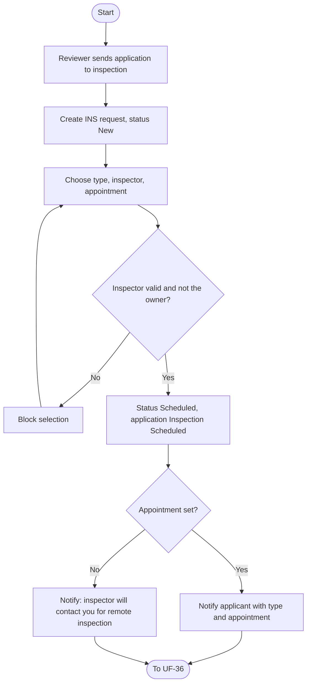
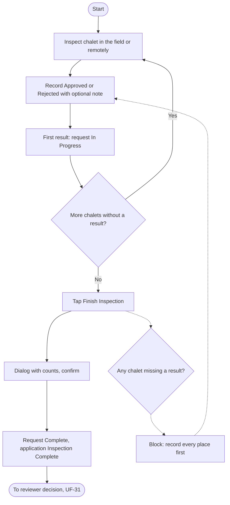
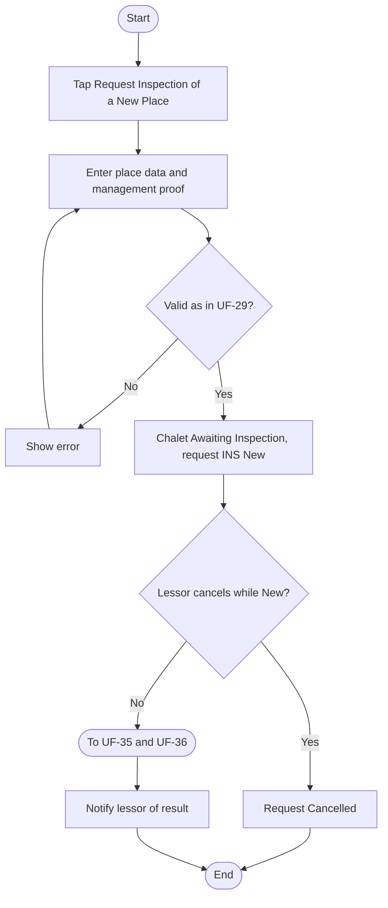
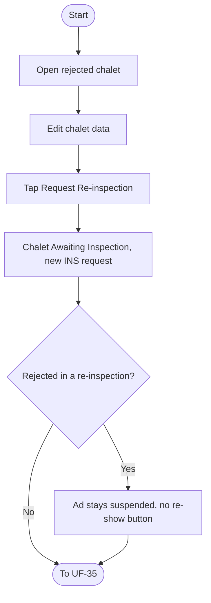
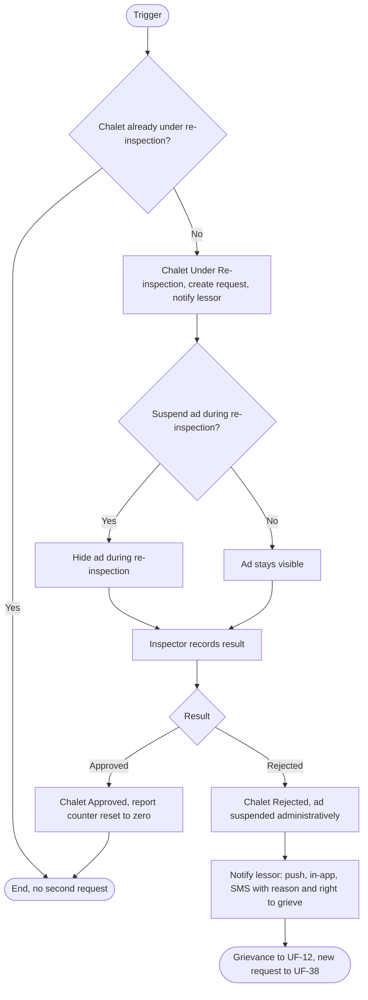
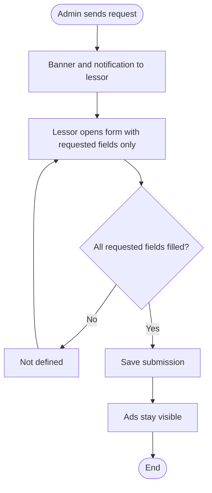
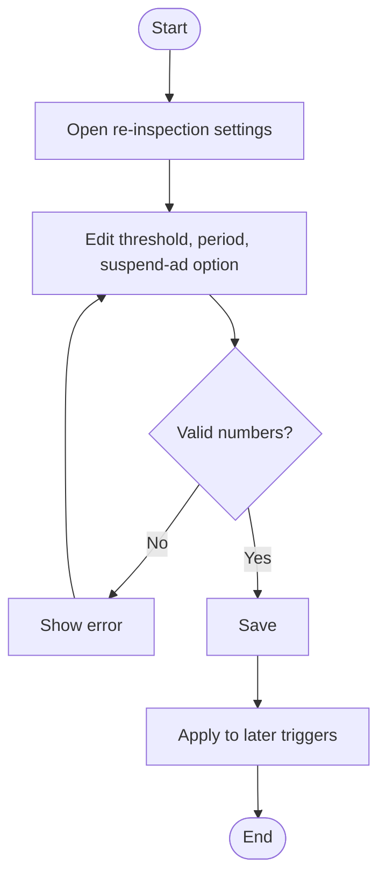

# UF-35: Schedule an Inspection

**Actor:** Review staff (the applicant is notified, the inspector is assigned)
**Goal:** Send an application to inspection with one type, an inspector, and an appointment
**Entry Point:** Application with status **Under Review** (UF-31)
**Preconditions:** The application is Under Review, and the chosen inspector holds the "Inspector" role and is not the application owner
**Postconditions:** Inspection request `INS-…` is **Scheduled**, the inspector can see only this assigned request, and the applicant is notified

## Main Flow

| #   | User Action                                                                                             | System Response                                                                                                                 |
| --- | ------------------------------------------------------------------------------------------------------- | ------------------------------------------------------------------------------------------------------------------------------- |
| 1   | Reviewer sends the application to inspection                                                            | Creates inspection request `INS-…` (reason: Join) with status **New**                                                           |
| 2   | Chooses one inspection type for the whole request (field or remote), the inspector, and the appointment | Validates the inspector                                                                                                         |
| 3   | Saves                                                                                                   | Request becomes **Scheduled**, application becomes **Inspection Scheduled**, and the inspector gets access to this request only |
| 4   | n/a                                                                                                     | Notifies the applicant with the type and appointment                                                                            |

## Alternative / Error Flows

| ID  | At Step                  | Condition                                   | Result                                                       |
| --- | ------------------------ | ------------------------------------------- | ------------------------------------------------------------ |
| A1  | 4                        | Type is remote and no appointment is set    | Applicant sees «سيتواصل معك المعاين لترتيب المعاينة عن بُعد» |
| A2  | After 3                  | Request is reassigned to another inspector  | The previous inspector loses access immediately              |
| A3  | Any step before Complete | Admin cancels the request with a reason     | Request becomes **Cancelled**                                |
| E1  | 2                        | Selected inspector is the application owner | Not allowed                                                  |

## Diagram

## Notes
- Related requirements: §21-1, §21-2, §21-3, policy (inspector role, reassignment, access), §19-10, request status table
- One inspection type applies to the whole request (all chalets in it).
- **Contradiction:** the §19 status table says "Inspection Scheduled" means an inspector **and an appointment**, but §21-1 allows a remote inspection with no appointment. I followed §21-1.
- Open questions:
  - Who creates and schedules inspection requests for reasons other than Join (new chalet, repair, re-inspection)?
  - Is the applicant notified when the inspector is reassigned or the request is cancelled?
  - Which channel carries the scheduling notification?

---

# UF-36: Perform Inspection and Record Results

**Actor:** Inspector
**Goal:** Inspect each chalet and record a result for every one
**Entry Point:** The assigned inspection request
**Preconditions:** Request is **Scheduled** and assigned to this inspector
**Postconditions:** Every chalet has a result, the request is **Complete**, and the reviewer can decide

## Main Flow

| #   | User Action                                                                                                                              | System Response                                                                                                             |
| --- | ---------------------------------------------------------------------------------------------------------------------------------------- | --------------------------------------------------------------------------------------------------------------------------- |
| 1   | Visits the chalet at the appointment (field), or holds a video call or video through an external channel agreed with the lessor (remote) | n/a                                                                                                                         |
| 2   | Records **Approved** or **Rejected** for a chalet, with an optional note (up to 1000 characters)                                         | Saves the result. On the first result, the request becomes **In Progress** and the application becomes **Under Inspection** |
| 3   | Repeats step 2 for every chalet                                                                                                          | n/a                                                                                                                         |
| 4   | Taps **"Finish Inspection"**                                                                                                             | Shows a dialog with the counts                                                                                              |
| 5   | Confirms                                                                                                                                 | Request becomes **Complete** and the application becomes **Inspection Complete**                                            |

## Alternative / Error Flows

| ID | At Step | Condition | Result |
|----|---------|-----------|--------|
| A1 | 1 | Inspection type is remote | The inspector and the lessor agree on the channel outside the platform |
| A2 | Any | Request is reassigned or cancelled | The inspector loses access immediately |
| A3 | 2 | Inspection reason is Re-inspection | The result follows UF-39 (Approved resets the report counter, Rejected suspends the ad) |
| E1 | 4 | A chalet has no result | Finish is blocked: «سجّل نتيجة كل الأماكن قبل الإنهاء» |
| E2 | 2 | Note exceeds 1000 characters | Not accepted (message not defined) |

## Diagram

## Notes
- Related requirements: §21-2, §21-3, §21-4, §21-5, policy (no photos, checklist, report, or location tracking), request status table
- The inspector records only a result and an optional note. The inspector does not attach photos or reports and is not location-tracked.
- Acceptance does **not** require every chalet to be approved. On acceptance, the approved chalets become **Approved** (see UF-33).
- **Contradiction:** the §19 status "Under Inspection" and the §21 request status "In Progress" appear to be the same moment, but §21 does not say when "In Progress" starts. I tied it to the first recorded result, as §19 does.
- **Ambiguity:** the chalet status table says Awaiting Inspection moves to Approved/Rejected "by the inspector, then review", but §21-5 says the approved chalets become Approved when the application is accepted. It is unclear whether the inspector's result sets the chalet status or only informs the reviewer.
- Open questions:
  - Can the inspector change a recorded result before finishing?
  - What happens if the lessor does not attend the appointment or the remote call?
  - Can the lessor see the inspector's note on a rejected chalet?

---

# UF-37: Request Inspection of a New Chalet

**Actor:** Lessor (accepted)
**Goal:** Add a new chalet after acceptance and have it inspected
**Entry Point:** "Request Inspection of a New Place" in the lessor's area
**Preconditions:** The user is an accepted lessor
**Postconditions:** The chalet status is **Awaiting Inspection** with an inspection request (reason: New Chalet), the lessor's personal data is not reviewed again, and the lessor is notified of the result

## Main Flow

| # | User Action | System Response |
|---|-------------|-----------------|
| 1 | Taps **"Request Inspection of a New Place"** | Opens the same place form as UF-29. The type is fixed to "Chalet" and hidden |
| 2 | Enters the place data and uploads the proof of the right to manage and rent | Validates as in UF-29 |
| 3 | Submits | Chalet becomes **Awaiting Inspection**. Creates request `INS-…` (status **New**). Personal data is not reviewed again |
| 4 | n/a | Inspection continues through UF-35 and UF-36 |
| 5 | n/a | Notifies the lessor of the result |

## Alternative / Error Flows

| ID  | At Step | Condition                                                         | Result                                            |
| --- | ------- | ----------------------------------------------------------------- | ------------------------------------------------- |
| A1  | 4       | Lessor cancels while the request is still **New** (not scheduled) | Request becomes **Cancelled**                     |
| A2  | 5       | Chalet is rejected                                                | Lessor continues with UF-38                       |
| E1  | 4       | Lessor tries to cancel after the request is scheduled             | Not allowed. Only Admin can cancel, with a reason |
| E2  | 2       | Fewer than 3 photos, or other place data is invalid               | Same validation as UF-29                          |

## Diagram

## Notes
- Related requirements: §21-6, policy (a chalet is not published before approval), chalet and request status tables
- Open questions:
  - Does adding a new chalet depend on the lessor's package or subscription?
  - Which channel carries the result notification, and can the lessor see the inspector's note?
  - Who schedules the request: the same reviewer, or a different role?

---

# UF-38: Request Re-inspection of a Rejected Chalet

**Actor:** Lessor
**Goal:** Fix a rejected chalet and ask for inspection again
**Entry Point:** A rejected chalet in the lessor's list
**Preconditions:** Chalet status is **Rejected**
**Postconditions:** Chalet status is **Awaiting Inspection** and a new inspection request exists

## Main Flow

| # | User Action | System Response |
|---|-------------|-----------------|
| 1 | Opens the rejected chalet | Shows it as Rejected and not published |
| 2 | Edits the chalet data | Saves the changes |
| 3 | Taps **"Request Re-inspection"** | Chalet becomes **Awaiting Inspection** and a new inspection request is created |
| 4 | n/a | Continues through UF-35 and UF-36 |

## Alternative / Error Flows

| ID | At Step | Condition | Result |
|----|---------|-----------|--------|
| A1 | 1 | The chalet was rejected in a re-inspection (UF-39) | The ad is suspended administratively. The lessor sees «الإعلان موقوف من الإدارة: {السبب}» with no re-show button, and existing bookings continue |
| A2 | 1 | Lessor disagrees with the administrative suspension | Lessor may submit a grievance within 3 business days (UF-12) |

## Diagram

## Notes
- Related requirements: §21-7, penalties (re-inspection rejected), chalet status table
- Open questions:
  - What reason does the new inspection request carry: Re-inspection, or another reason?
  - Is any edit required before the button works?
  - If a re-inspection later approves a chalet whose ad was suspended after a rejected re-inspection, does the ad return automatically?
  - Is there a limit on how many times the lessor can request re-inspection?

---

# UF-39: Re-inspection Triggered and Resolved

**Actor:** System or Admin (trigger), Inspector (result), Lessor (notified)
**Goal:** Re-verify an approved chalet when reports, time, an admin decision, or a dispute decision requires it
**Entry Point:** One of four triggers: 3 valid reports since the last approved inspection, 12 months since the last approval, a manual Admin request with a reason, or a type D dispute decision in the customer's favor
**Preconditions:** Chalet status is **Approved** and it is not already under re-inspection
**Postconditions:** **Approved** result: the report counter resets to zero and the chalet stays Approved. **Rejected** result: the ad is suspended administratively

## Main Flow

| # | User Action | System Response |
|---|-------------|-----------------|
| 1 | n/a (trigger occurs) | Counts only valid reports on the ad itself, since the last approved inspection. The periodic timer runs from the last approval |
| 2 | n/a | Chalet becomes **Under Re-inspection**. Creates an inspection request (reason: Re-inspection). Notifies the lessor |
| 3 | n/a | Keeps the ad visible (default) |
| 4 | Inspector inspects and records the result (UF-36) | Saves the result |
| 5 | Result is **Approved** | Chalet becomes **Approved** and the report counter resets to zero |

## Alternative / Error Flows

| ID | At Step | Condition | Result |
|----|---------|-----------|--------|
| A1 | 5 | Result is **Rejected** | Chalet becomes **Rejected**. The ad is suspended administratively. The lessor cannot re-show it and sees «الإعلان موقوف من الإدارة: {السبب}». Existing bookings continue. The lessor gets SMS, push, and in-app with the reason and the right to grieve (the 3 business days start from the notice) |
| A2 | After A1 | Lessor submits a grievance | Handled as UF-12 |
| A3 | 1 | Trigger is a type D dispute decision | Also applies full refund in 3 business days, administrative ad suspension, and the next penalty step (UF-15 A7, UF-11) |
| A4 | 3 | Admin enabled "suspend ad during re-inspection" | The ad is hidden during the re-inspection |
| A5 | 1 | Report threshold or periodic period is set to 0 | The matching automatic trigger is off |
| A6 | 1 | Chalet is already **Under Re-inspection** | No second request is created |
| E1 | 1 | Admin starts a manual re-inspection without a reason | Not allowed, a reason is mandatory |

## Diagram

## Notes
- Related requirements: §21-8, policy (re-inspection effects), penalties (re-inspection rejected, type D), settings table, §19 penalty grievance rules (D47, D48, D49)
- Triggers: 3 valid reports (setting), 12 months from the last approval (setting), manual Admin with a reason, or a type D decision. Reports that count are valid reports on the ad only.
- Re-inspection is **not** a penalty step by itself. The penalty ladder applies only through the type D trigger (UF-11).
- Open questions:
  - Who schedules the inspector and type for a re-inspection (see UF-35 open question)?
  - Does the lessor receive a notification for each valid report, or only when re-inspection starts?
  - If a re-inspection is Approved after a type D decision, is the ad suspension lifted?
  - What happens to a report that arrives while the chalet is Under Re-inspection?

---

# UF-40: Respond to a Data Update Request

**Actor:** Lessor (the request is sent by Admin)
**Goal:** Provide the data the administration asked for without losing visible ads
**Entry Point:** Banner in the lessor's dashboard, or the notification
**Preconditions:** Admin sent a data update request to the lessor
**Postconditions:** The requested fields are submitted, and the ads stayed visible

## Main Flow

| # | User Action | System Response |
|---|-------------|-----------------|
| 1 | n/a (Admin sends the request) | Shows a banner in the lessor's dashboard and sends a notification |
| 2 | Opens the banner | Shows a form with only the requested fields |
| 3 | Fills in the fields and submits | Saves the submission |
| 4 | n/a | Keeps the lessor's ads visible throughout |

## Alternative / Error Flows

| ID | At Step | Condition | Result |
|----|---------|-----------|--------|
| A1 | 4 | Admin decides to suspend an ad | A separate administrative decision, not part of this flow (UF-11 / UF-12 rules) |
| E1 | 3 | A requested field is left empty | Not defined |

## Diagram

## Notes
- Related requirements: §21-9, policy (the data update request does not hide ads)
- Open questions:
  - Is there a deadline to respond, and what happens if the lessor ignores the request?
  - Who reviews the submitted data, and can the Admin send it back or request re-inspection?
  - Which events does the lessor see as notifications (UF-26 lists "data update request")?

---

# UF-41: Configure Re-inspection Settings

**Actor:** Admin
**Goal:** Control when re-inspection starts and whether ads stay visible during it
**Entry Point:** Admin panel, re-inspection settings
**Preconditions:** Admin has permission to manage settings
**Postconditions:** The new values apply to later triggers

## Main Flow

| # | User Action | System Response |
|---|-------------|-----------------|
| 1 | Opens the re-inspection settings | Shows the report threshold (default 3), the periodic period (default 12 months), and "suspend ad during re-inspection" (default No) |
| 2 | Changes the report threshold (a number; 0 turns it off) | Validates |
| 3 | Changes the periodic period in months (0 turns it off) | Validates |
| 4 | Turns "suspend ad during re-inspection" on or off | n/a |
| 5 | Saves | Applies the values to later triggers |

## Alternative / Error Flows

| ID | At Step | Condition | Result |
|----|---------|-----------|--------|
| A1 | 2-3 | Value is 0 | The matching automatic trigger is turned off |
| E1 | 2-3 | Value is not a valid number | Not defined |

## Diagram

## Notes
- Related requirements: settings table
- Manual re-inspection by Admin is a trigger in UF-39, not a setting.
- Open questions:
  - Do changed values affect chalets whose reports or periods are already counting?
  - Is every settings change audit-logged?
  - Is there a maximum value for the threshold or the period?