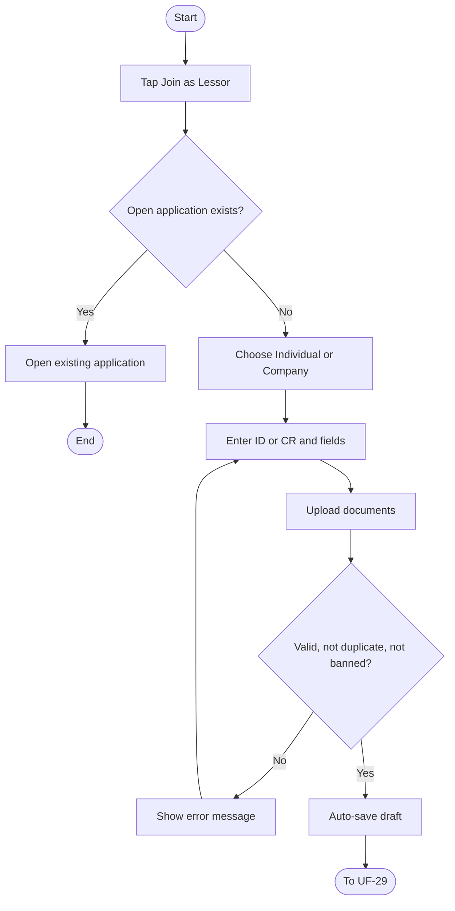
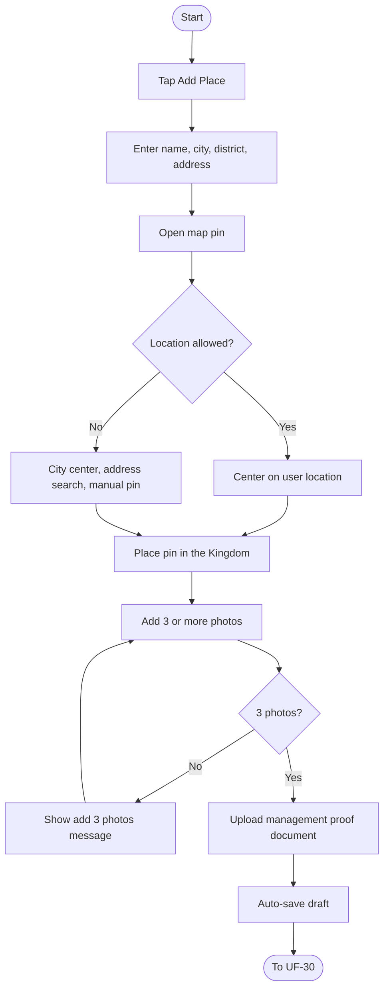
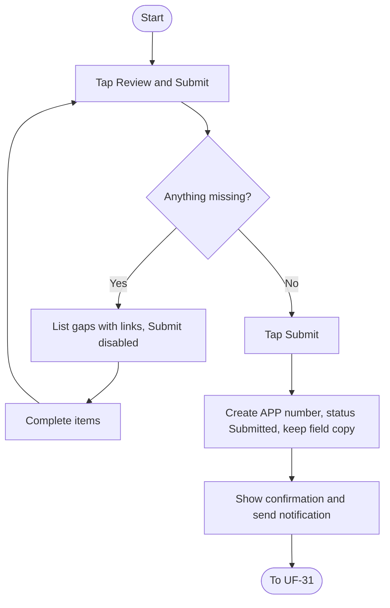
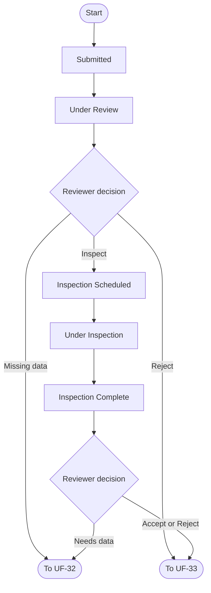
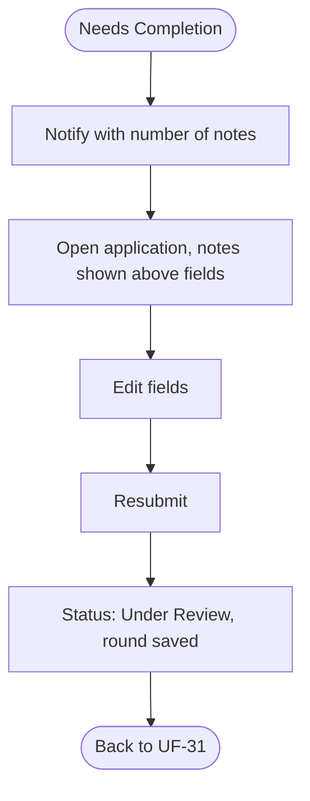
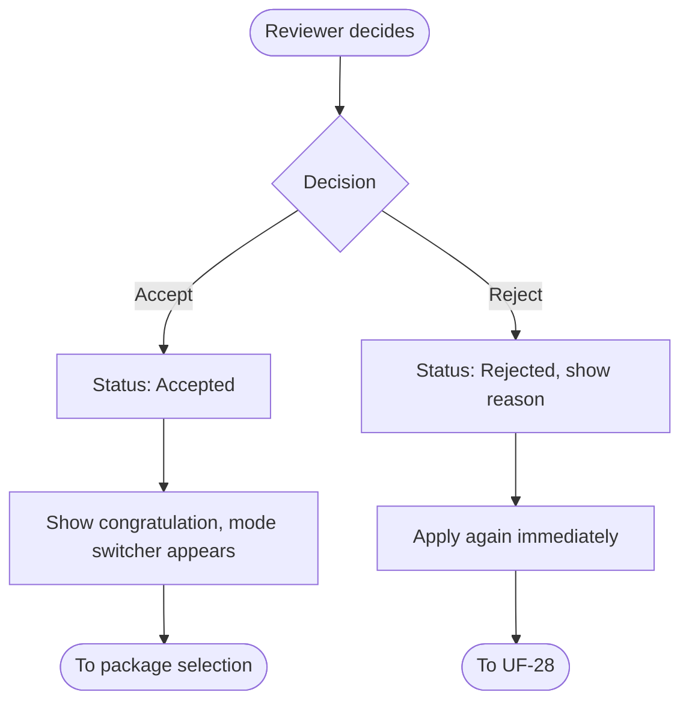
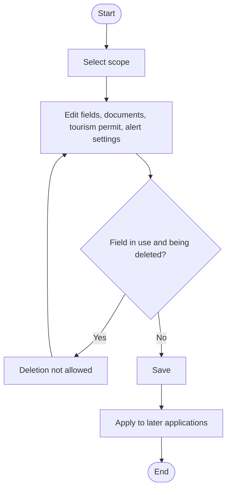

# UF-28: Start Join Application and Enter Applicant Data

**Actor:** Customer (prospective lessor)
**Goal:** Begin a lessor application as an individual or a company
**Entry Point:** "My Account", then "Join as Lessor"
**Preconditions:** The user is logged in, and their phone and ID/CR are not permanently banned
**Postconditions:** Applicant data and documents are saved as a draft, and the user continues to UF-29

## Main Flow

| #   | User Action                                                                                                                                                                 | System Response                                              |
| --- | --------------------------------------------------------------------------------------------------------------------------------------------------------------------------- | ------------------------------------------------------------ |
| 1   | Taps **"Join as Lessor"**                                                                                                                                                   | Shows the benefits, steps, and required documents            |
| 2   | Chooses **Individual** or **Company**                                                                                                                                       | Opens the form with the admin-defined fields for that scope  |
| 3   | Individual: enters  - National ID (10 digits, starts with 1).  - Name. - Activity name optional.  - ID photo.                                                   | Validates the ID format and the verification algorithm       |
| 4   | Company: enters  - Company name.  - Trade name. - CR number (10 digits). - Activity address - Responsible/authorized person data - Authorization document | Validates the CR number   (رقم السجل التجاري)                |
| 5   | Uploads the required documents                                                                                                                                              | Stores them (rules in [[متطلبات مشروع تنفيذ#٢٠. المستندات]]) |
| 6   | n/a                                                                                                                                                                         | Auto-saves every step as a draft                             |

## Alternative / Error Flows

| ID | At Step | Condition | Result |
|----|---------|-----------|--------|
| A1 | 2 | User already has an open application | Opens the existing one: «لديك طلب قيد المراجعة» |
| A2 | Any | User leaves the form | Draft is kept and can be continued later from the app |
| A3 | Any | Admin added a mandatory field while the draft exists | A banner appears at the top of the form |
| A4 | 3-4 | Tourism permit number is enabled by admin | Accepts 6 to 12 digits. It may be a publishing condition or shown publicly |
| A5 | Any | User deletes the draft | Draft and its files are deleted |
| A6 | 1 | Phone belongs to a permanently banned lessor | "Join as Lessor" is not shown. The user stays a customer only |
| E1 | 3 | ID starts with 2 | «الانضمام كفرد متاح للمواطنين السعوديين فقط. يمكن لغير السعودي الانضمام عبر شركة» |
| E2 | 3 | ID fails the algorithm | «رقم الهوية غير صحيح» |
| E3 | 3 | ID belongs to another active lessor profile | «هذا الرقم مسجل لحساب آخر. تواصل معنا إن كان ذلك خطأ». Logged for review |
| E4 | 4 | CR is not 10 digits | «رقم السجل التجاري 10 أرقام» |
| E5 | 4 | CR belongs to another account | «هذا السجل التجاري مسجل لحساب آخر. تواصل معنا إن كنت المفوّض الجديد» |
| E6 | 3-4 | ID or CR belongs to a permanently banned lessor | «لا يمكن قبول طلب انضمام بهذه البيانات. تواصل مع الدعم» |
| E7 | 4 | Tourism permit is not 6 to 12 digits | «رقم التصريح من 6 إلى 12 رقمًا» |

## Diagram

## Notes
- Related requirements: policy (individual Saudi only, no duplicates, encrypted ID/CR), penalties (permanent ban)
- Fields and documents are admin-defined per scope (see UF-34).
- No sub-accounts for company employees.
- Closed question:
	  - What happens for an individual whose ID starts with a digit other than 1 or 2? The source defines only the message for 2.
	  - Which document types, sizes, and formats are allowed? `PDF أو JPG أو PNG أو HEIC، حتى 10 ميجابايت للملف.`
	  - Where does the user delete a draft? From the status page 
- Open questions:
  - Is the banned-ID check done on entry of the ID, or at submission?

---

# UF-29: Add a Place for Inspection

**Actor:** Customer (prospective lessor)
**Goal:** Add one or more chalets to the application for inspection
**Entry Point:** "Add Place" step in the application
**Preconditions:** A draft application exists
**Postconditions:** At least one place with required data is saved in the draft

## Main Flow

| #   | User Action                                                                                                 | System Response                                                                                                                            |
| --- | ----------------------------------------------------------------------------------------------------------- | ------------------------------------------------------------------------------------------------------------------------------------------ |
| 1   | Taps **"Add Place"**                                                                                        | Opens the place form.  The type field is fixed to "Chalet" and hidden if there is only one type, else should be visible and selectable. |
| 2   | Enters: - Name (3 to 80). - City. - District منطقة (belongs to the city). - Address (5 to 200). | Validates                                                                                                                                  |
| 3   | Opens the map pin                                                                                           | Asks for location permission: **Allow** or **Set manually**                                                                                |
| 4   | Allows                                                                                                      | Centers the map on the user's location                                                                                                     |
| 5   | Places the pin inside the Kingdom                                                                           | Saves the pin                                                                                                                              |
| 6   | Adds at least 3 photos                                                                                      | Stores them                                                                                                                                |
| 7   | Uploads the document proving the right to manage and rent the place                                         | Stores it                                                                                                                                  |
| 8   | Saves the place                                                                                             | Auto-saves the draft. More places can be added                                                                                             |

## Alternative / Error Flows

| ID  | At Step | Condition                                        | Result                                                                         |
| --- | ------- | ------------------------------------------------ | ------------------------------------------------------------------------------ |
| A1  | 3       | User chooses "Set manually" or denies permission | Map opens on the city center with address search, and the pin is moved by hand |
| A2  | 8       | User adds another place                          | Repeats from step 1                                                            |
| E1  | 6       | Fewer than 3 photos                              | «أضف 3 صور على الأقل للمكان»                                                   |
| E2  | 5       | Pin is outside the Kingdom                       | Not accepted (message not defined)                                             |
| E3  | 2       | Name or address length is out of range           | Not accepted (message not defined)                                             |

## Diagram

## Notes
- Related requirements: [[متطلبات مشروع تنفيذ#٢٤. إضافة الشاليه و الإعلان و المراجعة]]

---

# UF-30: Review and Submit the Application

**Actor:** Customer (prospective lessor)
**Goal:** Send the completed application for review
**Entry Point:** "Review and Submit"
**Preconditions:** A draft exists
**Postconditions:** Application `APP-…` exists with status **Submitted**, and the applicant is notified

## Main Flow

| #   | User Action                                   | System Response                                                                                                          |
| --- | --------------------------------------------- | ------------------------------------------------------------------------------------------------------------------------ |
| 1   | Taps **"Review and Submit"**                  | Lists every missing item with a link to its step.  Submit is disabled until all are complete.                         |
| 2   | Completes the missing items through the links | Updates the list                                                                                                         |
| 3   | Taps **Submit**                               | Creates the application with its number, status **Submitted**, and a copy of the field definitions it was submitted with |
| 4   | n/a                                           | Shows «أُرسل طلبك برقم APP-…»                                                                                            |
| 5   | n/a                                           | Sends «استلمنا طلب انضمامك APP-… وسنراجعه»                                                                               |

## Alternative / Error Flows

| ID  | At Step | Condition                       | Result                                 |
| --- | ------- | ------------------------------- | -------------------------------------- |
| A1  | 3       | Submit is pressed twice         | Only one application is created        |
| E1  | 1       | No place was added              | «أضف مكانًا واحدًا على الأقل للمعاينة» |
| E2  | 1       | A place has fewer than 3 photos | «أضف 3 صور على الأقل للمكان»           |
| E3  | 1       | Any other item is missing       | Submit stays disabled                  |

## Diagram

## Notes
- Related requirements: §19-9, policy (field copy per submitted application, one open application per user)
- Closed question:
	- Can the applicant edit or withdraw the application after submission and before review? No
- Open questions:
  - Through which channel is the "we received your application" notification sent? UF-26 lists onboarding stages as push and in-app for the lessor.

---

# UF-31: Track Application Status

**Actor:** Customer (prospective lessor), with staff and inspector driving the status
**Goal:** Follow the application until a decision
**Entry Point:** The application screen
**Preconditions:** Application is **Submitted**
**Postconditions:** The user sees the current status. The flow ends at Accepted, Rejected, or Needs Completion

## Main Flow

| #   | User Action                                        | System Response                                                                                                                                                                                                                                           |
| --- | -------------------------------------------------- | --------------------------------------------------------------------------------------------------------------------------------------------------------------------------------------------------------------------------------------------------------- |
| 1   | Opens the application                              | Shows a timeline:  - Submitted (مُرسل) - Under Review (قيد المراجعة) - Needs Completion (يحتاج استكمال) - ==🔴Inspection Scheduled (المعاينة مجدولة)== - ==🔴Under Inspection (قيد المعاينة)== - Accepted (مقبول) - Rejected (مرفوض) |
| 2   | n/a (reviewer opens it)                            | Status becomes **Under Review**                                                                                                                                                                                                                           |
| 3   | n/a (reviewer schedules inspection)                | Status becomes **Inspection Scheduled**, with an inspector and an appointment                                                                                                                                                                             |
| 4   | n/a (inspector records the first result)           | Status becomes **Under Inspection**                                                                                                                                                                                                                       |
| 5   | n/a (inspector finishes the result for each place) | Status becomes **Inspection Complete**                                                                                                                                                                                                                    |
| 6   | n/a (reviewer decides)                             | Moves to Accepted (UF-33), Rejected (UF-33), or Needs Completion (UF-32)                                                                                                                                                                                  |

## Alternative / Error Flows

| ID | At Step | Condition | Result |
|----|---------|-----------|--------|
| A1 | 2 | Reviewer finds missing data | Status becomes **Needs Completion** (UF-32) |
| A2 | 2 | Reviewer decides without inspection | Status becomes **Rejected** (UF-33). Allowed by the status table |
| A3 | 6 | Inspection result is incomplete | Status becomes **Needs Completion** (UF-32) |
| E1 | Any | Application stays unreviewed past the late-alert threshold (default 5 business days) | Alert behavior is not defined |

## Diagram

## Notes
- Related requirements: [[متطلبات مشروع تنفيذ# ١٩. الانضمام كمؤجّر]], status table
- **Contradiction:** the timeline in item 10 omits "Inspection Complete", but the status table includes it. I kept it in the flow.
- Closed questions:
  - Who is alerted when the late threshold is reached, and what does that person do? The Lessor
  - Is the applicant notified at each status change? (UF-26 says lessor onboarding and inspection stages are push and in-app.) YES
  - Does the applicant see the inspector or appointment details? Out the App

---

# UF-32: Complete Requested Corrections

**Actor:** Customer (prospective lessor)
**Goal:** Fix the reviewer's notes and resend the application
**Entry Point:** Notification «طلبك يحتاج استكمال: {عدد} ملاحظات»
**Preconditions:** Status is **Needs Completion**
**Postconditions:** Status returns to **Under Review**, and the round is kept in the application history

## Main Flow

| # | User Action | System Response |
|---|-------------|-----------------|
| 1 | n/a | Sends «طلبك يحتاج استكمال: {عدد} ملاحظات» |
| 2 | Opens the application | Shows each field's note above it in an orange frame |
| 3 | Edits the flagged fields | Auto-saves |
| 4 | Resubmits | Status becomes **Under Review**. Keeps a record of every round |

## Alternative / Error Flows

| ID | At Step | Condition | Result |
|----|---------|-----------|--------|
| A1 | 3 | Another round of notes is issued later | Repeats from step 1. Each round stays in history |
| E1 | 4 | A flagged field is still incomplete | Not defined |

## Diagram

## Notes
- Related requirements: [[متطلبات مشروع تنفيذ# ١٩. الانضمام كمؤجّر]], status table
- Closed questions:
  - Can the applicant edit only flagged fields, or all fields? All fields
  - Is there a limit on the number of rounds or a deadline to respond? NO

---

# UF-33: Receive the Decision and Reapply

**Actor:** Customer (prospective lessor); decision by reviewer
**Goal:** Learn the result and either start as a lessor or apply again
**Entry Point:** Final decision on the application
**Preconditions:** Status is Under Review or Inspection Complete, and the reviewer decided
**Postconditions:** Accepted: user is a lessor with the mode switcher. Rejected: reason shown, new application allowed

## Main Flow

| # | User Action | System Response |
|---|-------------|-----------------|
| 1 | n/a (reviewer accepts) | Status becomes **Accepted** (final) |
| 2 | Opens the app | Shows «مبروك! أصبحت مؤجّرًا. اختر باقتك لنشر إعلاناتك» |
| 3 | n/a | Shows the customer/lessor mode switcher |

## Alternative / Error Flows

| ID | At Step | Condition | Result |
|----|---------|-----------|--------|
| A1 | 1 | Reviewer rejects | Status becomes **Rejected** (final). The applicant sees the reason |
| A2 | After A1 | Applicant applies again | Allowed immediately with no waiting period. Starts UF-28 |
| E1 | After A1 | Applicant's ID or CR was permanently banned earlier | Blocked (UF-28 E6) |

## Diagram

## Notes
- Related requirements: [[متطلبات مشروع تنفيذ# ١٩. الانضمام كمؤجّر]], status table, policy (one open application per user)
- Package selection and ad publishing are outside this requirement.
- Lessor penalties and grievances after acceptance: see UF-11 and UF-12.
- Closed questions:
  - Is the applicant notified of the decision (channel)? Yes
  - Is the rejection reason a fixed list or free text? free text 
  - Does a new application after rejection reuse the previous data? Yes

---

# UF-34: Configure Join Fields and Settings

**Actor:** Admin
**Goal:** Define the application fields and documents without a code change
**Entry Point:** Admin panel, join application settings
**Preconditions:** Admin has permission to manage settings
**Postconditions:** New settings apply to later applications. Submitted applications keep their own copy

## Main Flow

| # | User Action | System Response |
|---|-------------|-----------------|
| 1 | Opens the settings and selects a scope (Individual, Company, Place) | Shows the current fields and documents (defaults per scope) |
| 2 | Adds, edits, disables, or reorders fields and documents | Saves and allows a preview |
| 3 | Deletes a field | Allowed only if it is unused |
| 4 | Enables the tourism permit number and sets "shown publicly" and "publishing condition" | Saves |
| 5 | Sets the late-application alert threshold and working days | Saves (default 5 business days, Sunday to Thursday) |

## Alternative / Error Flows

| ID | At Step | Condition | Result |
|----|---------|-----------|--------|
| A1 | 2 | A mandatory field is added while drafts exist | Drafts show the top banner (UF-28 A3) |
| E1 | 3 | Field is already used | Deletion is not allowed |

## Diagram

## Notes
- Related requirements: [[متطلبات مشروع تنفيذ# ١٩. الانضمام كمؤجّر]], policy (fields not fixed in code), settings table
- Tourism permit stays built and disabled until the lawyer's opinion.
- Closed questions:
  - Is every settings change audit-logged? YES
  - Does disabling a field affect existing drafts? NO
