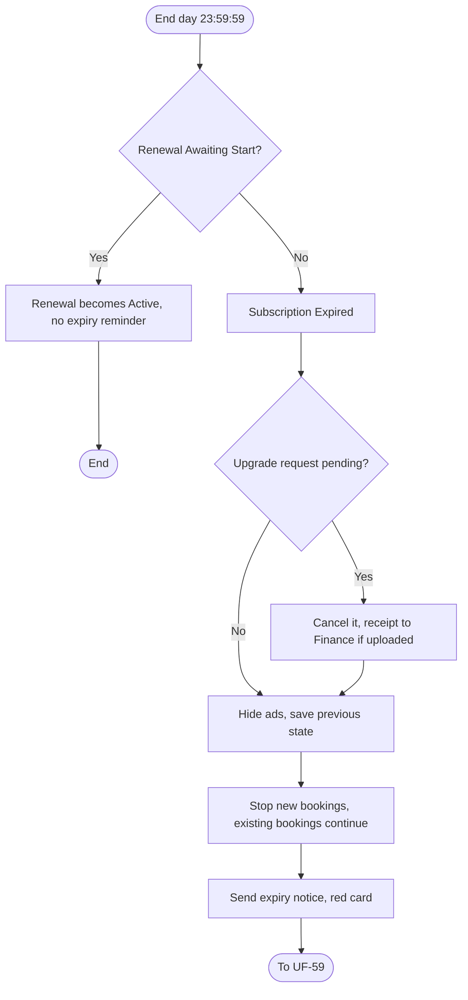
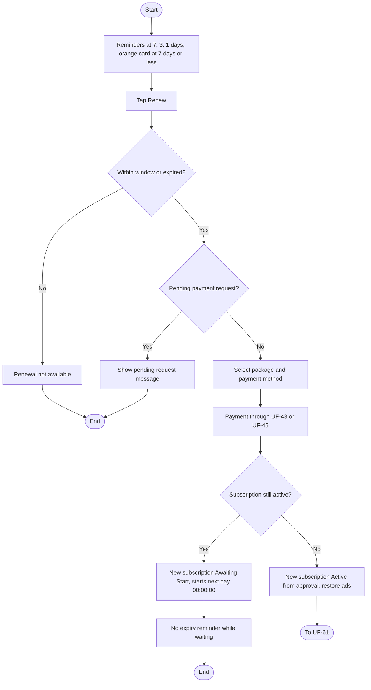
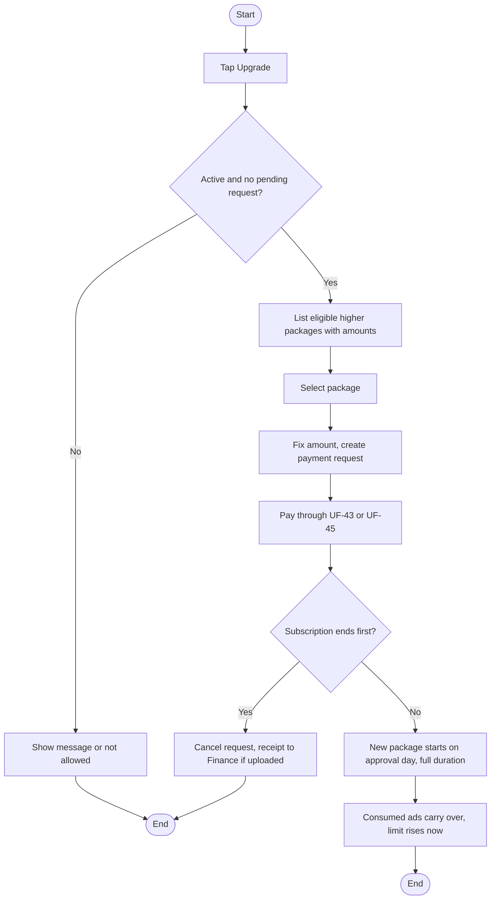
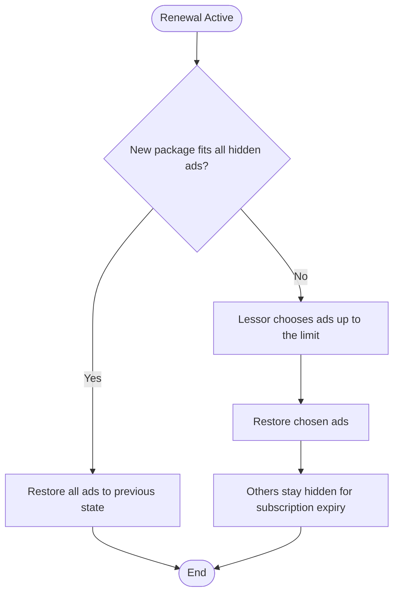
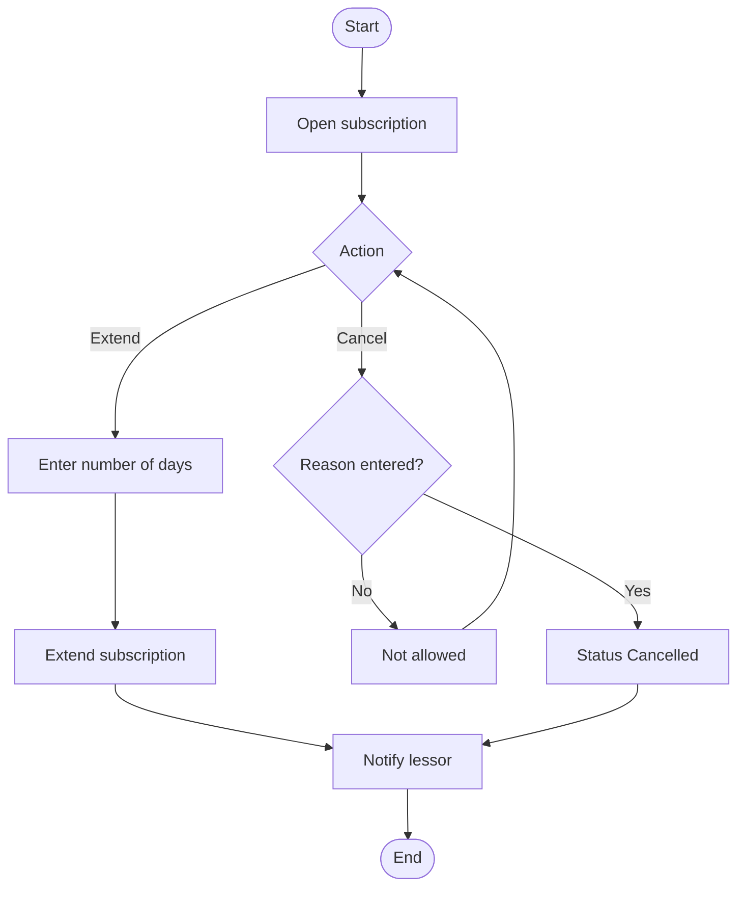
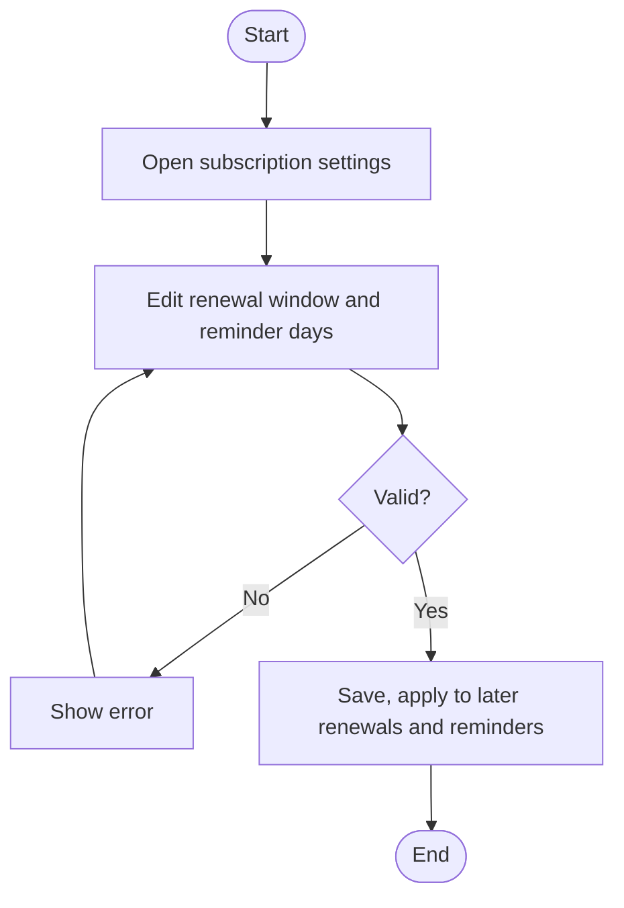

# UF-57: Subscription Expires and Ads Are Hidden

**Actor:** System (the lessor is notified)
**Goal:** End the subscription on time, hide the ads, and keep existing bookings running
**Entry Point:** 23:59:59 on the subscription's end day (Riyadh time)
**Preconditions:** The subscription is **Active** and no renewal is **Awaiting Start**
**Postconditions:** The subscription is **Expired** (final), the ads are **Hidden for Subscription Expiry**, new bookings are stopped, and existing bookings continue

## Main Flow

| #   | User Action                                                             | System Response                                                                                   |
| --- | ----------------------------------------------------------------------- | ------------------------------------------------------------------------------------------------- |
| 1   | n/a (end day reaches 23:59:59)                                          | Sets the subscription to **Expired** (final)                                                      |
| 2   | n/a                                                                     | Hides the lessor's ads as **Hidden for Subscription Expiry** and saves each ad's previous state   |
| 3   | n/a                                                                     | Stops new bookings only.  Confirmed and pending bookings stay visible.  Lessor data is kept |
| 4   | n/a                                                                     | Keeps featuring saved but not visible                                                             |
| 5   | n/a                                                                     | Sends the expiry notice and turns the dashboard card red: «إعلاناتك مخفية — جدّد الآن»            |
| 6   | Continues managing existing bookings (confirm, reject, cancel) as usual | Allows it (UF-04, UF-06, UF-09)                                                                   |
| 7   | Taps **"Renew Now"**                                                    | Continues to UF-59                                                                                |

## Alternative / Error Flows

| ID  | At Step | Condition                                               | Result                                                                                                       |
| --- | ------- | ------------------------------------------------------- | ------------------------------------------------------------------------------------------------------------ |
| A1  | 1       | A renewal is **Awaiting Start**                         | No expiry reminder is sent.  The renewal becomes Active at the end of the previous subscription (UF-59)   |
| A2  | 1       | An upgrade request is pending at expiry                 | System cancels it automatically. If a receipt was uploaded, it stays for Finance with «يحتاج معالجة مبلغ» |
| A3  | 1       | Finance cancels the subscription before its end (UF-62) | Subscription becomes **Cancelled** (final).  Effect on ads is not defined                                 |
| A4  | 2       | An ad is administratively suspended                     | The suspension overrides (UF-56)                                                                             |

## Diagram

## Notes
- Related requirements: [[متطلبات مشروع تنفيذ#٢٣. التجديد و الترقية و الانتهاء]], policy (at expiry), subscription status table, §22 status table (upgrade auto-cancel), §24 ad status table, UF-26 (notifications)
- Existing bookings continue and are followed up as usual. Only new bookings stop.
- **Contradiction (carried from UF-57 before):** §23-4 says "his ads" are hidden, but the §24 table moves an ad to hidden only from Published, while its restore returns "Published or Disabled".
- Closed questions:
  - Are ads in Draft, Under Review, Changes Requested, or Rejected affected at expiry? Yes
  - What happens to a pending edit on a hidden ad? Will be dis-active 
  - What happens to the calendar and the ad's visibility to customers with confirmed bookings? Continue the booking as it is, old bookings not affected.
  - When a renewal moves from Awaiting Start to Active, are ads hidden for a moment or stay visible? Stay visible 
  - Can the lessor use "Renew Now" from the expiry notice with the same package only? Yes

---

# UF-59: Renew Subscription

**Actor:** Lessor (the system sends reminders)
**Goal:** Extend the subscription before or after it ends, with the same or a different package
**Entry Point:** Reminder with **"Renew Now"** (7, 3, and 1 day before the end), the dashboard card, or **"Renew"** in My Subscription (UF-46)
**Preconditions:** The lessor is accepted. The subscription is within the renewal window (from 30 days before the end, by default) or is expired. No other payment request is pending
**Postconditions:** A new subscription exists after payment approval. Early renewal: **Awaiting Start**. Late renewal: **Active** from approval

## Main Flow

| #   | User Action                                                        | System Response                                                                                                         |
| --- | ------------------------------------------------------------------ | ----------------------------------------------------------------------------------------------------------------------- |
| 1   | n/a (7, 3, and 1 day before the end)                               | Sends a reminder with **"Renew Now"**.  The dashboard card turns orange when 7 days or less remain                   |
| 2   | Taps **"Renew Now"** or **"Renew"**                                | Checks the renewal window and opens the package list                                                                    |
| 3   | Selects the same package or a different one, then a payment method | Creates the payment request (UF-42) and continues to UF-43 or UF-45                                                     |
| 4   | Pays and the payment is approved or paid (UF-44, UF-45)            | Creates the new subscription                                                                                            |
| 5   | n/a (early renewal)                                                | Sets it to **Awaiting Start**. It starts at 00:00:00 on the day after the current one ends                              |
| 6   | n/a (late renewal, after expiry)                                   | Starts it at the moment of approval and restores the ads (UF-61)                                                        |
| 7   | n/a                                                                | Applies the new package limits from the start of its period. Sends no expiry reminder while a renewal is Awaiting Start |

## Alternative / Error Flows

| ID | At Step | Condition | Result |
|----|---------|-----------|--------|
| A1 | 3 | Lessor picks a different package | Allowed |
| A2 | 5 | The current subscription ends | System changes the renewal from **Awaiting Start** to **Active** |
| A3 | 6 | The old subscription is expired | Expired is final. Renewal always creates a new subscription |
| E1 | 2 | More than the window remains (default 30 days) | Renewal is not available |
| E2 | 3 | Another payment request is pending | «لديك طلب دفع قيد المراجعة. ألغه أولًا أو انتظر القرار» |
| E3 | 4 | Receipt is rejected or the gateway fails | See UF-44 and UF-45 |

## Diagram

## Notes
- Related requirements: [[متطلبات مشروع تنفيذ#٢٣. التجديد و الترقية و الانتهاء]], policy (early and late renewal, no reminder with a waiting renewal), settings table, subscription status table, UF-42 to UF-46
- This answers the earlier UF-46 question: a renewal during an active subscription starts after the current end, not at approval.
- Closed questions:
  - Can a second renewal be requested while one is already Awaiting Start? No
  - Does "no expiry reminder" cover the 7, 3, and 1 day reminders, the expiry notice, and the orange card? No expiry reminder ONLY if the lessor already subscribe for a new package before the current one ended 
  - Is the orange threshold (7 days) tied to the first reminder day setting or fixed? fixed
  - ==🟢Early renewal with a smaller package: what happens to the visible ads at the start of the new period?== MUST disable the over ads.
  - Can the lessor renew while an upgrade request is pending? No

---

# UF-60: Upgrade Subscription

**Actor:** Lessor
**Goal:** Move to a higher package and pay only the difference
**Entry Point:** **"Upgrade"** in My Subscription (UF-46)
**Preconditions:** The subscription is **Active** (not expired and not Awaiting Start), and no upgrade or other payment request is pending
**Postconditions:** After approval, the new package starts on the approval day with its full duration, the consumed ads carry over, and the ad limit rises immediately

## Main Flow

| # | User Action | System Response |
|---|-------------|-----------------|
| 1 | Taps **"Upgrade"** | Lists the eligible higher packages: enabled, higher daily price, and ad limit not lower than the current one |
| 2 | n/a | For each package shows: «رصيد اشتراكك الحالي … — المبلغ المطلوب … ر.س» |
| 3 | Selects a package | Calculates the amount (see Notes) and fixes it when the request is created |
| 4 | Selects a payment method | Creates the payment request (UF-42) and continues to UF-43 or UF-45 |
| 5 | Pays and the payment is approved or paid (UF-44, UF-45) | Starts the new package on the approval day with its full duration |
| 6 | n/a | Carries the consumed ads over to the new package and raises the limit immediately |

## Alternative / Error Flows

| ID | At Step | Condition | Result |
|----|---------|-----------|--------|
| A1 | 3 | Example: one week left worth 5 SAR, new package 30 SAR | Lessor pays 25 SAR |
| A2 | 3 | Example: 300 SAR for 30 days with 15 days left, new package 600 SAR | Remaining value 150.00, amount 450.00 |
| A3 | 5 | Subscription ends while the request is pending | System cancels it automatically. If a receipt was uploaded, it stays for Finance with «يحتاج معالجة مبلغ» |
| E1 | 1 | An upgrade or other payment request is already pending | «لديك طلب دفع قيد المراجعة. ألغه أولًا أو انتظر القرار» |
| E2 | 1 | Subscription is expired or Awaiting Start | Upgrade is not allowed |
| E3 | 1 | No package meets the eligibility rules | Not defined |

## Diagram

## Notes
- Related requirements: [[متطلبات مشروع تنفيذ#٢٣. التجديد و الترقية و الانتهاء]], policy (upgrade formula, eligibility, one pending upgrade, consumption carries over), §22 status table, UF-42 to UF-46
- Amount = new package full price − (current price ÷ current duration × remaining days). Remaining days are the full days from today to the end date, including today. The result is rounded to the nearest halala (half up), has no minimum, and is fixed at request creation.
- Consumed = ads published at least once. Remaining = the larger of 0 and (package limit − consumed). Visible ads never exceed the package limit.
- This answers earlier UF-46 questions: remaining days are valued at the current price and deducted from the new full price, and consumed ads carry over.
- Closed questions:
  - What status does the old subscription get when the upgrade starts (the table has only Expired and Cancelled)? old subscription will Just became removed. 
  - The amount is fixed at creation but the new package starts at approval. Are the days between the two counted? 
  - Can the lessor upgrade while a renewal is Awaiting Start? No
  - Is the featured-ads count also carried over? Yes

---

# UF-61: Restore Ads After Renewal

**Actor:** Lessor (the system restores)
**Goal:** Bring hidden ads back after renewal, choosing which ones if the new package is smaller
**Entry Point:** A late renewal becomes **Active** (UF-59)
**Preconditions:** The ads are **Hidden for Subscription Expiry**
**Postconditions:** The ads that fit the package limit are back in their previous state. The rest stay hidden

## Main Flow

| # | User Action | System Response |
|---|-------------|-----------------|
| 1 | n/a (renewal becomes Active) | Applies the new package limits and checks the hidden ads |
| 2 | n/a (new package fits all hidden ads) | Restores each ad to its saved previous state: Published or Disabled |
| 3 | Chooses which ads return (new package is smaller) | Restores the chosen ads. The visible count never exceeds the package limit |
| 4 | n/a | Leaves the other ads as **Hidden for Subscription Expiry** |

## Alternative / Error Flows

| ID | At Step | Condition | Result |
|----|---------|-----------|--------|
| A1 | 2 | An ad is administratively suspended | The suspension overrides (UF-56) |
| A2 | 2 | Restoring an ad | Consumes no credit, and the consumed count stays as it was |
| E1 | 3 | Lessor selects more ads than the package limit | Not allowed (message not defined) |

## Diagram

## Notes
- Related requirements: [[متطلبات مشروع تنفيذ#٢٣. التجديد و الترقية و الانتهاء]], policy (consumption carries over, visible not above limit), §24 status table and credit rule
- This resolves earlier UF-57 questions: what limits the return is the package limit on visible ads, not "enough credit".
- Open questions:
  - Is the ad choice a screen shown right after approval, or must the lessor do it later? What if the lessor does not choose? No,  lessor do it later
  - When the lessor later upgrades or renews with a larger package, do ads left hidden return, and how?  No all ads will became visible.
  - Does featuring return with the ad, and what if the new package has fewer featured slots? Yes
  - Is the lessor notified when ads are restored? Yes

---

# UF-62: Finance Extends or Cancels a Subscription

**Actor:** Finance (the lessor is notified)
**Goal:** Compensate the lessor with extra days, or cancel a subscription with a reason
**Entry Point:** Admin panel, the lessor's subscription
**Preconditions:** A subscription exists and Finance has permission
**Postconditions:** 
- Compensatory تعويضي extension: the end date is moved by the entered days. 
- Cancellation: status **Cancelled** (final) with a recorded reason. 
- The lessor is notified in both cases

## Main Flow

| # | User Action | System Response |
|---|-------------|-----------------|
| 1 | Opens the lessor's subscription | Shows its status and dates |
| 2 | Chooses **"Compensatory Extension"** and enters the number of days | Extends the subscription by those days |
| 3 | n/a | Notifies the lessor |

## Alternative / Error Flows

| ID  | At Step  | Condition                                        | Result                                                           |
| --- | -------- | ------------------------------------------------ | ---------------------------------------------------------------- |
| A1  | 2        | Finance chooses **"Cancel"** and enters a reason | Status becomes **Cancelled** (final).  The lessor is notified |
| A2  | After A1 | A later penalty is applied to the lessor         | No amount of the subscription is refunded                        |
| E1  | A1       | Cancel without a reason                          | Not allowed, the reason is mandatory                             |

## Diagram

## Notes
- Related requirements: [[متطلبات مشروع تنفيذ#٢٣. التجديد و الترقية و الانتهاء]], subscription status table, §22 penalties block, UF-26 (notifications)
- Cancelled is final. A new subscription needs a new payment (UF-42).
- Closed questions:
  - Can the extension apply to an Expired or Awaiting Start subscription? Does it restore hidden ads? No, extension will ONLY affect new subscriptions
  - Is there a maximum number of days? 730
  - Does cancellation hide the ads and stop new bookings, as expiry does? ONLY Stop new bookings

---

# UF-63: Configure Renewal Settings

**Actor:** Admin
**Goal:** Control the early renewal window and the expiry reminder days
**Entry Point:** Admin panel, subscription settings
**Preconditions:** The admin has permission to manage settings
**Postconditions:** The new values apply to later renewals and reminders

## Main Flow

| # | User Action | System Response |
|---|-------------|-----------------|
| 1 | Opens the subscription settings | Shows the early renewal window (default 30 days) and the reminder days (default 7, 3, 1) |
| 2 | Changes the window (number of days) | Validates |
| 3 | Changes the reminder days (a list of days) | Validates |
| 4 | Saves | Applies the values to later renewals and reminders |

## Alternative / Error Flows

| ID | At Step | Condition | Result |
|----|---------|-----------|--------|
| E1 | 2-3 | A value is not a valid number | Not defined |

## Diagram

## Notes
- Related requirements: [[متطلبات مشروع تنفيذ#٢٣. التجديد و الترقية و الانتهاء]] settings table
- Closed questions:
  - Can the reminder list be empty? Yes
- Open questions:
  - Do changed values affect subscriptions already running or reminders already scheduled?
  - Can a reminder day be larger than the renewal window?
  - Is every settings change audit-logged?