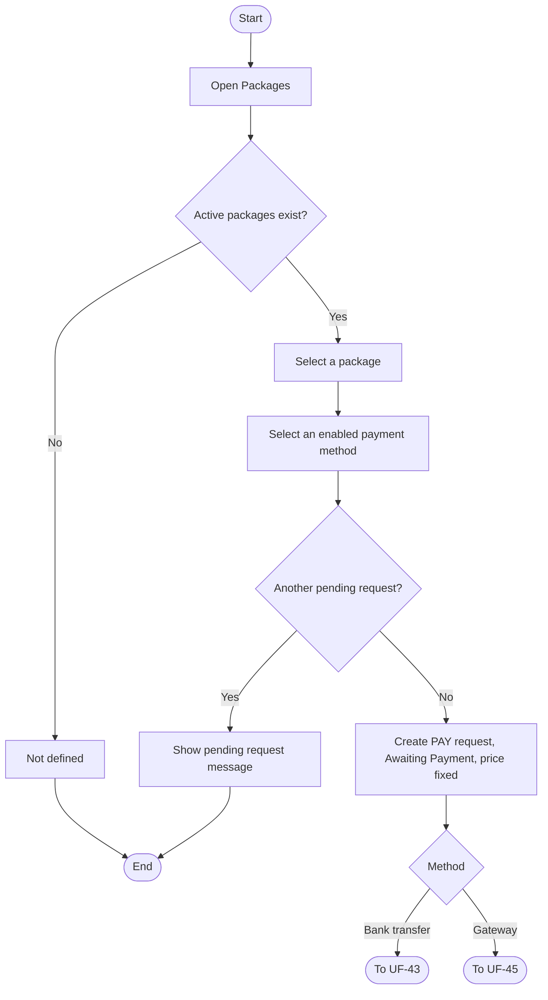
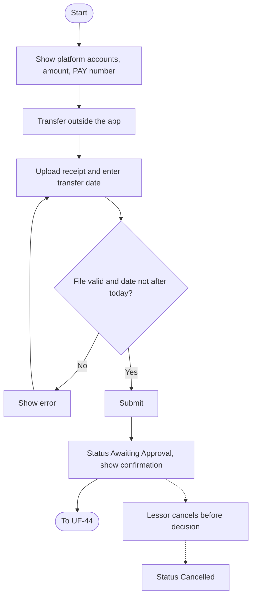
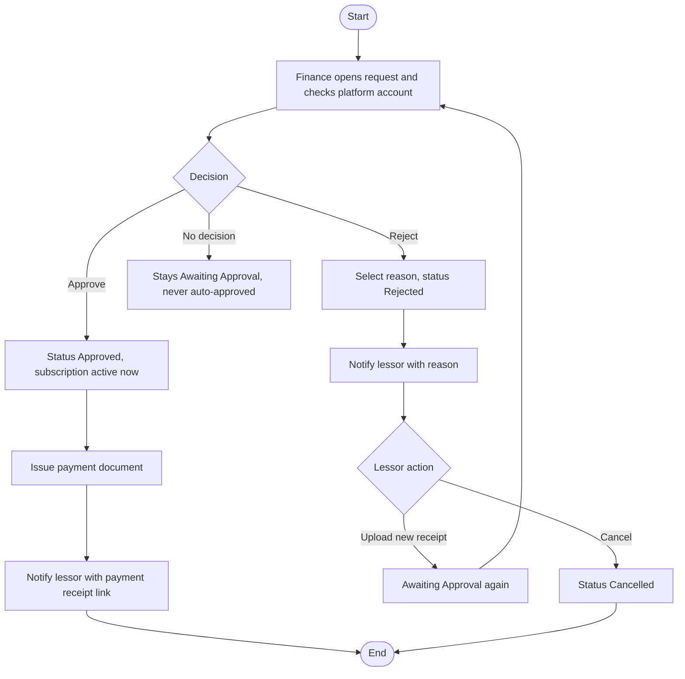
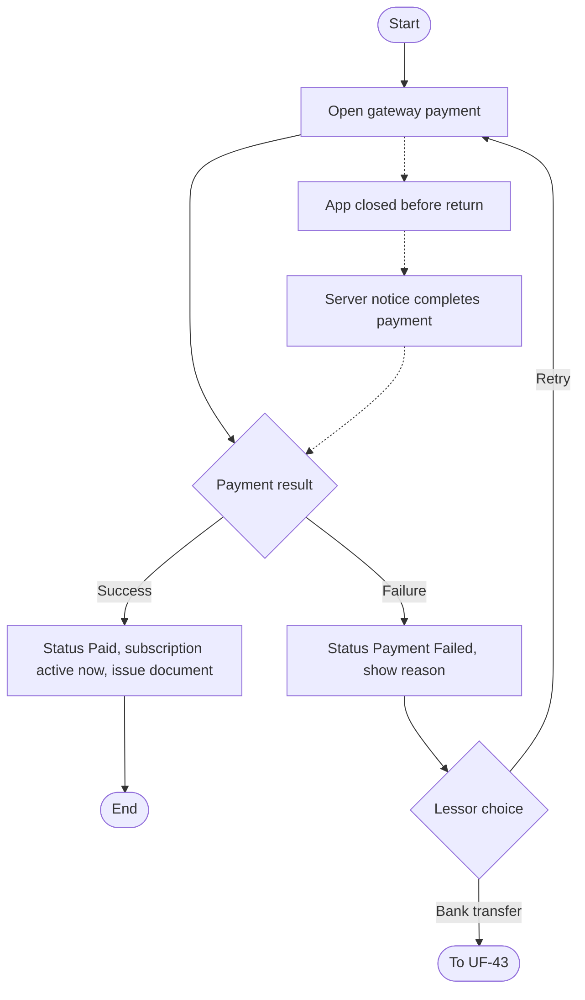
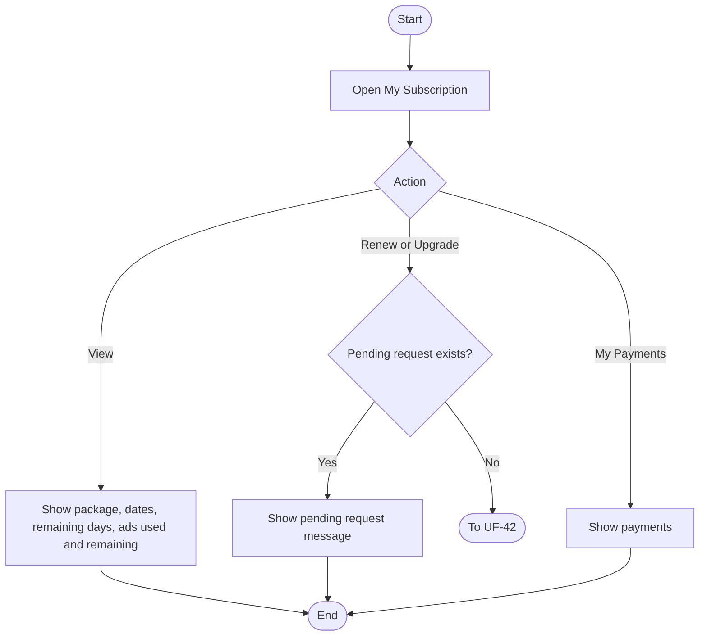
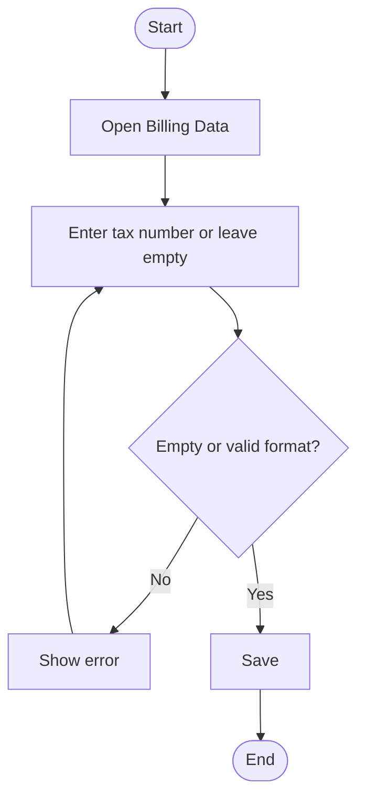
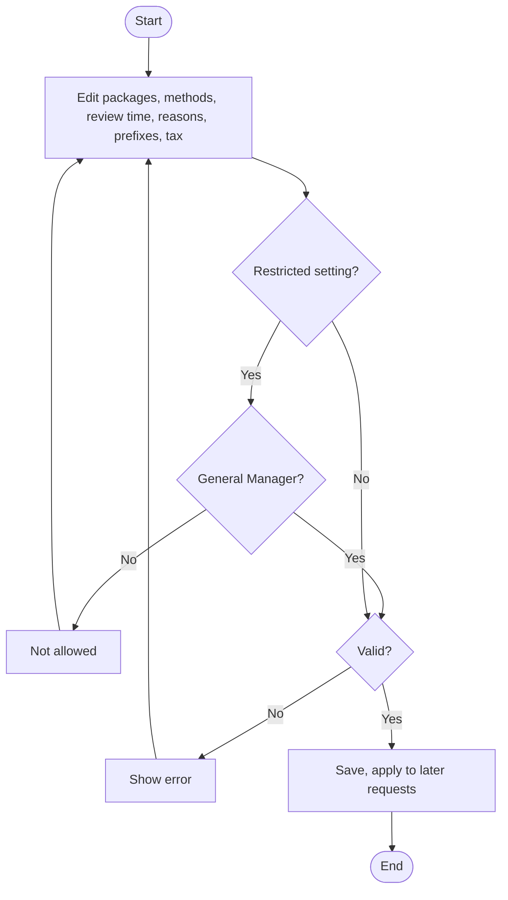

# UF-42: Choose a Package and Payment Method

**Actor:** Lessor (accepted)
**Goal:** Select a package and a payment method to start a subscription
**Entry Point:** First dashboard card «اختر باقة لنشر إعلاناتك» after acceptance (UF-33), or "Packages"
**Preconditions:** The lessor is accepted, at least one package is active, and no other payment request is pending
**Postconditions:** Payment request `PAY-YYYY-NNNNNN` exists with status **Awaiting Payment** and the price fixed at creation. The flow continues to UF-43 or UF-45

## Main Flow

| #   | User Action                            | System Response                                                                                                 |
| --- | -------------------------------------- | --------------------------------------------------------------------------------------------------------------- |
| 1   | Opens the dashboard card or "Packages" | Shows one card per active package:  - Price.  - Duration. - Number of ads. - Featured ads included. |
| 2   | Selects a package                      | Shows the payment methods enabled for the user's platform                                                       |
| 3   | Selects a payment method               | Creates the payment request with status **Awaiting Payment** and the package price fixed                        |
| 4   | n/a                                    | Bank transfer continues to UF-43. Gateway continues to UF-45                                                    |

## Alternative / Error Flows

| ID | At Step | Condition | Result |
|----|---------|-----------|--------|
| A1 | 3 | Admin changes the package price later | The existing request keeps its fixed amount. The new price applies to new requests only |
| A2 | 1 | A package is hidden or archived | It is not shown as an active package |
| E1 | 3 | The lessor already has a pending payment request | «لديك طلب دفع قيد المراجعة. ألغه أولًا أو انتظر القرار» |
| E2 | 1 | No active package exists | Not defined |

## Diagram

## Notes
- Related requirements: [[متطلبات مشروع تنفيذ#٢٢. الباقات والاشتراك والدفع]] policy (no free package, one pending request, price change applies to new requests only)
- ==Package data==: 
	- Price.
	- Duration 1 to 730 days.
	- Ads count 1 or more.
	- Featured ads 0 up to the ads count.
	- priority 1 to 100.
- Closed questions:
  - What does the lessor see when no package exists (the default until the manager creates one)? Always be at least one package.
  - If only one method is enabled on the platform, is the method choice skipped? YES

---

# UF-43: Pay by Bank Transfer and Upload Receipt

**Actor:** Lessor
**Goal:** Prove the transfer to the platform account so the subscription can be approved
**Entry Point:** Bank transfer selected in UF-42
**Preconditions:** Payment request is **Awaiting Payment**
**Postconditions:** Receipt is stored, status is **Awaiting Approval**, and the lessor is told the review time

## Main Flow

| # | User Action | System Response |
|---|-------------|-----------------|
| 1 | Opens the bank transfer step | Shows the enabled platform accounts (bank, beneficiary, IBAN with copy), the amount, and the `PAY-YYYY-NNNNNN` number to write in the transfer description |
| 2 | Transfers the amount from their bank app | n/a (outside the app) |
| 3 | Uploads the receipt (JPG, PNG, or PDF, up to 10 MB) | Validates the file |
| 4 | Enters the transfer date, and optionally the payer name (up to 80 characters) and a note (up to 500 characters) | Validates the date |
| 5 | Submits | Sets status **Awaiting Approval** and shows «استلمنا إيصالك PAY-… وسنراجعه خلال {المهلة}» |
| 6 | Follows the request in "Payment Request Status" | Shows the current status |

## Alternative / Error Flows

| ID  | At Step | Condition                                                                                                                          | Result                                                                                                                     |     |
| --- | ------- | ---------------------------------------------------------------------------------------------------------------------------------- | -------------------------------------------------------------------------------------------------------------------------- | --- |
| A1  | 1-6     | Lessor cancels before the decision: - Awaiting Payment . بانتظار الد - Awaiting Approval . بانتظار الاعت - Rejected مرفوض | Status becomes **Cancelled** (final).  If a receipt was uploaded, it stays for Finance with the tag «يحتاج معالجة مبلغ» |     |
| A2  | 6       | Receipt was rejected (UF-44)                                                                                                       | Lessor taps «رفع إيصال جديد» on the same request.  Status returns to Awaiting Approval                                  |     |
| E1  | 3       | No receipt attached                                                                                                                | «ارفع إيصال التحويل»                                                                                                       |     |
| E2  | 4       | Transfer date is after today                                                                                                       | «تاريخ التحويل لا يمكن أن يكون بعد اليوم»                                                                                  |     |
| E3  | 3       | File type or size is not allowed                                                                                                   | Not defined                                                                                                                |     |
| E4  | 4       | Payer name or note exceeds its limit                                                                                               | Not defined                                                                                                                |     |

## Diagram

## Notes
- Related requirements: [[متطلبات مشروع تنفيذ#٢٢. الباقات والاشتراك والدفع]] policy (bank transfer at launch, platform accounts for packages only)
- The only bank account the lessor sees in this path is the platform account.
- Closed questions:
  - Allowed behavior when the transfer amount differs from the request amount? (Finance rejects with «المبلغ غير مطابق», but the lessor-side step is Just Upload an approval as an evidence .)
  - Is the cancel button available while the status is Awaiting Payment, or only after the receipt is uploaded? (Item 6 says "before the decision" and after the receipt uploaded.) 

---

# UF-44: Finance Approves or Rejects a Payment Receipt

**Actor:** Finance (the lessor is notified)
**Goal:** Verify the transfer and decide on the payment request
**Entry Point:** Payment request with status **Awaiting Approval**
**Preconditions:** A receipt is uploaded and the request is not cancelled
**Postconditions:** 
- Approved: subscription is active and a payment document is issued. 
- Rejected: the lessor has the reason and may upload a new receipt or cancel.

## Main Flow

| #   | User Action                      | System Response                                                                                                                                               |
| --- | -------------------------------- | ------------------------------------------------------------------------------------------------------------------------------------------------------------- |
| 1   | Opens the request                | Shows the receipt, the fixed amount, the package, and the transfer date                                                                                       |
| 2   | Checks the platform bank account | n/a (outside the app)                                                                                                                                         |
| 3   | Approves                         | Sets status **Approved** and activates the subscription immediately.  It starts at approval and ends at 23:59:59 Riyadh time on day (start + duration − 1) |
| 4   | n/a                              | Issues the payment document (see Notes)                                                                                                                       |
| 5   | n/a                              | Notifies the lessor «تم تفعيل اشتراكك في {الباقة} حتى {التاريخ}» with a "Payment Receipt" link (PDF, share and download)                                      |

## Alternative / Error Flows

| ID  | At Step | Condition                                                                                                                     | Result                                                                                                      |
| --- | ------- | ----------------------------------------------------------------------------------------------------------------------------- | ----------------------------------------------------------------------------------------------------------- |
| A1  | 3       | Finance rejects and selects a reason: - Amount not received. - Amount does not match. - Receipt unclear. - Other. | Status **Rejected**. Lessor is notified «رُفض إيصالك: {السبب}» with «رفع إيصال جديد», or may cancel (UF-43) |
| A2  | 3       | Lessor uploads a new receipt after a rejection                                                                                | Status returns to Awaiting Approval, same request                                                           |
| A3  | 3       | The same lessor has 3 rejected receipts                                                                                       | A tag appears in the lessor's profile for Finance.  It is not a penalty                                  |
| A4  | 1       | Review time passes (default 24 hours) with no decision                                                                        | The request is **never** approved automatically. Further behavior is not defined                            |
| A5  | 1       | Admin changes the review time                                                                                                 | The new value is used                                                                                       |
| E1  | 3       | Rejection without a reason                                                                                                    | Not defined                                                                                                 |

## Diagram

## Notes
- Related requirements: [[متطلبات مشروع تنفيذ#٢٢. الباقات والاشتراك والدفع]] policy (approval time 24 hours, no auto-approval, subscription dates, document rules), penalties block (3 rejected receipts, no refund), §22 status table
- Payment document: **payment receipt** (`RCPT-YYYY-NNNNNN`, no tax) while the invoice key is off. After the key is on, a **simplified tax invoice** (`INV-YYYY-NNNNNN`) with a QR code. Price includes 15% tax: net = total ÷ 1.15 rounded to two halalas, tax = total − net. Numbers are sequential with no gaps per year, and an issued document is never deleted.
- Example: approved 2026-10-21 for 30 days ends 2026-11-19 23:59:59.
- A rejected receipt carries no penalty. A later penalty (UF-11) means no refund of any subscription amount.
- Closed questions:
  - What happens when the review time passes without a decision (reminder, escalation)? Nothing
  - Does "other" require written details, as in the booking rejection (UF-06)? Yes require written details
  - Which role is "Finance", and who can view the receipt? any authorized admin 

---

# UF-45: Pay by Payment Gateway

**Actor:** Lessor
**Goal:** Pay online and get the subscription activated at once
**Entry Point:** Gateway selected in UF-42
**Preconditions:** The gateway is enabled for the lessor's platform (default: off on iOS and Android), and the request is **Awaiting Payment**
**Postconditions:** Status is **Paid**, the subscription is active, and the payment document is issued

## Main Flow

| # | User Action | System Response |
|---|-------------|-----------------|
| 1 | Selects the gateway | Opens the electronic payment |
| 2 | Pays | The gateway processes the payment |
| 3 | n/a (payment succeeds) | Sets status **Paid** and activates the subscription immediately |
| 4 | n/a | Issues the payment document (as in UF-44) |

## Alternative / Error Flows

| ID | At Step | Condition | Result |
|----|---------|-----------|--------|
| A1 | 2 | Payment fails | Status **Payment Failed**. Shows the reason. Lessor retries (back to Awaiting Payment) or chooses bank transfer (UF-43) |
| A2 | 2 | App is closed before returning from the gateway | The system relies on the gateway's server notice |
| A3 | 3 | A duplicate success notice arrives | Processed once only |
| A4 | 1 | Gateway is disabled for the platform | Not offered. At least one payment method stays enabled per platform |

## Diagram

## Notes
- Related requirements: [[متطلبات مشروع تنفيذ#٢٢. الباقات والاشتراك والدفع]] policy (gateway built but off, enabled per platform, iOS stays off pending store policy review), settings table
- Closed questions:
  - When the lessor switches from the gateway to bank transfer, is it the same request or a new one? gateway will be on V2
  - Does a failed payment count as a pending request? NO 

---

# UF-46: View Subscription and Start Renewal or Upgrade

**Actor:** Lessor
**Goal:** See subscription and credit status, and renew or upgrade
**Entry Point:** "My Subscription"
**Preconditions:** The user is an accepted lessor
**Postconditions:** The lessor sees current data, or a new payment request starts (UF-42)

## Main Flow

| #   | User Action                   | System Response                                                                                                                    |
| --- | ----------------------------- | ---------------------------------------------------------------------------------------------------------------------------------- |
| 1   | Opens "My Subscription"       | Shows the package, start and end, remaining days, ads and featured ads used and remaining (for example «3 من 5 مستخدمة — متبقٍ 2») |
| 2   | Taps **Renew** or **Upgrade** | Starts a new payment request (UF-42)                                                                                               |
| 3   | Taps **"My Payments"**        | Shows the lessor's payments                                                                                                        |

## Alternative / Error Flows

| ID | At Step | Condition | Result |
|----|---------|-----------|--------|
| A1 | 2 | Another payment request is pending | «لديك طلب دفع قيد المراجعة. ألغه أولًا أو انتظر القرار» |
| A2 | Any | The subscription ends while an upgrade request is pending | The system cancels the request. If a receipt was uploaded, it stays for Finance with «يحتاج معالجة مبلغ» |
| A3 | Any | A penalty is applied to the lessor | No part of the subscription is refunded (UF-11) |

## Diagram

## Notes
- Related requirements: [[متطلبات مشروع تنفيذ#٢٢. الباقات والاشتراك والدفع]] policy (credit rule, subscription end, no refund after a penalty), penalties block, §22 status table
- Credit rule: one ad is consumed only at the **first publication**. Drafts, review, rejection, edit, disabling, and re-show do not consume. Disabling does not give the credit back. Publishing a new chalet consumes even if an earlier one was disabled. Featuring is immediate, needs no review, and uses no credit within the package's featured count.
- Expiry reminders (7, 3, and 1 day, and expiry) are in UF-26.
- Closed questions:
  - If the lessor renews while the subscription is active, does the new one start at approval or after the current end? No start directly
  - On upgrade, what happens to the remaining days and unused credits? Expired
  - What does "My Payments" show (requests, documents, statuses)? requests, documents and statuses
  - What happens to published ads when the subscription ends? No new Ads can published, Old Ads disabled.  

---

# UF-47: Add Billing Data (Tax Number)

**Actor:** Lessor (company)
**Goal:** Record the company's tax number for billing
**Entry Point:** "Billing Data"
**Preconditions:** The lessor is a company
**Postconditions:** The optional tax number is saved

## Main Flow

| #   | User Action                                               | System Response                       |
| --- | --------------------------------------------------------- | ------------------------------------- |
| 1   | Opens "Billing Data"                                      | Shows the tax number field (optional) |
| 2   | Enters the tax number (15 digits, starts and ends with 3) | Validates the format                  |
| 3   | Saves                                                     | Stores the number                     |

## Alternative / Error Flows

| ID | At Step | Condition | Result |
|----|---------|-----------|--------|
| A1 | 2 | Lessor leaves the field empty | Allowed, the field is optional |
| E1 | 2 | Number is not 15 digits or does not start and end with 3 | Not accepted (message not defined) |

## Diagram

## Notes
- Related requirements: [[متطلبات مشروع تنفيذ#٢٢. الباقات والاشتراك والدفع]]
- Closed questions:
  - Does the number appear on the payment document or invoice, and can it be edited after documents were issued? NO

---

# UF-48: Configure Packages and Payment Settings

**Actor:** Admin (the General Manager only for restricted settings)
**Goal:** Control packages, payment methods, review time, and document settings without a code change
**Entry Point:** Admin panel, packages and payment settings
**Preconditions:** The admin has permission. Restricted settings need the General Manager
**Postconditions:** New values apply to later requests. Existing requests keep their fixed amount

## Main Flow

| # | User Action | System Response |
|---|-------------|-----------------|
| 1 | Creates, orders, hides, or archives a package (price, duration, ads, featured ads, priority) | Validates and saves |
| 2 | Turns bank transfer on or off, and the gateway per platform (iOS, Android) | Saves |
| 3 | Sets the receipt review time (hours) and the rejection reasons (translated list) | Saves |
| 4 | Sets numbering prefixes, and whether prices include tax and the rate | Saves |
| 5 | General Manager only: platform bank accounts, gateway credentials and test mode, invoice key | Saves |

## Alternative / Error Flows

| ID | At Step | Condition | Result |
|----|---------|-----------|--------|
| A1 | 1 | Package has subscribers | It can be archived, but not deleted |
| A2 | 5 | Invoice key is turned on | Allowed only when the data and the gateway link are complete |
| E1 | 2 | The last enabled method on a platform is turned off | Not allowed, each platform needs at least one |
| E2 | 5 | A non-General-Manager edits a restricted setting | Not allowed |
| E3 | 1 | Duration outside 1 to 730, ads below 1, featured above ads, or priority outside 1 to 100 | Not accepted (message not defined) |

## Diagram

## Notes
- Related requirements: [[متطلبات مشروع تنفيذ#٢٢. الباقات والاشتراك والدفع]] settings table, policy (packages, platforms, document rules)
- Defaults: no packages, bank transfer on, gateway off on both platforms (test mode), review time 24 hours, tax included at 15%, invoice key off, no bank accounts. A platform bank account is required before launch.
- Closed questions:
  - What stops a launch with no package or no bank account? packages  always allowed and if there is no Bank account no customer can book this Ads
  - Is every settings change audit-logged? Yes