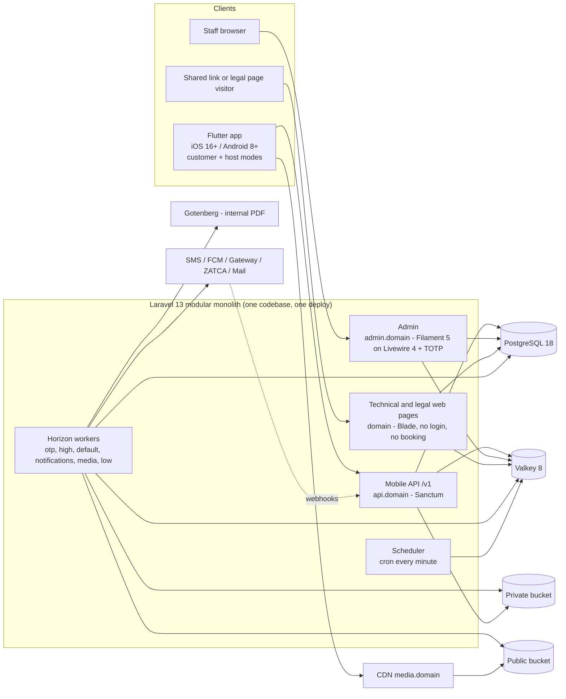

# «تنفيذ» — رحلة المشروع الكاملة

> ملف واحد للفريق كله: المصمم، مطوّرو الخادم واللوحة، مطوّر التطبيق، المختبِر، مدير المشروع.
> يمشي بالترتيب الذي يعيشه الناس: من فتح التطبيق، إلى رحلة العميل، ثم المؤجّر، ثم الإدارة، ثم صفحات الويب، ثم المرحلة الثانية، ثم طريق البناء حتى الإطلاق.
> في كل قسم تجد السياسة المعتمدة كاملة والعقوبات كاملة في مكانها، ولو تكررت. نفّذ من القسم الذي أمامك دون الرجوع لغيره.
> لا يضيف هذا الملف متطلبًا ولا يغيّر متطلبًا. كل رقم ورسالة منقولان من الوثائق المعتمدة (PRD v1.13 بقرارات المالك D1–D49، وطلبات التغيير CR-001 … CR-012، وSRS وPAGES وUX-LOGIC وDASHBOARD v2.8، وSYSTEM-DESIGN v2.4، وBACKLOG v2.3). وحيث اختلفت الوثائق أُخذ آخر قرار للمالك.
> «إعداد» = قيمة تغيّرها الإدارة من اللوحة دون تطوير، وتسري خلال 5 دقائق، ويُسجل تغييرها في سجل التدقيق.
> «أيام العمل» في كل هذا الملف = الأحد إلى الخميس، بلا الجمعة والسبت، وبلا العطل الرسمية التي تضيفها الإدارة في قائمة العطل.

---

# الفهرس

**٠.** المشروع في صفحة

**رحلة العميل**
- ١. فتح التطبيق
- ٢. التصفح كزائر
- ٣. الرئيسية والبحث والفلاتر
- ٤. صفحة الشاليه
- ٥. تسجيل الدخول بالرمز
- ٦. إظهار التواصل وطلب المعاينة
- ٧. الحجز المؤقت
- ٨. التحويل ورفع الإيصال
- ٩. تأكيد المؤجّر أو رفضه
- ١٠. حجوزاتي
- ١١. إلغاء العميل
- ١٢. إلغاء المؤجّر (طلب الإلغاء)
- ١٣. النزاعات
- ١٤. التقييم بعد الإقامة
- ١٥. البلاغات
- ١٦. المفضلة والمشاركة
- ١٧. الحساب والمساعدة وحقوق البيانات وحذف الحساب
- ١٨. الإشعارات

**رحلة المؤجّر**
- ١٩. الانضمام كمؤجّر
- ٢٠. المستندات
- ٢١. المعاينة وإعادة المعاينة
- ٢٢. الباقات والاشتراك والدفع
- ٢٣. التجديد والترقية والانتهاء
- ٢٤. إضافة الشاليه والإعلان والمراجعة
- ٢٥. التقويم والأسعار والأوقات
- ٢٦. الحسابات البنكية
- ٢٧. استقبال الحجوزات
- ٢٨. المهتمون والإقامات الخارجية
- ٢٩. المشاركة والتعطيل وإعادة الإظهار والتمييز
- ٣٠. التقييمات والرد عليها
- ٣١. العقوبات على المؤجّر

**الإدارة**
- ٣٢. دخول الموظفين والرئيسية وقواعد القرار
- ٣٣. طلبات الانضمام والمعاينات
- ٣٤. مراجعة الإعلانات والإيقاف الإداري
- ٣٥. إيصالات الباقات والاشتراكات والباقات وحسابات المنصة
- ٣٦. متابعة الحجوزات
- ٣٧. النزاعات: القرار والاستئناف
- ٣٨. سجل العقوبات وتطبيقها
- ٣٩. البلاغات والتقييمات والإقامات والمستخدمون
- ٤٠. الموظفون والأدوار وسجل التدقيق وسجل الاطلاع
- ٤١. الإعدادات
- ٤٢. العطل الرسمية وأيام العمل
- ٤٣. الحجز القانوني وطلبات الجهات الرسمية
- ٤٤. التقارير والتصدير
- ٤٥. المحتوى والبنرات والأسئلة الشائعة وقوالب الإشعارات
- ٤٦. النظام والنسخ الاحتياطي وسلة المحذوفات

**الويب والمستقبل والتنفيذ**
- ٤٧. الصفحات التقنية والقانونية على الويب
- ٤٨. المرحلة الثانية باختصار
- ٤٩. من Figma إلى الإطلاق

---

# ٠. المشروع في صفحة

## الفكرة
1. «تنفيذ» سوق سعودي لتأجير **الشاليهات** باليوم أو بالفترة.
2. **نطاق الإطلاق الشاليهات فقط.** نوع واحد مفعّل «شاليه»؛ العميل لا يرى شرائح الأنواع في الرئيسية ولا فلتر النوع في البحث ما دام نوع واحد مفعّلًا؛ الإدارة لا تستطيع تعطيل آخر نوع مفعّل؛ وحقل «النوع» في نماذج المؤجّر يُضبط تلقائيًا على «شاليه» ويُخفى. تظهر هذه كلها آليًا فقط إن فعّلت الإدارة نوعًا ثانيًا.
3. ما يميزها: كل شاليه منشور عاينته المنصة بنفسها، وكل مؤجّر هوية موثّقة.
4. العميل يرى السعر المحسوب لتواريخه، والتوافر في تقويم يحدّثه المؤجّر، ثم يتواصل مع المؤجّر أو يحجز من داخل التطبيق.

## المستخدمون
5. **الزائر:** بلا دخول؛ يتصفح الرئيسية والبحث وصفحة الشاليه والتقويم والتقييمات وصفحات المحتوى.
6. **العميل:** سجّل برقم جواله؛ يُظهر التواصل، ويطلب معاينة، ويحجز، ويحفظ في المفضلة، ويقيّم، ويبلّغ، ويفتح نزاعًا.
7. **المؤجّر الفرد:** عميل سعودي قُبل بالهوية الوطنية.
8. **المؤجّر الشركة:** المسؤول أو المفوّض عن شركة بسجل تجاري؛ الطريق الوحيد لغير السعودي. لا حسابات فرعية لموظفي الشركة.
9. **فريق الإدارة:** موظف المراجعة، المعاين، موظف المالية، موظف الدعم والبلاغات، مسؤول المحتوى والتسويق، مدير النظام، والمدير العام (حساب المالك المحمي).
10. **النظام:** مهام مجدولة تنهي المهل، وترسل التذكيرات، وتحرر الحجوزات المؤقتة، وتنفذ الحذف بعد المهل.

## المرحلتان
11. **المرحلة الأولى (الإطلاق):** تصفح، وإظهار تواصل أو طلب معاينة، وحجز داخل التطبيق بالتحويل المباشر لحساب المؤجّر، وباقات للمؤجرين، ونزاعات وعقوبات، وتقييمات وبلاغات.
12. **المرحلة الثانية:** الحجز و الدفع للمنصة عبر البوابة، والعمولة، وكشف المستحقات وتحويلات المؤجرين، وخريطة نتائج البحث، والمحادثة اختياريًا (القسم ٤٨). لا يبدأ تطويرها قبل حسم أسئلتها.

## كيف تربح المنصة
13. في المرحلة الأولى دخلها الوحيد **اشتراكات الباقات** التي يدفعها المؤجّر.
14. لا عمولة ولا رسوم على العميل، ولا يدفع العميل للمنصة شيئًا.
15. مبلغ الحجز يذهب مباشرة من العميل إلى حساب المؤجّر خارج المنصة؛ المنصة ليست طرفًا في الدفع ولا العربون ولا التأمين ولا الإلغاء ولا الاسترداد.
16. لكنها **وسيط يطبق قواعده**: تستقبل النزاع، وتصدر قرارًا مسببًا، وتعاقب من لا يلتزم، دون أن تحرك أي مبلغ. «وسيط لا ضامن».

## المنصات عند الإطلاق
17. ==🟢**تطبيق جوال واحد** على iOS وAndroid للعميل والمؤجّر معًا؛ بعد قبول المستخدم مؤجّرًا يظهر مبدّل «وضع العميل / وضع المؤجّر».==
18. ==🟢شريط وضع العميل: الرئيسية، البحث، المفضلة، الإشعارات، حسابي.== 
	- ==🟢شريط وضع المؤجّر: لوحتي، أماكني، التقويم، المهتمون، حسابي.==
19. **لوحة إدارة على الويب** للموظفين فقط، بحسابات منفصلة عن حسابات التطبيق.
20. ==🟢**لا موقع ويب للعملاء ولا بوابة ويب للمؤجّر**؛ كلاهما ___تطوير إضافي___ مستقبلي بطلب تغيير جديد. كل ما كان المؤجّر يفعله في البوابة يفعله من وضع المؤجّر في التطبيق.==
21. ==🟢على الويب فقط **صفحات تقنية و قانونية** يخدمها الخادم نفسه، بلا دخول ولا حجز، ونصوصها وبياناتها من لوحة الإدارة: الشروط، الخصوصية، سياسة النزاعات، طلب حذف الحساب، صفحة الدعم (جوال وواتساب وبريد الدعم، بلا نموذج)، صفحة المشاركة، وصفحات الخطأ والصيانة (القسم ٤٧).==

## اللغة و المنطقة
22. ==🟢العربية وحدها مفعّلة عند الإطلاق، و المنصة متعددة اللغات من أول جدول؛ إضافة لغة لا تحتاج تغيير الكود.==
23. ==🟢التقويم **ميلادي فقط** في كل الواجهات والمستندات، ولا عرض للهجري.==
24. ==🟢الأرقام تُعرض لاتينية افتراضيًا، والإدخال يقبل العربية واللاتينية.==
25. ==🟢كل الأوقات بتوقيت الرياض، والعملة الريال فقط، والأسعار تُكتب «1,250 ر.س».==
26. ==🟢أرقام الجوال ‎+966 فقط افتراضيًا، والإدارة تفعّل دولًا أخرى.==
27. ==🟢**القصيم أولًا:** المدن مُعدّة عند الإطلاق بمحافظات القصيم، والإدارة تضيف المدن والأحياء دون تطوير.==

---

# رحلة العميل

# ١. فتح التطبيق

## ماذا يحدث

1. يفتح التطبيق فتظهر شاشة التشغيل بالشعار فقط (2 ثانية كحد أقصى): تجلب الإعدادات، وتستعيد الجلسة، وتفحص الإصدار والصيانة.
2. لا شرائح تعريف ولا اختيار لغة عند أول تشغيل.
3. إن فشل جلب الإعدادات وعنده نسخة مخزنة يكمل بها؛ بلا نسخة وبلا اتصال: «تعذر الاتصال» + «إعادة المحاولة».
4. إصداره أقل من المدعوم: شاشة تحديث إجباري بلا رجوع ولا إغلاق: «يلزم تحديث التطبيق للمتابعة. الإصدار الجديد يحمل تحسينات مهمة» + «تحديث التطبيق».
5. يوجد إصدار أحدث موصى به: ورقة «تحديث الآن» / «لاحقًا» مرة كل 3 أيام.
6. الصيانة مفعّلة: رسالة الإدارة ووقت العودة المتوقع + «إعادة المحاولة»؛ إن بقيت الصيانة: توست «ما زلنا نعمل على التحسينات».
7. انقطاع الشبكة: شريط «لا يوجد اتصال» أعلى أي شاشة، ويبقى آخر محتوى محمّل للقراءة؛ عند العودة يتحول أخضر «عاد الاتصال» لثانيتين وتتحدث الشاشة.
8. خطأ خادم: «حدث خطأ غير متوقع. رقم المرجع: {id}» + «إعادة المحاولة»؛ رابط لمحتوى غير موجود: «لم نجد هذه الصفحة» + «تصفح الأماكن».
9. رابط عميق (مثل رابط مشاركة) يفتح هدفه مباشرة؛ إن كان يتطلب دخولًا تظهر ورقة الدخول ثم الهدف.
10. إن نشرت الإدارة نسخة جديدة من الشروط أو الخصوصية «تتطلب موافقة» تظهر شاشة الموافقة عند هذا الفتح (القسم ١٧).

## السياسة المعتمدة

- التحديث الإجباري يمنع أي استخدام حتى التحديث؛ الاختياري لا يُعرض أكثر من مرة كل 3 أيام.
- أي إعداد تغيّره الإدارة يصل التطبيق خلال 5 دقائق دون تحديث التطبيق.
- اللغة لا تظهر في الإعدادات ما دامت لغة واحدة مفعّلة.

## الإعدادات التي تغيّرها الإدارة

| الإعداد | الافتراضي | المدى |
|---|---|---|
| أقل إصدار مدعوم لكل منصة | 1.0.0 | رقم إصدار لكل من iOS وAndroid |
| الإصدار الموصى به وتكرار عرضه | 1.0.0؛ كل 3 أيام | رقم إصدار؛ أيام |
| وضع الصيانة ورسالته ووقت العودة | متوقف | تشغيل/إيقاف؛ رسالة مترجمة |
| روابط المتاجر | تُضبط قبل الإطلاق | رابط App Store ورابط Google Play |

(المرجع: APP-01 … APP-06، FR-141، D-112 … D-115)

---

# ٢. التصفح كزائر

## ماذا يحدث
1. يصل مباشرة إلى الرئيسية كزائر، دون دخول.
2. يتصفح الرئيسية والبحث وصفحة الشاليه ومعرض الصور والتقويم والتقييمات وصفحات المحتوى.
3. الدخول يُطلب فقط عند إجراء يحتاج هوية: إظهار التواصل، طلب معاينة، المفضلة، الحجز، التقييم، البلاغ، فتح نزاع.
4. عند هذا الإجراء تفتح شاشة رقم الجوال، وبعد الدخول **يعود لنفس الشاشة ويكتمل الإجراء الذي بدأه** دون أن يعيده (مثلًا يُحفظ الشاليه في المفضلة).

## السياسة المعتمدة
- لا تُطلب هوية لأي قراءة.
- ==🔴بيانات تواصل المؤجّر والموقع الدقيق وبيانات الحساب البنكي **لا تظهر للزائر في أي شاشة أو طلب**.==
- شرح إذن الإشعارات لا يظهر للزائر ولا عند أول تشغيل.

---

# ٣. الرئيسية و البحث و الفلاتر

## ماذا يحدث

1. ==🟢الرئيسية: شريط بحث (المدينة، التواريخ، الضيوف)، والبنرات الموجهة لجمهوره داخل نافذتها الزمنية، وقسم «المميزة» حتى 10 إعلانات مع «عرض الكل»، وسحب للتحديث.==
2. ==🟢**قسم أنواع الأماكن لا يظهر** ما دام نوع واحد «شاليه» مفعّلًا.==
3. ==🟢لا بنرات أو لا مميزة: يختفي القسم كاملًا. لا إعلانات منشورة بعد: «نجهز لك أماكن مميزة قريبًا» + «تواصل معنا إن كنت مؤجّرًا».==
4. ==🟢يضغط شريط البحث: يختار المدينة والحي، ثم التواريخ من المنتقي الميلادي، ثم عدد الضيوف.==
5. ==🔴التواريخ نوعان: **يوم كامل** بتاريخ دخول وتاريخ خروج، أو **تاريخ واحد مع فترة** (صباحية أو مسائية مثلًا).==
6. ==🟢النتائج بطاقات؛ كل بطاقة: الصورة الرئيسية، الاسم، المدينة والحي، السعة، متوسط التقييم وعدده أو «جديد»، شارة «معاين»، شارة «مميز» إن وُجدت، زر المفضلة، والسعر:==
   - ==🟢مع تواريخ: المجموع المحسوب لها، مثل «1,900 ر.س لليلتين».==
   - ==🟢بلا تواريخ: «من {أقل سعر} ر.س».==
1. ==🟢الفلاتر: المدينة، الحي==، ==🔴التواريخ==، ==🟢الضيوف، السعر من/إلى، الغرف (≥)، المرافق (كل المختارة)، التقييم (≥)؛ مع عداد للفلاتر المفعّلة و«مسح الكل». **فلتر النوع لا يظهر** ما دام نوع واحد مفعّلًا.==
2. ==🟢الترتيب: الأحدث (افتراضي)، السعر من الأقل، السعر من الأعلى، التقييم==.
3. ==🟢20 نتيجة للصفحة، والمزيد يُحمّل بالتمرير؛ فشل تحميل المزيد: «تعذر تحميل المزيد» مع إعادة المحاولة دون فقد ما ظهر.==
4. ==🟢لا نتائج: «لا توجد أماكن مطابقة. جرّب تغيير التواريخ أو إزالة بعض الفلاتر» + [مسح الفلاتر] [تغيير التواريخ].==
5. ==🟢المنتقي يمنع: الخروج قبل الدخول، والتاريخ الماضي، و أكثر من 30 ليلة: «أقصى مدة للبحث 30 ليلة».==

## السياسة المعتمدة

- **مع التواريخ لا يظهر إلا الشاليه المتاح طوال المدة كلها** حسب تقويمه (كل الوحدات متاحة).
- الوحدة متاحة إذا: حالتها «متاح»، وليست محجوزة مؤقتًا أو بانتظار التأكيد أو محجوزة عبر التطبيق ولا تتداخل زمنيًا مع أي منها، ويومها يوم عمل للشاليه، وتاريخها اليوم أو بعده وضمن المدى؛ وإذا مضى وقت دخول اليوم الحالي تصبح وحدة اليوم غير متاحة.
- ==🟢الفترات تُبحث لتاريخ واحد.==
- **المميزة أولًا داخل النتائج المطابقة فقط**، مرتبة برقم أولوية باقة مؤجّرها تصاعديًا (1 هو الأعلى)، ثم بالترتيب المختار، والتعادل يُكسر بالأحدث نشرًا؛ وقسم المميزة في الرئيسية بنفس القاعدة.
- ترتيب «التقييم» بالمتوسط ثم العدد، والأماكن بلا تقييم في آخره.
- السعر من/إلى يُحسب على التواريخ إن اختيرت، وإلا على أقل سعر.
- ==🟢الإعلان يظهر للعامة فقط وهو «منشور» مع حساب مؤجّر نشط واشتراك ساري؛ التحديث يظهر للعامة خلال 5 دقائق.==
- ==🟢البنر يظهر فقط داخل نافذته ولجمهوره (الكل، الزوار، العملاء، المؤجرون)، والمرتبط بشاليه أصبح غير متاح يختفي آليًا.==
- ==🟢المدن والأحياء والمرافق المعطّلة لا تظهر في الفلاتر.==

## ==🟢الإعدادات التي تغيّرها الإدارة==

| الإعداد                 | الافتراضي          | المدى                                                         |
| ----------------------- | ------------------ | ------------------------------------------------------------- |
| أقصى مدة بحث            | 30 ليلة            | عدد ليالٍ                                                     |
| نتائج لكل صفحة          | 20                 | عدد                                                           |
| الترتيب الافتراضي       | الأحدث             | الأحدث، السعر، التقييم                                        |
| عدد المميزة في الرئيسية | 10                 | عدد                                                           |
| أنواع الأماكن           | «شاليه» وحده مفعّل | تفعيل نوع ثانٍ يُظهر القسم والفلتر آليًا؛ تعطيل آخر نوع ممنوع |
| البنرات                 | لا بنرات           | الصورة لكل لغة، الهدف، الجمهور، البداية والنهاية              |

---

# ٤. صفحة الشاليه

## ماذا يحدث
1. ==🟢تعرض: الصور (معرض بملء الشاشة وتكبير)، الاسم، المواصفات، المرافق، نظام الإيجار وأوقات الدخول والخروج، الشروط، التأمين، سياسة الإلغاء المختارة، التقويم بالأسعار، أول 3 تقييمات مع ردود المؤجّر و«عرض كل التقييمات»، شارة «معاين» وتاريخ آخر معاينة معتمدة، و«آخر تحديث للتقويم: منذ {مدة}».==
2. ==🟢التأمين: «التأمين: 500 ر.س — يُدفع ويُرد في المكان» مع النص الثابت «يُدفع التأمين ويُرد في المكان بين العميل والمؤجّر، ولا يُدفع عبر المنصة»؛ أو «لا يوجد تأمين».==
3. ==🟢بلا تقييمات: «جديد — لا تقييمات بعد». رقم التصريح السياحي يظهر فقط إن فعّلته الإدارة للعامة.==
4. ==🟢يغيّر التواريخ فيُحسب المجموع، مثل: «ليلتان: الخميس 900، الجمعة 1000 — المجموع 1,900 ر.س».==
5. ==🔴أي يوم غير متاح: «غير متاح: {التواريخ}» بدل المجموع، مع «اقترح تواريخ أخرى» يفتح التقويم.==
6. ==🟢الموقع: دائرة تقريبية فقط للعامة؛ الدبوس الدقيق و«افتح في الخرائط» بعد إظهار التواصل فقط.==
7. ==🟢من الصفحة: «حجز»، «إظهار بيانات التواصل» (أساسي)، «طلب معاينة» (ثانوي)، القلب للمفضلة، «مشاركة»، و«إبلاغ» من قائمة ⋮.==
8. حالات الصفحة:
   - ==🟢مسجّل لم يُظهر التواصل: أزرار التواصل تفتح الإفصاح.==
   - ==🔴أظهر سابقًا: «اتصال» و «واتساب» مباشرة، والخريطة دقيقة.==
   - ==🟢المؤجّر صاحب الإعلان: شريط «إدارة الإعلان» بدل أزرار العميل.==
   - ==🟢الإعلان معطّل أو موقوف أو انتهى اشتراك مؤجّره: «هذا المكان غير متاح حاليًا» بالصورة والاسم فقط و«تصفح أماكن مشابهة»، بلا أزرار تواصل.==
   - ==🟢غير موجود أو مسودة: «لم نجد هذه الصفحة» + «تصفح الأماكن».==
   - ==🟢أصبح غير متاح أثناء التصفح: يُعاد التحقق عند أي إجراء: «هذا المكان لم يعد متاحًا».==

## السياسة المعتمدة
- **الموقع التقريبي:** دائرة نصف قطرها 1 كم حول نقطة مزاحة عشوائيًا 200–800 م عن الموقع الدقيق، تُحسب مرة لكل إعلان وتُعاد فقط عند تغيير الموقع.
- **الموقع الدقيق** لمن أظهر التواصل لهذا الإعلان، وللمؤجّر، وللإدارة فقط.
- **زر «حجز» يظهر فقط إذا:** الإعلان منشور، واشتراك المؤجّر ساري، وللشاليه حساب بنكي معروض، والمستخدم ليس صاحب الإعلان.
- **سياسة الإلغاء المعروضة ملزمة للمؤجّر** بموجب شروطه رغم أن المال خارج المنصة. السياسات الثلاث المعتمدة:

| السياسة | المستحق للعميل عند إلغائه |
|---|---|
| مرنة | 100% حتى 24 ساعة قبل الدخول، ثم 0% |
| متوسطة | 100% حتى 3 أيام قبل الدخول، و50% من 3 أيام حتى 24 ساعة، و0% في آخر 24 ساعة |
| صارمة | 100% حتى 7 أيام قبل الدخول، و50% من 7 أيام حتى 48 ساعة، و0% في آخر 48 ساعة |

- ==🟢المتوسط حسابي للتقييمات الظاهرة فقط بخانة عشرية واحدة، مثل «4.3 (3 تقييمات)»، ويُعرض من تقييم واحد.==
- ==🟢التقييم يظهر باسم كاتبه الأول وحرف من اسم العائلة، مع وسم «من حجز عبر التطبيق» أو «من إقامة سجّلها المؤجّر».==
- ==🟢تُحتسب مشاهدة الصفحة مرة لكل جهاز لكل إعلان لكل يوم لقياس التحويل، ولا تُعرض للعامة.==
- ==🟢هوية المؤجّر لا تُعرض لأي مستخدم.==

## الإعدادات التي تغيّرها الإدارة

| الإعداد | الافتراضي | المدى |
|---|---|---|
| نصف قطر الموقع التقريبي | 1000 متر | بالمتر |
| إظهار «آخر تحديث للتقويم» | نعم | نعم/لا |
| أقل عدد تقييمات لعرض المتوسط | 1 | عدد |
| رقم التصريح السياحي: تفعيل، «يُعرض للعامة»، «شرط للنشر» | مبني ومعطّل حتى رأي المحامي | ثلاثة مفاتيح؛ أرقام 6–12 |
| نصوص سياسات الإلغاء ونسبها | الثلاث أعلاه | تعديلها يسري على الحجوزات الجديدة فقط |

---

# ٥. تسجيل الدخول بالرمز

## ماذا يحدث

1. ==🟢يضغط إجراءً يحتاج الدخول فتفتح شاشة رقم الجوال.==
2. ==🟢يختار الدولة من المفعّلة فقط (افتراضيًا ‎+966 وحدها)، ويكتب رقمه بأي صيغة: 05 أو 5 أو ‎+966 أو 00966، بأرقام عربية أو لاتينية وبمسافات.==
3. ==🟢«إرسال الرمز»: تصله رسالة «رمز الدخول إلى تنفيذ: {الرمز}. لا تشاركه مع أحد».==
4. ==🟢الرمز يُملأ تلقائيًا من الرسالة أو يُلصق، ويتحقق النظام فور اكتمال الخانات. «إعادة الإرسال» تظهر بعد 60 ثانية. زر «تحقق» معطّل حتى الرد، والطلب الثاني يُتجاهل.==
5. ==🟢رقم جديد: شاشة استكمال الحساب: الاسم (2–60 حرفًا) ومربع الموافقة على الشروط والخصوصية **غير محدد افتراضيًا**، ثم «إنشاء الحساب».==
6. **يعود لنفس الشاشة ويكتمل الإجراء الذي بدأه.**
7. رسائل الفشل:
   - ==🟢رقم سعودي خاطئ: «أدخل رقم جوال سعودي صحيح يبدأ بـ 5».==
   - ==🟢دولة غير مفعّلة: «التسجيل متاح حاليًا لأرقام: {الدول المفعّلة}».==
   - ==🟢قبل 60 ثانية: «يمكنك طلب رمز جديد بعد {ث} ثانية»؛ تجاوز الحد: «تجاوزت عدد المحاولات، حاول بعد {د} دقيقة».==
   - ==🟢فشل المزود: «تعذر إرسال الرمز الآن، حاول بعد قليل» (يُحاول عبر المزود الاحتياطي إن ضُبط، ولا تُحتسب من الحد)==.
   - ==🟢رمز خاطئ: «الرمز غير صحيح. متبقٍ {n} محاولات»؛ منتهٍ: «انتهت صلاحية الرمز، اطلب رمزًا جديدًا»؛ مقفل: «أوقفنا المحاولة 15 دقيقة لحماية حسابك».==
   - ==🟢الاسم: «الاسم بين 2 و60 حرفًا».==
   - ==🟢حساب موقوف: «حسابك موقوف: {السبب}» وزرا «اعتراض» و«تواصل معنا» فقط (قراري المالك D48 وD49) بلا جلسة.==
   - ==🟢حساب مجدول للحذف: «حسابك مجدول للحذف في {التاريخ}. هل تريد استعادته؟»== [استعادة الحساب] [إلغاء] قبل إنشاء الجلسة.
   - ==🟢انتهت الجلسة أثناء إجراء: «انتهت جلستك. سجّل الدخول للمتابعة — لن تفقد ما أدخلته».==

## السياسة المعتمدة

- **لا كلمة مرور ولا بريد للعملاء.**
- ==🟢الرمز 4 أرقام عشوائية، صالح 5 دقائق، إعادة الإرسال بعد 60 ثانية، حد **5 رسائل في الساعة و20 في اليوم** للرقم، و**5 محاولات خاطئة تقفل الرقم 15 دقيقة** وتُسجل حدثًا أمنيًا؛ الرمز الجديد يبطل السابق.==
- ==🟢حدود إضافية للجهاز والعنوان وسقف يومي عام، ولا إرسال لدولة غير مفعّلة. الحماية من البوتات لا تمنع البشر، ولا ألغاز إلزامية.==
- ==🟢الرقم يُخزن بصيغة ‎+9665XXXXXXXX؛ و‎+966 مفعّلة دائمًا ولا تُوقف، والحسابات القائمة من دولة أُوقفت تستمر في الدخول.==
- ==🟢الجلسة تبقى حتى الخروج أو 90 يومًا بلا استخدام.==
- ==🟢الموافقة على الشروط والخصوصية تُحفظ برقم النسخة ووقتها.==
- ==🟢حساب واحد بدورين: يبقى عميلًا ويستطيع التقدم ليصبح مؤجّرًا.==
- ==🔴رقم مراجعي المتاجر برمز ثابت متوقف افتراضيًا؛ تشغيله يُدخل الرقم بالرمز الثابت دون رسالة، وإيقافه يرفض الرمز الثابت.==

## العقوبات
- القفل 15 دقيقة بعد 5 محاولات خاطئة قيد أمني آلي، ليس من سلم العقوبات.
- الحساب الموقوف بعقوبة أو بقرار إداري (ومنه الإيقاف على بلاغ صحيح) لا يدخل؛ بعد التحقق بالرمز يرى شاشة «الحساب موقوف» بسبب الإيقاف وزرين فقط: «اعتراض» و«تواصل معنا»، ولا يصل لأي شاشة أخرى (قرار المالك D48، ووسّعه D49). «تواصل معنا» يعرض بيانات التواصل نفسها في صفحة الدعم (جوال الدعم وواتساب الدعم وبريد الدعم)، ويبقى ظاهرًا ولو انتهت مهلة الاعتراض.
- **إشعار الإيقاف (قرار المالك D49):** كل إيقاف إداري للحساب أو الإعلان، ومنه الإيقاف المباشر غير المرتبط بنزاع أو عقوبة، تصل صاحبه عنده رسالة نصية (مع إشعار فوري وداخلي): «أُوقف حسابك في تنفيذ: {السبب}. يمكنك الاعتراض حتى {التاريخ} بعد الدخول برمز التحقق».
- ==🔴**التظلم من الإيقاف (قرار المالك D47، ووسّعه D48 وD49):** أيًا كان سبب الإيقاف (عقوبة، أو بلاغ صحيح، أو قرار إداري مباشر)، يفتح زر «اعتراض» التظلم خلال 3 أيام عمل من إرسال إشعار الإيقاف (لا من أول دخول): تظلم واحد مع السبب؛ يفصل فيه مدير النظام أو المدير العام لا الموظف الذي فرض الإيقاف؛ يبقى الإيقاف ساريًا حتى القرار، ويُبلَّغ بالنتيجة قبولًا أو رفضًا.==

## الإعدادات التي تغيّرها الإدارة

| الإعداد | الافتراضي | المدى |
|---|---|---|
| الدول المسموحة لأرقام الجوال | ‎+966 فقط | قائمة دول + قاعدة الطول |
| طول الرمز وصلاحيته | 4 أرقام؛ 5 دقائق | 4–6 أرقام؛ 1–15 دقيقة |
| إعادة الإرسال؛ رسائل/ساعة؛ رسائل/يوم | 60 ثانية؛ 5؛ 20 | ثوانٍ؛ عدد؛ عدد |
| المحاولات الخاطئة؛ مدة القفل | 5؛ 15 دقيقة | عدد؛ دقائق |
| بقاء جلسة المستخدم بلا استخدام | 90 يومًا | أيام |
| مزود الرسائل واسم المرسل والاحتياطي | يُضبط قبل الإطلاق | — |
| رقم مراجعي المتاجر | متوقف | تشغيل/إيقاف |

## الحالات

| الحالة | معناها | تنتقل إلى | متى/بواسطة |
|---|---|---|---|
| نشط | يعمل؛ يبدأ بعد التحقق والاسم والموافقة | موقوف / مجدول للحذف | الإدارة بسبب / المستخدم دون موانع |
| موقوف | لا دخول؛ إعلاناته (إن كان مؤجّرًا) موقوفة | نشط | الإدارة بسبب |
| مجدول للحذف | 30 يومًا قابلة للاستعادة | نشط / محذوف | المستخدم بالدخول و«استعادة» / النظام بانتهاء المهلة |
| محذوف (مجهول الهوية) | نهائي؛ السجلات المالية تبقى | — | — |

---

# ٦. إظهار التواصل وطلب المعاينة

## ماذا يحدث

1. يضغط «إظهار بيانات التواصل» أو «طلب معاينة» (ليعاين الشاليه بنفسه مع المؤجّر). الزائر يُطلب منه الدخول ثم يعود.
2. ==🟢**أول مرة لهذا الإعلان** تظهر ورقة الإفصاح: «سيصل اسمك ورقم جوالك إلى المؤجّر ليتواصل معك»، ونصيحة الأمان: «عاين المكان بنفسك قبل أن تدفع أي مبلغ. الاتفاق والدفع بينك وبين المؤجّر خارج المنصة»، مع «موافق، أظهر البيانات» و «إلغاء».==
3. ==🔴بعد الموافقة: «اتصال»، «واتساب» برسالة جاهزة «السلام عليكم، أستفسر عن {اسم المكان} في تطبيق تنفيذ»، «نسخ الرقم» (توست «تم نسخ الرقم»)، «افتح في الخرائط» بالموقع الدقيق.==
4. ==🟢في المرات التالية: «اتصال» و«واتساب» مباشرة دون إفصاح، والخريطة دقيقة.==
5. ==🟢بعد «طلب معاينة»: توست «أبلغنا المؤجّر باهتمامك بالمعاينة».==
6. يصل المؤجّر فورًا: «{الاسم} ({الرقم}) {أظهر بيانات التواصل / يريد معاينة} {المكان}».
7. الفشل:
   - ==🟢تجاوز الحد اليومي: «وصلت للحد اليومي لإظهار بيانات التواصل. حاول غدًا» (يُمنع ويُسجل).==
   - ==🟢انقطاع الشبكة بعد الموافقة: إعادة آلية مرة، وإن فشلت: «تعذر إظهار البيانات. تحقق من الاتصال وأعد المحاولة»، ولا يُسجل مهتم ولا تُعرض البيانات.==
   - ==🟢المؤجّر على إعلانه برابط قديم: «هذا إعلانك» ولا يُسجل مهتم.==
   - ==🟢الإعلان صار غير متاح: «هذا المكان لم يعد متاحًا».==

## السياسة المعتمدة
- **كل ضغطة تُسجَّل للمؤجّر «عميلًا مهتمًا»** باسم العميل ورقمه ونوع الطلب (إظهار تواصل، طلب معاينة، وحجز عند الحجز المؤقت).
- ==🟢تكرار نفس العميل على نفس الإعلان بنفس النوع خلال 24 ساعة لا ينشئ سجلًا جديدًا== ==🔴ولا إشعارًا.==
- ==🟢لا يُسجل مهتم للمؤجّر على إعلانه، واسم العميل ورقمه يصلان للمؤجّر **بعد الإفصاح فقط**.==
- ==🟢**حد يومي للعميل: 30 إظهار تواصل أو طلب معاينة لإعلانات مختلفة** (حماية للأرقام من الجمع).==
- ==🟢لا تصدير ولا نسخ جماعي لأرقام المهتمين عند المؤجّر.==
- ==🟢التواصل **لا يُعد تأكيدًا للحجز**. واتساب رابط مباشر برسالة جاهزة، بلا ربط برمجي.==
- ==🟢التواصل في المرحلة الأولى اتصال وواتساب فقط؛ لا محادثة داخل التطبيق.==

## العقوبات
- ==🔴الحد اليومي قيد آلي ليس من سلم العقوبات؛ يرجع الحق في اليوم التالي.==

## الإعدادات التي تغيّرها الإدارة

| الإعداد | الافتراضي | المدى |
|---|---|---|
| نافذة تكرار المهتم | 24 ساعة | ساعات |
| حد الإظهار اليومي للعميل | 30 | عدد |

---

# ٧. الحجز المؤقت

## ماذا يحدث
1. ==🟢يضغط «حجز» (الزائر يدخل أولًا ثم يعود لشاشة الحجز).==
2. ==🟢يختار اليوم الكامل (دخول وخروج) أو التاريخ والفترة، وعدد الضيوف من 1 حتى سعة الشاليه: «الحد الأقصى لهذا المكان 20 ضيفًا» مثلًا.==
3. ==🟢يرى تفصيل سعر كل يوم والمجموع، وأوقات الدخول والخروج، وسياسة الإلغاء، والنص الثابت: «المنصة ليست طرفًا في المال. التحويل والاسترداد بينك وبين المؤجّر».==
4. ==🟢إن كان له حجز قائم على نفس الشاليه: «لديك حجز على هذا المكان» + [عرض الحجز].==
5. ==🟢يضغط «احجز مؤقتًا» فيظهر حوار: «حجز مؤقت لـ{المدة}؟ سيُحجز الموعد لك== ==🔴{ساعتين}== ==🟢لتحوّل المبلغ وترفع الإيصال».==
6. يُنشأ الحجز برقم **`BKG-YYYY-NNNNNN`**، وتُقفل الوحدات له خلال ثانيتين، ويثبت السعر ونص سياسة الإلغاء، ويُسجل ==مهتمًا بنوع «حجز»==، ويصله إشعار إنشاء الحجز المؤقت.
7. ==🟢الرسالة الظاهرة: «هذا الموعد محجوز لك حتى {الوقت}. حوّل المبلغ للمؤجّر وارفع الإيصال قبل انتهاء المهلة، وإلا يُحرر الموعد تلقائيًا» مع عداد تنازلي.==
8. الفشل:
   - ==🟢يوم غير متاح: «غير متاح: {التاريخ}» ولا يظهر «احجز مؤقتًا»؛ تعارض: «غير متاح: {التاريخ} — يتعارض مع حجز قائم».==
   - ==🟢عميلان في اللحظة نفسها: الأول يأخذه، والثاني: «هذا الموعد محجوز مؤقتًا لعميل آخر. جرّب لاحقًا أو اختر موعدًا آخر».==
   - ==🟢حجز ثالث وعنده حجزان نشطان: «لديك حجزان مؤقتان نشطان. أكمل أحدهما أو ألغه أولًا».==
   - ==🟢الحظر المؤقت: «أوقفنا الحجز المؤقت مؤقتًا حتى {الوقت} بعد انتهاء== ==🔴عدة حجوزات== ==🟢دون تحويل».==
   - انقطاع الشبكة بعد «احجز مؤقتًا»: «جارٍ التحقق من حجزك…»، وعند العودة يُعرض الحجز من الخادم بلا تكرار.
9. إن أغلق التطبيق أثناء المهلة يبقى الحجز ظاهرًا بعداده، ويصله تذكير قبل نهايتها بـ 15 دقيقة.
10. انتهت المهلة بلا إيصال: يُحرر الموعد **خلال دقيقة**، والحالة «منتهي المهلة»، ويصله «انتهت مهلة حجزك المؤقت وأُعيد الموعد للعرض» + «احجز مجددًا» إن بقي الموعد متاحًا.

## السياسة المعتمدة
- ==🟢مدة الحجز المؤقت== ==🔴ساعتان== ==🟢افتراضيًا، تبدأ لحظة «احجز مؤقتًا» بتوقيت الخادم، وتتوقف عند رفع الإيصال.==
- ==🟢**السعر ونص سياسة الإلغاء يثبتان على الحجز لحظة الحجز المؤقت**؛ تغيير المؤجّر للسعر أو السياسة بعدها يسري على الحجوزات الجديدة فقط.==
- الإنشاء عملية واحدة غير قابلة للتجزئة ==🔴تمنع حجزين لنفس الوحدة؛== والضامن قيد في قاعدة البيانات يرفض أي تداخل زمني (اختبار 50 حجزًا مؤقتًا متزامنًا: تنجح واحدة وترجع 49 بخطأ).
- **أي تداخل زمني بين فترة ويوم كامل يمنع حجزهما معًا** بأي نوع حجز من التطبيق (مؤقت، بانتظار، مؤكد).
- ==🟢**حدود الحماية:**== ==🔴حجزان== ==🟢مؤقتان نشطان كحد أقصى للعميل في الوقت نفسه؛ و3 حجوزات تنتهي مهلتها دون تحويل خلال يوم تقويمي تمنعه من إنشاء حجز مؤقت 24 ساعة من آخرها؛ والحجوزات التي يلغيها العميل بنفسه لا تُحسب منتهية.==
- ==🟢**بيانات الحساب البنكي للمؤجّر لا تظهر قبل الحجز المؤقت** في أي شاشة أو طلب.==
- ==🟢يُحفظ مع الحجز نسخة من بيانات الحساب وقت إنشائه، فتغيير المؤجّر لحسابه لاحقًا لا يغيّر هذا الحجز.==
- ==🟢انتهاء الاشتراك أو تعطيل الإعلان أو إيقافه يمنع الحجوزات المؤقتة الجديدة فقط.==
- الحجز خدمة مادية، فهو خارج قواعد الشراء داخل التطبيق في متجر Apple.

## العقوبات
- **قيد آلي، ليس من سلم العقوبات:** 3 حجوزات منتهية المهلة في يوم تمنع الحجز المؤقت 24 ساعة. لا يُسجل في سجل العقوبات.
- العبث المتكرر بالحجوزات لا يطلق سلم العقوبات بحد ذاته؛ سلم العميل يطلقه الإيصال المزور (من أول حالة مثبتة) أو النزاعات الكاذبة المتكررة (بلا عدد ثابت، بتقدير الإدارة وبسبب إلزامي — قرار المالك D47) فقط (القسم ٨).
- لكل عقوبة على العميل تظلم واحد من التطبيق خلال 3 أيام عمل من إبلاغه، والعقوبة سارية حتى القرار (القسم ٨)؛ والإبلاغ رسالة نصية مع إشعار فوري وداخلي بالسبب وحق التظلم، ومنها تبدأ المهلة (قرار المالك D49).

## الإعدادات التي تغيّرها الإدارة

| الإعداد                           | الافتراضي           | المدى                                          |
| --------------------------------- | ------------------- | ---------------------------------------------- |
| مدة الحجز المؤقت                  | 120 دقيقة           | 15–1440 دقيقة (الحجوزات القائمة تحتفظ بمهلتها) |
| تذكير العميل قبل نهاية المؤقت     | 15 دقيقة            | دقائق (0 = متوقف)                              |
| حد الحجوزات المؤقتة النشطة        | 2                   | 1–5                                            |
| الحظر بعد المنتهية                | 3 في اليوم؛ 24 ساعة | عدد؛ ساعات                                     |
| قاعدة تعارض الفترات واليوم الكامل | ثابتة               | لا تتغير                                       |

## الحالات

| الحالة | معناها | تنتقل إلى | متى/بواسطة |
|---|---|---|---|
| محجوز مؤقتًا | عداد؛ يرى الحساب ويرفع الإيصال | بانتظار تأكيد المؤجّر / منتهي المهلة / ملغى من العميل | العميل برفع الإيصال / النظام بانتهاء المهلة / العميل بالإلغاء |
| منتهي المهلة | نهائية؛ الموعد عاد متاحًا؛ لا نزاع عليه | — | — |

---

# ٨. التحويل و رفع الإيصال

## ماذا يحدث
1. **الآن فقط** تظهر بيانات الحساب البنكي للمؤجّر: اسم المستفيد، البنك، الآيبان مع زر نسخ (يُنسخ بلا مسافات: «تم نسخ الآيبان»)، والمبلغ، ورقم الحجز ليكتبه في وصف التحويل، والعداد.
2. تنبيه ثابت: «التحويل يتم مباشرة لحساب المؤجّر. المنصة ليست طرفًا في الدفع أو الاسترداد».
3. يحوّل المبلغ من تطبيق بنكه، خارج المنصة.
4. يرفع الإيصال (JPG أو PNG أو PDF حتى 10 ميجابايت) وتاريخ التحويل وملاحظة اختيارية، ثم «إرسال الإيصال» بحوار «يبقى الموعد محجوزًا لك حتى يرد».
5. تصبح الحالة **«بانتظار تأكيد المؤجّر»** و يختفي العداد، ويبقى الموعد غير متاح لغيره، ويصل المؤجّر خلال 60 ثانية: «{العميل} حجز {المكان} {التاريخ} ورفع إيصال {المبلغ}. تحقق من وصوله ثم أكّد».
6. الفشل:
   - وصل الإيصال بعد انتهاء المهلة: يُرفض: «انتهت مهلة الحجز المؤقت قبل وصول الإيصال. إن كان الموعد متاحًا يمكنك الحجز مجددًا».
   - فشل الرفع: «تعذر رفع الملف. تحقق من الاتصال وأعد المحاولة».
   - المؤجّر غيّر السعر أثناء المهلة: المبلغ يبقى المثبت.

## السياسة المعتمدة
- **المال لا يمر بالمنصة.** التحويل والاسترداد بين العميل والمؤجّر مباشرة.
- الحساب المعروض = حساب الشاليه إن حدده المؤجّر، وإلا حسابه الافتراضي.
- يُقبل الإيصال فقط إن وصل الخادم قبل نهاية المهلة.
- **خصوصية الإيصال:** يراه رافعه والمؤجّر فقط؛ الإدارة لا تراه إلا عند نزاع مفتوح على الحجز، وكل اطلاع مسجل؛ عند المؤجّر لا مشاركة ولا تنزيل خارجي.
- **حفظ الإيصال:** سنة بعد انتهاء الحجز أو إغلاق آخر نزاع عليه أيهما أبعد، ثم يُحذف آليًا؛ إلا إن وضع المدير العام «حجزًا قانونيًا» على النزاع.
- الصور تُعاد معالجتها وتُجرّد من بيانات الموقع؛ SVG ممنوع؛ ملف 0 بايت يُرفض؛ 30 رفعًا في الدقيقة للمستخدم.

## العقوبات
**سلم عقوبات العميل (كاملًا):**
1. **ما يطلقه:** إيصال مزور (يُعاقب عليه من أول حالة مثبتة)، أو نزاعات كاذبة متكررة (**بلا عدد ثابت**: لا يطلقها عدد آليًا، والعقوبة بتقدير الإدارة **وبسبب إلزامي** — قرار المالك D47).
2. **الخطوات بالترتيب:** تحذير ← إيقاف الحساب. لا حظر دائم للعميل.
3. **التحذير:** يُسجل في ملفه وفي سجل العقوبات، ويصله إشعار فوري وداخلي ورسالة نصية بالخطوة والسبب والمرجع؛ يسقط بعد 12 شهرًا بلا مخالفات فلا يُحتسب ويظهر «منقضٍ».
4. **إيقاف الحساب:** تصله رسالة نصية (مع إشعار فوري وداخلي) بالسبب وحق التظلم، ومنها تبدأ المهلة (قرار المالك D49)؛ وتنتهي جلساته ويُطرد من التطبيق، ولا يدخل: «حسابك موقوف: {السبب}» وزرا «اعتراض» و«تواصل معنا» فقط (قراري المالك D48 وD49).
5. **من يطبق:** الخطوة التالية تُقترح آليًا حسب سجله، ويطبقها موظف الدعم بسبب ومرجع؛ مثال معتمد: عميل عليه تحذير ثم ثبت عليه إيصال مزور جديد ← تُقترح «إيقاف الحساب» وتُطبق بسبب.
6. **الإيقافات تبقى محسوبة** ولا تسقط بالمدة.
7. **من يرفع:** الإدارة ترفع أي خطوة يدويًا بسبب؛ العقوبة لا تُحذف (مطبقة ← مرفوعة)، ويصله إشعار بالرفع.
8. **الاعتراض على قرار النزاع:** استئناف واحد خلال 3 أيام عمل من القرار، يفصل فيه مدير النظام أو المدير العام غير متخذ القرار الأول، وقراره نهائي.
9. **التظلم من العقوبة نفسها (قرار المالك D47):** لكل عقوبة تظلم واحد خلال 3 أيام عمل من إبلاغه بها، يقدمه من التطبيق مع السبب (من لوحة «تفاصيل العقوبة» عند فتح إشعارها، أو من شاشة «الحساب موقوف» إن كانت العقوبة إيقاف الحساب)؛ يفصل فيه مدير النظام أو المدير العام، ولا يفصل فيه الموظف الذي فرض العقوبة؛ **تبقى العقوبة سارية حتى قرار التظلم**؛ ويُبلَّغ بالنتيجة في الحالتين: قبول (تُرفع العقوبة) أو رفض (تبقى)، والقرار نهائي. تظلم ثانٍ: «استخدمت حقك في التظلم من هذه العقوبة»؛ بعد المهلة: «انتهت مهلة التظلم من هذه العقوبة». **والمسار نفسه لكل إيقاف إداري أيًا كان سببه (قرار المالك D48):** إيقاف الإعلان أو الحساب على بلاغ صحيح، أو بقرار إداري مباشر، له تظلم واحد بالقواعد ذاتها، يفصل فيه مدير النظام أو المدير العام لا الموظف الذي قرره، والإيقاف سارٍ حتى القرار. **وإشعار الإيقاف (قرار المالك D49):** كل إيقاف إداري، ومنه المباشر، تصل صاحبه عنده رسالة نصية (مع إشعار فوري وداخلي) بالسبب وحق التظلم، ومنها تبدأ مهلة الأيام الثلاثة لا من أول دخول.

## الإعدادات التي تغيّرها الإدارة

| الإعداد | الافتراضي | المدى |
|---|---|---|
| مدة حفظ الإيصالات وأدلة النزاع وكشوف الحساب | 12 شهرًا | أشهر بعد الإغلاق |
| انقضاء التحذير بلا مخالفات | 12 شهرًا | أشهر |
| نوع الإيصال وحجمه | JPG/PNG/PDF حتى 10 ميجابايت | ثابت |

## الحالات

| الحالة | معناها | تنتقل إلى | متى/بواسطة |
|---|---|---|---|
| محجوز مؤقتًا | العداد يعمل | بانتظار تأكيد المؤجّر | العميل برفع الإيصال قبل المهلة |
| بانتظار تأكيد المؤجّر | الإيصال مرفوع؛ الموعد غير متاح لغيره؛ **لا يتغير بمرور الوقت أبدًا** | محجوز / مرفوض / ملغى من العميل | المؤجّر يؤكد أو يرفض بسبب / العميل يلغي |

---

# ٩. تأكيد المؤجّر أو رفضه

## ماذا يحدث
1. المؤجّر يتحقق من وصول المبلغ لحسابه، ثم:
   - **يؤكد** بحوار «هل وصلك {المبلغ} ر.س في حسابك {آخر 4}؟ بعد التأكيد يُحجز الموعد للعميل»: الحالة «محجوز»، والتقويم «محجوز عبر التطبيق» فورًا، ويرى العميل «تم تأكيد حجزك».
   - أو **يرفض** بسبب إلزامي (المبلغ لم يصل، المبلغ ناقص، الإيصال غير واضح، أخرى + نص): يُحرر الموعد خلال دقيقة.
2. عند التأكيد يصل العميل إشعار فوري وداخلي **ورسالة نصية**: «تم تأكيد حجزك BKG-… في {المكان}» مع **الموقع الدقيق ورقم المؤجّر**.
3. قبل الدخول بـ 24 ساعة يصل الطرفين تذكير.
4. عند الرفض يصل العميل «رفض المؤجّر حجزك: {السبب}» + «الإبلاغ عن مشكلة»، ويستطيع فتح نزاع (القسم ١٣).
5. **تأخر المؤجّر:** عند نصف المهلة يصله «حجز بانتظار تأكيدك منذ {مدة}»؛ عند نهايتها يُنبَّه فريق الدعم (لوحة وبريد) ويظهر الحجز في «متأخرة التأكيد»؛ ويرى العميل «بانتظار تأكيد المؤجّر منذ {مدة}. يمكنك الإبلاغ عن مشكلة».
6. إن جاء وقت الدخول والحجز ما زال معلقًا يبقى معلقًا ويظهر للدعم بوسم «عاجل».
7. مثال معتمد: إيصال رُفع 10:00 ومهلة 24 ساعة ← تذكير للمؤجّر 22:00، وتنبيه للإدارة 10:00 اليوم التالي، والحجز ما زال «بانتظار تأكيد المؤجّر».

## السياسة المعتمدة
- **مهلة التأكيد 24 ساعة من رفع الإيصال**، تذكير عند 50% منها، وتنبيه للدعم عند 100%.
- **لا يُحرر الحجز المعلق آليًا أبدًا** لأن العميل قد يكون دفع.
- إن انتهى اشتراك المؤجّر والحجز بانتظار التأكيد يبقى قابلًا للتأكيد والرفض.
- **أثناء نزاع مفتوح** لا يؤكد المؤجّر ولا يرفض، وتتوقف مهلة التأكيد وتذكيراتها: «الحجز مجمّد حتى صدور قرار النزاع DSP-…».
- الموقع الدقيق ورقم المؤجّر يظهران للعميل **بعد التأكيد فقط**.

## العقوبات
- التأخر في التأكيد لا يطلق عقوبة آليًا؛ الدعم يتصل بالمؤجّر ويتابع، ويُعرض «عداد تأخر التأكيد» لكل مؤجّر في اللوحة.
- **رفض المؤجّر حجزًا والعميل يؤكد أنه حوّل:** يفتح العميل نزاعًا من الحالة (أ) (القسم ١٣)، وإن لم يرفع المؤجّر كشف الحساب خلال 48 ساعة فذلك قرينة لصالح العميل ويُقترح معه الخطوة التالية في سلم عقوبات المؤجّر: تحذير ← إيقاف الإعلان ← إيقاف الحساب ← حظر دائم (التفصيل الكامل في القسم ١٣ وفي القسم ٣١، وهو نفسه هنا: التحذير يسقط بعد 12 شهرًا بلا مخالفات، والإيقافات تبقى محسوبة، والحظر الدائم للمدير العام فقط، ولا استرداد للاشتراك).
- **التظلم من العقوبة (قرار المالك D47):** للمؤجّر تظلم واحد على كل عقوبة خلال 3 أيام عمل من إبلاغه بها، يقدمه من التطبيق مع السبب؛ يفصل فيه مدير النظام أو المدير العام لا الموظف الذي فرضها؛ تبقى العقوبة سارية حتى القرار، ويُبلَّغ بالنتيجة قبولًا (تُرفع) أو رفضًا (تبقى). والمسار نفسه لكل إيقاف إداري للإعلان أو الحساب أيًا كان سببه، ومنه الإيقاف على بلاغ صحيح (قرار المالك D48). وكل إيقاف إداري، ومنه المباشر غير المرتبط بنزاع أو عقوبة، تصل صاحبه رسالة نصية (مع إشعار فوري وداخلي) بالسبب وحق التظلم، ومنها تبدأ مهلة الأيام الثلاثة (قرار المالك D49).

## الإعدادات التي تغيّرها الإدارة

| الإعداد | الافتراضي | المدى |
|---|---|---|
| مهلة تأكيد المؤجّر | 24 ساعة | 1–72 ساعة |
| أسباب رفض الحجز | المبلغ لم يصل؛ المبلغ ناقص؛ الإيصال غير واضح؛ أخرى | قائمة مترجمة |
| تذكير قبل الدخول | 24 ساعة | ساعات |

## الحالات

| الحالة | معناها | تنتقل إلى | متى/بواسطة |
|---|---|---|---|
| بانتظار تأكيد المؤجّر | الإيصال مرفوع | محجوز / مرفوض / ملغى من العميل | المؤجّر / المؤجّر بسبب / العميل |
| محجوز | مؤكد؛ موقع دقيق ورقم المؤجّر | ملغى من العميل / ملغى بالاتفاق / ملغى إداريًا / منتهٍ | العميل ضمن المهلة / قبول العميل طلب المؤجّر / الدعم عند نزاع / النظام بعد وقت الخروج |
| مرفوض | نهائية؛ الموعد عاد متاحًا؛ يمكن فتح نزاع | — | — |

---

# ١٠. حجوزاتي

## ماذا يحدث
1. تبويبات: القادمة، بانتظار الإجراء، السابقة، الملغاة والمرفوضة ومنتهية المهلة.
2. لكل حجز بطاقة بالشاليه والتواريخ والحالة والمبلغ؛ الحجز المؤقت بعداده؛ المعلق «بانتظار تأكيد المؤجّر منذ {مدة}».
3. التفاصيل: كل حالة وتاريخها، والتفصيل المثبت، والسياسة المثبتة، والإيصال (للعميل الرافع)، ونسخة بيانات الحساب المحفوظة، وطلبات الإلغاء، ونص ثابت «الدفع والاسترداد بينك وبين المؤجّر مباشرة».
4. الموقع الدقيق ورقم المؤجّر وزرا «اتصال» و«واتساب» **بعد التأكيد فقط**.
5. الإجراءات حسب الحالة: رفع الإيصال، إلغاء الحجز، الرد على طلب إلغاء من المؤجّر، فتح نزاع، «قيّم إقامتك» بعد الخروج.
6. لكل تبويب حالة فارغة خاصة به.

## السياسة المعتمدة
- الحجز المؤكد يتحول «منتهٍ» بعد وقت الخروج للعرض و التقييم.
- الحجز المجمّد بنزاع لا تظهر عليه إجراءات تغيير الحالة.

---

# ١١. إلغاء العميل

## ماذا يحدث
**قبل التأكيد (محجوز مؤقتًا أو بانتظار تأكيد المؤجّر):**
1. «إلغاء الحجز» بحوار أحمر: «إلغاء الحجز؟ سيُحرر الموعد لغيرك. إن كنت حوّلت مبلغًا فاسترداده يتم مباشرة مع المؤجّر».
2. يُحرر الموعد خلال دقيقة، والحالة «ملغى من العميل»، ويصل المؤجّر «ألغى {العميل} حجزه في {المكان} {التاريخ}».
3. بعد إيصال مرفوع: «أُلغي الحجز. إن كنت حوّلت مبلغًا فاسترداده يتم مباشرة مع المؤجّر».

**بعد التأكيد (محجوز):**
4. زر «إلغاء الحجز» ظاهر حتى {الوقت} المسموح فقط.
5. حوار أحمر: «إلغاء الحجز الآن؟ يُلغى فورًا ويُحرر الموعد. حسب السياسة المعروضة يرد لك المؤجّر {المبلغ} ر.س خارج المنصة». السبب اختياري.
6. **يُلغى فورًا دون حاجة لموافقة المؤجّر**، ويُحرر الموعد خلال دقيقة، ويصل المؤجّر: «ألغى {العميل} الحجز BKG-… ويستحق {المبلغ} حسب سياستك».
7. يرى الطرفان المستحق للعلم، مثل: «حسب السياسة المعروضة يستحق العميل 500.00 ر.س يردها المؤجّر خارج المنصة».
8. بعد انقضاء المسموح: الزر يختفي، ويظهر «انتهت مهلة الإلغاء المسموحة لهذا الحجز»، والطلب المباشر يُرفض.
9. إن لم يرد المؤجّر المبلغ يفتح العميل نزاعًا من الحالة (ج) من تفاصيل الحجز الملغى.
10. حجز مجمّد بنزاع: «الحجز مجمّد حتى صدور قرار النزاع DSP-…».

## السياسة المعتمدة
- **المعلق** يلغيه العميل في أي وقت قبل التأكيد.
- **المؤكد** يلغيه العميل **فورًا** حتى 24 ساعة قبل وقت الدخول.
- **الحجز المنشأ قبل الدخول بأقل من 24 ساعة** له نافذة إلغاء ساعتان بعد إنشائه فقط، ثم لا إلغاء. مثال معتمد: دخول بعد 20 ساعة وحجز أُنشئ قبل 10 ساعات ← لا يظهر «إلغاء الحجز».
- **المؤجّر ملزم بالسياسة المثبتة على الحجز** بموجب شروطه رغم أن المال خارج المنصة.
- المنصة **تحسب للعلم** المستحق = نسبة السياسة × المبلغ المثبت، حسب الساعات من وقت الإلغاء حتى وقت الدخول المثبت، وتعرضه للطرفين، ولا تحرك أي مال.
- السياسات الثلاث المعتمدة:

| السياسة | المستحق للعميل |
|---|---|
| مرنة | 100% حتى 24 ساعة قبل الدخول، ثم 0% |
| متوسطة | 100% حتى 3 أيام، و50% من 3 أيام حتى 24 ساعة، و0% في آخر 24 ساعة |
| صارمة | 100% حتى 7 أيام، و50% من 7 أيام حتى 48 ساعة، و0% في آخر 48 ساعة |

- أمثلة معتمدة: حجز 1,000 بسياسة «متوسطة» أُلغي قبل الدخول بيومين ← يستحق 500.00 ر.س؛ دخول بعد 3 أيام وسياسة «متوسطة» ← «يستحق العميل 500.00 ر.س»؛ سياسة «مرنة» وإلغاء قبل الدخول بيومين ← المبلغ المثبت كاملًا.
- **لا إلغاء ولا طلب إلغاء أثناء نزاع مفتوح.**
- الحجوزات التي يلغيها العميل بنفسه لا تُحسب ضمن «المنتهية المهلة».
- طلب إلغاء مفتوح أو حجز قائم يمنعان حذف حسابه.

## العقوبات
- إلغاء العميل ضمن المسموح لا يترتب عليه أي عقوبة.
- **المؤجّر الذي لا يرد المستحق:** يفتح العميل نزاعًا (ج)، فيصدر القرار «رد المبلغ حسب السياسة المثبتة خلال 3 أيام عمل»، ويُذكَّر المؤجّر قبل الموعد بيوم عمل. **إن تجاوز موعد الرد دون تسجيل «تم الرد» تُقترح الخطوة التالية في سلم عقوبات المؤجّر:**
  1. تحذير: يُسجل ويصله فوري وداخلي ورسالة نصية؛ يسقط بعد 12 شهرًا بلا مخالفات.
  2. إيقاف الإعلان: إيقاف إداري لا يرفعه هو، يرى «الإعلان موقوف من الإدارة: {السبب}» بلا زر إعادة إظهار.
  3. إيقاف الحساب: تنتهي جلساته وتُوقف كل إعلاناته، وحجوزاته القائمة يقرر فيها الدعم واحدًا واحدًا.
  4. حظر دائم: للمدير العام فقط؛ يمنع الانضمام بنفس الهوية أو السجل، ويبقى رقمه عميلًا فقط.
  - الإيقافات تبقى محسوبة؛ الإدارة ترفع أي خطوة بسبب؛ لا استرداد للاشتراك عند أي عقوبة؛ وإن رفض الالتزام بعد الحظر تُسلّم هويته لجهة رسمية فقط بطلب رسمي يسجله المدير العام.
  - **التظلم من العقوبة (قرار المالك D47):** تظلم واحد على كل عقوبة خلال 3 أيام عمل من إبلاغه بها، من التطبيق مع السبب؛ يفصل فيه مدير النظام أو المدير العام لا الموظف الذي فرضها؛ تبقى العقوبة سارية حتى القرار، ويُبلَّغ بالنتيجة قبولًا (تُرفع) أو رفضًا (تبقى). والمسار نفسه لكل إيقاف إداري للإعلان أو الحساب أيًا كان سببه، ومنه الإيقاف على بلاغ صحيح (قرار المالك D48). وكل إيقاف إداري، ومنه المباشر غير المرتبط بنزاع أو عقوبة، تصل صاحبه رسالة نصية (مع إشعار فوري وداخلي) بالسبب وحق التظلم، ومنها تبدأ مهلة الأيام الثلاثة (قرار المالك D49).

## الإعدادات التي تغيّرها الإدارة

| الإعداد | الافتراضي | المدى |
|---|---|---|
| مهلة إلغاء الحجز المؤكد قبل الدخول | 24 ساعة | ساعات |
| نافذة الإلغاء للحجز القريب | ساعتان بعد إنشائه | ساعات |
| سياسات الإلغاء ونسبها | مرنة، متوسطة، صارمة | إنشاء، تعديل للجديد فقط، قواعد «قبل الدخول بـ X ساعة ← Y%» من 0 إلى 100%، تعطيل مع بديل، ترتيب |

## الحالات

| الحالة | معناها | تنتقل إلى | متى/بواسطة |
|---|---|---|---|
| ملغى من العميل | نهائية؛ الموعد عاد متاحًا؛ يمكن فتح نزاع (ج) ضمن المهلة | — | العميل قبل التأكيد، أو بعده ضمن المسموح |

---

# ١٢. إلغاء المؤجّر (طلب الإلغاء)

## ماذا يحدث

1. **المؤجّر لا يلغي حجزًا مؤكدًا مباشرة.** من تفاصيل الحجز يضغط «طلب إلغاء» ويكتب السبب (10–1000 حرف؛ بدونه: «اكتب سبب الإلغاء»).
2. حوار: «طلب إلغاء الحجز؟ يُلغى إن وافق العميل، وعليك حينها رد المبلغ كاملًا».
3. يصل العميل: «طلب المؤجّر إلغاء الحجز BKG-…: {السبب}» مع [قبول] [رفض].
4. **قبول العميل** بحوار «قبول إلغاء الحجز؟ يُحرر الموعد ويلتزم المؤجّر برد {المبلغ كاملًا}»: يُلغى الحجز «بالاتفاق» ويُحرر الموعد، ويظهر للطرفين «على المؤجّر رد {المبلغ كاملًا} للعميل»، ويصل المؤجّر «قبل العميل الإلغاء — عليك رد {المبلغ كاملًا}».
5. **رفض العميل:** يبقى الحجز «محجوز» وملزمًا للمؤجّر، ويصله «رفض العميل طلب الإلغاء».
6. **بلا رد حتى وقت الدخول:** يُغلق الطلب ويبقى الحجز مؤكدًا، ويصل المؤجّر «لم يُرد على الطلب قبل موعد الدخول».
7. يستطيع المؤجّر «سحب الطلب» ما دام مفتوحًا.
8. طلب ثانٍ والأول مفتوح: «يوجد طلب إلغاء قيد الرد على هذا الحجز».
9. إن لم يرد المؤجّر المبلغ بعد القبول يفتح العميل نزاعًا من الحالة (ب).

## السياسة المعتمدة
- إلغاء المؤجّر **طلب يقبله العميل أو يرفضه**.
- القبول **يلزم المؤجّر برد المبلغ كاملًا خلال 3 أيام عمل**، وإلا تُفتح الحالة (ب).
- الرفض يبقي الحجز مؤكدًا وملزمًا للمؤجّر.
- طلب إلغاء مفتوح واحد لكل حجز؛ والطلب بلا رد يُغلق عند وقت الدخول.
- لا طلب إلغاء أثناء نزاع مفتوح.
- المال خارج المنصة؛ المنصة تعرض المبلغ الواجب للعلم فقط.

## العقوبات
**إن لم يرد المؤجّر المبلغ كاملًا خلال 3 أيام عمل بعد قبول العميل:**
1. يفتح العميل نزاعًا (ب)؛ القرار «رد المبلغ كاملًا خلال 3 أيام عمل»، وتذكير قبل الموعد بيوم عمل برسالة نصية.
2. **تجاوز موعد الرد دون تسجيله يطلق الخطوة التالية في سلم عقوبات المؤجّر:**
   - **تحذير:** يُسجل في سجل العقوبات، ويصله فوري وداخلي ورسالة نصية بالخطوة والسبب والمرجع؛ يسقط بعد 12 شهرًا بلا مخالفات ويظهر «منقضٍ».
   - **إيقاف الإعلان:** إيقاف إداري؛ يختفي الإعلان ويتوقف التواصل والحجز الجديد؛ يرى «الإعلان موقوف من الإدارة: {السبب}» بلا زر إعادة إظهار؛ لا يرفعه هو؛ يختلف عن تعطيله لإعلانه؛ الحجوزات القائمة تبقى.
   - **إيقاف الحساب:** تنتهي جلساته ولا يدخل، وتُوقف كل إعلاناته إداريًا، وحجوزاته القائمة تظهر للدعم في «تحتاج متابعة» ويقرر فيها واحدًا واحدًا (إلغاء بسبب أو إبقاء)، ويصل العميل عند الإلغاء «ألغت الإدارة الحجز: {السبب}»؛ رفع الإيقاف يعيد الإعلانات التي كانت منشورة إن كان الاشتراك ساريًا.
   - **حظر دائم (للمدير العام فقط):** تختفي إعلاناته وتبقى مؤرشفة معطّلة، ويُمنع أي طلب انضمام بنفس الهوية الوطنية أو السجل التجاري، ويبقى رقمه قادرًا على الدخول كعميل فقط.
3. الخطوة تُقترح آليًا حسب سجله ويطبقها موظف الدعم بسبب ومرجع؛ الإيقافات تبقى محسوبة؛ الإدارة ترفع أي خطوة يدويًا بسبب.
4. **لا استرداد للاشتراك** عند أي عقوبة.
5. هويته لا تُعرض لأحد، وإن رفض الالتزام بعد الحظر تُسلّم لجهة رسمية فقط بطلب رسمي يسجله المدير العام.
6. **عدّ الإلغاءات المتكررة:** في المرحلة الأولى لا يُعدّ قبول العميل لطلبات المؤجّر آليًا في السلم؛ العقوبة تأتي من عدم الرد. في المرحلة الثانية فقط: إلغاءان من المؤجّر خلال 90 يومًا يطلقان الخطوة التالية.
7. **التظلم من العقوبة (قرار المالك D47):** تظلم واحد على كل عقوبة خلال 3 أيام عمل من إبلاغه بها، من التطبيق مع السبب؛ يفصل فيه مدير النظام أو المدير العام لا الموظف الذي فرضها؛ تبقى العقوبة سارية حتى القرار، ويُبلَّغ بالنتيجة قبولًا (تُرفع) أو رفضًا (تبقى). والمسار نفسه لكل إيقاف إداري للإعلان أو الحساب أيًا كان سببه، ومنه الإيقاف على بلاغ صحيح (قرار المالك D48). وكل إيقاف إداري، ومنه المباشر غير المرتبط بنزاع أو عقوبة، تصل صاحبه رسالة نصية (مع إشعار فوري وداخلي) بالسبب وحق التظلم، ومنها تبدأ مهلة الأيام الثلاثة (قرار المالك D49).

## الإعدادات التي تغيّرها الإدارة

| الإعداد | الافتراضي | المدى |
|---|---|---|
| مهلة رد المؤجّر للمبلغ | 3 أيام عمل | أيام عمل |
| العطل الرسمية | قائمة فارغة | تواريخ يضيفها المدير سنويًا |
| أيام العمل في الأسبوع | الأحد–الخميس | الجمعة والسبت مستبعدان دائمًا |

## الحالات

| الحالة | معناها | تنتقل إلى | متى/بواسطة |
|---|---|---|---|
| مفتوح | ينتظر رد العميل | مقبول / مرفوض / مسحوب / منتهٍ | العميل / العميل / المؤجّر / النظام عند وقت الدخول |
| مقبول | أُلغي الحجز «بالاتفاق»؛ رد كامل خلال 3 أيام عمل | — | — |
| مرفوض | الحجز باقٍ وملزم | — | — |
| مسحوب | سحبه المؤجّر | — | — |
| منتهٍ | لم يُرد حتى وقت الدخول؛ الحجز باقٍ | — | — |

---

# ١٣. النزاعات

## ماذا يحدث

**فتح النزاع (العميل أو المؤجّر):**
1. من تفاصيل الحجز «فتح نزاع»، **من لحظة رفع الإيصال حتى 7 أيام بعد وقت الخروج**.
2. يختار نوع الحالة:
   - **(أ)** حوّلت ولم يُعترف بالمبلغ.
   - **(ب)** ألغى المؤجّر حجزًا مؤكدًا.
   - **(ج)** ألغيت ضمن المسموح ولم أُسترد.
   - **(د)** المكان غير مطابق أو غير متاح عند الوصول («أرفق صورًا أو فيديو للمكان عند وصولك»).
   - أخرى.
3. يكتب وصفًا 20–2000 حرف («اكتب وصف المشكلة (20 حرفًا على الأقل)»)، ويرفق حتى 10 ملفات (صور، PDF، فيديو حتى 200 ميجابايت): «الحد الأقصى 10 ملفات، والفيديو 200 ميجابايت».
4. يرى النص الثابت: «المنصة وسيط لا ضامن، ولا تستطيع تحويل أو حجز أي مبلغ»، ثم «إرسال النزاع» بحوار «سيصل للطرف الآخر وفريق الدعم».
5. يحصل النزاع على رقم **DSP-YYYY-NNNNN**، ويصل الطرف الآخر والدعم خلال 60 ثانية: «فُتح نزاع DSP-… على الحجز BKG-…: {نوع الحالة}»، و**يُجمَّد الحجز**.
6. يتابع في «نزاعاتي» و«تفاصيل النزاع»: الخط الزمني بكل حدث ومنفذه، وأدلته بمعاينة، و«إضافة دليل» قبل القرار، ووسم «مطلوب منك إجراء».
7. الفشل: بعد 7 أيام من الخروج: الزر مخفي، والطلب المباشر: «انتهت مهلة فتح النزاع لهذا الحجز. يمكنك التواصل مع الدعم»؛ نزاع ثانٍ والأول مفتوح: «يوجد نزاع مفتوح على هذا الحجز» ويُفتح الأول.

**الحالة (أ):**
8. الدعم يطّلع على الإيصال والأدلة (كل فتح مسجل) ويضغط «طلب كشف حساب»، فيصل المؤجّر فوري وداخلي ورسالة نصية: «ارفع كشف حساب يغطي {التاريخ} خلال 48 ساعة للنزاع DSP-…».
9. المؤجّر يرفع الكشف من التطبيق، PDF أو صورة من ملفات الجوال، بعداد 48 ساعة.
10. بعد الرفع أو انتهاء المهلة يقرر الدعم:
    - لصالح العميل والموعد متاح: **تأكيد الحجز قسرًا**.
    - لصالح العميل والموعد أُخذ: **إلزام المؤجّر برد المبلغ كاملًا** («لا يمكن التأكيد: الموعد محجوز لحجز آخر» إن حاول التأكيد).
    - لصالح المؤجّر: إغلاق بلا إجراء.
11. عدم رفع الكشف في المهلة: يظهر للموظف «لم يرفع المؤجّر الكشف»، ويُقترح القرار لصالح العميل وخطوة العقوبة.

**الحالات (ب) و(ج) و(د):**
12. (ب): رد المبلغ كاملًا خلال 3 أيام عمل.
13. (ج): رد المبلغ حسب السياسة المثبتة خلال 3 أيام عمل.
14. (د) إن ثبت: رد كامل خلال 3 أيام عمل **+ إيقاف الإعلان إداريًا + طلب إعادة معاينة آليًا** بسبب «نزاع DSP-…».

**بعد القرار:**
15. يصل الطرفين النتيجة والسبب والمبلغ المستحق للعلم وتاريخ الاستحقاق.
16. قبل الموعد بيوم عمل يصل المؤجّر فوري وداخلي ورسالة نصية: «يستحق رد {المبلغ} للعميل قبل {التاريخ}».
17. المؤجّر يرد خارج المنصة ثم «تم الرد»: المبلغ والتاريخ (لا يتجاوز اليوم) إلزاميان، ومرجع اختياري حتى 100 حرف، وإثبات اختياري يراه الدعم؛ حوار «تأكيد أنك رددت {المبلغ} للعميل؟ سيُطلب منه تأكيد الاستلام».
18. يصل العميل «سجّل المؤجّر رد {المبلغ}. أكّد الاستلام»، فيضغط «استلمت المبلغ» فيُغلق النزاع، أو «لم يصلني» فيعود للدعم.
19. إن لم يرد العميل: تذكير بعد يوم عمل: «سجّل المؤجّر رد المبلغ. أكّد الاستلام أو أبلغنا إن لم يصلك قبل {التاريخ}، وإلا يُغلق النزاع كمستلَم»، ثم إغلاق آلي «مستلَم (إغلاق آلي)» بعد 3 أيام عمل.

**الاستئناف:**
20. لكل طرف استئناف واحد خلال 3 أيام عمل من القرار، بسبب 10–1000 حرف ودليل إضافي اختياري، بحوار «لك استئناف واحد فقط».
21. يصل الطرف الآخر والإدارة؛ يفصل فيه مدير النظام أو المدير العام **ولا يفصل فيه من أصدر القرار الأول**؛ قراره نهائي ويُبلّغ الطرفان.
22. ثانٍ: «استخدمت حقك في الاستئناف لهذا النزاع»؛ بعد المهلة: «انتهت مهلة الاستئناف».

## السياسة المعتمدة
- نزاع مفتوح واحد لكل حجز؛ ومسموح على حجز ملغى بالاتفاق ضمن المهلة؛ ولا نزاع على حجز «منتهي المهلة».
- **التجميد:** من فتح النزاع حتى القرار لا يغيّر أي طرف حالة الحجز (لا تأكيد ولا رفض ولا إلغاء ولا طلب إلغاء)، وتتوقف مهلة التأكيد وتذكيراتها؛ التغيير بقرار الدعم فقط؛ وتقييم الحجز يُحفظ ولا يُنشر حتى إغلاق النزاع.
- **رؤية الأدلة:** يراها رافعها والدعم فقط؛ الطرف الآخر يرى «رفع {الطرف} {n} أدلة» فقط ولا يفتحها؛ كشف حساب المؤجّر وإثبات الرد للدعم فقط؛ كل اطلاع مسجل.
- **الإيصال** تراه الإدارة عند نزاع مفتوح فقط.
- **التدخل القسري:** الدعم يلغي الحجز أو يؤكده قسرًا بسبب إلزامي، والتأكيد فقط إن كانت الوحدات غير محجوزة لغيره؛ يصل الطرفين «{ألغت/أكدت} الإدارة الحجز BKG-…: {السبب}».
- **مهلة رد واحدة 3 أيام عمل لكل الحالات**؛ تاريخ الاستحقاق يُحسب لحظة القرار ويُخزن، فلا يتغير إن تغيّر الإعداد لاحقًا.
- **أيام العمل:** بلا الجمعة والسبت والعطل الرسمية المضافة في اللوحة.
- كل قرار بنوع النتيجة وسبب إلزامي، ويُبلّغ الطرفان، ويُكتب في سجل التدقيق.
- **حفظ الأدلة وكشوف الحساب والإيصالات:** سنة بعد الإغلاق ثم تُحذف آليًا، إلا مع «حجز قانوني» من المدير العام (القسم ٤٣).
- المنصة وسيط لا ضامن: **لا تحوّل ولا تحجز أي مبلغ**.

## العقوبات
**سلم عقوبات المؤجّر (كاملًا):**
1. **ما يطلقه:** عدم تنفيذ قرار نزاع في مهلته (عدم تسجيل «تم الرد» خلال 3 أيام عمل)، أو عدم رفع كشف الحساب خلال 48 ساعة في الحالة (أ)، أو ثبوت الحالة (د)، أو تكرار المخالفات.
2. **الخطوات بالترتيب:** تحذير ← إيقاف الإعلان ← إيقاف الحساب ← حظر دائم.
3. **التحذير:** سطر في سجل العقوبات، وإشعار فوري وداخلي ورسالة نصية بالخطوة والسبب والمرجع؛ يسقط بعد 12 شهرًا بلا مخالفات فلا يُحتسب في اقتراح الخطوة التالية ويظهر «منقضٍ».
4. **إيقاف الإعلان:** إيقاف إداري لا يستطيع المؤجّر رفعه، ويختلف عن تعطيله لإعلانه؛ يختفي الإعلان ويتوقف التواصل والحجز الجديد؛ يرى «الإعلان موقوف من الإدارة: {السبب}» بلا زر إعادة إظهار؛ الحجوزات القائمة تستمر وتظهر للدعم في «تحتاج متابعة».
5. **إيقاف الحساب:** تصله رسالة نصية بالسبب وحق التظلم (قرار المالك D49)، وتنتهي جلساته ولا يدخل («حسابك موقوف: {السبب}» وزرا «اعتراض» و«تواصل معنا» فقط (قراري المالك D48 وD49))، وتُوقف كل إعلاناته إداريًا؛ حجوزاته القائمة يقرر فيها الدعم واحدًا واحدًا (إلغاء بسبب أو إبقاء)، ويصل العميل عند الإلغاء «ألغت الإدارة الحجز: {السبب}»؛ رفع الإيقاف يعيد الإعلانات التي كانت منشورة إن كان الاشتراك ساريًا.
6. **الحظر الدائم:** للمدير العام فقط؛ تختفي كل إعلاناته وتبقى مؤرشفة معطّلة؛ يُمنع أي طلب انضمام جديد بنفس الهوية الوطنية أو السجل التجاري («لا يمكن قبول طلب انضمام بهذه البيانات. تواصل مع الدعم»)؛ يبقى رقمه قادرًا على الدخول كعميل فقط بلا «انضم كمؤجّر».
7. **الاقتراح والتطبيق:** الخطوة التالية تُقترح آليًا في شاشة القرار حسب سجل الطرف، ويطبقها موظف الدعم بحوار أحمر بالخطوة والسبب والمرجع.
8. **الإيقافات تبقى محسوبة** ولا تسقط بالمدة.
9. **الرفع:** للإدارة رفع أي خطوة يدويًا بسبب؛ العقوبة لا تُحذف (مطبقة ← مرفوعة)، ويصل الطرف إشعار بالرفع.
10. **الاعتراض:** الاستئناف على قرار النزاع (واحد لكل طرف خلال 3 أيام عمل، يفصل فيه غير متخذ القرار، ونهائي)؛ **وللعقوبة نفسها مسار تظلم منفصل (قرار المالك D47):** تظلم واحد على كل عقوبة خلال 3 أيام عمل من إبلاغه بها، من التطبيق مع السبب؛ يفصل فيه مدير النظام أو المدير العام لا الموظف الذي فرضها؛ تبقى العقوبة سارية حتى القرار، ويُبلَّغ بالنتيجة قبولًا (تُرفع) أو رفضًا (تبقى). والمسار نفسه لكل إيقاف إداري للإعلان أو الحساب أيًا كان سببه، ومنه الإيقاف على بلاغ صحيح (قرار المالك D48). وكل إيقاف إداري، ومنه المباشر غير المرتبط بنزاع أو عقوبة، تصل صاحبه رسالة نصية (مع إشعار فوري وداخلي) بالسبب وحق التظلم، ومنها تبدأ مهلة الأيام الثلاثة (قرار المالك D49).
11. **الاشتراك:** لا يُسترد عند أي عقوبة.
12. **الهوية:** لا تُعرض هوية المؤجّر لأي مستخدم؛ وإن رفض الالتزام بعد الحظر تُسلّم بيانات هويته لجهة رسمية **فقط بطلب رسمي** يسجله المدير العام في سجل لا يُعدّل ولا يُحذف.
13. **العقوبة المطبقة** تظهر للمؤجّر المعني فقط في تفاصيل النزاع.

**سلم عقوبات العميل (كاملًا):**
1. **ما يطلقه:** إيصال مزور (من أول حالة مثبتة)، أو نزاعات كاذبة متكررة (بلا عدد ثابت: بتقدير الإدارة وبسبب إلزامي، ولا يطلقها عدد آليًا — قرار المالك D47).
2. **الخطوات:** تحذير ← إيقاف الحساب (لا حظر دائم للعميل).
3. التحذير بنفس الإشعارات (فوري وداخلي ورسالة نصية)، ويسقط بعد 12 شهرًا بلا مخالفات.
4. إيقاف الحساب يطرده من التطبيق وينهي جلساته.
5. تُقترح آليًا ويطبقها الدعم بسبب ومرجع وتُسجل في ملفه؛ الإيقافات تبقى محسوبة؛ الإدارة ترفع أي خطوة بسبب؛ الاعتراض بالاستئناف على قرار النزاع.
6. **التظلم من العقوبة (قرار المالك D47):** تظلم واحد على كل عقوبة خلال 3 أيام عمل من إبلاغه بها، من التطبيق مع السبب (ومن شاشة «الحساب موقوف» إن كانت إيقاف الحساب)؛ يفصل فيه مدير النظام أو المدير العام لا الموظف الذي فرضها؛ تبقى العقوبة سارية حتى القرار، ويُبلَّغ بالنتيجة قبولًا (تُرفع) أو رفضًا (تبقى). والمسار نفسه لكل إيقاف إداري للإعلان أو الحساب أيًا كان سببه، ومنه الإيقاف على بلاغ صحيح (قرار المالك D48). وكل إيقاف إداري، ومنه المباشر غير المرتبط بنزاع أو عقوبة، تصل صاحبه رسالة نصية (مع إشعار فوري وداخلي) بالسبب وحق التظلم، ومنها تبدأ مهلة الأيام الثلاثة (قرار المالك D49).

## الإعدادات التي تغيّرها الإدارة

| الإعداد | الافتراضي | المدى |
|---|---|---|
| نافذة فتح النزاع بعد الخروج | 7 أيام | أيام |
| مهلة رفع كشف الحساب | 48 ساعة | ساعات |
| مهلة رد المؤجّر للمبلغ | 3 أيام عمل | أيام عمل |
| الإغلاق الآلي بعد تسجيل الرد | 3 أيام عمل | أيام عمل |
| مهلة الاستئناف على قرار النزاع والتظلم من العقوبة (D47) | 3 أيام عمل | أيام عمل |
| أنواع حالات النزاع | أ، ب، ج، د، أخرى | قائمة مترجمة؛ تعطيل وترتيب |
| حفظ الأدلة وكشوف الحساب والإيصالات | 12 شهرًا بعد الإغلاق | أشهر |
| انقضاء التحذير | 12 شهرًا | أشهر |
| العطل الرسمية | فارغة | تواريخ سنوية |
| حدود الأدلة والوصف | 10 ملفات، فيديو 200 ميجابايت؛ 20–2000 حرف | ثابت |

## الحالات

| الحالة | معناها | تنتقل إلى | متى/بواسطة |
|---|---|---|---|
| مفتوح | الحجز مجمّد | بانتظار كشف الحساب / قيد المراجعة / مغلق بلا إجراء | الدعم |
| بانتظار كشف الحساب | الحالة (أ)، عداد 48 ساعة | قيد المراجعة | برفع الكشف أو انتهاء المهلة |
| قيد المراجعة | الدعم يدرس | صدر القرار | الدعم بسبب (وقد يلغي أو يؤكد قسرًا) |
| صدر القرار | النتيجة والمبلغ للعلم وتاريخ الاستحقاق | بانتظار الرد / مغلق / مستأنف | حسب القرار / أي طرف خلال 3 أيام عمل |
| بانتظار الرد | رد خلال 3 أيام عمل | بانتظار تأكيد العميل | المؤجّر بـ «تم الرد»؛ التجاوز يقترح عقوبة |
| بانتظار تأكيد العميل | يؤكد أو ينكر | مغلق / قيد المراجعة | «استلمت» أو آليًا بعد 3 أيام عمل / «لم يصلني» |
| مستأنف | ينتظر الفصل | قرار نهائي ثم بانتظار الرد أو مغلق | مدير النظام أو المدير العام غير متخذ القرار |
| مغلق | للقراءة | — | — |

---

# ١٤. التقييم بعد الإقامة

## ماذا يحدث

1. بعد وقت الخروج يصله خلال 15 دقيقة: «كيف كانت إقامتك في {المكان}؟ قيّمها الآن».
2. حجز التطبيق المنتهي يُقيّم من تفاصيل الحجز بزر «قيّم إقامتك»؛ والإقامة الخارجية التي سجلها المؤجّر برقمه تظهر في «إقاماتي ودعوات التقييم» حتى يقيّم.
3. «كتابة تقييم»: النجوم 1–5 (بدونها: «اختر عدد النجوم») وتعليق 10–1000 حرف؛ معلومة: «يظهر تقييمك باسمك الأول ولا يمكن تعديله بعد الإرسال».
4. حوار «إرسال التقييم؟ لا يمكن تعديله بعد الإرسال، ويمكنك حذفه لاحقًا»، ثم «شكرًا! نُشر تقييمك»؛ يظهر في صفحة الشاليه خلال دقيقة ويتحدث المتوسط، ويصير الزر «تم التقييم»، ويصل المؤجّر «تقييم جديد ({النجوم}★) على {المكان}» + «رد الآن».
5. على حجز عليه نزاع مفتوح: «حُفظ تقييمك وسيُنشر بعد إغلاق النزاع».
6. مكرر: «قيّمت هذه الإقامة من قبل».
7. من «تقييماتي» يحذف تقييمه بعد تأكيد: يختفي هو ورده، ويُعاد حساب المتوسط، ويظهر «حُذف التقييم» بلا زر تقييم.
8. تقييم أُخفي بعد بلاغ: يختفي مع رده، ويبقى لكاتبه «مخفي من الإدارة»، ويصله إشعار.

## السياسة المعتمدة
- **لا يقيّم إلا من أقام فعلًا:** تقييم واحد لكل حجز مؤكد مر وقت خروجه، أو لكل إقامة خارجية سجلها المؤجّر.
- **بلا مهلة زمنية**؛ مثال معتمد: مرت سنة ولم يقيّم ← الزر ما زال ظاهرًا.
- **لا تعديل بعد الإرسال**؛ الحذف مسموح، ولا يُقيّم المصدر نفسه مجددًا.
- صاحب الرقم مؤهل حتى لو أنشأ حسابه بعد الإقامة؛ والمؤجّر لا يقيّم شاليهه.
- الحجز الملغى أو المرفوض لا دعوة تقييم له.
- يظهر باسمه الأول وحرف من اسم العائلة.
- المتوسط حسابي للظاهر فقط بخانة عشرية واحدة، ويتحدث عند كل إضافة أو حذف أو إخفاء.
- تقييم حجز عليه نزاع مفتوح يُحفظ ولا يُنشر حتى الإغلاق، ثم يظهر آليًا.

## العقوبات
- التقييم المخالف يُبلّغ عنه، وإن صُنف البلاغ «صحيحًا» تخفيه الإدارة بسبب ويصل الكاتب إشعار. الإخفاء ليس من سلم العقوبات.

## الإعدادات التي تغيّرها الإدارة

| الإعداد | الافتراضي | المدى |
|---|---|---|
| أقل عدد تقييمات لعرض المتوسط | 1 | عدد |
| حدود التقييم | 1–5 نجوم؛ 10–1000 حرف | ثابت |

## الحالات

| الحالة | معناها | تنتقل إلى | متى/بواسطة |
|---|---|---|---|
| ظاهر | منشور ويدخل المتوسط | مخفي إداريًا / محذوف | الإدارة بسبب / الكاتب |
| محجوب حتى إغلاق النزاع | محفوظ غير منشور | ظاهر | النظام عند إغلاق النزاع |
| مخفي إداريًا | لا يظهر ولا يُرد عليه | ظاهر | الإدارة بقرار |
| محذوف من كاتبه | نهائي | — | — |

---

# ١٥. البلاغات

## ماذا يحدث
1. أي مستخدم مسجل يبلّغ عن إعلان أو تقييم أو رد أو حجز من قائمة ⋮.
2. يختار السبب من قائمة الإدارة، ويكتب التفاصيل حتى 1000 حرف (إلزامية 10 أحرف فأكثر عند «أخرى»).
3. الأسباب الافتراضية: معلومات أو صور غير مطابقة، غير متاح فعليًا رغم التقويم، اشتباه احتيال، محتوى مسيء، أخرى. وللحجز: المبلغ حُوّل ولم يُؤكد، رُفض الحجز رغم التحويل، المكان غير مطابق، مشكلة في الإلغاء، أخرى.
4. بعد الإرسال: «وصل بلاغك وسنراجعه».
5. مكرر: «لديك بلاغ قيد المراجعة على هذا المحتوى»؛ الحد: «وصلت للحد اليومي للبلاغات».
6. لا يظهر زر البلاغ على محتواه هو.
7. عند إغلاق البلاغ (صحيح أو غير صحيح) يصله: «تمت مراجعة بلاغك. شكرًا لمساعدتنا» **دون تفاصيل الإجراء**.

## السياسة المعتمدة
- بلاغ مفتوح واحد لكل مستخدم لكل هدف، و**10 بلاغات يوميًا** كحد أقصى.
- الدعم يصنّف البلاغ «صحيح» أو «غير صحيح»؛ عند «صحيح» يختار إجراءً: إخفاء التقييم أو الرد، إيقاف الإعلان إداريًا، إيقاف الحساب، طلب إعادة معاينة، أو «بلا إجراء» مع ملاحظة.
- **كل بلاغ صحيح على إعلان يُحتسب لمشغل إعادة المعاينة**: 3 بلاغات صحيحة منذ آخر معاينة معتمدة تنشئ طلب إعادة معاينة آليًا. البلاغ «غير الصحيح» لا يُحتسب.
- البلاغ لا يُحذف.

## العقوبات
- **إجراءات البلاغ الصحيح:** إخفاء المحتوى، أو إيقاف الإعلان إداريًا (لا يرفعه المؤجّر، يرى «الإعلان موقوف من الإدارة: {السبب}»)، أو إيقاف الحساب (ينهي الجلسات ويوقف إعلاناته؛ الرفع يعيدها إن كان الاشتراك ساريًا)، أو إعادة معاينة.
- **التظلم من الإيقاف على بلاغ (قرار المالك D48):** إيقاف الإعلان أو الحساب على بلاغ صحيح يُتظلم منه كأي عقوبة: تصل صاحبه رسالة نصية (مع إشعار فوري وداخلي) بالسبب وحق التظلم (قرار المالك D49)، وله تظلم واحد خلال 3 أيام عمل من إرسالها، من التطبيق مع السبب (زر «تظلم» في حالة «موقوف إداريًا» للإعلان، أو زر «اعتراض» في شاشة «الحساب موقوف»)؛ يفصل فيه مدير النظام أو المدير العام لا الموظف الذي صنّف البلاغ وقرر الإيقاف؛ يبقى الإيقاف ساريًا حتى القرار، ويُبلَّغ صاحبه بالنتيجة قبولًا (يُرفع) أو رفضًا (يبقى).
- **إعادة المعاينة الناتجة:** «معتمد» يصفّر عداد البلاغات؛ «مرفوض» يوقف الإعلان إداريًا.
- بلاغات الحجز التي تكشف عدم الالتزام بالمال تُعالج بالنزاع (القسم ١٣)، وسلم العقوبات هناك: للمؤجّر تحذير ← إيقاف الإعلان ← إيقاف الحساب ← حظر دائم (الحظر للمدير العام فقط)؛ وللعميل تحذير ← إيقاف الحساب؛ التحذير يسقط بعد 12 شهرًا والإيقافات تبقى محسوبة؛ ولا استرداد للاشتراك.

## الإعدادات التي تغيّرها الإدارة

| الإعداد | الافتراضي | المدى |
|---|---|---|
| حد البلاغات اليومي | 10 | عدد |
| أسباب البلاغ لكل هدف و«يطلب تفاصيل» | الأسباب أعلاه | قائمة مترجمة |
| عتبة البلاغات لإعادة المعاينة | 3 | عدد (0 = متوقف) |

## الحالات

| الحالة | معناها | تنتقل إلى | متى/بواسطة |
|---|---|---|---|
| جديد | وصل | قيد المراجعة | الدعم عند فتحه |
| قيد المراجعة | يُدرس | صحيح / غير صحيح | الدعم |
| صحيح | مع إجراء، ويُحتسب لإعادة المعاينة إن كان على إعلان | — | — |
| غير صحيح | لا يُحتسب | — | — |

---

# ١٦. المفضلة والمشاركة

## ماذا يحدث
**المفضلة:**
1. يضغط القلب في البطاقة أو صفحة الشاليه: «أُضيف إلى المفضلة» / «أُزيل من المفضلة» مع [تراجع].
2. «المفضلة» مرتبة بالأحدث؛ الشاليه غير المتاح يبقى رماديًا «غير متاح حاليًا» مع زر إزالة.
3. دون اتصال تتراجع الحالة: «تعذر الحفظ، تحقق من الاتصال».

**المشاركة:**
4. «مشاركة» تفتح مشاركة النظام برابط ويب عام، ومعاينة الرابط في تطبيقات المراسلة تعرض العنوان والصورة.
5. من عنده التطبيق ينتقل لصفحة الشاليه في التطبيق مباشرة.
6. من ليس عنده التطبيق يرى صفحة المشاركة الصغيرة: **الصورة، والعنوان بكلمة النوع «شاليه سعف — الريان، بريدة»، وسعر اليوم، والتقييم (أو «جديد» بلا تقييمات)، وشارة «معاين»، وزرا App Store وGoogle Play**.
7. الإعلان غير المتاح: «هذا الشاليه غير متاح حاليًا» مع زري المتجرين؛ غير الموجود: صفحة 404.

## السياسة المعتمدة
- صفحة المشاركة **بلا حجز ولا بيانات تواصل**: لا رقم مؤجّر ولا موقع دقيق.
- الصفحة لا تُفهرس في محركات البحث، وروابطها بمعرّف عشوائي لا بالتسلسل.
- زرا المتجرين يفتحان الرابطين المضبوطين في الإعدادات.

## الإعدادات التي تغيّرها الإدارة

| الإعداد | الافتراضي | المدى |
|---|---|---|
| روابط المتاجر | تُضبط قبل الإطلاق | رابطان |

(المرجع: FR-092، FR-180، D25، D45، D46)

---

# ١٧. الحساب و المساعدة و حقوق البيانات وحذف الحساب

## ماذا يحدث
**حسابي:**
1. يرى اسمه والروابط وبطاقة «انضم كمؤجّر» أو حالة طلبه؛ وللمؤجّر مبدّل الوضع.
2. يعدّل اسمه (2–60 حرفًا)، أو يغيّر رقمه برمز يصل الرقم الجديد، فتصل رسالة نصية للرقم القديم: «تم تغيير رقم الدخول لحسابك في تنفيذ. إن لم تكن أنت تواصل معنا». رقم مرتبط بحساب آخر: «هذا الرقم مرتبط بحساب آخر».
3. الأمان والجلسات: «الخروج» من الجهاز، أو «الخروج من كل الأجهزة».

**المساعدة والتواصل:**
4. «المساعدة والأسئلة الشائعة» بتصنيفات وبحث يوحّد الهمزات.
5. «تواصل معنا»: الاسم، الجوال (من الحساب)، نوع الاستفسار (عام، الحساب، الاشتراك والدفع، إعلان، اقتراح، أخرى)، الرسالة 10–2000 حرف، وصورة اختيارية حتى 5 ميجابايت؛ وزر «واتساب الدعم».
6. بعد الإرسال: «وصلت رسالتك برقم MSG-… وسنرد عليك»؛ عند الرد يصله «وصلك رد على رسالتك MSG-…»، ويتابع في «رسائلي للدعم» ويرد فتعود الرسالة «قيد المعالجة».
7. «عن التطبيق»: الإصدار، والكيان القانوني ورقم السجل والرقم الضريبي إن وُجد والعنوان الوطني، والروابط.

**السياسة المحدثة:**
8. نسخة «تتطلب موافقة»: شاشة «قراءة {الشروط/الخصوصية}»، «أوافق»، «تسجيل الخروج»، «حذف حسابي»؛ الموافقة: توست «شكرًا، حُفظت موافقتك»؛ الرفض أو الإغلاق: تبقى الشاشة: «لا يمكنك متابعة استخدام التطبيق دون الموافقة على السياسة المحدّثة».

**حقوق البيانات:**
9. «حقوق بياناتي»: طلب نسخة من بياناته أو تصحيحها، ورؤية حالة الطلب؛ عند جاهزية النسخة يصله إشعار برابط تنزيل.

**حذف الحساب:**
10. «حذف الحساب»: ما يُحذف وما يُحتفظ به، وأي مانع قائم، ثم رمز تحقق، ثم تأكيد بحوار أحمر.
11. الموانع:
    - طلب دفع معلق: «لا يمكن حذف الحساب وطلب الدفع PAY-… قيد المراجعة. ألغه أو انتظر القرار».
    - حجز قائم: «لا يمكن حذف الحساب ولديك حجز قائم. ألغه أو انتظر انتهاءه».
12. اشتراك ساري (للمؤجّر): «لديك اشتراك ساري حتى {التاريخ}. سيُلغى بحذف الحساب دون استرداد، وتُعطل كل إعلاناتك نهائيًا» [حذف الحساب] [تراجع]؛ إعلانات منشورة: حوار بعددها وتُعطّل فورًا.
13. يصله إشعار داخلي بتاريخ الحذف وطريقة الاستعادة.
14. خلال 30 يومًا إن دخل: «حسابك مجدول للحذف في {التاريخ}. هل تريد استعادته؟».
15. بعد المهلة يُنفذ: الاسم «مستخدم محذوف»، والرقم يُستبدل ببصمة لا تُسترجع، والتقييمات تبقى بلا اسم، وتصله رسالة نصية «حُذف حسابك». يستطيع التسجيل لاحقًا بنفس الرقم كحساب جديد.
16. من خارج التطبيق: صفحة الويب «طلب حذف الحساب» بالرقم والرمز ثم نفس القواعد (القسم ٤٧).

## السياسة المعتمدة
- **الخصوصية:** لا نجمع بريدًا ولا تاريخ ميلاد للعملاء؛ البريد للموظفين والدعم فقط.
- **الشروط** تنص أن المنصة ليست طرفًا في الدفع والعربون والتأمين والإلغاء والاسترداد في المرحلة الأولى، وأنها وسيط لا ضامن، وأن المؤجّر ملزم بسياسة إلغائه وبقرارات النزاع وسلم العقوبات.
- **سياسة الخصوصية** تذكر: عرض حساب المؤجّر البنكي بعد الحجز المؤقت، وحفظ الإيصالات وأدلة النزاع، وأن هوية المؤجّر لا تُسلّم إلا لجهة رسمية بطلب رسمي، وأن الملفات المحذوفة تبقى في النسخ الاحتياطية حتى نهاية دورتها (30 يومًا).
- موافقة كل مستخدم تُحفظ برقم النسخة ووقتها؛ النسخة «تتطلب موافقة» تظهر عند الفتح التالي.
- **حقوق البيانات:** الرد خلال 30 يومًا مع تذكير للإدارة قبل انتهائها؛ رابط نسخة البيانات صالح 7 أيام؛ رابط أي مستند خاص صالح 5 دقائق ومرتبط بالمستخدم.
- **حذف الحساب:** مهلة 30 يومًا قابلة للاستعادة، ثم إخفاء هوية لا حذف للسجلات المالية؛ المفضلة والتفضيلات والأجهزة تُحذف نهائيًا؛ ملف المؤجّر يُؤرشف ومستنداته تبقى دائمًا؛ إعلانات المؤجّر المحذوف تبقى معطّلة مؤرشفة، وسجلات المهتمين عنده تعرض «مستخدم محذوف» بلا رقم.
- **موانع الحذف:** طلب دفع «بانتظار الاعتماد»، أو حجز قائم كعميل أو على شاليهاته (محجوز مؤقتًا، بانتظار التأكيد، محجوز قادم أو جارٍ)، أو طلب إلغاء مفتوح.
- **الاشتراك الساري يُفقد دون استرداد** بعد تحذير صريح.
- **رسائل التواصل:** هدف أول رد خلال يوم عمل (للتقارير)؛ الملاحظات الداخلية للدعم لا يراها المستخدم.
- **الاحتفاظ:** سجل التدقيق 5 سنوات، سجلات التطبيق 90 يومًا، الإشعارات 12 شهرًا، مستندات المؤجرين دائمًا بلا حذف آلي (حتى للطلبات المرفوضة والحسابات المحذوفة).
- رسائل الأمان (الدخول وتغيير الرقم) لا تُطفأ.

## العقوبات
- الحساب الموقوف تصله عند الإيقاف رسالة نصية بالسبب وحق التظلم (قرار المالك D49)، ولا يدخل ويرى «حسابك موقوف: {السبب}» وزري «اعتراض» و«تواصل معنا» فقط (قراري المالك D48 وD49). الإيقاف يأتي من سلم العقوبات (المؤجّر: تحذير ← إيقاف الإعلان ← إيقاف الحساب ← حظر دائم؛ العميل: تحذير ← إيقاف الحساب) أو من قرار إداري بسبب إلزامي على بلاغ صحيح؛ ورفعه بيد الإدارة بسبب.
- الحظر الدائم للمؤجّر لا يمنع رقمه من الدخول كعميل، لكنه يمنع «انضم كمؤجّر» بنفس الهوية أو السجل.
- **التظلم من العقوبة (قرار المالك D47):** لصاحب أي عقوبة، مؤجّرًا أو عميلًا، تظلم واحد على كل عقوبة خلال 3 أيام عمل من إبلاغه بها، من التطبيق مع السبب (وإن كانت إيقاف الحساب فمن شاشة «الحساب موقوف» بعد التحقق بالرمز)؛ يفصل فيه مدير النظام أو المدير العام لا الموظف الذي فرضها؛ تبقى العقوبة سارية حتى القرار، ويُبلَّغ بالنتيجة قبولًا (تُرفع) أو رفضًا (تبقى). والمسار نفسه لكل إيقاف إداري للإعلان أو الحساب أيًا كان سببه، ومنه الإيقاف على بلاغ صحيح (قرار المالك D48). وكل إيقاف إداري، ومنه المباشر غير المرتبط بنزاع أو عقوبة، تصل صاحبه رسالة نصية (مع إشعار فوري وداخلي) بالسبب وحق التظلم، ومنها تبدأ مهلة الأيام الثلاثة (قرار المالك D49). والنزاعات الكاذبة المتكررة من العميل بلا عدد ثابت: العقوبة بتقدير الإدارة وبسبب إلزامي.

## الإعدادات التي تغيّرها الإدارة

| الإعداد | الافتراضي | المدى |
|---|---|---|
| مهلة حذف الحساب | 30 يومًا | أيام (0 = فوري) |
| مهلة طلبات حقوق البيانات | 30 يومًا | أيام |
| رابط نسخة البيانات؛ رابط المستند الخاص | 7 أيام؛ 5 دقائق | أيام؛ دقائق |
| الاحتفاظ: التدقيق؛ السجلات؛ الإشعارات؛ المستندات | 5 سنوات؛ 90 يومًا؛ 12 شهرًا؛ دائم | سنوات؛ أيام؛ أشهر؛ المستندات ثابتة |
| بيانات التواصل والدعم | فارغة | جوال، واتساب، بريد الدعم، ساعات العمل، روابط التواصل |
| الكيان القانوني | فارغ — إلزامي قبل الإطلاق | الاسم، السجل، الرقم الضريبي، العنوان الوطني |

---

# ١٨. الإشعارات

## ماذا يحدث
1. شرح إذن الإشعارات يظهر **بعد أول إجراء ذي معنى** (أول إظهار تواصل، أول إرسال طلب انضمام، أول تفعيل لوضع المؤجّر)، لا عند أول تشغيل:
   - للعميل: «نبلغك عند الرد على رسائلك وعند دعوتك لتقييم إقامتك».
   - للمؤجّر: «نبلغك فورًا عند وصول مهتم جديد وقبل انتهاء اشتراكك».
   - «تفعيل الإشعارات» أو «ليس الآن» (لا يُعاد قبل 7 أيام).
2. إن رفض الإذن: تصله الإشعارات داخل التطبيق فقط، ويظهر في الإعدادات «الإشعارات معطلة من الجهاز» [افتح الإعدادات].
3. «الإشعارات» بالأحدث بتبويب لوضع العميل وآخر لوضع المؤجّر، مع شارة غير المقروء؛ فتح الإشعار ينقل لهدفه ويعلّمه مقروءًا؛ «تعليم الكل كمقروء»؛ حذف إشعار.
4. «تفضيلات الإشعارات»: تشغيل أو إيقاف كل فئة: المهتمون، الحساب والاشتراك، الإعلانات، التقييمات. فئة الأمان لا تُطفأ.

**ما يصل العميل:**

| متى | القناة |
|---|---|
| رمز الدخول؛ تنبيه الرقم القديم عند تغييره | رسالة نصية |
| إنشاء الحجز المؤقت، وتذكير قبل نهايته بـ 15 دقيقة | داخلي (+ فوري للتذكير) |
| انتهاء المهلة، رفض المؤجّر، تذكير قبل الدخول بـ 24 ساعة | فوري وداخلي |
| تأكيد الحجز بالموقع الدقيق ورقم المؤجّر | فوري وداخلي ورسالة نصية |
| طلب إلغاء من المؤجّر؛ إلغاء أو تأكيد قسري من الإدارة | فوري وداخلي |
| النزاع: فتحه ضده، القرار، تسجيل الرد، الاستئناف، الإغلاق | فوري وداخلي (الإغلاق داخلي) |
| عقوبة عليه أو رفعها؛ إيقاف حسابه أو إعلانه إداريًا أو رفعه، ومنه المباشر، بالسبب وحق التظلم ومهلته (D49)؛ قرار تظلمه (D47) | فوري وداخلي ورسالة نصية |
| دعوة التقييم؛ إخفاء تقييمه؛ إغلاق بلاغه؛ رد الدعم؛ نسخة بياناته | فوري وداخلي أو داخلي |
| طلب حذف الحساب؛ ثم تنفيذه | داخلي؛ ثم رسالة نصية |

**ما يصل المؤجّر** (فوري وداخلي): مراحل الانضمام والمعاينة وطلب تحديث البيانات؛ قرارات الإعلان (النشر بالرصيد المتبقي، الرفض، التعديل، الإيقاف)؛ الاشتراك (الاعتماد، الرفض، 7 و3 و1 يوم، الانتهاء، التمديد أو الإلغاء اليدوي)؛ مهتم جديد؛ تذكير التقويم؛ رفع إيصال حجز؛ منتصف مهلة التأكيد؛ إلغاء العميل مع المستحق؛ رد العميل على طلب الإلغاء؛ فتح نزاع وقراره؛ تقييم جديد؛ تذكير قبل الدخول. **وبرسالة نصية أيضًا:** أي تغيير في حساباته البنكية، وطلب كشف الحساب، وتذكير موعد الرد، والعقوبة.

## السياسة المعتمدة
- كل إشعار بلغة المستخدم، ونصه من قالب تديره الإدارة، ويحمل رابطًا لهدفه.
- الداخلي يُحفظ دائمًا حتى لو أُطفئ الفوري.
- العملاء لا يُطلب منهم بريد؛ البريد للموظفين وبريد الدعم فقط.
- رمز الدخول يصل خلال 30 ثانية، والفوري خلال 60 ثانية من الحدث، في 95% من الحالات؛ ونسبة تسليم رسائل الرمز 97% على الأقل؛ وللرسائل مزود احتياطي.
- رمز جهاز غير صالح يُحذف بعد رد المزود ولا يُعاد عليه.
- **الإشعار بالعقوبة يصل دائمًا برسالة نصية** ولا يُطفأ.

## الإعدادات التي تغيّرها الإدارة

| الإعداد | الافتراضي | المدى |
|---|---|---|
| مصفوفة الحدث × القناة | حسب جدول الإشعارات المعتمد | فوري، داخلي، رسالة نصية، بريد لكل حدث |
| قوالب الإشعارات | النصوص المعتمدة | نص لكل لغة مفعّلة؛ المتغيرات الإلزامية لا تُحذف |
| مستلمو تنبيهات الموظفين | حسب الدور | أدوار أو موظفون أو بريد |
| بريد الدعم ومرسل البريد | فارغ | — |
| مفاتيح الإشعارات الفورية | تُضبط قبل الإطلاق | مفاتيح Apple وGoogle |

---

# رحلة المؤجّر

# ١٩. الانضمام كمؤجّر

## ماذا يحدث
1. من «حسابي» يضغط «انضم كمؤجّر» فيرى المزايا والخطوات والمستندات المطلوبة.
2. يختار «فرد» أو «شركة». إن كان له طلب مفتوح يُفتح الطلب الحالي: «لديك طلب قيد المراجعة».
3. **الفرد:** رقم الهوية الوطنية 10 أرقام يبدأ بـ 1 ويجتاز خوارزمية التحقق، وبقية الحقول كما عرّفتها الإدارة (افتراضيًا: الاسم، الهوية الوطنية، اسم النشاط اختياري، صورة الهوية).
   - رقم يبدأ بـ 2: «الانضمام كفرد متاح للمواطنين السعوديين فقط. يمكن لغير السعودي الانضمام عبر شركة».
   - لا يجتاز الخوارزمية: «رقم الهوية غير صحيح».
   - مستخدم في ملف مؤجّر نشط آخر: «هذا الرقم مسجل لحساب آخر. تواصل معنا إن كان ذلك خطأ» (ويُسجل للمراجعة).
4. **الشركة:** اسم الشركة، الاسم التجاري، رقم السجل التجاري (10 أرقام: «رقم السجل التجاري 10 أرقام»)، عنوان النشاط، بيانات المسؤول أو المفوّض، مستند التفويض. سجل مستخدم: «هذا السجل التجاري مسجل لحساب آخر. تواصل معنا إن كنت المفوّض الجديد».
5. يرفع المستندات (القسم ٢٠).
6. يضيف شاليهًا أو أكثر للمعاينة: الاسم (3–80)، المدينة، الحي (تابع للمدينة)، العنوان (5–200)، الدبوس على الخريطة داخل المملكة، و3 صور على الأقل، ومستند يثبت حق إدارة الشاليه وتأجيره. **حقل «النوع» مضبوط تلقائيًا على «شاليه» ومخفي.** رسائل: «أضف مكانًا واحدًا على الأقل للمعاينة»، «أضف 3 صور على الأقل للمكان».
7. إذن الموقع عند فتح الدبوس: «السماح» أو «أحدد يدويًا»؛ رُفض: الخريطة على مركز المدينة مع بحث بالعنوان وتحريك الدبوس يدويًا.
8. كل خطوة تُحفظ تلقائيًا كمسودة، ويكمل لاحقًا من التطبيق.
9. «مراجعة وإرسال»: قائمة بكل نقص برابط لخطوته، والزر معطّل حتى الإكمال؛ الإرسال مرة واحدة حتى لو ضُغط مرتين: «أُرسل طلبك برقم APP-…»، ويصله «استلمنا طلب انضمامك APP-… وسنراجعه».
10. يتابع خطًا زمنيًا: مُرسل، قيد المراجعة، يحتاج استكمال، المعاينة مجدولة، قيد المعاينة، مقبول، مرفوض.
11. **يحتاج استكمال:** يصله «طلبك يحتاج استكمال: {عدد} ملاحظات»، ويرى ملاحظة كل حقل بإطار برتقالي فوقه، يعدّل ويعيد الإرسال؛ ويحتفظ الطلب بسجل كل جولة.
12. أضافت الإدارة حقلًا إلزاميًا والمسودة قائمة: شريط أعلى النموذج.
13. **القبول:** «مبروك! أصبحت مؤجّرًا. اختر باقتك لنشر إعلاناتك»، ويظهر مبدّل الوضع.
14. **الرفض:** يرى السبب ويقدم طلبًا جديدًا فورًا دون انتظار.

## السياسة المعتمدة
- **الفرد سعودي فقط** بالهوية الوطنية؛ غير السعودي عبر شركة بسجل تجاري.
- الهوية والسجل لا يتكرران بين ملفات المؤجرين النشطة، ويُخزنان مشفرين.
- **الحقول والمستندات ليست ثابتة في الكود:** الإدارة تعرّفها لكل نطاق (فرد، شركة، مكان) وتغيّرها متى شاءت، وكل طلب مُرسل يحتفظ بنسخة الحقول التي أُرسل بها.
- **طلب انضمام مفتوح واحد** لكل مستخدم (غير مقبول أو مرفوض أو محذوف)؛ المرفوض يقدم فورًا.
- المسودة تُحفظ تلقائيًا، وحذفها يحذف ملفاتها.
- **رقم التصريح السياحي** حقل مبني ومعطّل حتى رأي المحامي؛ إن فعّلته الإدارة فأرقام 6–12 («رقم التصريح من 6 إلى 12 رقمًا»)، ويمكن جعله «شرطًا للنشر» أو «يُعرض للعامة».
- لا حسابات فرعية لموظفي الشركة.

## العقوبات

- **المحظور حظرًا دائمًا** لا يُقبل له طلب جديد بنفس الهوية الوطنية أو السجل التجاري: «لا يمكن قبول طلب انضمام بهذه البيانات. تواصل مع الدعم»، ويبقى رقمه يدخل كعميل فقط بلا «انضم كمؤجّر». الحظر الدائم آخر درجة في سلم عقوبات المؤجّر (تحذير ← إيقاف الإعلان ← إيقاف الحساب ← حظر دائم)، ويطبقه المدير العام وحده، ولا يُسترد معه الاشتراك.
- **التظلم من العقوبة (قرار المالك D47):** على كل عقوبة، ومنها الحظر الدائم، تظلم واحد خلال 3 أيام عمل من إبلاغه بها، من التطبيق مع السبب؛ يفصل فيه مدير النظام أو المدير العام لا الموظف الذي فرضها؛ تبقى العقوبة سارية حتى القرار، ويُبلَّغ بالنتيجة قبولًا (تُرفع) أو رفضًا (تبقى). والمسار نفسه لكل إيقاف إداري للإعلان أو الحساب أيًا كان سببه، ومنه الإيقاف على بلاغ صحيح (قرار المالك D48). وكل إيقاف إداري، ومنه المباشر غير المرتبط بنزاع أو عقوبة، تصل صاحبه رسالة نصية (مع إشعار فوري وداخلي) بالسبب وحق التظلم، ومنها تبدأ مهلة الأيام الثلاثة (قرار المالك D49).

## الإعدادات التي تغيّرها الإدارة

| الإعداد | الافتراضي | المدى |
|---|---|---|
| حقول ومستندات الانضمام لكل نطاق | الحقول الافتراضية أعلاه؛ المكان: مستند حق الإدارة | إضافة، تعديل، تعطيل، ترتيب، حذف غير المستخدم، معاينة |
| رقم التصريح السياحي | مبني ومعطّل | تفعيل؛ يُعرض للعامة؛ شرط للنشر |
| مهلة تنبيه الطلب المتأخر وأيام العمل | 5 أيام عمل؛ الأحد–الخميس | أيام عمل؛ أيام الأسبوع |

## الحالات

| الحالة | معناها | تنتقل إلى | متى/بواسطة |
|---|---|---|---|
| مسودة | يكتبه المتقدم | مُرسل / محذوف | المتقدم بالإرسال / بالحذف مع ملفاته |
| مُرسل | لم يُفتح بعد | قيد المراجعة | موظف المراجعة عند فتحه |
| قيد المراجعة | يُراجع | يحتاج استكمال / المعاينة مجدولة / مرفوض | موظف المراجعة |
| يحتاج استكمال | ملاحظات على الحقول | قيد المراجعة | المتقدم بإعادة الإرسال |
| المعاينة مجدولة | معاين وموعد | قيد المعاينة | المعاين بتسجيل أول نتيجة |
| قيد المعاينة | تُسجل النتائج | المعاينة مكتملة | المعاين بعد نتيجة كل شاليه |
| المعاينة مكتملة | جاهز للقرار | مقبول / يحتاج استكمال / مرفوض | موظف المراجعة |
| مقبول / مرفوض | نهائيتان؛ المرفوض يقدم طلبًا جديدًا | — | — |

---

# ٢٠. المستندات

## ماذا يحدث
1. ==🟢يرفع كل مستند مطلوب، ويعاينه، ويحذفه أو يستبدله قبل الإرسال.==
2. ==🟢نوع غير مسموح أو ملف متنكر: «نوع الملف غير مدعوم. المسموح: {الأنواع}»؛ ملف فارغ: «الملف فارغ»؛ أكبر من الحد: «الحد الأقصى لحجم الملف 10 ميجابايت».==
3. ==🟢انقطاع الشبكة أثناء الرفع: الملف «فشل الرفع» وبقية النموذج محفوظ: «تعذر رفع الملف. تحقق من الاتصال وأعد المحاولة».==

## السياسة المعتمدة
- المستندات: **PDF أو JPG أو PNG أو HEIC، حتى 10 ميجابايت للملف**.
- **المستندات خاصة دائمًا**: بلا روابط عامة، تُفتح عبر الخادم بعد فحص الصلاحية برابط موقّع صالح 5 دقائق ومرتبط بالمستخدم، و**كل فتح أو تنزيل مسجل** (من ومتى ومن أين).
- **تُحفظ دائمًا دون حذف آلي**، حتى للطلبات المرفوضة والحسابات المحذوفة.
- مسودات لم تُرسل تُحذف ملفاتها عند حذف المسودة.
- الهوية والسجل والآيبان مشفرة.

---

# ٢١. المعاينة وإعادة المعاينة

## ماذا يحدث
1. موظف المراجعة يحوّل الطلب للمعاينة، ويختار **نوعًا واحدًا لكل الطلب** والمعاين والموعد؛ يصل المتقدم النوع والموعد، أو «سيتواصل معك المعاين لترتيب المعاينة عن بُعد».
2. **ميدانية:** يزور المعاين الشاليه في موعده.
3. **عن بُعد:** مكالمة فيديو أو فيديو عبر قناة خارجية يتفق عليها المعاين مع المؤجّر.
4. المعاين يسجل لكل شاليه **«معتمد» أو «مرفوض» مع ملاحظة اختيارية** (حتى 1000 حرف)، ثم «إنهاء المعاينة» بحوار يعرض الأعداد؛ لا يُنهى قبل نتيجة كل الشاليهات: «سجّل نتيجة كل الأماكن قبل الإنهاء».
5. بعدها يقرر موظف المراجعة القبول أو الاستكمال أو الرفض. **القبول لا يشترط اعتماد كل الشاليهات.**
6. **شاليه جديد بعد القبول:** «طلب معاينة مكان جديد» بنفس البيانات (النوع مضبوط ومخفي)، دون مراجعة بياناته الشخصية مجددًا؛ يستطيع إلغاء الطلب ما دام «جديدًا» لم يُجدول، وتصله النتيجة.
7. **شاليه مرفوض:** يعدّل بياناته ويضغط «طلب إعادة المعاينة».
8. **إعادة المعاينة** تبدأ آليًا عند 3 بلاغات صحيحة منذ آخر معاينة معتمدة، أو بعد 12 شهرًا من آخر اعتماد، أو يدويًا من الإدارة بسبب، أو مع قرار نزاع (د) لصالح العميل؛ ويصله إشعار.
9. **طلب تحديث البيانات** من الإدارة: شريط في لوحته ونموذج بالحقول المطلوبة فقط، وإعلاناته تبقى ظاهرة.

## السياسة المعتمدة
- لا صور ولا قائمة تحقق ولا تقرير ولا تسجيل موقع للمعاين؛ ملاحظة اختيارية فقط.
- المعاين يملك دور «معاين»، ولا يكون صاحب الطلب، ويرى المسند إليه فقط؛ إعادة تعيينه تُفقد السابق الوصول فورًا.
- **لا يُنشر شاليه قبل اعتماده.**
- القبول ينشئ ملف المؤجّر ويمنحه الدور، والشاليهات المعتمدة تصبح «معتمدة».
- **أثر إعادة المعاينة:** الإعلان يبقى ظاهرًا أثناءها افتراضيًا؛ «معتمد» يصفّر عداد البلاغات؛ «مرفوض» يوقف الإعلان إداريًا.
- لا يُنشأ طلب ثانٍ والشاليه «قيد إعادة المعاينة»؛ الفترة الدورية تُحسب من آخر اعتماد؛ البلاغ الصحيح على الإعلان فقط يُحتسب.
- طلب تحديث البيانات لا يخفي الإعلانات، والإيقاف قرار إداري منفصل.

## العقوبات
- **إعادة معاينة بنتيجة «مرفوض»** توقف الإعلان إداريًا: لا يرفعه المؤجّر، ويرى «الإعلان موقوف من الإدارة: {السبب}» بلا زر إعادة إظهار، وحجوزاته القائمة تستمر.
- **ثبوت الحالة (د)** في نزاع: إيقاف الإعلان إداريًا + إعادة معاينة آليًا + رد كامل خلال 3 أيام عمل + الخطوة التالية في سلم عقوبات المؤجّر (تحذير ← إيقاف الإعلان ← إيقاف الحساب ← حظر دائم؛ التحذير يسقط بعد 12 شهرًا، والإيقافات تبقى محسوبة، والحظر للمدير العام فقط، ولا استرداد للاشتراك).
- **التظلم من العقوبة (قرار المالك D47):** للمؤجّر تظلم واحد على كل عقوبة خلال 3 أيام عمل من إبلاغه بها، من التطبيق مع السبب؛ يفصل فيه مدير النظام أو المدير العام لا الموظف الذي فرضها؛ تبقى العقوبة سارية حتى القرار، ويُبلَّغ بالنتيجة قبولًا (تُرفع) أو رفضًا (تبقى). والمسار نفسه لكل إيقاف إداري للإعلان أو الحساب أيًا كان سببه، ومنه الإيقاف على بلاغ صحيح (قرار المالك D48). وكل إيقاف إداري، ومنه المباشر غير المرتبط بنزاع أو عقوبة، تصل صاحبه رسالة نصية (مع إشعار فوري وداخلي) بالسبب وحق التظلم، ومنها تبدأ مهلة الأيام الثلاثة (قرار المالك D49). والاعتراض على قرار النزاع نفسه بالاستئناف.

## الإعدادات التي تغيّرها الإدارة

| الإعداد | الافتراضي | المدى |
|---|---|---|
| عتبة البلاغات لإعادة المعاينة | 3 | عدد (0 = متوقف) |
| الفترة الدورية لإعادة المعاينة | 12 شهرًا | أشهر (0 = متوقف) |
| إيقاف الإعلان أثناء إعادة المعاينة | لا | نعم/لا |

## الحالات
**الشاليه (المكان):**

| الحالة | معناها | تنتقل إلى | متى/بواسطة |
|---|---|---|---|
| مسودة | أُضيف ولم يُرسل | بانتظار المعاينة | المؤجّر بالإرسال |
| بانتظار المعاينة | في طلب معاينة | معتمد / مرفوض | المعاين ثم المراجعة |
| مرفوض | لا يُنشر | بانتظار المعاينة | المؤجّر بعد التعديل |
| معتمد | يُنشر إعلانه | قيد إعادة المعاينة | النظام (3 بلاغات أو 12 شهرًا) أو الإدارة أو قرار (د) |
| قيد إعادة المعاينة | الإعلان ظاهر افتراضيًا | معتمد / مرفوض (يوقف الإعلان) | المعاين |

**طلب المعاينة:** جديد ← مجدول ← قيد التنفيذ ← مكتمل؛ وأي حالة قبل «مكتمل» إلى «ملغى» (الإدارة بسبب، أو المؤجّر ما دام «جديدًا»). رقمه INS، وسببه: انضمام، شاليه جديد، إصلاح، إعادة معاينة.

---

# ٢٢. الباقات والاشتراك والدفع

## ماذا يحدث
1. بعد القبول أول بطاقة في لوحته: «اختر باقة لنشر إعلاناتك».
2. «الباقات»: بطاقة لكل باقة مفعّلة بسعرها ومدتها وعدد إعلاناتها والمميزة ضمنها.
3. يختار الباقة، ثم وسيلة الدفع المفعّلة.
4. **التحويل البنكي:** يرى حسابات المنصة المفعّلة (البنك، المستفيد، الآيبان مع نسخ)، والمبلغ، ورقم الطلب **PAY-YYYY-NNNNNN** ليكتبه في وصف التحويل.
5. يحوّل، ثم يرفع الإيصال (JPG أو PNG أو PDF حتى 10 ميجابايت؛ «ارفع إيصال التحويل») وتاريخ التحويل («تاريخ التحويل لا يمكن أن يكون بعد اليوم») واسم المحوِّل (اختياري حتى 80 حرفًا) وملاحظة (حتى 500 حرف)؛ الحالة «بانتظار الاعتماد»، ويصله «استلمنا إيصالك PAY-… وسنراجعه خلال {المهلة}».
6. يتابع في «حالة طلب الدفع»، ويستطيع إلغاء طلبه قبل القرار.
7. **الاعتماد:** يُفعّل الاشتراك فورًا ويصله «تم تفعيل اشتراكك في {الباقة} حتى {التاريخ}» مع رابط «إيصال الدفع» (PDF بمشاركة وتنزيل).
8. **الرفض:** «رُفض إيصالك: {السبب}» + «رفع إيصال جديد» على الطلب نفسه، أو يلغيه.
9. طلب ثانٍ وآخر معلق: «لديك طلب دفع قيد المراجعة. ألغه أولًا أو انتظر القرار».
10. «اشتراكي»: الباقة، البداية والنهاية، الأيام المتبقية، الإعلانات والمميزة المستخدمة والمتبقية (مثل «3 من 5 مستخدمة — متبقٍ 2»)، و«تجديد» و«ترقية» و«مدفوعاتي».
11. المؤجّر الشركة يضيف رقمه الضريبي اختياريًا في «بيانات الفوترة» (15 رقمًا يبدأ وينتهي بـ 3).
12. **البوابة** (حين تُفعّل لمنصته): يدفع إلكترونيًا؛ النجاح يفعّل فورًا ويصدر الإيصال؛ الفشل يعرض السبب ويسمح بإعادة المحاولة أو التحويل البنكي؛ إن أُغلق التطبيق قبل العودة يُعتمد على إشعار البوابة من الخادم؛ إشعار نجاح مكرر يُعالج مرة واحدة.

## السياسة المعتمدة
- **لا باقة مجانية.** لكل باقة: سعر، ومدة بالأيام (1–730)، وعدد إعلانات (≥ 1)، وعدد مميزة ضمنها (0 حتى عدد الإعلانات)، ورقم أولوية للظهور (1–100، و1 هو الأعلى).
- **عند الإطلاق الدفع بالتحويل البنكي إلى حساب المنصة ثم رفع الإيصال.** بوابة الدفع مبنية كاملًا لكنها مطفأة، والإدارة تفعّلها لكل منصة على حدة (iOS، Android)؛ iOS يبقى موقوفًا حتى مراجعة سياسات المتجر. لكل منصة وسيلة دفع مفعّلة واحدة على الأقل.
- **طلب دفع معلق واحد** لكل مؤجّر.
- تغيير سعر الباقة يسري على الطلبات الجديدة فقط؛ الطلب يُعتمد بمبلغه المثبت.
- **مهلة اعتماد الإيصال 24 ساعة**، ولا يُعتمد طلب تلقائيًا أبدًا.
- **الاشتراك يبدأ لحظة الاعتماد** وينتهي 23:59:59 بتوقيت الرياض من يوم (البداية + المدة − 1). مثال معتمد: اعتُمد 2026-10-21 لمدة 30 يومًا ← ينتهي 2026-11-19 23:59:59.
- **قاعدة الرصيد:** يُستهلك إعلان واحد عند **أول نشر** فقط؛ لا للمسودة ولا المراجعة ولا الرفض ولا التعديل ولا التعطيل ولا إعادة الإظهار؛ ولا يعود المستهلك بالتعطيل؛ ونشر شاليه جديد يستهلك حتى لو عُطّل سابق.
- **التمييز** فوري بلا مراجعة ولا استهلاك، ضمن عدد المميزة في باقته.
- **مستند الدفع:** «إيصال دفع» بلا ضريبة ما دام مفتاح الفاتورة موقوفًا؛ بعد تفعيله «فاتورة ضريبية مبسطة» برمز QR، والسعر شامل الضريبة 15%: الصافي = الإجمالي ÷ 1.15 مقربًا لهللتين، والضريبة = الإجمالي − الصافي. الترقيم RCPT-YYYY-NNNNNN وINV-YYYY-NNNNNN متسلسل بلا فجوات لكل سنة، ولا يُحذف مستند صادر.
- الحساب البنكي الوحيد الذي يراه المؤجّر في هذا المسار هو حساب المنصة؛ وحسابات المنصة **للباقات فقط**.

## العقوبات

- إيصال اشتراك مرفوض لا عقوبة عليه؛ **3 إيصالات مرفوضة لنفس المؤجّر تُظهر وسمًا في ملفه** للمالية (ليس من سلم العقوبات).
- **عند أي عقوبة عليه لاحقًا لا يُسترد أي مبلغ من الاشتراك.**

## الإعدادات التي تغيّرها الإدارة

| الإعداد | الافتراضي | المدى |
|---|---|---|
| الباقات | لا باقات حتى ينشئها المدير | إنشاء، ترتيب، إخفاء، أرشفة (المشترك فيها لا تُحذف) |
| التحويل البنكي | مفعّل | مفعّل/موقوف |
| بوابة الدفع لكل منصة | موقوفة على iOS وAndroid | مفتاح لكل منصة |
| بيانات ربط البوابة ووضع الاختبار | فارغ؛ اختبار | للمدير العام |
| مهلة اعتماد الإيصال | 24 ساعة | ساعات |
| أسباب رفض الإيصال | المبلغ لم يصل؛ المبلغ غير مطابق؛ الإيصال غير واضح؛ أخرى | قائمة مترجمة |
| بادئات الترقيم | APP، PLC، INS، LST، SUB، PAY، RCPT، INV، RPT، MSG | نص لكل نوع |
| مفتاح الفاتورة الضريبية | موقوف | للمدير العام؛ لا يُفعّل قبل اكتمال البيانات والربط |
| الأسعار شاملة الضريبة ونسبتها | نعم؛ 15% | نعم/لا؛ نسبة |
| حسابات المنصة البنكية | لا حسابات؛ يلزم حساب قبل الإطلاق | للمدير العام وحده |

## الحالات

**طلب الدفع:**

| الحالة | معناها | تنتقل إلى | متى/بواسطة |
|---|---|---|---|
| بانتظار الدفع | اختار الباقة والوسيلة | بانتظار الاعتماد / مدفوع / فشل الدفع / ملغى | المؤجّر برفع الإيصال / البوابة / المؤجّر |
| فشل الدفع | فشلت البوابة | بانتظار الدفع | إعادة المحاولة |
| بانتظار الاعتماد | الإيصال مرفوع | معتمد / مرفوض / ملغى | المالية / المالية / المؤجّر |
| مرفوض | رُفض الإيصال | بانتظار الاعتماد / ملغى | المؤجّر بإيصال جديد / بالإلغاء |
| معتمد أو مدفوع | الاشتراك مفعّل | — | — |
| ملغى | نهائي؛ إن رُفع عليه إيصال يبقى للمالية بوسم «يحتاج معالجة مبلغ» | — | المؤجّر، أو النظام لطلب ترقية عند انتهاء الاشتراك |

(المرجع: FR-035 … FR-047، FR-053، FR-054، FR-182، BR-009، BR-013، BR-015، BR-016، BR-043، BR-044، EC-026 … EC-038، D14 … D16، D21، D-017، D-022، D-090 … D-101)

---

# ٢٣. التجديد والترقية والانتهاء

## ماذا يحدث

1. تصله تذكيرات قبل الانتهاء بـ 7 و3 و1 يوم مع «جدّد الآن»؛ بطاقة لوحته برتقالية حين يبقى 7 أيام أو أقل.
2. **التجديد:** متاح من 30 يومًا قبل النهاية أو بعد الانتهاء، بنفس مسار الدفع؛ يمكن بباقة مختلفة.
3. **الترقية:** يرى الباقات الأعلى المؤهلة ومبلغ كل منها: «رصيد اشتراكك الحالي … — المبلغ المطلوب … ر.س».
4. **الانتهاء:** تُخفى إعلاناته «مخفية لانتهاء الاشتراك»، ويصله إشعار الانتهاء، وبطاقته حمراء «إعلاناتك مخفية — جدّد الآن».
5. التجديد يعيد إعلاناته؛ وإن كانت الباقة الجديدة أصغر يختار الإعلانات التي تعود، والباقي يبقى «مخفي لانتهاء الاشتراك».
6. المالية تستطيع «تمديد تعويضي» بعدد أيام أو «إلغاء» بسبب إلزامي، ويُبلَّغ.

## السياسة المعتمدة

- **التجديد المبكر** يبدأ 00:00:00 من اليوم التالي لنهاية الحالي (حالة «بانتظار البدء»)؛ **المتأخر** يبدأ لحظة الاعتماد؛ ويأخذ حدود الباقة الجديدة من بداية فترتها.
- **لا تذكير بالانتهاء إن وُجد تجديد بانتظار البدء.**
- **الترقية:** تُقيَّم الأيام المتبقية بسعر الباقة الحالية، وتُخصم من **السعر الكامل** للباقة الجديدة:
  - المبلغ = سعر الجديدة كاملًا − (سعر الحالية ÷ مدتها × الأيام المتبقية)، والأيام المتبقية هي الأيام الكاملة من اليوم حتى تاريخ النهاية شاملًا اليوم.
  - يُقرّب لأقرب هللة (النصف لأعلى)، **بلا حد أدنى**، ويُثبت عند إنشاء الطلب.
  - مثال القرار: بقي أسبوع قيمته 5 ريالات والجديدة 30 ريالًا ← يدفع 25 ريالًا.
  - مثال القاعدة: 300 لـ 30 يومًا ومتبقٍ 15 يومًا ← قيمة المتبقي 150.00؛ الجديدة 600 ← المبلغ 450.00.
  - الجديدة تبدأ **يوم الاعتماد بمدتها الكاملة**، وعدد الإعلانات المستهلكة ينتقل معه، والحد يرتفع فورًا.
- **أهلية الترقية:** الباقة الهدف مفعّلة، وسعرها اليومي أعلى، وحد إعلاناتها لا يقل؛ ترقية معلقة واحدة؛ لا ترقية لاشتراك منتهٍ أو «بانتظار البدء». انتهى الاشتراك وطلب الترقية معلق: يُلغى آليًا، وإن رُفع عليه إيصال يظهر للمالية «يحتاج معالجة مبلغ».
- **المستهلك ينتقل** عبر التجديد والترقية: المستهلك = إعلاناته التي نُشرت مرة على الأقل؛ المتبقي = أكبر من (0، حد الباقة − المستهلك)؛ الظاهر في أي وقت لا يتجاوز حد الباقة.
- **عند الانتهاء:** تختفي الإعلانات ويتوقف الحجز الجديد فقط؛ **الحجوزات المؤكدة والمعلقة تستمر** ظاهرة ويتابعها كالمعتاد (تأكيدًا ورفضًا وإلغاءً)، وبياناته تبقى؛ ويبقى التمييز محفوظًا ويختفي ظهوره.

## الإعدادات التي تغيّرها الإدارة

| الإعداد | الافتراضي | المدى |
|---|---|---|
| نافذة التجديد المبكر | 30 يومًا | أيام |
| أيام تذكير الانتهاء | 7، 3، 1 | قائمة أيام |

## الحالات

**الاشتراك:**

| الحالة | معناها | تنتقل إلى | متى/بواسطة |
|---|---|---|---|
| بانتظار البدء | تجديد مبكر | ساري | النظام عند نهاية السابق |
| ساري | الإعلانات ظاهرة | منتهٍ / ملغى | النظام 23:59:59 يوم النهاية / المالية بسبب |
| منتهٍ، ملغى | نهائيتان | — | التجديد ينشئ اشتراكًا جديدًا |

(المرجع: FR-048 … FR-052، FR-055، BR-009 … BR-014، BR-045، BR-073، EC-031، D22، CR-001، D32، D-095، D-096)

---

# ٢٤. إضافة الشاليه والإعلان والمراجعة

## ماذا يحدث

1. «أماكني»: كل شاليه وحالته وحالة إعلانه؛ «تفاصيل المكان والإعلان»: أسباب الرفض، الإجراءات، الحساب البنكي لهذا الشاليه، سياسة الإلغاء المختارة.
2. من شاليه معتمد ينشئ إعلانًا فيفتح المحرر، وتُنسخ بيانات الشاليه المعاين مبدئيًا. **لكل شاليه معتمد إعلان واحد بالضبط.**
3. **المحرر سبع خطوات:**
   4. التعريف: الاسم (3–80)، والوصف (50–3000)؛ **«النوع» مضبوط تلقائيًا على «شاليه» ومخفي**.
   5. الموقع: المدينة، الحي، العنوان، الدبوس: «الموقع على الخريطة بعيد عن المدينة المختارة. تأكد منه».
   6. الصور: 5–30، رفع وترتيب بالسحب و«تعيين رئيسية»: «أضف 5 صور على الأقل».
   7. المواصفات والمرافق: السعة 1–500 («السعة من 1 إلى 500 ضيف»)، الغرف والأسرة ودورات المياه 0–50، المساحة اختيارية 10–100,000 م²، والمرافق من القائمة.
   8. نظام الإيجار والأوقات (القسم ٢٥).
   9. الأسعار (القسم ٢٥).
   10. الشروط (20–3000)، والتأمين اختياري 0–50,000 ريال وشروطه حتى 1000 حرف («أدخل قيمة التأمين أو ألغِ تفعيله»)، وأرقام التواصل: الأساسي إلزامي (افتراضيًا رقمه)، والثاني اختياري، وواتساب (افتراضيًا الأساسي): «رقم الواتساب يجب أن يكون من دولة مفعّلة».
11. يختار **سياسة الإلغاء** للشاليه من السياسات المفعّلة.
12. شريط التقدم يحدد الناقص، والمسودة تُحفظ تلقائيًا، ويعاين الإعلان كما يراه العميل.
13. «إرسال للمراجعة»: كل شرط ناقص يظهر برابط إصلاحه:
   - «لا يمكن إرسال الإعلان قبل اعتماد المكان».
   - «تحتاج اشتراكًا ساريًا لنشر الإعلان» + «اختر باقة».
   - «استنفدت رصيد إعلاناتك. رقِّ باقتك لنشر إعلان جديد».
   - «رقم التصريح السياحي مطلوب للنشر» (إن جعلته الإدارة شرطًا).
7. الحالة «قيد المراجعة»، ويستطيع سحبه إلى «مسودة» قبل القرار.
8. عند النشر: «نُشر إعلانك {الاسم}» + الرصيد المتبقي. عند الرفض أو طلب التعديلات: السبب ورابط التعديل، فيعدّل ويعيد الإرسال دون استهلاك رصيد.
9. **على الإعلان المنشور:** شريط «الأسعار والتقويم ونظام الإيجار والأوقات والفترات تُعدّل فورًا، وغيرها يُراجع قبل الظهور». التعديل الذي يحتاج مراجعة يُرسل بحوار «تبقى النسخة الحالية ظاهرة حتى القبول»، ويتابعه في «التعديل المعلق» بمقارنة قبل/بعد ويستطيع سحبه؛ القرار: «قُبل تعديلك» / «رُفض تعديلك: {السبب}».
10. تعديل والإعلان عليه تعديل معلق: «أُضيف تعديلك للتعديل قيد المراجعة». حفظ من جهازين: «عُدّلت هذه البيانات من جهاز آخر. حدّث الصفحة لرؤية آخر نسخة». تعديل معلق يُنقص الصور عن 5: «أبقِ 5 صور على الأقل».
11. المسودة التي لم تُرسل قط يحذفها المؤجّر.

## السياسة المعتمدة

- **شروط الإرسال والنشر** (تُفحص عند الإرسال وعند الموافقة): الشاليه «معتمد»، والاشتراك «ساري»، ورصيد متبقٍ ≥ 1 للإعلان الذي لم يُنشر قط، والحقول الإلزامية وحد الصور الأدنى، وحقول المكان «شرط للنشر».
- **فوري بلا مراجعة:** السعر الأساسي، أسعار التواريخ، حالات الوحدات، الإغلاق، التمييز، نظام الإيجار، أوقات الدخول والخروج، أيام العمل، الفترات، وسياسة الإلغاء (فورية وتسري على الحجوزات الجديدة فقط).
- **بمراجعة:** كل ما عدا ذلك: النص والصور والمواصفات والموقع والشروط والتأمين والأرقام.
- **تعديل معلق واحد** لكل إعلان، والنسخة المعتمدة تبقى ظاهرة حتى القبول.
- **لا حذف للإعلانات**؛ تعطيل وإعادة إظهار فقط (القسم ٢٩).
- **الإيقاف الإداري يغلب أي إجراء للمؤجّر.**
- الصور تُعاد معالجتها وتُجرّد من بيانات الموقع، وHEIC يُحوّل، وSVG ممنوع.
- التأمين يُدفع ويُرد في الشاليه بين الطرفين، ولا يُحصّل عبر المنصة ولا يدخل في أي عمولة؛ تغييره في إعلان منشور يذهب للمراجعة.
- **السياسة التي يختارها ملزمة له** بموجب شروطه رغم أن المال خارج المنصة، وتثبت على كل حجز لحظة الحجز المؤقت. السياسات الثلاث:

| السياسة | المستحق للعميل |
|---|---|
| مرنة | 100% حتى 24 ساعة قبل الدخول، ثم 0% |
| متوسطة | 100% حتى 3 أيام، و50% من 3 أيام حتى 24 ساعة، و0% في آخر 24 ساعة |
| صارمة | 100% حتى 7 أيام، و50% من 7 أيام حتى 48 ساعة، و0% في آخر 48 ساعة |

## العقوبات

- **الإيقاف الإداري للإعلان** (بقرار مراجعة أو بلاغ صحيح أو إعادة معاينة «مرفوض» أو نزاع (د) أو عقوبة «إيقاف الإعلان»): يصله السبب، ويرى «الإعلان موقوف من الإدارة: {السبب}» بلا زر إعادة إظهار، ولا يرفعه إلا الإدارة.
- مخالفة السياسة المختارة (عدم رد المستحق) تمر بالنزاع وسلم عقوبات المؤجّر: تحذير ← إيقاف الإعلان ← إيقاف الحساب ← حظر دائم؛ التحذير يسقط بعد 12 شهرًا بلا مخالفات، والإيقافات تبقى محسوبة، والحظر للمدير العام فقط، ولا استرداد للاشتراك.
- **التظلم من العقوبة (قرار المالك D47):** تظلم واحد على كل عقوبة خلال 3 أيام عمل من إبلاغه بها، من التطبيق مع السبب (ولإيقاف الإعلان يظهر زر «تظلم» في حالة «موقوف إداريًا» داخل المهلة)؛ يفصل فيه مدير النظام أو المدير العام لا الموظف الذي فرضها؛ تبقى العقوبة سارية حتى القرار، ويُبلَّغ بالنتيجة قبولًا (تُرفع) أو رفضًا (تبقى). والمسار نفسه لكل إيقاف إداري للإعلان أو الحساب أيًا كان سببه، ومنه الإيقاف على بلاغ صحيح (قرار المالك D48). وكل إيقاف إداري، ومنه المباشر غير المرتبط بنزاع أو عقوبة، تصل صاحبه رسالة نصية (مع إشعار فوري وداخلي) بالسبب وحق التظلم، ومنها تبدأ مهلة الأيام الثلاثة (قرار المالك D49).

## الإعدادات التي تغيّرها الإدارة

| الإعداد | الافتراضي | المدى |
|---|---|---|
| حد الصور الأدنى والأعلى | 5؛ 30 | عددان |
| طول الوصف والشروط | 50–3000؛ 20–3000 | أقل/أعلى |
| مهلة تنبيه مراجعة الإعلانات | 48 ساعة | ساعات |
| أنواع الأماكن | «شاليه» وحده | تعطيل آخر نوع ممنوع |
| المرافق | مسبح، مطبخ، مواقف، تكييف، ألعاب أطفال، شواء… | إضافة، تعديل، أيقونة، تعطيل، ترتيب، حذف غير المستخدم |
| السعة؛ التأمين | 1–500؛ 0–50,000 ريال | ثابت |

## الحالات

**الإعلان:**

| الحالة | معناها | تنتقل إلى | متى/بواسطة |
|---|---|---|---|
| مسودة | يكتبه المؤجّر | قيد المراجعة | المؤجّر إن تحققت الشروط |
| قيد المراجعة | ينتظر القرار | مسودة / منشور / مطلوب تعديلات / مرفوض | المؤجّر بالسحب / المراجعة (النشر الأول يستهلك رصيدًا) |
| مطلوب تعديلات، مرفوض | عاد بالسبب | قيد المراجعة | المؤجّر |
| منشور | ظاهر وقابل للحجز | معطّل / مخفي لانتهاء الاشتراك / موقوف إداريًا | المؤجّر / النظام / الإدارة |
| معطّل | أخفاه المؤجّر | منشور | المؤجّر بشروط إعادة الإظهار |
| مخفي لانتهاء الاشتراك | تُحفظ حالته السابقة | منشور أو معطّل كما كان | النظام عند التجديد برصيد كافٍ |
| موقوف إداريًا | تُحفظ حالته السابقة | الحالة السابقة | الإدارة بسبب |

**التعديل المعلق:** معلق ← مقبول أو مرفوض (الإدارة) أو مسحوب (المؤجّر).

(المرجع: FR-056 … FR-068، BR-013، BR-017 … BR-020، BR-041، BR-042، EC-024، EC-039 … EC-046، D13، D35، D39، D45، D-027، D-029، D-077، D-078، D-082)

---

# ٢٥. التقويم والأسعار والأوقات

## ماذا يحدث

1. **نظام الإيجار** (الخطوة ٥ في المحرر): يفعّل «يوم كامل» و/أو «فترات» (واحد على الأقل).
   - اليوم الكامل: تسمية (يوم/ليلة)، وقت دخول ووقت خروج في اليوم التالي.
   - كل فترة (صباحية، مسائية، أو باسم يحدده): الاسم، البداية، النهاية، و«تنتهي بعد منتصف الليل؟»: «وقت النهاية يجب أن يكون بعد البداية». حذف فترة: «حذف فترة "{الاسم}"؟ أسعارها المخصصة ستُحذف».
   - أيام العمل في الأسبوع (كلها افتراضيًا، يوم واحد على الأقل).
2. **الأسعار** (الخطوة ٦): السعر الأساسي لكل نوع وحدة.
3. **التقويم:** يختار الإعلان، ويتنقل حتى 365 يومًا للأمام، ويرى لكل يوم حالته وسعره بمفتاح ألوان (متاح، محجوز يدوي، إقامة خارجية، مغلق)؛ الأيام الماضية رمادية للقراءة؛ اليوم غير العامل «مغلق (يوم غير عامل)»؛ بلا اتصال للقراءة فقط.
4. يلمس يومًا أو يسحب لعدة أيام ثم «تعديل المحدد»: الحالة (متاح، محجوز يدويًا، مغلق بسبب: صيانة، استخدام خاص، حجز خارجي، أخرى) والسعر المخصص.
5. **التسعير الجماعي:** مدى تواريخ + أيام الأسبوع + نوع الوحدة + السعر، مع معاينة قبل التأكيد: «سيتغير سعر 13 يومًا»؛ خارج المدى: «طُبق السعر على {n} يومًا. تجاهلنا {m} يومًا خارج المدى المسموح».
6. الفشل:
   - سعر 0 أو سالب أو كسري أو فوق الحد: «السعر بالريال من 1 إلى 100,000 بدون كسور».
   - يوم مرتبط بحجز من التطبيق: «هذا اليوم مرتبط بحجز. أدِره من الحجوزات».
   - تعليم وحدة متاحة تتداخل زمنيًا مع محجوزة: «هذا اليوم يتداخل مع فترة محجوزة في نفس الوقت» [متابعة].
   - تغيير أوقات أو فترات أو أيام عمل تتعارض مع حجز قائم من التطبيق: «لا يمكن تغيير الأوقات لوجود حجوزات قائمة. يسري التغيير بعد {آخر تاريخ حجز}».
   - إقامات خارجية قادمة بالأوقات القديمة: «لديك {n} إقامات مسجلة قادمة بالأوقات القديمة. أبلغ عملاءك بالتغيير».
7. إن لم يحدّث تقويم شاليه منشور منذ 7 أيام: «حدّث تقويم {المكان} حتى يرى العملاء التوافر الصحيح».

## السياسة المعتمدة

- **التقويم يدوي** يديره المؤجّر بنفسه، بسعر لكل يوم، وتعديلاته فورية دون مراجعة.
- **اليوم الكامل** لتاريخ D من وقت الدخول في D إلى وقت الخروج في D+1؛ الافتراضي **4:00 م حتى 12:00 م ظهر اليوم التالي**، والمؤجّر يعدّله لكل شاليه؛ الفترة قد تنتهي بعد منتصف الليل إن حُددت.
- **السعر** عدد صحيح بالريال من 1 إلى 100,000؛ السعر المخصص للتاريخ يغلب الأساسي؛ وما يدخله المؤجّر هو ما يراه العميل.
- **المجموع** = مجموع أسعار الوحدات؛ اليوم الكامل من دخول D1 إلى خروج D2 = الوحدات من D1 إلى D2−1؛ يُعرض «1,900 ر.س».
- **أي تداخل زمني بين فترة ويوم كامل يمنع حجزهما معًا من التطبيق**؛ التعليم اليدوي يبقى بتحذير فقط.
- حالات حجوزات التطبيق في التقويم (محجوز مؤقتًا، بانتظار تأكيدك، محجوز عبر التطبيق) تتحدث آليًا ولا تُغيّر يدويًا.
- لا تعديل للتواريخ الماضية.
- السعر يثبت على الحجز لحظة الحجز المؤقت؛ تغييره يسري على الجديدة فقط.
- «آخر تحديث للتقويم» يُعرض للعملاء.

## الإعدادات التي تغيّرها الإدارة

| الإعداد | الافتراضي | المدى |
|---|---|---|
| وقت الدخول والخروج الافتراضي | 4:00 م؛ 12:00 م | وقتان (يسري على الشاليهات الجديدة فقط) |
| مدى التقويم للأمام | 365 يومًا | أيام |
| حدود سعر الوحدة | 1؛ 100,000 | أقل؛ أعلى |
| تذكير تحديث التقويم | 7 أيام | أيام (0 = متوقف) |
| إظهار «آخر تحديث للتقويم» | نعم | نعم/لا |

## الحالات

| حالة الوحدة | معناها | تنتقل إلى | متى/بواسطة |
|---|---|---|---|
| متاح | قابلة للحجز | محجوز يدويًا / مغلق / محجوز مؤقتًا | المؤجّر / المؤجّر بسبب / العميل |
| محجوز يدويًا، مغلق | أغلقها المؤجّر | متاح | المؤجّر |
| محجوز (إقامة خارجية) | سجلها المؤجّر | متاح | إلغاء الإقامة مع «نعم» لإعادة الأيام |
| محجوز مؤقتًا، بانتظار تأكيدك، محجوز عبر التطبيق | من حجز التطبيق | تتبع الحجز | آليًا فقط |

(المرجع: FR-069 … FR-076، BR-021 … BR-025، BR-071، EC-047 … EC-050، EC-103، EC-104، D8، D-079 … D-084)

---

# ٢٦. الحسابات البنكية

## ماذا يحدث

1. «الحسابات البنكية»؛ بلا حساب: «أضف حسابًا ليظهر للعملاء عند الحجز. بدون حساب لا يظهر زر الحجز»، وفي لوحته شريط «أضف حسابًا بنكيًا ليتمكن العملاء من الحجز».
2. «إضافة حساب»: اسم المستفيد (2–100)، البنك (قائمة البنوك السعودية)، الآيبان (SA ثم 22 رقمًا)، و«باسمي / باسم شخص آخر».
3. للشخص الآخر إقرار إلزامي: «أقر بأن صاحب الحساب موافق على استقبال المبالغ وعرض بياناته وأتحمل المسؤولية»؛ بدونه: «يجب الإقرار بموافقة صاحب الحساب».
4. «حفظ» يطلب رمز تحقق على جواله المسجل؛ رمز خاطئ أو منتهٍ: «الرمز غير صحيح. لم يُحفظ التغيير».
5. بعد الحفظ تصله رسالة نصية «تم تغيير حساب بنكي في حسابك على تنفيذ» وإشعار داخلي، ويُكتب سطر في سجل التدقيق.
6. يعيّن حسابًا افتراضيًا، ويعيّن حسابًا مختلفًا لشاليه من «تفاصيل المكان والإعلان».
7. الحذف: «حذف الحساب {آخر 4}؟ {n} أماكن ستستخدم الحساب الافتراضي»، أو «سيختفي زر الحجز من أماكنك» إن كان الأخير.

## السياسة المعتمدة

- **بدون حساب بنكي لا يظهر زر «حجز»** على شاليهاته.
- الحساب المعروض للعميل = حساب الشاليه إن حُدد، وإلا الافتراضي.
- **لا يُشترط تطابق اسم صاحب الحساب مع المؤجّر** (كثير من المؤجرين يديرون شاليهات يملكها غيرهم)؛ الحساب باسم آخر يحتاج الإقرار، ويُحفظ نصه ووقته.
- **كل إضافة أو تعديل أو حذف أو تعيين لشاليه يحتاج رمز تحقق** على الجوال المسجل (بقواعد الرمز نفسها) + رسالة نصية وإشعار + سطر في سجل التدقيق بالقيم قبل/بعد والآيبان مخفي جزئيًا.
- الآيبان يجتاز تحقق باقي القسمة على 97، ويُخزن بلا مسافات ومشفرًا.
- **كل حجز يحتفظ بنسخة من الحساب وقت إنشائه**؛ تغيير الحساب لاحقًا لا يغيّر الحجوزات القائمة، ويرى المؤجّر تنبيهًا إن اختلف المحفوظ عن الحالي.
- الإدارة ترى الحسابات في ملفه للعرض فقط بآيبان مخفي جزئيًا، وفتح الآيبان كاملًا مسجل؛ **لا تعديل من الإدارة**.
- لا تحقق مسبق من المالية على الآيبان.

## الإعدادات التي تغيّرها الإدارة

- لا إعداد خاص؛ قواعد الرمز من إعدادات الدخول (4 أرقام، 5 دقائق، 5 محاولات خاطئة تقفل 15 دقيقة).

(المرجع: FR-194، BR-005، BR-067، BR-068، EC-105، EC-106، EC-110، D28، D30، D32، D-159، D-160)

---

# ٢٧. استقبال الحجوزات

## ماذا يحدث

1. حين يرفع العميل الإيصال يصله: «{العميل} حجز {المكان} {التاريخ} ورفع إيصال {المبلغ}. تحقق من وصوله ثم أكّد».
2. في لوحته بطاقة «حجوزات بانتظار تأكيدك» بالعدد وعمر الأقدم، تفتح «حجوزات أماكني» مصفاة.
3. تبويبات «حجوزات أماكني»: بانتظار تأكيدك، اليوم، غدًا، القادمة، السابقة، الملغاة؛ عداد التأكيد برتقالي بعد نصف المهلة وأحمر بعد نهايتها.
4. يفتح الحجز: اسم العميل ورقمه، الضيوف، المبلغ، الإيصال بتكبير، والحساب المحفوظ بآخر 4 خانات، وعداد مهلة التأكيد.
5. يتحقق من حسابه، ثم «تأكيد وصول المبلغ» بحوار «هل وصلك {المبلغ} ر.س في حسابك {آخر 4}؟ بعد التأكيد يُحجز الموعد للعميل».
6. أو «رفض» بسبب إلزامي («اختر سبب الرفض»؛ «أخرى» تحتاج نصًا).
7. عند نصف المهلة: «حجز بانتظار تأكيدك منذ {مدة}»؛ عند نهايتها يُنبَّه الدعم.
8. إن ألغى العميل حجزًا معلقًا: «ألغى {العميل} حجزه في {المكان} {التاريخ}»؛ مؤكدًا: «ألغى {العميل} الحجز BKG-… ويستحق {المبلغ} حسب سياستك»، ويرد خارج المنصة؛ وفي التفاصيل: «يستحق العميل {المبلغ} ر.س حسب سياستك — ردّه خارج المنصة».
9. قبل الدخول بـ 24 ساعة يصله تذكير.
10. حجز مجمّد بنزاع: «الحجز مجمّد حتى صدور قرار النزاع DSP-…».

## السياسة المعتمدة

- **مهلة التأكيد 24 ساعة** من رفع الإيصال؛ تذكير عند نصفها؛ تنبيه للدعم عند نهايتها؛ **لا تحرير آلي أبدًا**؛ إن جاء وقت الدخول يبقى معلقًا ويظهر للدعم بوسم «عاجل».
- **الإيصال خاص:** لا مشاركة ولا تنزيل خارجي.
- انتهاء اشتراكه أو تعطيل إعلانه أو إيقافه لا يوقف متابعة الحجوزات القائمة: يؤكد ويرفض ويطلب الإلغاء كالمعتاد.
- **ملزم بسياسة الإلغاء المثبتة** على كل حجز؛ والمنصة تعرض المستحق للعلم.
- لا يتعامل كعميل مع شاليهاته: لا حجز ولا تواصل ولا تقييم ولا بلاغ عليها؛ يرى «إدارة الإعلان».

## العقوبات

- **عدم رد المستحق للعميل بعد إلغائه** ← نزاع (ج) ← قرار رد حسب السياسة خلال 3 أيام عمل ← تجاوز الموعد يطلق الخطوة التالية في سلم عقوبات المؤجّر.
- **رفض حجز والعميل قد حوّل** ← نزاع (أ) ← كشف حساب خلال 48 ساعة؛ عدم رفعه قرينة لصالح العميل ويطلق الخطوة التالية.
- **سلم عقوبات المؤجّر:** تحذير ← إيقاف الإعلان (إداري، لا يرفعه هو) ← إيقاف الحساب (لا دخول، وإعلاناته موقوفة، والدعم يقرر في حجوزاته القائمة) ← حظر دائم (للمدير العام فقط؛ لا انضمام بنفس الهوية أو السجل؛ رقمه عميل فقط). التحذير يسقط بعد 12 شهرًا بلا مخالفات، والإيقافات تبقى محسوبة، والإدارة ترفع أي خطوة بسبب، ولا استرداد للاشتراك، وهويته لا تُسلّم إلا لجهة رسمية بطلب رسمي يسجله المدير العام.
- **التظلم من العقوبة (قرار المالك D47):** تظلم واحد على كل عقوبة خلال 3 أيام عمل من إبلاغه بها، من التطبيق مع السبب؛ يفصل فيه مدير النظام أو المدير العام لا الموظف الذي فرضها؛ تبقى العقوبة سارية حتى القرار، ويُبلَّغ بالنتيجة قبولًا (تُرفع) أو رفضًا (تبقى). والمسار نفسه لكل إيقاف إداري للإعلان أو الحساب أيًا كان سببه، ومنه الإيقاف على بلاغ صحيح (قرار المالك D48). وكل إيقاف إداري، ومنه المباشر غير المرتبط بنزاع أو عقوبة، تصل صاحبه رسالة نصية (مع إشعار فوري وداخلي) بالسبب وحق التظلم، ومنها تبدأ مهلة الأيام الثلاثة (قرار المالك D49).

## الإعدادات التي تغيّرها الإدارة

| الإعداد | الافتراضي | المدى |
|---|---|---|
| مهلة تأكيد المؤجّر | 24 ساعة | 1–72 ساعة |
| أسباب رفض الحجز | المبلغ لم يصل؛ المبلغ ناقص؛ الإيصال غير واضح؛ أخرى | قائمة مترجمة |
| تذكير قبل الدخول | 24 ساعة | ساعات |

(المرجع: FR-188، FR-189، FR-192، BR-066، BR-073، EC-107، EC-111، EC-137، D29، D-155، D-157، D-133)

---

# ٢٨. المهتمون والإقامات الخارجية

## ماذا يحدث

**المهتمون:**
1. يصله إشعار فوري مع كل مهتم: «{الاسم} ({الرقم}) {أظهر بيانات التواصل / يريد معاينة} {المكان}».
2. «المهتمون»: عداد لكل إعلان (الإجمالي، هذا الشهر)، والقائمة بالاسم والرقم والنوع (إظهار تواصل، طلب معاينة، حجز) والوقت، مع فلتر بالإعلان والنوع والفترة.
3. «تفاصيل المهتم»: اتصال، واتساب، «تسجيل إقامة».
4. فارغ: «لم يصلك مهتمون بعد. حدّث تقويمك وصورك لتظهر بأفضل شكل». بلا اشتراك: آخر المهتمين ظاهرون مع شريط «إعلاناتك مخفية». حساب محذوف: «مستخدم محذوف» بلا رقم.

**الإقامات الخارجية:**
5. «تسجيل إقامة»: الشاليه، رقم جوال العميل، الدخول والخروج (أو التاريخ والفترة)، واسم العميل اختياريًا (2–60)؛ معلومة: «سيتمكن صاحب هذا الرقم من تقييم مكانك بعد الخروج».
6. «حفظ»: «سُجلت الإقامة وحُجزت أيامها»، والأيام «محجوز (إقامة خارجية)»؛ مثال: دخول 10 وخروج 12 ← ليلتا 10 و11 محجوزتان فورًا.
7. الفشل: «لا يمكن تسجيل إقامة برقمك»؛ «توجد إقامة مسجلة في هذه التواريخ»؛ «توجد حجوزات من التطبيق في هذه التواريخ».
8. يعدّلها أو يلغيها قبل تاريخ الخروج؛ الإلغاء يسأل «إعادة الأيام متاحة في التقويم؟» (نعم افتراضيًا) وتختفي دعوة التقييم؛ بعد الخروج لا تُعدّل، ولا تُلغى إن كُتب عليها تقييم: «لا يمكن إلغاء إقامة عليها تقييم».

## السياسة المعتمدة

- **كل إظهار تواصل أو طلب معاينة أو حجز مؤقت يُسجّل مهتمًا**؛ التكرار لنفس العميل والإعلان والنوع خلال 24 ساعة لا ينشئ سجلًا ولا إشعارًا.
- **لا تصدير ولا نسخ جماعي للأرقام** لحمايتها من الجمع.
- الإقامة الخارجية حجز اتفق عليه خارج التطبيق؛ صاحب الرقم يصبح مؤهلًا لتقييم واحد بعد الخروج، بلا مهلة، حتى لو أنشأ حسابه لاحقًا.
- الإقامة ليست برقم المؤجّر، ولا تتداخل مع إقامة أخرى للشاليه ولا مع حجز من التطبيق؛ **لا حد لعدد الإقامات لنفس الرقم**.
- العميل الذي غيّر رقمه بعد التسجيل تبقى الإقامة مرتبطة بحسابه إن وُجد وقت التسجيل.
- الإدارة تراقب الإقامات الخارجية لاكتشاف تكرار نفس الأرقام عند المؤجّر.

## العقوبات

- اكتشاف تكرار مريب للأرقام يُعالج بالبلاغ وقرار الإدارة (إخفاء التقييمات، أو إيقاف الإعلان، أو إيقاف الحساب بسبب). لا عقوبة آلية. والإيقاف هنا تصل صاحبه رسالة نصية بالسبب وحق التظلم خلال 3 أيام عمل منها (قراري المالك D48 وD49).

## الإعدادات التي تغيّرها الإدارة

| الإعداد | الافتراضي | المدى |
|---|---|---|
| نافذة تكرار المهتم | 24 ساعة | ساعات |

## الحالات

| حالة الإقامة | معناها | تنتقل إلى | متى/بواسطة |
|---|---|---|---|
| قادمة | لم يبدأ تاريخها | جارية / ملغاة | الوقت / المؤجّر قبل الخروج |
| جارية | بين الدخول والخروج | منتهية / ملغاة | الوقت / المؤجّر قبل الخروج إن لم يُقيّم |
| منتهية | بعد الخروج؛ دعوة تقييم | — | — |
| ملغاة | أُلغيت قبل الخروج | — | — |

(المرجع: FR-085 … FR-090، FR-094 … FR-097، BR-028، BR-032، EC-060 … EC-065، EC-116، D5، D9، D-102)

---

# ٢٩. المشاركة والتعطيل وإعادة الإظهار والتمييز

## ماذا يحدث

1. **المشاركة:** يشارك رابط إعلانه بنفس رابط المشاركة: يفتح التطبيق إن كان مثبتًا، وإلا الصفحة الصغيرة: الصورة، و«شاليه سعف — الريان، بريدة»، وسعر اليوم، والتقييم أو «جديد»، وشارة «معاين»، وزرا المتجرين؛ بلا حجز ولا بيانات تواصل.
2. **التعطيل:** يخفي الإعلان، ويوقف التواصل والحجز الجديد، ولا يلغي الحجوزات القائمة.
3. **إعادة الإظهار:** بشروطها؛ الرفض بالسبب: «جدّد اشتراكك لإعادة إظهار الإعلان» / «الإعلان موقوف من الإدارة» / «وصلت لحد الإعلانات الظاهرة في باقتك».
4. **التمييز:** من «التمييز» يميّز إعلاناته المنشورة فورًا ودون مراجعة؛ الحد الممتلئ: «وصلت للحد الأقصى من الإعلانات المميزة (2). ألغِ تمييز إعلان آخر أولًا» مثلًا.
5. الإعلان الموقوف من الإدارة: «الإعلان موقوف من الإدارة: {السبب}» بلا زر إعادة إظهار.

## السياسة المعتمدة

- **إعادة الإظهار** فقط إن نُشر الإعلان من قبل، والاشتراك ساري، والإعلان غير موقوف إداريًا، والظاهر بعده ضمن حد الباقة؛ ولا تستهلك رصيدًا.
- التعطيل لا يعيد الرصيد المستهلك.
- **التمييز** وإلغاؤه فوريان بلا مراجعة ولا استهلاك، والمميزة الظاهرة لا تتجاوز حد المميزة؛ انتهاء الاشتراك يلغي الظهور ويحتفظ بالاختيار؛ الترقية ترفع الحد فورًا.
- المميزة تظهر أولًا داخل النتائج المطابقة وفي قسم الرئيسية برقم أولوية باقته (1 الأعلى)، والتعادل بالأحدث نشرًا.

## العقوبات

- «إيقاف الإعلان» من سلم العقوبات **إيقاف إداري** يختلف عن تعطيله: لا يرفعه هو ولا يظهر له زر إعادة الإظهار حتى ترفعه الإدارة بسبب. السلم كاملًا: تحذير ← إيقاف الإعلان ← إيقاف الحساب ← حظر دائم (الحظر للمدير العام فقط)؛ التحذير يسقط بعد 12 شهرًا بلا مخالفات، والإيقافات تبقى محسوبة، ولا استرداد للاشتراك.
- **التظلم من العقوبة (قرار المالك D47):** على «إيقاف الإعلان» وأي عقوبة أخرى تظلم واحد خلال 3 أيام عمل من إبلاغه بها، من التطبيق مع السبب (زر «تظلم» في حالة «موقوف إداريًا» داخل المهلة)؛ يفصل فيه مدير النظام أو المدير العام لا الموظف الذي فرضها؛ يبقى الإعلان موقوفًا حتى القرار، ويُبلَّغ بالنتيجة قبولًا (يُرفع الإيقاف) أو رفضًا (يبقى). وزر «تظلم» نفسه يظهر لكل إيقاف إداري للإعلان أيًا كان سببه، ومنه الإيقاف على بلاغ صحيح (قرار المالك D48). وعند كل إيقاف إداري للإعلان، ومنه المباشر، تصل المؤجّر رسالة نصية (مع إشعار فوري وداخلي): «أُوقف إعلانك {الاسم} في تنفيذ: {السبب}. يمكنك التظلم من التطبيق حتى {التاريخ}»، ومنها تبدأ المهلة (قرار المالك D49).

(المرجع: FR-047، FR-067، FR-068، FR-180، BR-015، BR-019، EC-043، D46، D47)

---

# ٣٠. التقييمات والرد عليها

## ماذا يحدث

1. يصله عند كل تقييم: «تقييم جديد ({النجوم}★) على {المكان}» + «رد الآن».
2. «تقييمات أماكني» ← «كتابة/تعديل الرد»: ردًا واحدًا لكل تقييم (2–1000 حرف)، يعدّله أو يحذفه؛ تقييم عليه رد يُظهر «تعديل الرد» و«حذف الرد» فقط.
3. تقييم مخفي من الإدارة: لا رد عليه.

## السياسة المعتمدة

- رد علني واحد ظاهر لكل تقييم في أي وقت؛ لا رد على تقييم مخفي.
- الرد قابل للبلاغ مثل التقييم، وقد تخفيه الإدارة بسبب فيصله إشعار.
- لا يقيّم المؤجّر عميله في المرحلة الأولى.

## العقوبات

- رد مخالف يُخفى بقرار إداري على بلاغ صحيح؛ والتكرار يُعالج بإيقاف الإعلان أو الحساب بقرار مسبب، تصل المؤجّر به رسالة نصية بالسبب وحق التظلم خلال 3 أيام عمل منها (قراري المالك D48 وD49). لا عقوبة آلية.

## الحالات

| حالة الرد | معناها | تنتقل إلى | متى/بواسطة |
|---|---|---|---|
| ظاهر | تحت التقييم | مخفي إداريًا / محذوف | الإدارة بسبب / المؤجّر |
| مخفي إداريًا | لا يظهر | ظاهر | الإدارة |
| محذوف | يكتب ردًا جديدًا إن شاء | — | — |

(المرجع: FR-100، BR-033، D9)

---

# ٣١. العقوبات على المؤجّر

## ماذا يحدث

1. عند مخالفة، تظهر للدعم في شاشة النزاع الخطوة التالية مقترحة آليًا حسب سجله.
2. يطبقها موظف الدعم بحوار أحمر بالخطوة والسبب والمرجع؛ الحظر الدائم يطبقه المدير العام فقط.
3. يصله إشعار فوري وداخلي ورسالة نصية بالخطوة والسبب والمرجع، وتظهر العقوبة له في تفاصيل النزاع.
4. تُسجل في «سجل العقوبات» بالطرف والخطوة والسبب والمرجع والموظف والتاريخ.
5. يفتح المؤجّر إشعار العقوبة فتظهر لوحة «تفاصيل العقوبة» (الخطوة والسبب والمرجع والتاريخ) وزر «تظلم» بعداد 3 أيام عمل؛ يكتب السبب ويؤكد «لك تظلم واحد فقط على هذه العقوبة»؛ تبقى العقوبة سارية حتى يفصل مدير النظام أو المدير العام (غير فارضها)، ويصله القرار قبولًا أو رفضًا (قرار المالك D47).

## السياسة المعتمدة

- **المنصة وسيط يطبق قواعده لا ضامن مالي**؛ لا تحرك المال، لكنها تعاقب من لا يلتزم.
- **المؤجّر ملزم** بسياسة الإلغاء المعروضة على إعلانه، وبقرارات النزاع، وبسلم العقوبات، بموجب شروطه.

## العقوبات

**سلم عقوبات المؤجّر (كاملًا):**

1. **ما يطلقه:**
   - عدم تنفيذ قرار نزاع في مهلته: عدم تسجيل «تم الرد» خلال 3 أيام عمل من القرار (للحالات أ وب وج ود).
   - عدم رفع كشف الحساب خلال 48 ساعة في الحالة (أ) (قرينة لصالح العميل أيضًا).
   - ثبوت الحالة (د): الشاليه غير مطابق أو غير متاح عند الوصول (ومعه آليًا إيقاف الإعلان وإعادة المعاينة).
   - تكرار المخالفات.
   - المرحلة الثانية فقط: إلغاءان من المؤجّر خلال 90 يومًا. **في المرحلة الأولى لا يُعدّ إلغاء المؤجّر بالاتفاق آليًا في السلم**؛ العقوبة تأتي من عدم رد المبلغ كاملًا خلال 3 أيام عمل بعد قبول العميل.

2. **الخطوات بالترتيب:** تحذير ← إيقاف الإعلان ← إيقاف الحساب ← حظر دائم.

| الخطوة | ماذا تعني | من يطبق |
|---|---|---|
| تحذير | سطر في سجل العقوبات وإشعار فوري وداخلي ورسالة نصية؛ لا أثر آخر؛ **يسقط بعد 12 شهرًا بلا مخالفات** فلا يُحتسب في اقتراح الخطوة التالية ويظهر «منقضٍ» | موظف الدعم |
| إيقاف الإعلان | إيقاف إداري للإعلان المعني: يختفي، ويتوقف التواصل والحجز الجديد، ويرى «الإعلان موقوف من الإدارة: {السبب}» بلا زر إعادة إظهار؛ **لا يرفعه هو** ويختلف عن تعطيله؛ الحجوزات القائمة تستمر وتظهر للدعم في «تحتاج متابعة» | موظف الدعم |
| إيقاف الحساب | تصله رسالة نصية بالسبب وحق التظلم (قرار المالك D49)، وتنتهي جلساته ولا يدخل («حسابك موقوف: {السبب}» وزرا «اعتراض» و«تواصل معنا» فقط (قراري المالك D48 وD49))، وتُوقف كل إعلاناته إداريًا؛ حجوزاته القائمة تبقى في «تحتاج متابعة» ويقرر الدعم كل حجز (إلغاء بسبب أو إبقاء)، ويصل العميل عند الإلغاء «ألغت الإدارة الحجز: {السبب}»؛ رفع الإيقاف يعيد الإعلانات التي كانت منشورة إن كان الاشتراك ساريًا | موظف الدعم |
| حظر دائم | تختفي كل إعلاناته وتبقى مؤرشفة معطّلة؛ يُمنع أي طلب انضمام جديد بنفس الهوية الوطنية أو السجل التجاري («لا يمكن قبول طلب انضمام بهذه البيانات. تواصل مع الدعم»)؛ يبقى رقمه يدخل كعميل فقط بلا «انضم كمؤجّر» | **المدير العام فقط** |

3. **العدّ:** التحذير يسقط بعد 12 شهرًا بلا مخالفات؛ **الإيقافات تبقى محسوبة دائمًا**.
4. **الرفع:** للإدارة رفع أي خطوة يدويًا بسبب؛ العقوبة لا تُحذف (مطبقة ← مرفوعة)، ويصله إشعار بالرفع (فوري وداخلي ورسالة نصية).
5. **الاعتراض:** الاستئناف على قرار النزاع الذي بُنيت عليه العقوبة: واحد لكل طرف خلال 3 أيام عمل من القرار، بسبب ودليل إضافي، يفصل فيه مدير النظام أو المدير العام غير متخذ القرار الأول، وقراره نهائي. **وللعقوبة نفسها مسار تظلم منفصل (قرار المالك D47):** تظلم واحد على كل عقوبة، أيًا كانت خطوتها، خلال 3 أيام عمل من إبلاغه بها، يقدمه من التطبيق مع السبب (من لوحة «تفاصيل العقوبة» عند فتح إشعارها، أو من حالة «موقوف إداريًا» للإعلان، أو من شاشة «الحساب موقوف»)؛ يفصل فيه مدير النظام أو المدير العام، **ولا يفصل فيه الموظف الذي فرضها**؛ **تبقى العقوبة سارية حتى قرار التظلم**؛ ويُبلَّغ بالنتيجة في الحالتين: قبول (تُرفع العقوبة) أو رفض (تبقى)، والقرار نهائي. تظلم ثانٍ: «استخدمت حقك في التظلم من هذه العقوبة»؛ بعد المهلة: «انتهت مهلة التظلم من هذه العقوبة». **والمسار نفسه لكل إيقاف إداري أيًا كان سببه (قرار المالك D48):** إيقاف الإعلان أو الحساب على بلاغ صحيح، أو بقرار إداري مباشر، له تظلم واحد بالقواعد ذاتها، يفصل فيه مدير النظام أو المدير العام لا الموظف الذي قرره، والإيقاف سارٍ حتى القرار. **وإشعار الإيقاف (قرار المالك D49):** كل إيقاف إداري، ومنه المباشر، تصل صاحبه عنده رسالة نصية (مع إشعار فوري وداخلي) بالسبب وحق التظلم، ومنها تبدأ مهلة الأيام الثلاثة لا من أول دخول.
6. **الاشتراك:** **لا يُسترد أي مبلغ من الاشتراك عند أي عقوبة.**
7. **الهوية:** لا تُعرض هوية المؤجّر لأي مستخدم في أي حال. إن رفض الالتزام بعد الحظر **تُسلّم بيانات هويته لجهة رسمية فقط بطلب رسمي**: يسجله المدير العام وحده (الجهة، رقم الخطاب وتاريخه، البيانات المسلّمة، الموظف) في سجل مستقل لا يُعدّل ولا يُحذف؛ بدون رقم خطاب: «رقم الخطاب الرسمي مطلوب».
8. **عقوبات أخرى خارج السلم:** إيقاف الإعلان إداريًا بقرار مراجعة أو بلاغ صحيح أو إعادة معاينة «مرفوض»؛ وإيقاف الحساب بقرار إداري مسبب. كلها بسبب إلزامي ويُبلَّغ بها صاحبها برسالة نصية (مع إشعار فوري وداخلي) فيها السبب وحق التظلم، ومنها تبدأ مهلة الأيام الثلاثة (قرار المالك D49)، ولكل منها تظلم واحد (قرار المالك D48).

## الإعدادات التي تغيّرها الإدارة

| الإعداد | الافتراضي | المدى |
|---|---|---|
| انقضاء التحذير بلا مخالفات | 12 شهرًا | أشهر |
| مهلة رد المؤجّر للمبلغ | 3 أيام عمل | أيام عمل |
| مهلة كشف الحساب | 48 ساعة | ساعات |
| مشغل إلغاءات المؤجّر (المرحلة الثانية) | 2 خلال 90 يومًا | عدد؛ أيام |

## الحالات

| حالة العقوبة | معناها | تنتقل إلى | متى/بواسطة |
|---|---|---|---|
| مطبقة | سارية؛ التحذير المنقضي يبقى ظاهرًا بوسم «منقضٍ» | مرفوعة / قيد التظلم | الإدارة بسبب / صاحبها بتظلم خلال 3 أيام عمل من الإبلاغ (D47) |
| قيد التظلم (D47) | سارية حتى القرار | مرفوعة (قُبل) / مطبقة نهائيًا (رُفض) | مدير النظام أو المدير العام غير فارضها، بسبب |
| مرفوعة | انتهى أثرها؛ تبقى في السجل | — | — |

(المرجع: FR-068، FR-107، FR-206، FR-208، FR-210، BR-080 … BR-082، EC-133، EC-134، EC-141، D38 … D41، D-165، D-166، D-169، D-177، D-179)

---

# الإدارة

# ٣٢. دخول الموظفين والرئيسية وقواعد القرار

## ماذا يحدث

1. الموظف الجديد يُدعى بالبريد برابط صالح 72 ساعة؛ بعدها: «انتهت صلاحية الدعوة».
2. يقبل الدعوة: كلمة مرور 12 حرفًا على الأقل («كلمة المرور 12 حرفًا على الأقل»؛ الشائعة ممنوعة)، ثم إعداد التحقق الثنائي.
3. يدخل بالبريد وكلمة المرور ثم **التحقق الثنائي الإلزامي**؛ بلا تحقق ثنائي يُحوّل لشاشة الإعداد ولا يصل لغيرها.
4. نسي كلمة المرور: رابط بالبريد ورد غير كاشف.
5. 5 كلمات مرور خاطئة تقفل الدخول 15 دقيقة وتُسجل حدثًا أمنيًا.
6. بعد 30 دقيقة خمول: «انتهت جلستك لعدم النشاط»، ويعود بعد الدخول لنفس الصفحة؛ أقصى جلسة 12 ساعة.
7. الرئيسية: مؤشرات اليوم (مستخدمون جدد، مهتمون، اشتراكات جديدة وإيرادات الشهر، إعلانات منشورة)، وقوائم العمل حسب دوره؛ كل بطاقة تفتح قائمتها مصفاة؛ لا مهام: «لا مهام معلقة الآن»؛ البطاقة التي فشلت تعرض خطأها داخلها فقط.
8. القائمة الجانبية تُظهر الأقسام التي تسمح بها أدواره فقط؛ رابط بلا صلاحية: «لا تملك صلاحية الوصول لهذه الصفحة» (403) وتُسجل المحاولة.
9. «حسابي»: الملف وكلمة المرور والتحقق الثنائي والجلسات و«إنهاء الجلسات الأخرى»؛ «إشعارات الموظف» داخل اللوحة وبالبريد.

## السياسة المعتمدة

- **لا يتخذ موظف قرارًا على طلب يخص حسابه الشخصي**: «لا يمكنك اتخاذ قرار على طلب يخصك».
- **أول قرار يُحفظ على الطلب يغلقه**؛ الثاني المتزامن يُرفض: «اتخذ {الموظف} قرارًا على هذا الطلب قبل لحظات».
- كل قرار بسبب يُكتب في حوار حديث والزر معطّل حتى يكتمل؛ لا `alert()` ولا `confirm()`.
- **الصلاحية في الخادم**؛ إخفاء الزر ليس حماية؛ كل مسار مرفوض ما لم تُحدد صلاحيته؛ سجل مستخدم آخر: 404 دون كشف وجوده.
- الروابط بمعرّف عشوائي لا بالتسلسل.
- تغيير الدور أو الإيقاف ينهي جلسات الموظف.

## الإعدادات التي تغيّرها الإدارة

| الإعداد | الافتراضي | المدى |
|---|---|---|
| التحقق الثنائي للموظفين | إلزامي | ثابت |
| قفل الدخول | 5 محاولات؛ 15 دقيقة | عدد؛ دقائق |
| الخمول؛ أقصى جلسة | 30 دقيقة؛ 12 ساعة | دقائق؛ ساعات |
| سياسة كلمة المرور | 12 حرفًا؛ منع الشائعة | أقل طول؛ نعم/لا |
| صلاحية دعوة الموظف | 72 ساعة | ساعات |
| العناوين المسموحة للوحة | متوقف | قائمة عناوين؛ تشغيل/إيقاف |

(المرجع: FR-115، NFR-015، NFR-016، BR-046، EC-072 … EC-074، D-062 … D-067)

---

# ٣٣. طلبات الانضمام والمعاينات

## ماذا يحدث

**موظف المراجعة:**
1. «طلبات الانضمام» بعمود «منذ» بالأيام، ووسم أحمر لما تجاوز 5 أيام عمل؛ تنبيه عند الطلب الجديد وعند التجاوز.
2. يفتح الطلب: الحقول بالنسخة التي أُرسل بها، والمستندات في عارض داخلي (كل فتح مسجل)، و«ما تغيّر منذ الجولة السابقة»، وشريط تحذير إن كانت الهوية أو السجل مكررة.
3. يقرر:
   - **طلب استكمال** بملاحظة لكل حقل («اكتب ملاحظة واحدة على الأقل») ← يعود للمتقدم.
   - **رفض** بسبب 10–1000 حرف («اكتب سبب الرفض») ← يرى السبب ويقدم فورًا.
   - **تحويل للمعاينة**: النوع لكل الطلب، والمعاين، والموعد ← تظهر عند المعاين ويصل المتقدم الموعد.
4. بعد المعاينة: **قبول** بحوار يعرض عدد الشاليهات المعتمدة والمرفوضة، أو استكمال، أو رفض.
5. لوحة المعاينات وتفاصيلها: التعيين والجدولة والإلغاء بسبب.
6. من صفحة الشاليه في اللوحة يطلب إعادة معاينة يدويًا بسبب.
7. من ملف المؤجّر «طلب تحديث بيانات» (القسم ٢١).

**المعاين:**
8. «معايناتي» مرتبة بالموعد، للجوال أولًا، مع «الاتجاهات» و«اتصال بالمؤجّر»؛ يصله تنبيه عند الإسناد أو إعادة التعيين.
9. يسجل لكل شاليه «معتمد» أو «مرفوض» بملاحظة اختيارية حتى 1000 حرف، ولا يُنهي قبل نتيجة كل الشاليهات.

## السياسة المعتمدة

- نوع معاينة واحد لكل طلب (ميدانية أو عن بُعد)؛ المعاين بدور «معاين» وليس صاحب الطلب ويرى المسند إليه فقط.
- لا صور ولا قائمة تحقق ولا تقرير من المعاين.
- القبول لا يشترط اعتماد كل الشاليهات؛ المرفوض لا يُنشر.
- المستندات تُفتح في عارض داخلي فقط، وكل فتح مسجل، وتُحفظ دائمًا.
- المحظور دائمًا لا يُقبل له طلب بنفس الهوية أو السجل.

## العقوبات

- الطلب المقدم بهوية أو سجل محظور يُرفض آليًا («لا يمكن قبول طلب انضمام بهذه البيانات. تواصل مع الدعم»). الحظر الدائم آخر درجة في سلم المؤجّر ويضعه المدير العام فقط.

## الإعدادات التي تغيّرها الإدارة

| الإعداد | الافتراضي | المدى |
|---|---|---|
| مهلة تنبيه طلبات الانضمام | 5 أيام عمل | أيام عمل |
| أيام العمل | الأحد–الخميس | أيام الأسبوع |
| حقول الانضمام لكل نطاق | الحقول الافتراضية | المفتاح a-z و_ (3–40)، العنوان 2–80، المساعدة حتى 300، خيارات ≥ 2؛ تعطيل حقل مستخدم: «هذا الحقل مستخدم في {n} طلب» |
| إعادة المعاينة: العتبة؛ الفترة؛ الإيقاف أثناءها | 3؛ 12 شهرًا؛ لا | عدد؛ أشهر؛ نعم/لا |

(المرجع: FR-021 … FR-034، FR-108، FR-109، BR-007، EC-072، D-006 … D-012، D-068 … D-076)

---

# ٣٤. مراجعة الإعلانات والإيقاف الإداري

## ماذا يحدث

1. «قائمة مراجعة الإعلانات»: الجديدة والتعديلات المعلقة بالأقدم، ووسم لما تجاوز 48 ساعة، ووسم «بانتظار اشتراك/رصيد».
2. «مراجعة إعلان»: يعاينه كما يراه العميل، ويقارن الصور والموقع بنتيجة المعاينة، ويرى الرصيد بعد النشر.
3. **موافقة** بحوار يذكر هل سيُستهلك رصيد والمتبقي بعده؛ أو **طلب تعديلات** أو **رفض** بسبب 10 أحرف على الأقل («اكتب سببًا من 10 أحرف على الأقل»).
4. اشتراك منتهٍ أو رصيد صفر: الموافقة ممنوعة «لا يمكن النشر: {اشتراك المؤجّر غير ساري / لا رصيد}»، ويبقى الإعلان بوسم «بانتظار اشتراك/رصيد» ويُبلّغ المؤجّر.
5. «مراجعة تعديل معلق»: مقارنة قبل/بعد، قبول أو رفض، ويستطيع إيقاف الإعلان أثناء المراجعة.
6. «كل الإعلانات»: بحث وفلاتر وسجل، و**إيقاف إداري أو رفعه بسبب**؛ يصل المؤجّر السبب برسالة نصية مع إشعار فوري وداخلي، ومعه عند الإيقاف حق التظلم ومهلته (قرار المالك D49). حوار الإيقاف يذكّر الموظف: «تصله رسالة نصية بالسبب، وله تظلم واحد خلال 3 أيام عمل».

## السياسة المعتمدة

- شروط النشر تُفحص عند الموافقة أيضًا: شاليه معتمد، اشتراك ساري، رصيد للإعلان الذي لم يُنشر قط، الحقول الإلزامية.
- النشر الأول وحده يستهلك رصيدًا.
- **الإيقاف الإداري يغلب أي إجراء للمؤجّر**، وتُحفظ حالة الإعلان السابقة ليعود إليها عند الرفع.
- الحجوزات القائمة على إعلان موقوف تستمر وتظهر للدعم في «تحتاج متابعة»؛ الإلغاء الإداري لها بقرار مسبب فقط عند نزاع.

## العقوبات

- **إيقاف الإعلان** هو الخطوة الثانية في سلم عقوبات المؤجّر (تحذير ← إيقاف الإعلان ← إيقاف الحساب ← حظر دائم)، ويُطبق أيضًا بقرار مراجعة أو بلاغ صحيح أو إعادة معاينة «مرفوض» أو نزاع (د). لا يرفعه المؤجّر، ويرى «الإعلان موقوف من الإدارة: {السبب}». الإدارة ترفعه بسبب. لا استرداد للاشتراك.
- **التظلم من الإيقاف (قرار المالك D47، ووسّعه D48):** أيًا كان سبب الإيقاف (عقوبة، أو بلاغ صحيح، أو قرار مراجعة أو إداري مباشر)، فللمؤجّر تظلم واحد خلال 3 أيام عمل من إرسال إشعار الإيقاف (رسالة نصية مع فوري وداخلي بالسبب وحق التظلم — قرار المالك D49)، من التطبيق مع السبب؛ يظهر في «سجل العقوبات» بوسم «قيد التظلم»، ويفصل فيه مدير النظام أو المدير العام لا الموظف الذي فرضه؛ يبقى الإعلان موقوفًا حتى القرار، ويُبلَّغ المؤجّر بالنتيجة قبولًا (يُرفع) أو رفضًا (يبقى).

## الإعدادات التي تغيّرها الإدارة

| الإعداد | الافتراضي | المدى |
|---|---|---|
| مهلة تنبيه مراجعة الإعلانات | 48 ساعة | ساعات |
| حدود الصور والنصوص | 5–30 صورة؛ 50–3000؛ 20–3000 | أعداد |

(المرجع: FR-063 … FR-068، BR-017، BR-019، EC-040، D-013 … D-016، D-082)

---

# ٣٥. إيصالات الباقات والاشتراكات والباقات وحسابات المنصة

## ماذا يحدث

**موظف المالية:**
1. «طلبات الدفع» بالأقدم، والمتجاوز 24 ساعة بالأحمر، وتنبيه **مرة واحدة لكل طلب**؛ ووسم «يحتاج معالجة مبلغ» للطلب الملغى الذي رُفع عليه إيصال.
2. «مراجعة الإيصال»: عارض بتكبير وتدوير (برابط مؤقت مسجل)، والمبلغ المطلوب، والمؤجّر، ورقم الطلب المتوقع في وصف التحويل.
3. **اعتماد** بحوار «تأكد من وصول المبلغ لحساب المنصة» ← تفعيل فوري وإيصال PDF وعودة الإعلانات ضمن الحد.
4. **رفض** بسبب من القائمة + نص 10–500 حرف ← يرفع إيصالًا جديدًا أو يلغي.
5. إيصال بمبلغ أقل: يُرفض بسبب «المبلغ غير مطابق».
6. «الاشتراكات»: السلسلة، و«تمديد تعويضي» بعدد أيام أو «إلغاء» بسبب إلزامي («اكتب سبب الإلغاء»)، ويُبلَّغ المؤجّر.
7. «الإيصالات والفواتير»: التنزيل وحالة الإرسال للمنظومة.

**مدير النظام:** ينشئ الباقات ويرتبها ويخفيها ويؤرشفها؛ ويفعّل وسائل الدفع.
- محرر الباقة: الاسم والوصف مترجمان؛ السعر > 0 («سعر الباقة يجب أن يكون أكبر من صفر»)؛ المدة 1–730؛ الإعلانات ≥ 1؛ الأولوية 1–100؛ المميزة 0 حتى عدد الإعلانات («عدد المميزة ضمن إجمالي الإعلانات ولا يتجاوزه»).
- وسائل الدفع: «يجب أن تبقى وسيلة دفع واحدة مفعّلة على كل منصة».

**المدير العام وحده:** حسابات المنصة البنكية (البنك، المستفيد 2–100، الآيبان صحيح وفريد: «رقم الآيبان غير صحيح»، رقم الحساب اختياري)؛ آخر حساب مع التحويل مفعّل: «لا يمكن تعطيل آخر حساب بنكي والتحويل البنكي مفعّل». ومفتاح الفاتورة الضريبية بعد اكتمال بيانات التسجيل والربط. وبيانات ربط البوابة.

## السياسة المعتمدة

- **لا يُعتمد طلب تلقائيًا أبدًا.**
- **مهلة الاعتماد 24 ساعة**، وتنبيه واحد لكل طلب عند التجاوز.
- الاشتراك يبدأ لحظة الاعتماد، وينتهي 23:59:59 بتوقيت الرياض من يوم (البداية + المدة − 1).
- الطلب يُعتمد بمبلغه المثبت حتى لو تغيّر سعر الباقة.
- الباقة المشترك فيها تُؤرشف ولا تُحذف.
- **أي تغيير في حسابات المنصة البنكية أو وسائل الدفع ينبّه كل المدراء العامين.**
- الإيصالات والفواتير مرقمة بلا فجوات لكل سنة ولا تُحذف.

## العقوبات

- 3 إيصالات مرفوضة لنفس المؤجّر تُظهر وسمًا في ملفه؛ ليس من سلم العقوبات.

## الإعدادات التي تغيّرها الإدارة

| الإعداد | الافتراضي | المدى |
|---|---|---|
| مهلة اعتماد الإيصال | 24 ساعة | ساعات |
| أسباب رفض الإيصال | المبلغ لم يصل؛ غير مطابق؛ غير واضح؛ أخرى | قائمة مترجمة |
| التحويل البنكي؛ البوابة لكل منصة | مفعّل؛ موقوفة | مفاتيح |
| مفتاح الفاتورة؛ الضريبة | موقوف؛ 15% شاملة | المدير العام |

## الحالات

- الاشتراك وطلب الدفع: كما في القسمين ٢٢ و٢٣.

(المرجع: FR-036 … FR-055، BR-016، BR-043، BR-044، EC-026 … EC-038، EC-077، D-017 … D-022، D-090 … D-101)

---

# ٣٦. متابعة الحجوزات

## ماذا يحدث

1. «الحجوزات»: بحث برقم الحجز أو الرقم أو الشاليه، وفلاتر الحالة والتاريخ والمدينة، وسجل الحالات؛ **بلا إيصالات** (زر الإيصال مقفل حتى يُفتح نزاع).
2. «متأخرة التأكيد وتحتاج متابعة»:
   - الحجوزات التي تجاوزت مهلة المؤجّر بوسم أحمر وعمر التأخير، ووسم «عاجل» إن جاء وقت الدخول؛ يتصل بالمؤجّر ويفتح ملفه.
   - الحجوزات القائمة على إعلانات أو حسابات موقوفة.
   - عداد تأخر التأكيد لكل مؤجّر.
3. تأكيد المؤجّر لاحقًا يُخرج الحجز من القائمة.
4. **عند نزاع مفتوح فقط:** يطّلع على الإيصال (كل اطلاع مسجل)، ويستطيع **إلغاء الحجز أو تأكيده قسرًا بسبب إلزامي** («اكتب سبب القرار»)؛ التأكيد فقط إن كان الموعد غير محجوز لغيره، وإلا: «لا يمكن التأكيد: الموعد محجوز لحجز آخر».
5. يصل الطرفين: «{ألغت/أكدت} الإدارة الحجز BKG-…: {السبب}».

## السياسة المعتمدة

- الإيصال تراه الإدارة عند نزاع مفتوح فقط، وكل اطلاع مسجل.
- **لا تحرير آلي للحجز المعلق أبدًا**؛ دور الدعم المتابعة والاتصال.
- الحجوزات القائمة على إعلان أو حساب موقوف تستمر؛ الإلغاء الإداري بقرار مسبب فقط.
- المال يبقى خارج المنصة في كل تدخل.

## العقوبات

- عند **إيقاف حساب مؤجّر** عليه حجوزات قائمة: تبقى ظاهرة في «تحتاج متابعة»، ويقرر الدعم كل حجز (إلغاء بسبب أو إبقاء)، ويصل العميل عند الإلغاء «ألغت الإدارة الحجز: {السبب}». ويصل المؤجّر عند الإيقاف رسالة نصية بالسبب وحق التظلم، ومنها تبدأ مهلة الأيام الثلاثة (قرار المالك D49).

## الإعدادات التي تغيّرها الإدارة

| الإعداد | الافتراضي | المدى |
|---|---|---|
| مهلة الحجز المؤقت | 120 دقيقة | 15–1440 |
| مهلة تأكيد المؤجّر | 24 ساعة | 1–72 |
| تذكير قبل نهاية المؤقت | 15 دقيقة | 0 = متوقف |
| حد الحجوزات المؤقتة النشطة | 2 | 1–5 |
| الحظر بعد المنتهية | 3 في اليوم؛ 24 ساعة | عدد؛ ساعات |
| مهلة إلغاء المؤكد قبل الدخول؛ نافذة الحجز القريب | 24 ساعة؛ ساعتان | ساعات |
| تذكير قبل الدخول | 24 ساعة | ساعات |
| أسباب رفض الحجز | 4 أسباب | قائمة مترجمة |

(المرجع: FR-193، FR-198، BR-066، BR-069، EC-112، EC-132، EC-134، D-127، D-153 … D-158، D-171 … D-174)

---

# ٣٧. النزاعات: القرار والاستئناف

## ماذا يحدث

1. «قائمة النزاعات» بفلاتر: النوع، الحالة، المهل المتجاوزة، الاستئنافات؛ تنبيه للدعم عند كل نزاع جديد (لوحة وبريد).
2. «تفاصيل النزاع والقرار»: الأدلة والإيصال وكشف الحساب (كل فتح مسجل)، والخطوة المقترحة للعقوبة، وشارة «حجز قانوني» في الرأس.
3. **الحالة (أ):** «طلب كشف حساب» ← المؤجّر يرفع خلال 48 ساعة ← القرار:
   - لصالح العميل والموعد متاح: **تأكيد الحجز قسرًا**.
   - لصالح العميل والموعد أُخذ: **إلزام المؤجّر برد المبلغ كاملًا**.
   - لصالح المؤجّر: إغلاق بلا إجراء.
   - انتهت 48 ساعة بلا كشف: «لم يرفع المؤجّر الكشف» ويُقترح القرار لصالح العميل وخطوة العقوبة.
4. **(ب):** رد كامل خلال 3 أيام عمل.
5. **(ج):** رد حسب السياسة المثبتة خلال 3 أيام عمل.
6. **(د)** إن ثبت: رد كامل خلال 3 أيام عمل + إيقاف الإعلان إداريًا + طلب إعادة معاينة آليًا بسبب «نزاع DSP-…».
7. القرار: النتيجة وسبب إلزامي، مع عرض المبلغ المستحق للعلم وتاريخ الاستحقاق والإجراءات التلقائية؛ يُبلّغ الطرفان.
8. «لم يصلني» من العميل يعيد النزاع للمراجعة.
9. **الاستئناف:** يصل الطرف الآخر والإدارة؛ زر «الفصل في الاستئناف» **مخفي عن متخذ القرار الأول** («يفصل فيه مسؤول آخر»)؛ يفصل مدير النظام أو المدير العام؛ قراره نهائي ويُبلّغ الطرفان.

## السياسة المعتمدة

- النزاع من رفع الإيصال حتى 7 أيام بعد الخروج؛ نزاع مفتوح واحد لكل حجز.
- مهلة كشف الحساب 48 ساعة؛ مهلة رد واحدة 3 أيام عمل لكل الحالات؛ الإغلاق الآلي «مستلَم» بعد 3 أيام عمل من التذكير؛ استئناف واحد لكل طرف خلال 3 أيام عمل.
- **أيام العمل بلا الجمعة والسبت والعطل المضافة**؛ تاريخ الاستحقاق يُحسب لحظة القرار ويُخزن.
- **التجميد:** حتى القرار لا يغيّر أحد حالة الحجز إلا قرار الدعم، وتتوقف مهلة التأكيد، وتقييمه لا يُنشر حتى الإغلاق.
- **الأدلة** للرافع والدعم فقط؛ الطرف الآخر يرى عددها؛ كشف الحساب وإثبات الرد للدعم فقط؛ كل اطلاع مسجل.
- **الحفظ:** الأدلة وكشوف الحساب والإيصالات سنة بعد الإغلاق ثم حذف آلي، إلا مع «حجز قانوني».
- كل القرارات في سجل التدقيق.
- المنصة وسيط لا ضامن ولا تحرك المال.

## العقوبات

**سلم عقوبات المؤجّر:** تحذير ← إيقاف الإعلان ← إيقاف الحساب ← حظر دائم.
- يطلقه: عدم تنفيذ قرار في مهلته، عدم رفع الكشف خلال 48 ساعة، ثبوت (د)، تكرار المخالفات.
- التحذير: سجل وإشعار (فوري وداخلي ورسالة نصية)، يسقط بعد 12 شهرًا بلا مخالفات.
- إيقاف الإعلان: إداري لا يرفعه المؤجّر، الحجوزات القائمة تستمر.
- إيقاف الحساب: لا دخول، كل إعلاناته موقوفة، والدعم يقرر في كل حجز قائم.
- حظر دائم: **للمدير العام فقط**؛ لا انضمام بنفس الهوية أو السجل؛ رقمه عميل فقط.
- الإيقافات تبقى محسوبة؛ الإدارة ترفع أي خطوة بسبب؛ لا استرداد للاشتراك؛ الهوية لا تُسلّم إلا لجهة رسمية بطلب رسمي يسجله المدير العام.

**سلم عقوبات العميل:** تحذير ← إيقاف الحساب؛ يطلقه إيصال مزور (من أول حالة مثبتة) أو نزاعات كاذبة متكررة (بلا عدد ثابت: بتقدير الموظف وبسبب إلزامي — قرار المالك D47)؛ زر «تطبيق عقوبة على العميل»؛ التحذير يسقط بعد 12 شهرًا والإيقاف يبقى محسوبًا.

- الخطوة التالية تُقترح آليًا في هذه الشاشة، ويطبقها الموظف بحوار أحمر بالخطوة والسبب والمرجع.
- **التظلم من العقوبة (قرار المالك D47):** لصاحب كل عقوبة (مؤجّر أو عميل) تظلم واحد خلال 3 أيام عمل من إبلاغه، من التطبيق مع السبب؛ مساره منفصل عن الاستئناف على قرار النزاع ويُفصل فيه من «سجل العقوبات» (القسم ٣٨) بيد مدير النظام أو المدير العام لا الموظف الذي فرضها؛ تبقى العقوبة سارية حتى القرار، ويُبلَّغ صاحبها بالنتيجة قبولًا أو رفضًا. **ويشمل كل إيقاف إداري للحساب أو الإعلان أيًا كان سببه، ومنه الإيقاف على بلاغ صحيح (قرار المالك D48)**؛ والإبلاغ بالعقوبة أو الإيقاف رسالة نصية مع إشعار فوري وداخلي بالسبب وحق التظلم، ومنها تبدأ المهلة (قرار المالك D49)؛ والموقوف يعترض من شاشة «الحساب موقوف» التي تعرض السبب وزري «اعتراض» و«تواصل معنا».

## الإعدادات التي تغيّرها الإدارة

| الإعداد | الافتراضي | المدى |
|---|---|---|
| نافذة فتح النزاع | 7 أيام بعد الخروج | أيام |
| مهلة كشف الحساب | 48 ساعة | ساعات |
| مهلة الرد | 3 أيام عمل | أيام عمل |
| الإغلاق الآلي | 3 أيام عمل | أيام عمل |
| مهلة الاستئناف على قرار النزاع والتظلم من العقوبة (D47) | 3 أيام عمل | أيام عمل |
| أنواع الحالات | أ، ب، ج، د، أخرى | تعطيل وترتيب |
| حفظ الأدلة | 12 شهرًا بعد الإغلاق | أشهر |

## الحالات

- كما في جدول حالات النزاع في القسم ١٣.

(المرجع: FR-193، FR-200 … FR-207، FR-210، BR-072، BR-079 … BR-083، EC-125 … EC-141، D-164، D-167 … D-176، D-178)

---

# ٣٨. سجل العقوبات وتطبيقها

## ماذا يحدث

1. «سجل العقوبات» (المؤجرون والعملاء): الطرف، الخطوة، السبب، المرجع (نزاع أو حجز)، الموظف، التاريخ، الرفع وسببه؛ والتحذير المنقضي بوسم «منقضٍ».
2. التطبيق من شاشة النزاع أو من السجل بحوار أحمر، **والسبب إلزامي**؛ الرفع بسبب.
3. الطرف يصله إشعار فوري وداخلي ورسالة نصية بالتطبيق أو الرفع، وفيه عند التطبيق حق التظلم ومهلته «يمكنك التظلم حتى {التاريخ}»؛ وكذلك كل إيقاف إداري للحساب أو الإعلان خارج السلم، ومنه المباشر، تصل صاحبه رسالة نصية بالسبب وحق التظلم، ومنها تبدأ مهلة الأيام الثلاثة (قرار المالك D49).
4. **التظلمات (قرار المالك D47، ووسّعه D48):** فلتر «قيد التظلم» ووسم على العقوبة التي قُدم عليها تظلم، وتظهر معها تظلمات كل إيقاف إداري للإعلان أو الحساب أيًا كان سببه (بلاغ صحيح أو قرار إداري مباشر) بفلتر «نوع الإجراء: عقوبة / إيقاف إداري»؛ يصل مدير النظام والمدير العام (عدا فارض العقوبة) تنبيه في اللوحة وبريد بكل تظلم جديد.
5. **«الفصل في التظلم»** لمدير النظام أو المدير العام: يعرض سبب التظلم والعقوبة ومرجعها، ثم «قبول التظلم» (حوار «قبول التظلم ورفع {الخطوة}؟» + سبب) أو «رفض التظلم» (حوار أحمر «رفض التظلم؟ تبقى العقوبة والقرار نهائي» + سبب). الموظف الذي فرض العقوبة يرى «يفصل فيه مسؤول آخر» بلا زر، وموظف الدعم يرى التظلم ولا يفصل فيه.
6. صاحب العقوبة يصله القرار فوري وداخلي ورسالة نصية: «قُبل تظلمك ورُفعت العقوبة» أو «رُفض تظلمك وتبقى العقوبة: {السبب}».

## السياسة المعتمدة

- العقوبة لا تُحذف؛ حالاتها: مطبقة ← مرفوعة، ومع التظلم: مطبقة ← قيد التظلم (سارية) ← مرفوعة (قُبل) أو مطبقة نهائيًا (رُفض).
- التحذير المنقضي يبقى ظاهرًا في السجل ولا يُحتسب.
- **التظلم (قرار المالك D47، ووسّعه D48 وD49):** تظلم واحد لكل عقوبة أو إيقاف إداري أيًا كان سببه، خلال 3 أيام عمل من إبلاغ صاحبها، من التطبيق مع السبب؛ والإبلاغ رسالة نصية مع إشعار فوري وداخلي بالسبب وحق التظلم تُرسل عند التطبيق أو الإيقاف، ومنها تبدأ المهلة؛ يفصل فيه مدير النظام أو المدير العام لا الموظف الذي فرضها؛ الإجراء سارٍ حتى القرار، ولا يُرفع إلا إذا قُبل التظلم؛ القرار نهائي ويُبلَّغ صاحبها في الحالتين. مساره منفصل عن الاستئناف على قرار النزاع.
- **النزاعات الكاذبة المتكررة من العميل:** بلا عدد ثابت؛ لا يطلقها عدد آليًا، والعقوبة بتقدير الموظف وبسبب إلزامي. الإيصال المزور يُعاقب عليه من أول حالة مثبتة.

## العقوبات

**المؤجّر — كاملًا:**
1. الخطوات: تحذير ← إيقاف الإعلان ← إيقاف الحساب ← حظر دائم.
2. المشغلات: عدم تنفيذ قرار نزاع في مهلته، عدم رفع الكشف خلال 48 ساعة، ثبوت (د)، تكرار المخالفات؛ والمرحلة الثانية: إلغاءان من المؤجّر خلال 90 يومًا.
3. «إيقاف الإعلان» إداري: يختفي الإعلان وزر «إعادة إظهار» غير متاح للمؤجّر حتى رفع العقوبة.
4. «إيقاف الحساب»: ينهي جلساته ويوقف إعلاناته؛ حجوزاته القائمة يقرر فيها الدعم؛ الرفع يعيد الإعلانات المنشورة إن كان الاشتراك ساريًا.
5. «حظر دائم»: **للمدير العام فقط**؛ إعلاناته مؤرشفة معطّلة؛ لا طلب انضمام بنفس الهوية أو السجل؛ رقمه يدخل كعميل فقط.
6. التحذير يسقط بعد 12 شهرًا بلا مخالفات؛ الإيقافات تبقى محسوبة.
7. الإدارة ترفع أي خطوة يدويًا بسبب.
8. لا استرداد للاشتراك.
9. الاعتراض بالاستئناف على قرار النزاع (واحد، 3 أيام عمل، غير متخذ القرار، نهائي)؛ **والتظلم من العقوبة نفسها** (واحد لكل عقوبة، 3 أيام عمل من الإبلاغ، من التطبيق بسبب، يفصل فيه مدير النظام أو المدير العام لا فارضها، والعقوبة سارية حتى القرار — D47)؛ والإبلاغ رسالة نصية مع فوري وداخلي بالسبب وحق التظلم، ومنها تبدأ المهلة؛ والمسار نفسه لكل إيقاف إداري لإعلانه أو حسابه أيًا كان سببه (D48، D49).
10. هويته لا تُسلّم إلا لجهة رسمية بطلب رسمي يسجله المدير العام.

**العميل — كاملًا:**
1. الخطوات: تحذير ← إيقاف الحساب.
2. المشغلات: إيصال مزور (من أول حالة مثبتة)، نزاعات كاذبة متكررة (بلا عدد ثابت، بتقدير الموظف وبسبب إلزامي — D47).
3. «إيقاف الحساب» يطرده من التطبيق.
4. التحذير يسقط بعد 12 شهرًا؛ الإيقاف يبقى محسوبًا؛ الإدارة ترفع بسبب؛ الاعتراض بالاستئناف على قرار النزاع؛ **والتظلم من العقوبة نفسها** بالقواعد ذاتها (من التطبيق، أو من شاشة «الحساب موقوف» إن كانت إيقاف الحساب — D47)؛ والإبلاغ رسالة نصية تبدأ منها المهلة، وشاشة «الحساب موقوف» تعرض السبب وزري «اعتراض» و«تواصل معنا»؛ والمسار نفسه لكل إيقاف إداري لحسابه أيًا كان سببه (D48، D49).

## الإعدادات التي تغيّرها الإدارة

| الإعداد | الافتراضي | المدى |
|---|---|---|
| انقضاء التحذير | 12 شهرًا | أشهر |
| مشغل إلغاءات المؤجّر (م٢) | 2 خلال 90 يومًا | عدد؛ أيام |
| مهلة التظلم من العقوبة (نفس إعداد مهلة الاستئناف — D47) | 3 أيام عمل | أيام عمل |

## الحالات

| الحالة | معناها | تنتقل إلى | متى/بواسطة |
|---|---|---|---|
| مطبقة | سارية | مرفوعة | الإدارة بسبب |
| مرفوعة | للسجل فقط | — | — |

(المرجع: FR-206، FR-210، BR-080 … BR-082، EC-141، D-165، D-177، D-179)

---

# ٣٩. البلاغات و التقييمات و الإقامات و المستخدمون

## ماذا يحدث

**البلاغات (الدعم):**
1. «البلاغات» ثم «تفاصيل البلاغ»: الرقم RPT، المبلّغ، الهدف، السبب، التفاصيل، الحالة، الإجراء، ملاحظة الموظف؛ تنبيه عند كل بلاغ جديد.
2. يصنّف «صحيح» أو «غير صحيح»؛ عند «صحيح» يختار: إخفاء التقييم أو الرد، إيقاف الإعلان إداريًا، إيقاف الحساب، طلب إعادة معاينة، أو «بلا إجراء» مع ملاحظة.
3. يصل المبلّغ «تمت مراجعة بلاغك. شكرًا لمساعدتنا» دون تفاصيل.

**التقييمات والردود:** يخفي أو يُظهر بسبب، ويصل الكاتب إشعار.

**الإقامات الخارجية:** مراقبة تكرار نفس الأرقام لكل مؤجّر.

**المهتمون:** الأعداد حسب الإعلان والمدينة والنوع والفترة؛ الأرقام مخفية جزئيًا (05XX XXX 123)، وكاملة فقط بصلاحية «عرض البيانات الشخصية» مع تسجيل الاطلاع.

**المستخدمون (الدعم ومدير النظام):**
4. بحث بالاسم والرقم مع توحيد الأرقام العربية والهمزات، وفلاتر النوع والحالة والمدينة وتاريخ التسجيل، 25 صفًا للصفحة.
5. «ملف المستخدم» بتبويبات: البيانات، ملف المؤجّر ومستنداته (فتحها مسجل)، الشاليهات، الاشتراك، المهتمون، الإقامات، التقييمات، البلاغات، السجل، والحسابات البنكية للعرض فقط بآيبان مخفي جزئيًا.
6. «إيقاف» أو «رفع الإيقاف» بسبب إلزامي 5–500 حرف.

## السياسة المعتمدة

- **إيقاف المستخدم** ينهي جلساته ويوقف إعلاناته إداريًا، وتصله رسالة نصية (مع إشعار فوري وداخلي) بالسبب وحقه في التظلم خلال 3 أيام عمل من إرسالها، ولو كان الإيقاف مباشرًا بلا نزاع ولا عقوبة (قرار المالك D49)؛ يعترض من شاشة «الحساب موقوف» التي تعرض السبب وزري «اعتراض» و«تواصل معنا»؛ **الرفع** يعيد الإعلانات التي كانت منشورة إن كان الاشتراك ساريًا، وتصله رسالة «رُفع إيقاف حسابك».
- البلاغ الصحيح على إعلان يُحتسب لإعادة المعاينة (3 منذ آخر اعتماد)؛ «معتمد» يصفّر العداد.
- أرقام الجوال مخفية جزئيًا في اللوحة والتقارير، وكاملة بصلاحية مسجلة.
- لا تعديل للحسابات البنكية للمؤجّر من الإدارة.

## العقوبات

- إجراءات البلاغ الصحيح (إيقاف إعلان أو حساب) قرارات إدارية مسببة تُبلّغ للطرف؛ وسلم العقوبات الرسمي يطبق من النزاعات: للمؤجّر تحذير ← إيقاف الإعلان ← إيقاف الحساب ← حظر دائم (للمدير العام)، وللعميل تحذير ← إيقاف الحساب؛ التحذير يسقط بعد 12 شهرًا والإيقافات تبقى محسوبة؛ لا استرداد للاشتراك؛ ولكل عقوبة من السلم تظلم واحد من التطبيق خلال 3 أيام عمل من الإبلاغ، يفصل فيه مدير النظام أو المدير العام لا فارضها، والعقوبة سارية حتى القرار (قرار المالك D47، القسم ٣٨). **وإيقاف الإعلان أو الحساب على بلاغ صحيح يُتظلم منه بالطريقة نفسها (قرار المالك D48):** تظلم واحد خلال 3 أيام عمل من الإبلاغ، يفصل فيه مدير النظام أو المدير العام لا الموظف الذي صنّف البلاغ وقرر الإيقاف، والإيقاف سارٍ حتى القرار؛ ويظهر التظلم في «سجل العقوبات» بنوع «إيقاف إداري». **ويصل صاحب كل إيقاف إداري، ومنه المباشر، رسالة نصية بالسبب وحق التظلم، ومنها تبدأ المهلة (قرار المالك D49).**

---

# ٤٠. الموظفون والأدوار وسجل التدقيق وسجل الاطلاع

## ماذا يحدث

1. «الموظفون»: دعوة (البريد فريد، الأدوار إلزامية)، أدوار متعددة للموظف الواحد، إيقاف، حذف ناعم، إعادة ضبط التحقق الثنائي.
2. «الأدوار والصلاحيات»: مصفوفة الكيان × الإجراء، نسخ دور، إنشاء دور مخصص، حذف دور بلا موظفين.
3. حذف دور عليه موظفون: «انقل الموظفين ({n}) لدور آخر أولًا»؛ إيقاف آخر مدير عام: «لا يمكن إيقاف آخر حساب مدير عام».
4. «سجل التدقيق»: فلاتر المنفذ والكيان والحدث والتاريخ، وتفاصيل قبل/بعد، وتصدير؛ بلا حذف.
5. «سجل الاطلاع»: من فتح أو نزّل أي مستند حساس ومتى ومن أين.

## السياسة المعتمدة

- الأدوار الافتراضية قوالب قابلة للتعديل: موظف المراجعة، المعاين، موظف المالية، موظف الدعم والبلاغات، مسؤول المحتوى والتسويق، مدير النظام؛ والمدير العام حساب المالك المحمي.
- دورا مدير النظام والمدير العام محميان؛ منحهما للمدير العام وحده؛ لا يُحذف ولا يُوقف آخر مدير عام.
- **سجل التدقيق** يحفظ كل قرار مهم بمنفذه والقيم قبل وبعد والوقت والعنوان والجهاز: قرارات الانضمام والمعاينة والإعلانات والإيقاف والإيصالات والاشتراكات والباقات والحسابات البنكية ووسائل الدفع والإعدادات والموظفين والتصدير والنزاعات والعقوبات والحجز القانوني؛ **لا يُعدّل ولا يُحذف من أي واجهة**، والضمان بصلاحيات قاعدة البيانات؛ يُحفظ 5 سنوات.
- **سجل الاطلاع** لكل فتح أو تنزيل لمستند هوية أو سجل أو ملكية أو إيصال تحويل أو آيبان كامل.
- صلاحيات المدير العام الحصرية: حسابات المنصة البنكية، مفتاح الفاتورة الضريبية، بيانات بوابة الدفع، الحظر الدائم، الحجز القانوني، طلبات الجهات الرسمية، الحذف النهائي من سلة المحذوفات.

(المرجع: FR-115 … FR-118، NFR-026، EC-078، D-035 … D-041)

---

# ٤١. الإعدادات

## ماذا يحدث

1. مدير النظام والمدير العام يغيّرون الإعدادات من أقسامها؛ كل إعداد له قيمة افتراضية **واختبار أثر** يثبت أنه يعمل فعلًا.
2. كل تغيير يسري خلال 5 دقائق دون تحديث التطبيق، ويُسجل في سجل التدقيق.

## السياسة المعتمدة

- ما لم يُذكر هنا قاعدة ثابتة لا تتغير إلا بطلب تغيير.

## الإعدادات التي تغيّرها الإدارة (الجدول الكامل للمرحلة الأولى)

| المجال | الإعداد | الافتراضي | المدى |
|---|---|---|---|
| عام | اسم المنصة؛ الشعار | «تنفيذ»؛ شعار تنفيذ | نص مترجم؛ صورة |
| عام | الكيان القانوني | فارغ — إلزامي قبل الإطلاق | الاسم، السجل، الرقم الضريبي، العنوان الوطني |
| عام | بيانات التواصل والدعم | فارغة | جوال، واتساب، بريد، ساعات العمل، روابط |
| عام | المنطقة الزمنية والعملة | الرياض؛ الريال | للعرض فقط |
| اللغات | المفعّلة؛ الافتراضية والاحتياطية؛ شكل الأرقام | العربية؛ ar/ar؛ لاتينية | قائمة؛ اختيار؛ لاتينية أو عربية هندية |
| الدخول | الدول | ‎+966 | قائمة + قاعدة طول |
| الدخول | الرمز: الطول والصلاحية | 4؛ 5 دقائق | 4–6؛ 1–15 دقيقة |
| الدخول | إعادة الإرسال؛ ساعة؛ يوم | 60 ث؛ 5؛ 20 | أعداد |
| الدخول | المحاولات؛ القفل | 5؛ 15 دقيقة | أعداد |
| الدخول | جلسة المستخدم | 90 يومًا | أيام |
| الدخول | مهلة حذف الحساب | 30 يومًا | 0 = فوري |
| الدخول | رقم مراجعي المتاجر | متوقف | تشغيل/إيقاف |
| الموظفون | التحقق الثنائي؛ القفل؛ الخمول؛ الجلسة؛ كلمة المرور؛ الدعوة؛ العناوين | إلزامي؛ 5 و15 دقيقة؛ 30 دقيقة؛ 12 ساعة؛ 12 حرفًا؛ 72 ساعة؛ متوقف | — |
| الانضمام | الحقول لكل نطاق؛ التصريح السياحي | الافتراضية؛ معطّل | — |
| المعاينة | العتبة؛ الفترة؛ الإيقاف أثناءها | 3؛ 12 شهرًا؛ لا | 0 = متوقف |
| المعاينة | تنبيه الطلب؛ أيام العمل؛ العطل | 5 أيام عمل؛ الأحد–الخميس؛ فارغة | — |
| الإعلانات | الصور؛ الوصف؛ الشروط | 5–30؛ 50–3000؛ 20–3000 | أعداد |
| الإعلانات | اليوم الكامل؛ مدى التقويم؛ حدود السعر | 4:00 م–12:00 م؛ 365؛ 1–100,000 | — |
| الإعلانات | تنبيه المراجعة؛ تذكير التقويم؛ «آخر تحديث» | 48 ساعة؛ 7 أيام؛ نعم | 0 = متوقف للتذكير |
| البحث | المدة؛ النتائج؛ الترتيب؛ المميزة؛ نصف القطر | 30؛ 20؛ الأحدث؛ 10؛ 1000 م | — |
| الدفع | التحويل؛ البوابة لكل منصة؛ الربط | مفعّل؛ موقوفة؛ فارغ (اختبار) | iOS وAndroid |
| الدفع | مهلة الإيصال؛ أسباب الرفض | 24 ساعة؛ 4 أسباب | — |
| الاشتراكات | التجديد المبكر؛ التذكيرات؛ البادئات | 30 يومًا؛ 7، 3، 1؛ APP… MSG | — |
| الفاتورة | المفتاح؛ الربط؛ الشمول والنسبة | موقوف؛ فارغ (محاكاة)؛ نعم 15% | المدير العام |
| التفاعل | تكرار المهتم؛ حد الإظهار؛ أقل تقييمات؛ حد البلاغات | 24 ساعة؛ 30؛ 1؛ 10 | — |
| الإشعارات | الحدث × القناة؛ المستلمون؛ بريد الدعم؛ مفاتيح الفوري | المعتمد؛ حسب الدور؛ فارغ؛ — | — |
| التطبيق | أقل إصدار؛ الموصى به؛ المتاجر؛ الصيانة | 1.0.0؛ 1.0.0 كل 3 أيام؛ —؛ متوقف | — |
| الخصوصية | حقوق البيانات؛ رابط النسخة؛ رابط المستند | 30 يومًا؛ 7 أيام؛ 5 دقائق | — |
| الخصوصية | الاحتفاظ | التدقيق 5 سنوات؛ السجلات 90 يومًا؛ الإشعارات 12 شهرًا؛ المستندات دائم | المستندات ثابتة |
| الحجز | المؤقت؛ التأكيد؛ تذكير المؤقت | 120 دقيقة؛ 24 ساعة؛ 15 دقيقة | 15–1440؛ 1–72؛ 0 = متوقف |
| الحجز | النشطة؛ الحظر | 2؛ 3 في اليوم و24 ساعة | 1–5؛ — |
| الحجز | إلغاء المؤكد؛ نافذة القريب؛ تذكير الدخول؛ أسباب الرفض | 24 ساعة؛ ساعتان؛ 24 ساعة؛ 4 أسباب | — |
| الإلغاء | سياسات الإلغاء | مرنة، متوسطة، صارمة | تعديل للجديد فقط |
| النزاعات | النافذة؛ الكشف؛ الرد؛ الإغلاق الآلي؛ الاستئناف؛ الأنواع | 7 أيام؛ 48 ساعة؛ 3؛ 3؛ 3 أيام عمل؛ أ–د وأخرى | — |
| النزاعات | حفظ الأدلة؛ انقضاء التحذير | 12 شهرًا؛ 12 شهرًا | أشهر |
| النظام | النسخ؛ سلة المحذوفات؛ التصدير | 02:00 و30 يومية و12 شهرية؛ 30 يومًا؛ 5,000 صف ورابط 24 ساعة وUTF-8 BOM | — |
| القوائم الأولية | الأنواع؛ المدن؛ المرافق؛ أسباب البلاغ | «شاليه» وحده (آخر نوع لا يُعطّل)؛ محافظات القصيم؛ قائمة أولية؛ الافتراضية | — |

(المرجع: DASHBOARD M12 و M15 و M18، D-045 … D-181)

---

# ٤٢. العطل الرسمية وأيام العمل

## ماذا يحدث

1. قائمة العطل الرسمية **فارغة عند الإطلاق**، ويضيفها المدير سنويًا (عطل 2027 تُضاف في S13).
2. أيام العمل في الأسبوع الأحد–الخميس.

## السياسة المعتمدة

- **الجمعة والسبت مستبعدان دائمًا**، والعطل المضافة لا تُحسب.
- تُستخدم في: مهلة رد المؤجّر للمبلغ (3 أيام عمل)، والإغلاق الآلي (3)، ومهلة الاستئناف (3)، والتذكير قبل موعد الرد بيوم عمل، وتذكير العميل بعد يوم عمل، وتنبيه طلبات الانضمام (5 أيام عمل)، وهدف أول رد على رسائل التواصل (يوم عمل).
- **اختبار الأثر المعتمد:** إضافة عطلة داخل مهلة 3 أيام عمل لرد نزاع تؤخر تاريخ الاستحقاق يوم عمل واحدًا، وكذلك مهلة الاستئناف والإغلاق الآلي.
- تاريخ الاستحقاق يُحسب لحظة القرار ويُخزن؛ إضافة عطلة لاحقًا لا تغيّر قرارًا صادرًا.

## الإعدادات التي تغيّرها الإدارة

| الإعداد | الافتراضي | المدى |
|---|---|---|
| العطل الرسمية | قائمة فارغة | تواريخ |
| أيام العمل | الأحد–الخميس | أيام الأسبوع |

(المرجع: BR-047، BR-072، D-076، D-181)

---

# ٤٣. الحجز القانوني وطلبات الجهات الرسمية

## ماذا يحدث

1. **الحجز القانوني:** المدير العام يضع علامة «حجز قانوني» على نزاع بسبب ومرجع (مثل طلب جهة رسمية)، فتظهر شارة في رأس النزاع.
2. مهمة الحذف الآلي تتجاوز أدلته وكشوفه وإيصاله وتسجل «متجاوز: حجز قانوني»؛ عند رفع العلامة بسبب تُحذف الملفات في المهمة التالية إن تجاوزت مدة الحفظ.
3. موظف الدعم لا يظهر له خيار «حجز قانوني».
4. **طلبات الجهات الرسمية:** المدير العام وحده يسجل الطلب: الجهة، رقم الخطاب وتاريخه، البيانات المسلّمة، الموظف؛ بدون رقم خطاب: «رقم الخطاب الرسمي مطلوب»؛ السجل للقراءة فقط بعد التسجيل؛ أي موظف آخر يرى 403.

## السياسة المعتمدة

- **هوية المؤجّر لا تُعرض لأي مستخدم**، وتُسلّم لجهة رسمية **فقط بطلب رسمي** يسجله المدير العام.
- سجل الطلبات مستقل، لا يُعدّل ولا يُحذف.
- الوضع والرفع في سجل التدقيق.

## العقوبات

- هذا المسار هو آخر ما يترتب على مؤجّر محظور حظرًا دائمًا يرفض الالتزام: تُسلّم بياناته لجهة رسمية بطلب رسمي فقط، ولا تتحرك المنصة بنفسها نحو أي جهة.

## الإعدادات التي تغيّرها الإدارة

| الإعداد | الافتراضي | المدى |
|---|---|---|
| حجز قانوني على النزاع | — | المدير العام: وضع ورفع بسبب ومرجع |

(المرجع: FR-208، FR-211، BR-079، BR-081، D-166، D-180)

---

# ٤٤. التقارير والتصدير

## ماذا يحدث

1. «التقارير المالية» للمالية، افتراضيًا الشهر الحالي.
2. «التقارير التفصيلية» بفلاتر الفترة والمدينة والمؤجّر والشاليه والحالة، افتراضيًا آخر 30 يومًا؛ ومنها تقرير الإقامات الخارجية وتكرار الأرقام.
3. تقريرا المرحلة الأولى الإضافيان: **الحجوزات**، و**النزاعات**.
4. التصدير CSV (UTF-8 مع BOM، تفتحه Excel بالعربية سليمة) أو XLSX؛ أكثر من 5,000 صف: «جارٍ تجهيز الملف. سنرسل لك إشعارًا عند جاهزيته»، والرابط صالح 24 ساعة في «مركز التصدير».

## السياسة المعتمدة

- **الأعمدة الشخصية** (الرقم، الهوية) لا تُصدّر إلا بصلاحية «تصدير بيانات شخصية»، وكل تصدير في سجل التدقيق.
- أرقام الجوال مخفية جزئيًا في التقارير، وكاملة بصلاحية مسجلة.

## الإعدادات التي تغيّرها الإدارة

| الإعداد | الافتراضي | المدى |
|---|---|---|
| فترة التقارير المالية | الشهر الحالي | فلتر |
| فترة التقارير التفصيلية | آخر 30 يومًا | فلتر |
| التصدير المباشر؛ صلاحية الرابط؛ الترميز | 5,000 صف؛ 24 ساعة؛ UTF-8 BOM | أعداد |

(المرجع: FR-119 … FR-122، EC-079، D-042 … D-044، D-123)

---

# ٤٥. المحتوى والبنرات والأسئلة الشائعة وقوالب الإشعارات

## ماذا يحدث

1. **البنرات** (مسؤول المحتوى): ترتيب بالسحب؛ المحرر: الصورة لكل لغة مفعّلة («ارفع صورة البنر»)، العنوان، الهدف (شاليه، نوع أماكن، صفحة داخل التطبيق، رابط https: «الرابط يجب أن يبدأ بـ https://»)، الجمهور (الكل، الزوار، العملاء، المؤجرون)، البداية والنهاية، ومعاينة.
2. **صفحات المحتوى:** الشروط، الخصوصية، سياسة التأمين والاستخدام، سياسة النزاعات، عن المنصة، معلومات التواصل؛ العنوان والمحتوى مترجمان؛ النسخة برقم وتاريخ سريان وخيار «تتطلب موافقة جديدة»؛ ومنها تُدار نصوص الصفحات التقنية والقانونية على الويب.
3. **الأسئلة الشائعة:** التصنيف، السؤال والجواب مترجمان، الجمهور (العملاء، المؤجرون، الكل)، الترتيب، الإخفاء، الحذف الناعم؛ 10 أسئلة أولية.
4. **قوالب الإشعارات:** لكل حدث نص لكل لغة مفعّلة بمتغيرات معروضة، وتفعيل كل قناة، ومعاينة، وإرسال تجريبي لرقم الموظف؛ متغير إلزامي محذوف: «هذا المتغير مطلوب في القالب»؛ لا يُحفظ قالب فارغ للغة مفعّلة.
5. **رسائل التواصل** (الدعم): الحالة (جديدة، قيد المعالجة، مغلقة)، الرد، ملاحظة داخلية لا يراها المستخدم، الإسناد لموظف.
6. **طلبات حقوق البيانات والحذف:** بالمهلة المتبقية (30 يومًا) وتذكير قبل انتهائها: تنفيذ النسخة، التصحيح، متابعة الحذف المجدول، الإغلاق.

## السياسة المعتمدة

- **صفحتا الشروط والخصوصية لا تُحذفان ولا تُخفيان.**
- الشروط تنص: المنصة ليست طرفًا في الدفع والعربون والتأمين والإلغاء والاسترداد في المرحلة الأولى؛ وسيط لا ضامن؛ المؤجّر ملزم بسياسته وبقرارات النزاع وسلم العقوبات.
- سياسة الخصوصية تذكر: عرض حساب المؤجّر بعد الحجز المؤقت، وحفظ الإيصالات وأدلة النزاع، وأن هوية المؤجّر لا تُسلّم إلا لجهة رسمية بطلب رسمي، وبقاء المحذوف في النسخ الاحتياطية حتى نهاية دورتها (30 يومًا).
- **سياسة النزاعات** (صفحة قانونية): الحالات والمهل وسلم العقوبات ودور المنصة.
- البنر يختفي آليًا خارج نافذته أو إن صار الشاليه المرتبط به غير متاح.
- النسخة «تتطلب موافقة» تظهر لكل مستخدم عند الفتح التالي.
- هدف أول رد على رسائل التواصل يوم عمل.
- **المراجعة القانونية** لنصوص الشروط والخصوصية وسياسة النزاعات والتأمين مطلوبة قبل S15، ونقصها يمنع الإطلاق.

## العقوبات

- نص الشروط وسياسة النزاعات **يجب أن يحتوي سلم العقوبات كاملًا**: للمؤجّر تحذير ← إيقاف الإعلان ← إيقاف الحساب ← حظر دائم (المشغلات: عدم تنفيذ قرار النزاع في مهلته، عدم رفع كشف الحساب خلال 48 ساعة، ثبوت عدم المطابقة عند الوصول، تكرار المخالفات)؛ وللعميل تحذير ← إيقاف الحساب (إيصال مزور من أول حالة مثبتة، ونزاعات كاذبة متكررة بلا عدد ثابت بتقدير الإدارة وبسبب إلزامي)؛ التحذير يسقط بعد 12 شهرًا بلا مخالفات، والإيقافات تبقى محسوبة؛ الحظر الدائم يمنع الانضمام بنفس الهوية أو السجل ويبقى الرقم عميلًا؛ لا استرداد للاشتراك؛ وتسليم الهوية لجهة رسمية بطلب رسمي فقط؛ **والتظلم من أي عقوبة** (قرار المالك D47): تظلم واحد لكل عقوبة خلال 3 أيام عمل من الإبلاغ، من التطبيق مع السبب، يفصل فيه مدير النظام أو المدير العام لا الموظف الذي فرضها، والعقوبة سارية حتى القرار، ويُبلَّغ صاحبها بالنتيجة قبولًا أو رفضًا؛ **ويشمل كل إيقاف إداري للإعلان أو الحساب أيًا كان سببه، ومنه الإيقاف على بلاغ صحيح** (قرار المالك D48).
- قالبا الإشعار الجديدان (D47) يُداران من قوالب الإشعارات: «تظلم مقدّم على عقوبة أو إيقاف إداري» (للإدارة، لوحة وبريد) و«قرار التظلم من العقوبة أو الإيقاف» (لصاحبها، فوري وداخلي ورسالة نصية)؛ ويذكر كلاهما نوع الإجراء ومرجعه (نزاع، بلاغ، أو قرار إداري — قرار المالك D48). ومعهما قالب جديد (D49) «إيقاف الحساب إداريًا أو رفعه» (رسالة نصية وفوري وداخلي، بالسبب وحق التظلم ومهلته)، وصار قالب «إيقاف الإعلان إداريًا» يُرسل برسالة نصية أيضًا.

## الإعدادات التي تغيّرها الإدارة

| الإعداد | الافتراضي | المدى |
|---|---|---|
| البنرات | لا بنرات | — |
| صفحات المحتوى | الشروط، الخصوصية، سياسة التأمين والاستخدام، سياسة النزاعات، عن المنصة | نسخ وتواريخ سريان |
| الأسئلة الشائعة | 10 أسئلة أولية | — |
| قوالب الإشعارات | النصوص المعتمدة | لكل حدث ولغة وقناة |

(المرجع: FR-112 … FR-114، FR-126، FR-128، FR-133، FR-134، EC-080، D-031 … D-034)

---

# ٤٦. النظام والنسخ الاحتياطي وسلة المحذوفات

## ماذا يحدث

1. «حالة النظام والمهام»: الإصدار، قاعدة البيانات، الطوابير وتراكمها، المهام المجدولة وآخر تشغيل، المساحة، حالة مزودي الرسائل والإشعارات والبوابة والمنظومة، آخر نسخة احتياطية؛ إيقاف عامل الطوابير يحوّل المؤشر أحمر وتنبيهًا خلال 5 دقائق.
2. المهام الفاشلة: عرض، إعادة المحاولة، حذف.
3. النسخ الاحتياطي: الموعد، الاحتفاظ، آخر نسخة ناجحة، سجل اختبار الاستعادة، تنبيه الفشل لمدير النظام.
4. «سلة المحذوفات»: استرجاع ما حُذف ناعمًا (مع فحص التعارض)، والحذف النهائي للمدير العام، والإفراغ الآلي بعد 30 يومًا.
5. مسح ذاكرة إعدادات التطبيق المخزنة.

## السياسة المعتمدة

- كل مؤقت آمن للتكرار: المهام تحدّث بشرط الحالة وتُشعر عن الصفوف التي تغيرت فقط؛ تشغيلها مرتين لا يكرر إشعارًا؛ لا حلقات دائمة.
- العناصر المستخدمة من البيانات العامة تُعطّل ولا تُحذف («لا يمكن الحذف: مستخدم في {n} سجل. يمكنك تعطيله»).
- لا تغيير على خادم الإنتاج إلا بطلب مكتوب من المالك لكل إجراء.

## الإعدادات التي تغيّرها الإدارة

| الإعداد | الافتراضي | المدى |
|---|---|---|
| النسخ الاحتياطي | 02:00 يوميًا؛ 30 يومية + 12 شهرية | موعد؛ أعداد |
| إفراغ سلة المحذوفات | 30 يومًا | أيام |

(المرجع: NFR-007، NFR-009، NFR-029، D-119 … D-124)

---

# الويب والمستقبل والتنفيذ

# ٤٧. الصفحات التقنية والقانونية على الويب

## ماذا يحدث

1. **الشروط والخصوصية:** قراءة، فهرس بالعناوين، تنزيل PDF، النسخة السارية وتاريخها، ورابط «النسخ السابقة».
2. **سياسة النزاعات:** كالشروط؛ تعرض الحالات والمهل وسلم العقوبات ودور المنصة.
3. **طلب حذف الحساب:** رقم الجوال ← الرمز ← قراءة ما يُحذف ← «حذف حسابي» بحوار أحمر؛ لا حساب لهذا الرقم: نفس الرسالة العامة بعد الرمز «إن كان لهذا الرقم حساب فقد جدولنا حذفه» لمنع كشف الأرقام؛ الموانع كما في التطبيق؛ النجاح: «جدولنا حذف حسابك في {التاريخ}. يمكنك استعادته بالدخول من التطبيق قبل ذلك».
4. **صفحة الدعم:** صفحة ثابتة تعرض **جوال الدعم وواتساب الدعم وبريد الدعم فقط، بلا نموذج تواصل**؛ بياناتها من لوحة الإدارة؛ وهي رابط الدعم (Support URL) في App Store وGoogle Play.
5. **صفحة المشاركة:** إن كان التطبيق مثبتًا يفتح الرابط الإعلان فيه ولا تظهر الصفحة؛ وإلا: الصورة، و«شاليه سعف — الريان، بريدة»، وسعر اليوم، والتقييم أو «جديد»، وشارة «معاين»، وزرا App Store وGoogle Play؛ غير متاح: «هذا الشاليه غير متاح حاليًا» + زرا المتجرين؛ غير موجود: 404.
6. **صفحات الخطأ والصيانة:** 404 و500 والصيانة بهوية المنصة مع روابط المتجرين؛ نص الصيانة من اللوحة.

## السياسة المعتمدة

- **لا دخول ولا حجز** في أي صفحة ويب؛ الدخول الوحيد رمز التحقق في صفحة طلب الحذف.
- **لا موقع للعملاء ولا بوابة للمؤجّر**؛ صفحات الأماكن والمدن والأنواع على الويب غير موجودة.
- صفحة المشاركة بلا حجز ولا بيانات تواصل (لا رقم مؤجّر ولا موقع دقيق)، لا تُفهرس، ووسوم معاينة الرابط فيها العنوان والصورة.
- التواصل بنموذج وطلب حقوق البيانات يبقيان داخل التطبيق فقط.
- الشروط والخصوصية وسياسة النزاعات تشترطها Apple وGoogle؛ صفحة الحذف اشتراط Google Play؛ وصفحة الدعم رابط الدعم للمتجرين.
- يخدمها الخادم نفسه، ونصوصها من صفحات المحتوى؛ أداء Lighthouse 95 على الأقل؛ عرض 390 و1024 و1440 بلا تمرير أفقي.
- وضع الصيانة يعرض صفحة الصيانة على الويب، واللوحة تبقى تعمل للموظفين.

## العقوبات

- صفحة سياسة النزاعات تنشر سلم العقوبات كاملًا للعامة: للمؤجّر تحذير ← إيقاف الإعلان ← إيقاف الحساب ← حظر دائم، وللعميل تحذير ← إيقاف الحساب، بمشغلاتها ومدة انقضاء التحذير (12 شهرًا) وعدم استرداد الاشتراك وقاعدة تسليم الهوية لجهة رسمية بطلب رسمي فقط؛ ومعها (قرار المالك D47) أن النزاعات الكاذبة المتكررة تُعاقب بتقدير الإدارة وبسبب إلزامي بلا عدد ثابت، وأن لكل عقوبة تظلمًا واحدًا من التطبيق خلال 3 أيام عمل من الإبلاغ، يفصل فيه مسؤول غير من فرضها، والعقوبة سارية حتى القرار؛ ومعها (قرار المالك D48) أن التظلم نفسه يشمل كل إيقاف إداري للإعلان أو الحساب أيًا كان سببه، ومنه الإيقاف على بلاغ صحيح؛ و(قرار المالك D49) أن صاحب كل إيقاف إداري تصله رسالة نصية بالسبب وحق التظلم، ومنها تبدأ المهلة.

## الإعدادات التي تغيّرها الإدارة

| الإعداد | الافتراضي | المدى |
|---|---|---|
| بيانات التواصل والدعم | فارغة — تُملأ قبل الإطلاق | جوال، واتساب، بريد |
| روابط المتاجر | تُضبط قبل الإطلاق | رابطان |
| وضع الصيانة ورسالته | متوقف | تشغيل/إيقاف |

(المرجع: PUB-01 … PUB-07، PUB-20، FR-114، FR-133، FR-180، NFR-032، D44، D46، D-048، D-114، D-115)

---

# ٤٨. المرحلة الثانية باختصار

> القيم بين ⟨…⟩ توصيات لا قيم معتمدة.

## ما تضيفه

1. **دفع الحجز للمنصة عبر البوابة:** حجز فوري يتأكد بنجاح الدفع وتوافر الموعد؛ الدفع للمنصة عبر البوابة فقط، لا بتحويل وإيصال إلى المنصة.
2. **وضع الدفع للمنصة كلها يختاره الأدمن:** البوابة فقط، أو التحويل المباشر فقط (كالأولى)، أو الاثنان، حتى لا يتوقف النظام إن تعطلت البوابة؛ لا اختيار لكل مؤجّر؛ التغيير يسري على الحجوزات الجديدة، والمؤقتة والمعلقة تكتمل بوضعها ⟨توصيتنا: الاثنان⟩.
3. **العمولة:** نسبة قابلة للضبط (0–50%) قد تكون صفرًا ⟨صفر أو منخفضة ومراجعتها بعد 6 أشهر⟩.
4. **رسوم البوابة على المؤجّر دائمًا**، والمنصة لا تدفعها أبدًا. الصافي = القيمة − العمولة − رسوم البوابة.
5. **المستحقات:** كشف للمؤجّر، والمالية تسجل التحويلات لحساب الشاليه وإلا الافتراضي، بلا تحقق مسبق من الآيبان.
6. **إلغاء العميل:** طلب قبل وقت الدخول تقرر فيه الإدارة خلال 24 ساعة؛ المسترد = المدفوع × نسبة السياسة المثبتة − ما يعادل رسوم البوابة على الاسترداد، ولا يقل عن صفر، مع إشعار دائن؛ لا إلغاء بعد وقت الدخول (يُوجَّه للدعم).
7. **مهلة السماح مفعّلة افتراضيًا:** خلال ساعتين **من تأكيد الحجز**، إذا كان الدخول بعد 48 ساعة أو أكثر: استرداد كامل ناقص رسوم البوابة.
8. **إلغاء المؤجّر:** طلب للإدارة، واسترداد كامل للعميل، ورسوم البوابة على المؤجّر، ولا غرامة مالية.
9. **عقوبة الإلغاءات المتكررة:** إلغاءان من المؤجّر خلال 90 يومًا يطلقان الخطوة التالية في سلم العقوبات (تحذير ← إيقاف الإعلان ← إيقاف الحساب ← حظر دائم).
10. **الظرف القاهر:** الإدارة تتجاوز السياسة؛ الاسترداد ناقص رسوم البوابة إلا إن تنازل المؤجّر؛ والمنصة لا تدفع.
11. **خريطة نتائج البحث** في التطبيق: «قائمة / خريطة» و«ابحث في هذه المنطقة».
12. **اختياري:** المحادثة بطلب المالك (الإدارة ترى المبلّغ عنه فقط)، ومزامنة التقويم كل 60 دقيقة، وتقييم المؤجّر للعميل.
13. **موقع الويب للعملاء وبوابة المؤجّر:** ليسا من المرحلة الثانية؛ تطويران إضافيان مستقبليان بطلب تغيير جديد.

## أسئلة تُحسم قبل S17 (2027-06-13)

| السؤال | توصيتنا |
|---|---|
| صرف المستحقات | تحويل أسبوعي للحجوزات التي انتهت قبل 48 ساعة بلا بلاغ مفتوح |
| مدة الحجز المؤقت أثناء الدفع | 10 دقائق قابلة للضبط |
| النموذج المالي والبوابة | رأي قانوني مكتوب، واتفاقية تفويض بالتحصيل، وبوابة مرخصة تقسم الدفعات |
| الضريبة على الحجوزات والعمولة | استشارة ضريبية قبل اعتماد الأسعار والعمولة |
| مبلغ الدفع ورسوم الخدمة | كامل المبلغ، بلا رسوم خدمة على العميل |
| نسبة العمولة | صفر أو منخفضة، ومراجعتها بعد 6 أشهر |
| حدود مدة الحجز والحجز المسبق | يحددها المؤجّر لكل شاليه، وأقصى مسبق 12 شهرًا |
| تعديل موعد حجز مؤكد | لا؛ إلغاء وفق السياسة وحجز جديد |
| رقابة المحادثة إن بُنيت | لا مراقبة آلية، وزر بلاغ، واطلاع الإدارة عند البلاغ فقط |

(المرجع: D7، D26 … D28، D33 … D38، D40، BR-054 … BR-058، BR-074 … BR-077، D-137 … D-163، D-177)

---

# ٤٩. من Figma إلى الإطلاق

## الفريق والإيقاع

1. مالك منتج، ومصمم، و3 مطوري خادم وويب (الواجهة البرمجية ولوحة الإدارة والصفحات التقنية والقانونية)، ومطوّر Flutter، ومختبِر، وDevOps جزئي.
2. السبرنت أسبوعان (الأحد–الخميس)، وS0 أربعة أسابيع، والسعة أقل في رمضان والعيدين.
3. كل سبرنت ينتهي بعرض على staging يعتمد فيه مالك المنتج من جهة العميل تصاميم السبرنت التالي.
4. **المالك يحضر عرض نهاية كل سبرنت.**

## الخطوة ١: اتجاه التصميم المعتمد

5. اتجاه **«من العصر للظهر»**: فكرته وحدة الحجز نفسها، يوم يبدأ 4 العصر وينتهي 12 الظهر.
6. **قوس الشمس** على كل بطاقة وفي شاشة الحجز، و**الشرفات النجدية** حافة للأقسام.
7. الألوان: تمر للأزرار، وطين نجدي للنصوص، وسعف لـ«متاح»، وجدار للخلفية، وسماء العصر للبحث. الخطوط Alexandria للعناوين وTajawal للنص.
8. أرقام غربية، و«ر.س» بعد المبلغ، وتاريخ ميلادي. صور حقيقية **بلا أشخاص**، 4:3 للبطاقات و16:10 لصفحة الشاليه. لا تقييمات أو أعداد مخترعة.
9. **الشاشات الاثنتا عشرة المعتمدة:** الرئيسية، ونتائج البحث، وصفحة الشاليه، والدخول بالرمز، والحجز المؤقت وبيانات الحساب، وبانتظار تأكيد المؤجّر، وحجوزاتي، ولوحة المؤجّر، وتقويم الشاليه، وتأكيد الإيصال، ورئيسية لوحة الإدارة، وقرار النزاع.

## الخطوة ٢: مكتبة Figma ثم التصميم قبل التنفيذ بسبرنت

10. المصمم يبني مكتبة Figma من رموز التصميم والشاشات الاثنتي عشرة: الألوان والخطوط والمسافات والزوايا والمكونات (الأزرار، الحقول، بطاقة الشاليه، قوس الشمس، شرائح الحالات، عداد المهلة، خانة يوم التقويم، الورقة السفلية، التوست، أشرطة التنقل، جدول اللوحة). لا شيء من خارجها.
11. يصمم كل شاشة **قبل سبرنت تنفيذها بسبرنت كامل**، بكل حالاتها (فارغ، تحميل، خطأ، نجاح، بلا صلاحية، جزئي)، على 360 و430 للتطبيق و390 و1024 و1440 للويب؛ اسم الإطار رقم الشاشة واسمها وحالتها.
12. يعتمدها مالك المنتج في العرض؛ الزر أو الحالة الناقصة تُرفع لمالك المنتج ولا تُضاف من عند المصمم.
13. لا `alert()` ولا `confirm()`: حوار حديث للتأكيد (أحمر للإجراءات المدمرة) وتوست للنتيجة؛ ولكل كيان طقم أزراره كاملًا.

## الخطوة ٣: سبرنت التأسيس S0

14. المستودع والوحدات وDocker المحلي، وحراس الجودة بلا تكامل مستمر خارجي، وstaging مطابق للإنتاج بنسخ واسترجاع مجربين، وهيكل Flutter بالثيم والمكونات المشتركة، وإطارا الويب (اللوحة والصفحات التقنية والقانونية)، والإعدادات واللغات والبذور، والطوابير والمراقبة، ودخول الموظفين والأدوار وسجل التدقيق، ودخول العملاء بالرمز وبنية الإشعارات.

## الخطوة ٤: السبرنتات

| السبرنت | التواريخ | الهدف |
|---|---|---|
| S0 | 2026-10-18 → 2026-11-12 | الهيكل الذي يمشي، ودخول الموظفين والعملاء |
| S1 | 2026-11-15 → 2026-11-26 | الجلسات، والموظفون، والملفات والصور، والبيانات العامة، والتحكم في التطبيق |
| S2 | 2026-11-29 → 2026-12-10 | الإشعارات، وبداية الانضمام، والباقات ووسائل الدفع |
| S3 | 2026-12-13 → 2026-12-24 | إكمال الانضمام والمعاينة حتى القبول |
| S4 | 2026-12-27 → 2027-01-07 | معاينة الشاليهات الجديدة وإعادتها، والاشتراك بالتحويل واعتماده |
| S5 | 2027-01-10 → 2027-01-21 | اشتراكي والفاتورة، ومحرر الإعلان، والمستخدمون في اللوحة |
| S6 | 2027-01-24 → 2027-02-04 | النشر والتعديل والإيقاف، والتجديد والترقية والتمييز، وإسقاط البحث |
| S7 | 2027-02-07 → 2027-02-18 | التقويم والتسعير الجماعي، والبوابة مبنية ومطفأة، وإيقاف المستخدم |
| S8 | 2027-02-21 → 2027-03-04 | **لا يبدأ قبل رأي المحامي.** الرئيسية والبحث، وسياسات الإلغاء، والبنرات |
| S9 | 2027-03-07 → 2027-03-18 | النتائج وصفحة الشاليه، والتقارير المالية والتصدير، وسلة المحذوفات |
| S10 | 2027-03-21 → 2027-04-01 | حاسبة المدة والمشاركة والدخول عند الحاجة، والتواصل والمهتمون والمفضلة |
| S11 | 2027-04-04 → 2027-04-15 | الحسابات البنكية، والحجز المؤقت والإيصال والتحرير، والتأكيد، واختبار الخمسين المتزامنة |
| S12 | 2027-04-18 → 2027-04-29 | اكتمال دورة الحجز والإلغاء، وحقوق البيانات؛ **تبدأ التجربة الداخلية بنهايته** |
| S13 | 2027-05-02 → 2027-05-13 | النزاعات حتى القرار والاستئناف والتدخل القسري، وعطل 2027، وحذف الحساب من التطبيق |
| S14 | 2027-05-16 → 2027-05-27 | العقوبات والحجز القانوني، والإقامات الخارجية والتقييمات |
| S15 | 2027-05-30 → 2027-06-10 | رد المؤجّر، والبلاغات، والمحتوى والدعم، ورئيسية اللوحة، وصفحة الويب لطلب حذف الحساب؛ **آخر سبرنت ميزات** |
| S16 | — | فرغ وأُلغي مع إلغاء البوابة؛ الرقم محفوظ |
| S17 | 2027-06-13 → 2027-06-24 | التصلب: الحمل والأمان والإتاحة والأجهزة والمتاجر والتشغيل |
| S18 | 2027-06-27 → 2027-07-08 | الفحص الشامل لنهاية المرحلة والإصلاحات |
| S19 | 2027-07-11 → 2027-07-22 | فحص الإصدار والتسليم؛ الإطلاق التجريبي بعده فقط |

15. الخطة 19 سبرنتًا. المرحلة الأولى 130 قصة نشطة بـ 374 نقطة و896 مهمة نشطة (بعد إعادة مهمة تصميم صفحة الدعم بقرار المالك D46)، والمرحلة الثانية 17 قصة بـ 103 نقاط. وقصة التظلم من العقوبة (قرار المالك D47) يضيفها مخطط التسليم بتقدير أولي 3 نقاط.
16. النهاية بلا هامش **2027-07-22**، ومع هامش 20–30% **بين 2027-09-15 و2027-10-13**. تقديرات، والتاريخ التجاري تحدده الشركة.
17. أي تأخير في السلسلة الحرجة (الدخول ← الانضمام ← الإعلان ← البحث ← الحجز ← النزاعات ← التصلب) يؤخر النهاية.

## الخطوة ٥: كيف تمشي المهمة الواحدة

18. كل مهمة لا تزيد عن يوم.
19. **اختر** المهمة بترتيب السبرنت؛ القصة تدخل فقط وهي «جاهزة»: تصميم معتمد، وواجهة وجداول معرّفة، ولا سؤال مفتوح.
20. **اقرأ** قسمها في هذا الملف: ماذا يحدث، والسياسة، والعقوبات، والإعدادات، والحالات.
21. **ابنِ**، ثم **اختبر** كل معيار قبول وكل حالة حدية، وأثر كل إعداد، والدور الخاطئ والمستخدم الآخر.
22. **مراجعة كود** من مطوّر آخر، ثم **فحص سريع** من المختبِر.
23. **انشر على staging** و**اعرض** في عرض السبرنت.
24. المتطلب الناقص أو المتعارض لا تحسمه بنفسك: سجّله سؤالًا لمالك المنتج. وأي تغيير على المعتمد يمر بطلب تغيير **قبل** الكود.

## القواعد التي لا يكسرها أحد

25. لا حجز مزدوج، والضامن قيد استبعاد في قاعدة البيانات؛ اختبار 50 حجزًا مؤقتًا متزامنًا إلزامي ويفشل إن حُذف القيد.
26. كل مؤقت آمن للتكرار، ولا حلقات دائمة.
27. حدود إساءة الرمز كما في القسم ٥.
28. الملفات الخاصة في حاوية خاصة، برابط موقّع 5 دقائق، وكل فتح مسجل؛ الهوية والسجل والآيبان مشفرة.
29. سجل التدقيق لا يُعدّل ولا يُحذف.
30. 25 استعلامًا كحد أقصى لكل طلب وصفر مكرر، وفحص آلي يُفشل البناء.
31. متعدد اللغات من أول جدول: حقل مترجم واحد لا أعمدة لكل لغة، ولا نص ثابت في الكود.
32. البوابة ومزود الرسائل قابلان للتركيب، وبياناتهما من اللوحة مشفرة.
33. الاستضافة يختارها العميل؛ وstaging نسخة Docker محلية مطابقة للإنتاج؛ لا يُرفع الكود لأي خدمة سحابية؛ لا تغيير على الإنتاج إلا بطلب مكتوب من المالك لكل إجراء.
34. الاختبارات على PostgreSQL وتتحقق من الأثر لا من نجاح الرد فقط.
35. التعليقات في الكود بالإنجليزية فقط.

## تعريف الانتهاء

36. كود مدموج بعد مراجعة مطوّر آخر.
37. اختبارات خضراء على PostgreSQL 18: وحدة، وfeature لكل معيار قبول وحالة حدية، ومتصفح لكل صفحة ويب، وتكامل لكل شاشة تطبيق.
38. مصفوفة الوصول لكل مسار ولكل دور: 403 للموظف بلا صلاحية، و404 لسجل غيره، ولا يتغير أي عدد بعد الرفض.
39. فحص سريع بلا عيب حرج أو عالٍ مفتوح.
40. معيار الشركة: مجلد صور لكل قسم، وحذف الملف ونسخه نهائيًا، ولا أعمدة ميتة، والبريد في طابور، ولا open redirect.
41. 25 استعلامًا كحد أقصى وحراس الجودة خضراء.
42. التجاوب والاتجاه: الويب 390 و1024 و1440 بلا تمرير أفقي؛ التطبيق 360×640 و430×932 والخط الكبير؛ الأرقام العربية في كل حقل رقمي.
43. اختبار أثر لكل إعداد، وصفر نص ثابت، والتوثيق محدّث.
44. منشورة على staging ومعروضة.

## محطات الجودة

| المحطة | متى | شرط العبور |
|---|---|---|
| فحص سريع لكل قصة | داخل سبرنتها | صفر حرج أو عالٍ مفتوح |
| فحص شامل مرحلي أول (الدخول، الإشعارات، الانضمام، الاشتراكات، اللوحة) | نهاية S5 (2027-01-21) | تحقق مستقل وإصلاح قبل نهاية S6 |
| فحص شامل مرحلي ثانٍ (الإعلانات، الاكتشاف، التواصل) | نهاية S10 (2027-04-01) | إصلاح قبل نهاية S11، قبل التجربة الداخلية |
| الفحص الشامل لنهاية المرحلة (كل صفحة لكل دور، كل تدفق، الحمل والأمان) | S18 | تقرير الجودة بلا حرج أو عالٍ مؤكد |
| فحص الإصدار على staging بنسخة الإصدار | S19 | صفر حرج أو عالٍ، ونسخة احتياطية مع تجربة استرجاع |
| إعادة الفحص | بعد كل دفعة إصلاح | اختبار انحدار لكل عيب مغلق |

45. درجة الطفرات 80% على الأقل للصلاحيات والمال وآلات الحالات و60% للباقي، وLighthouse 95 على الأقل للصفحات التقنية والقانونية.

## التجربة والإطلاق

46. **التجربة الداخلية** على staging من نهاية S12 (2027-04-29).
47. **تجربة المالك:** بنهاية S15 (2027-06-10، آخر سبرنت ميزات) كل الميزات على staging لتجربة حرة كاملة من المالك، إضافة إلى حضوره عرض كل سبرنت.
48. في S17: TestFlight والاختبار المغلق في Google Play.
49. **الإطلاق التجريبي** لمؤجرين في بريدة بإعلاناتهم الحقيقية **بعد فحص الإصدار في S19 فقط**.
50. **شروط الإطلاق:** الكيان القانوني مُدخل في اللوحة، واسم مرسل الرسائل مسجل، والنصوص القانونية مراجعة، وحساب بنكي للمنصة مضاف، وبيانات الدعم مملوءة لصفحة الدعم.

## رأي المحامي قبل S8

51. **لا يبدأ S8 (2027-02-21) قبل رأي المحامي المكتوب**؛ فيه الرئيسية والبحث، ثم صفحة الشاليه في S9، والحجز في S11.
52. الأسئلة:
    1. هل نشترط رقم تصريح وزارة السياحة لكل شاليه؟
    2. هل تحتاج المنصة نفسها ترخيصًا؟
    3. هل يجعل الحجز داخل التطبيق بالتحويل المباشر المنصة «وسيط حجز» يحتاج ترخيصًا من المرحلة الأولى؟
53. ويشمل الرأي شروط النزاعات وتسليم بيانات الهوية للجهات الرسمية.
54. إلى أن يصل: حقل رقم التصريح مبني ومعطّل، ويمكن جعله «شرطًا للنشر» من اللوحة دون تطوير.
55. أي تغيير يفرضه الرأي يمر بطلب تغيير رسمي.
56. المراجعة القانونية لنصوص الشروط والخصوصية وسياسة النزاعات والتأمين مطلوبة قبل S15، ونقصها يمنع الإطلاق.

## اعتماديات العميل — تُطلب كلها في الأسبوع الأول من S0

> تأخرها يؤخر الإطلاق لا التطوير، لأن الربط يُطوّر على بيئات تجريبية.

| ما يجهزه | المدة | مطلوب قبل |
|---|---|---|
| النطاق وDNS والبريد المرسل | 1–3 أيام | تجريبي في S0؛ النهائي قبل S10 (روابط المشاركة) |
| اسم مرسل الرسائل لدى مزودين سعوديين مرخصين (رئيسي واحتياطي) | 2–6 أسابيع | S12، وS17 حتمًا |
| بوابة الدفع وحساب التاجر | 2–6 أسابيع | تفعيل البوابة فقط؛ ليست شرطًا للإطلاق |
| Apple Developer باسم المنشأة | 1–4 أسابيع | S10 |
| Google Play Console باسم المنشأة | أيام إلى أسبوعين | S10 (الحساب الشخصي يؤخر النشر أسبوعين على الأقل) |
| مفاتيح الخرائط بحساب فوترة وتنبيه ميزانية | 1–2 يوم | S0 |
| مشروع Firebase ومفتاح APNs | 1–2 يوم | الإعداد S0؛ الإشعارات S2 |
| الاستضافة والمنطقة ومزود النسخ الثاني | 1–3 أسابيع | S17 |
| بيانات الكيان القانوني (الاسم، السجل، الرقم الضريبي، العنوان) | أيام | S4 (إيصال الدفع يحتاجها) |
| المراجعة القانونية ورأي المحامي | 3–6 أسابيع | الرأي S8؛ النصوص S15 |
| المحتوى: نصوص الصفحات، الأسئلة الشائعة، أيقونات المرافق، صور البنرات، المدن والأحياء، العطل الرسمية، بيانات الدعم | 2–4 أسابيع | S8 |
| مؤجرون تجريبيون في بريدة بإعلاناتهم الحقيقية | 4 أسابيع قبل الإطلاق التجريبي | S17 |

57. نوصي كتابيًا باستضافة القاعدة والملفات داخل المملكة؛ الاستضافة خارجها تحتاج تقييم نقل وفق نظام حماية البيانات الشخصية.

(المرجع: BACKLOG v2.2، SYSTEM-DESIGN v2.2، Q15، D45، D46، CR-012)

---

# «تنفيذ» — الملحق التقني

> للمطوّرين الذين يحتاجون التفاصيل التقنية: الخادم، اللوحة، التطبيق، التشغيل. يُقرأ وحده دون الرجوع لغيره.
> لا يضيف متطلبًا ولا يغيّر متطلبًا. كل اسم وعمود ومسار منقول من الوثائق المعتمدة: SYSTEM-DESIGN v2.4، وقرارات ADR-0001 … ADR-0020، وDATA-MODEL v2.2، وAPI-CONTRACT v2.3، وعقد OpenAPI 3.1 الإصدار 1.2.0. عند أي اختلاف فالمرجع الملزم للحقول والأنواع هو `docs/api/openapi.yaml`، وللأعمدة والقيود `docs/design/DATA-MODEL.md`.
> النطاق: **الشاليهات فقط**. المنصات عند الإطلاق: تطبيق Flutter واحد (iOS + Android) بوضعي العميل والمؤجّر، ولوحة إدارة Filament، وصفحات ويب تقنية وقانونية قليلة بـ Blade (الخصوصية، الشروط، سياسة النزاعات، حذف الحساب، الدعم، تحويل رابط المشاركة). **لا بوابة ويب للمؤجّر ولا موقع للعملاء** (تطوير إضافي مستقبلي). بوابة الدفع ومزودا SMS والاستضافة **يختارها العميل** وتُركّب كمحولات.

---

# ١. التقنيات والإصدارات

| المكوّن | المختار | الإصدار | لماذا (سطر واحد) |
|---|---|---|---|
| لغة الخلفية | PHP (FPM) | 8.5 | Laravel 13 يدعم 8.3–8.5، و8.5 في دعمه النشط طوال السنة الأولى بعد الإطلاق |
| إطار الخلفية | Laravel | 13.x | قاعدة الشركة؛ يشمل Sanctum وHorizon والمجدول وUUIDv7؛ أمان حتى مارس 2028 |
| تقسيم الوحدات | internachi/modular | المتوافق مع Laravel 13 | 16 وحدة بحدود تُفرض بـ Pest arch، في نشر واحد |
| لوحة الإدارة | Filament (على Livewire 4 وTailwind 4) | 5.x | 96 صفحة جداول وفلاتر وقرارات بسبب، مع TOTP وRTL وحوارات حديثة بأقل تكلفة |
| صفحات الويب التقنية والقانونية | Blade بلا إطار JS | مع Laravel 13 | ليست موقعًا: بلا دخول ولا حجز؛ Lighthouse ≥ 95 |
| واجهة الجوال | REST JSON بإصدار `/v1` + Laravel Sanctum | OpenAPI 3.1، العقد 1.2.0 | التطبيق عميل خارجي؛ توكن لكل جهاز؛ عقد مكتوب يولّد عميل Dart |
| الصلاحيات | spatie/laravel-permission | المتوافق | حارس `staff` واحد، صلاحيات `entity.action` من مصفوفة SRS |
| الترجمة في القاعدة | spatie/laravel-translatable (JSONB) | المتوافق | لغة جديدة بلا migration؛ لا أعمدة `_ar`/`_en` |
| قاعدة البيانات | PostgreSQL + `btree_gist` + `pg_trgm` | 18 | قيد الاستبعاد يمنع الحجز المزدوج في القاعدة، JSONB، فهارس جزئية، بحث تقريبي |
| كاش، طوابير، جلسات، حدود | Valkey (بروتوكول Redis، ترخيص BSD) + Laravel Horizon | Valkey 8 | 6 طوابير بأولوية ومراقبة تراكم؛ Horizon يعمل على Redis/Valkey فقط |
| تخزين الملفات | S3-compatible: حاوية خاصة + حاوية عامة خلف CDN `media.<domain>` | — | المستندات والإيصالات خاصة دائمًا؛ صور عامة ~3TB/شهر في السنة ٣ |
| معالجة الصور | libvips عبر Intervention Image (مشغل vips) في job | Intervention Image 3 | AVIF/WebP بمقاسات، تجريد EXIF، سقف بكسلات، ذاكرة أقل |
| PDF | Gotenberg (Chromium داخلي على `127.0.0.1`) | — | PDF عربي سليم الاتجاه والخطوط؛ wkhtmltopdf مرفوض لخطورته |
| تنقية HTML | symfony/html-sanitizer | — | نصوص المحرر في الصفحات المُدارة |
| الإشعارات الفورية | FCM HTTP v1 (APNs عبر FCM) | v1 | مزود واحد ومكتبة واحدة في Flutter |
| SMS | واجهة `SmsProvider`: محول رئيسي + احتياطي | — | يختارهما العميل من المزودين السعوديين المرخصين؛ لا ارتهان لمزود |
| الدفع | واجهة `PaymentGateway` بمحولات | — | العميل يختار البوابة؛ مبنية ومطفأة عند الإطلاق |
| الخرائط | Google Maps (SDK الجوال) | — | مفاتيح مقيدة بمعرف التطبيق مع تنبيه ميزانية |
| حماية OTP | Firebase App Check (وضع «تشديد لا رفض») | — | يقلل ضخ الرسائل دون أن يرفض بشرًا |
| التطبيق | Flutter (stable، مثبت بـ FVM) + Dart: Riverpod، go_router، dio، drift، firebase_messaging، app_links، google_maps_flutter، gen-l10n (ARB) | Flutter 3 / Dart 3 | تطبيق واحد بوضعين، يعمل بلا اتصال للمحفوظ، روابط المشاركة؛ iOS 16+ وAndroid 8+ |
| الأخطاء | GlitchTip ذاتي الاستضافة (متوافق مع Sentry SDK) | — | لا بيانات مستخدمين ولا تتبعات كود لطرف خارجي |
| التوفر والنبض | Uptime Kuma على خادم عمليات عند مزود مختلف | — | فحص الإتاحة ونبض المجدول |
| النسخ الاحتياطي | pgBackRest (كامل + فرقي + أرشفة WAL) + rclone للحاوية الخاصة | — | RPO ≈ 5 دقائق، استرجاع لنقطة زمنية |
| الخادم | Ubuntu LTS، Nginx، Supervisor، cron | — | مستوى T1 في دليل الشركة |
| البناء المحلي فقط | Node 22 LTS (أصول Tailwind/Vite)، Composer 2 | Node 22 LTS | لا Node على خادم الإنتاج، ولا CI خارجي |
| جودة الكود | Pint (PER-CS)، Larastan مستوى 8، Rector، Pest 4 + Pest arch، Semgrep، jscpd، gitleaks، lefthook؛ `dart analyze` و`dart format` | Pest 4، Larastan 8 | معيار الشركة؛ لا تعليقات عربية في الكود |

---

# ٢. شكل النظام

**Monolith مقسم لوحدات**: قاعدة واحدة ونشر واحد، وثلاث واجهات تقديم فوق **نفس الـ Actions** (لا تتكرر قاعدة عمل في واجهتين). كل منطق عمل في Action واحد يستدعيه الـ controller أو مورد Filament أو الـ job.

**الحاويات:**
- **تطبيق Flutter** (iOS 16+ / Android 8+، وضعا العميل والمؤجّر) ← `api.<domain>/v1` وصور `media.<domain>`.
- **Mobile API `/v1`** على `api.<domain>`: JSON، Sanctum، والـ webhooks، وبث الملفات الخاصة.
- **لوحة الإدارة** على `admin.<domain>/admin`: Filament 5 على Livewire 4، حارس `staff` + TOTP. جلسة الموظف هي جلسة الويب الوحيدة في النظام.
- **صفحات الويب التقنية والقانونية** على `<domain>`: Blade، بلا دخول ولا حجز.
- **عمال Horizon**: الطوابير `otp`، `high`، `notifications`، `default`، `media`، `low`.
- **المجدول**: cron واحد `schedule:run` كل دقيقة.
- **PostgreSQL 18**، **Valkey 8**، **الحاوية الخاصة**، **الحاوية العامة** خلف CDN، **Gotenberg** داخلي.
- **الأطراف الخارجية**: SMS، FCM، بوابة الدفع، منظومة الفوترة (ZATCA)، البريد.

**الوحدات الست عشرة** (المساحة `Tanfeeth\<Module>\...`، المجلد `app-modules/<module>/`). كل وحدة تملك جداولها؛ لا علاقات Eloquent بين الوحدات (يُخزَّن المعرف ولقطة)؛ القراءة عبر `Contracts` والآثار الجانبية عبر `Events` بعد الـ commit؛ الحدود مفروضة بـ Pest arch.

| # | الوحدة | المسؤولية في سطر |
|---|---|---|
| 1 | `platform` | الإعدادات المكتوبة (D-xxx)، اللغات، الدول المسموحة، إصدارات التطبيق، الصيانة، الترقيم المقروء |
| 2 | `identity` | المستخدمون، رمز التحقق، الأجهزة والتوكنات، الموافقات، تغيير الرقم، حذف الحساب وإخفاء الهوية |
| 3 | `governance` | الموظفون، الأدوار والصلاحيات، سجل التدقيق، سجل الاطلاع، طلبات الجهات الرسمية، الخط الزمني للحالات |
| 4 | `catalog` | الأنواع، المدن والأحياء، المرافق، البنوك، قوائم الأسباب، سياسات الإلغاء |
| 5 | `files` | الرفع المؤقت، فحص النوع الحقيقي، خط الصور، البث الخاص المسجل، الحذف، الملفات اليتيمة |
| 6 | `onboarding` | طلب الانضمام وحقوله الديناميكية، المستندات، الأماكن، المعاينات، ملف المؤجّر، طلب تحديث البيانات |
| 7 | `subscriptions` | الباقات، الاشتراكات، طلبات الدفع، حسابات المنصة البنكية، الإيصالات والفواتير |
| 8 | `payments` | `PaymentGateway` ومحولاته، المدفوعات، صندوق الـ webhooks، الاستعلام عن المعلق |
| 9 | `listings` | الإعلان ومحرره وصوره، نظام الإيجار والفترات، التقويم والتسعير الجماعي، المراجعة والتعديل المعلق، التمييز |
| 10 | `bookings` | الحجز بالتحويل المباشر وآلة حالاته، الإشغال وقيد الاستبعاد، الحجز المؤقت، حسابات المؤجّر البنكية، طلبات الإلغاء |
| 11 | `search` | إسقاط البحث، الرئيسية، البحث والفلاتر والترتيب، عداد المشاهدات |
| 12 | `engagement` | المهتمون وإظهار التواصل، المفضلة، الإقامات الخارجية، التقييمات والردود، البلاغات |
| 13 | `disputes` | النزاعات وأدلتها وقراراتها واستئنافها، العقوبات، الإيقافات الإدارية، التظلم من أي إجراء، الحجز القانوني |
| 14 | `notifications` | القوالب، القنوات، التفضيلات، مركز الإشعارات، تنبيهات الموظفين |
| 15 | `content` | البنرات، الصفحات ونسخها، الأسئلة الشائعة، رسائل التواصل، طلبات حقوق البيانات |
| 16 | `reporting` | التقارير والتصدير بالخلفية (قراءة عبر Contracts فقط) |

وحدات المرحلة ٢ (لا تُبنى الآن): `finance`، و`messaging` و`calendar-sync` (اختياريتان).

**طبقات الطلب:** Controller أو Action في Filament ← FormRequest (أو قواعد نموذج Filament نفسها) ← Policy ← Action (transaction، أحداث بعد الـ commit) ← Model/Builder. لا `DB::` ولا `Storage::` في الـ controllers. الكلاسات `final`، `declare(strict_types=1)`، `env()` داخل `config/` فقط، لا Repository فوق Eloquent. أسماء المسارات `api.v1.<module>.<action>`. ملفات المسارات: `routes/api.php`، `routes/admin.php`، `routes/web.php` (الصفحات التقنية والقانونية وحدها)، `routes/console.php`.

**الطوابير (Valkey + Horizon):**

| الطابور | ماذا فيه | العمال (س١) | timeout | المحاولات |
|---|---|---|---|---|
| `otp` | رسائل رمز التحقق والأمان | 2 | 15ث | 1 + محاولة على المزود الاحتياطي داخل الـ job؛ تنبيه عند انتظار > 30ث |
| `high` | معالجة webhooks البوابة، تحديث إسقاط البحث، تفعيل الاشتراك، الاستعلام عن المعلق | 2 | 60ث | 5 (10، 30، 60، 120، 300ث)؛ `ShouldBeUnique` |
| `notifications` | push + داخلي + SMS غير الأمني + بريد الموظفين | 3 | 30ث | 3 (30، 120، 600ث)؛ `afterCommit` |
| `default` | PDF الإيصالات، إخفاء الهوية، طلبات حقوق البيانات، تفريغ عداد المشاهدات | 2 | 120ث | 3 (60، 300، 900ث) |
| `media` | مقاسات الصور، فحص فيديو الأدلة (ffprobe) | 1 (2 في س٣) | 300ث | 2 (60ث) |
| `low` | تصدير > 5,000 صف، الإرسال لمنظومة الفوترة، حذف الملفات المجدول، اليتامى | 1 | 900ث | 3 (300ث)؛ `WithoutOverlapping` |

كل job: idempotent، يمرر المعرفات لا البيانات، له `failed()`. كل إشعار `ShouldQueue` و`afterCommit`، وكل Mailable `ShouldQueue` (مفروض بـ Pest arch).

---

# ٣. الجداول

**أعراف كل الجداول:** `id bigint generated always as identity` داخلي، و`uuid uuid not null unique` (UUIDv7) لكل كيان يظهر في رابط أو رد. الأرقام المقروءة `number` (مثل `BKG-YYYY-NNNNNN`) للعرض فقط وتُولَّد من `document_sequences`. الوقت `timestamptz` بتوقيت UTC، وتواريخ الإقامة `date` محلية، والأوقات اليومية `time` محلية. المال `bigint` بالهللات (`*_halalas`) + `currency char(3) default 'SAR'` على الجداول المالية. النص المترجم `jsonb` بالشكل `{"ar": "...", "en": "..."}` مع `CHECK (x ? 'ar')` (يُكتب أدناه «مترجم»). الحالات `varchar(32)` + `CHECK` + Enum في PHP. `NOT NULL` افتراضيًا. الحذف: `RESTRICT` للتاريخي والمالي، `CASCADE` للأبناء، `SET NULL` للإشارة المعلوماتية — الرموز أدناه (R) و(C) و(N). كل مفتاح أجنبي مفهرس يدويًا.

**أدوار القاعدة:** `tanfeeth_owner` (يملك الجداول ويشغّل الـ migrations)، `tanfeeth_app` (التطبيق؛ SELECT/INSERT فقط على جداول append-only)، `tanfeeth_maintenance` (حذف المنتهي من جداول append-only بعد مدة الحفظ فقط).

## platform

| الجدول | الغرض | الأعمدة والقيود المهمة | الحذف / السقف |
|---|---|---|---|
| `settings` | قيمة كل إعداد D-xxx (~150 صف) يقرأها `SettingsRegistry` | `key varchar(100)` PK؛ `value jsonb` (الأسرار بقيمة مشفرة `{"enc": "..."}`: البوابة ومفاتيحها وسر الـ webhook، مزودا SMS، شهادة الفوترة؛ الإجازات في `business_days.holidays`)؛ `updated_by_staff_id` FK→staff (N) | — |
| `allowed_countries` | الدول المسموحة للجوال | `iso2` UK، `dial_code` UK، `name` مترجم، `national_number_pattern`، `is_enabled`، `is_locked` (+966 مفعّلة ومقفلة) | — |
| `document_sequences` | ترقيم بلا فجوات لكل بادئة وسنة | PK `(prefix, year)`؛ `last_value`؛ البادئات APP، PLC، INS، LST، SUB، PAY، RCPT، INV، RPT، MSG، BKG، DSP، APL؛ الزيادة `UPDATE ... SET last_value = last_value + 1 RETURNING` داخل transaction الإصدار | — |

## identity

| الجدول | الغرض | الأعمدة والقيود المهمة | الحذف / السقف |
|---|---|---|---|
| `users` | العملاء والمؤجرون (~50 ألف س١) | `phone_e164` (`UNIQUE WHERE NOT NULL`؛ NULL بعد إخفاء الهوية)؛ `phone_fingerprint` (HMAC)؛ `name`، `name_search` (GIN trgm)؛ `locale`؛ `status` (`active`، `suspended`، `pending_deletion`، `deleted`)؛ `suspension_reason`؛ `deletion_due_at` (+30 يومًا)؛ `anonymized_at`؛ `hold_banned_until`؛ `CHECK (status <> 'deleted' OR anonymized_at IS NOT NULL)` | لا يُحذف أبدًا؛ إخفاء هوية |
| `user_devices` | الجهاز وتوكنه وتوكن FCM | `uuid` (= `X-Device-Id`)؛ `user_id` FK (C)؛ `platform` (`ios`، `android`)؛ `push_token` `UNIQUE WHERE NOT NULL`؛ `personal_access_token_id` FK (C)؛ `last_seen_at` | 10 أجهزة للمستخدم؛ الأقدم يُحذف مع توكنه |
| `personal_access_tokens` | جدول Sanctum | `token` UK، `abilities` (`app` أو `suspended`)، `last_used_at`، `expires_at`؛ الانتهاء بعد 90 يومًا بلا استخدام يُفحص في middleware | `sanctum:prune-expired` يوميًا |
| `consents` | دليل قانوني للموافقة (append-only) | `user_id` FK (R)؛ `content_page_version_id` FK (R)؛ `channel` (`ios`، `android`)؛ `accepted_at`؛ UK `(user_id, content_page_version_id)` | لا حذف |
| `sms_messages` | سجل الإرسال والتسليم | `phone_e164`؛ `purpose` (`otp_login`، `otp_change_phone`، `otp_bank_account`، `otp_delete_account`، `security`، `booking`، `dispute`، `sanction`؛ و`otp_data_request` غير مستخدم عند الإطلاق)؛ `provider`؛ `provider_message_id` (UK جزئي مع `provider`)؛ `status` (`queued`، `sent`، `delivered`، `failed`). رموز OTP **لا تُخزن في القاعدة** | حدود OTP + سقف يومي عام؛ حذف بعد 90 يومًا |

قيمة `web` في أعمدة المنصة والقناة والمصدر (`user_devices.platform`، `consents.channel`، `leads.source`، `bookings.source`، `payment_requests.platform`) باقية في القيد للتطوير الإضافي **ولا تُكتب عند الإطلاق**.

## governance

| الجدول | الغرض | الأعمدة والقيود المهمة | الحذف / السقف |
|---|---|---|---|
| `staff` | موظفو اللوحة | `email` `UNIQUE (lower(email)) WHERE deleted_at IS NULL`؛ `password` argon2id (NULL حتى قبول الدعوة)؛ `app_authentication_secret` و`app_authentication_recovery_codes` مشفرة (TOTP)؛ `status` (`invited`، `active`، `suspended`)؛ `invitation_expires_at` (72 ساعة)؛ `deleted_at` | حذف ناعم مع سلة؛ لا يُوقف ولا يُحذف آخر مدير عام |
| `roles`، `permissions`، `model_has_roles`، `model_has_permissions`، `role_has_permissions` | جداول spatie | `roles.is_protected`، `name` UK لكل guard؛ أسماء الصلاحيات `entity.action`؛ حارس واحد `staff` | — |
| `audit_logs` | سجل التدقيق (append-only، ~300 ألف/سنة) | `actor_type` (`staff`، `user`، `system`)، `actor_id`؛ `action` (مثل `payment_request.approved`)؛ `subject_type`، `subject_id`، `subject_ref`؛ `before`/`after` jsonb (الآيبان مخفي جزئيًا)؛ `reason`؛ `ip`؛ `request_id` | 5 سنوات بدور الصيانة؛ IP يُفرّغ بعد 12 شهرًا |
| `sensitive_access_logs` | كل فتح أو تنزيل لبيان حساس (append-only) | `viewer_type`، `viewer_id`؛ `resource_type` (`document`، `transfer_receipt`، `bank_statement`، `evidence`، `refund_proof`، `iban`، `phone`، `national_id`)؛ `action` (`view`، `download`) | 5 سنوات |
| `official_requests` | طلبات الجهات الرسمية (append-only، المدير العام) | `authority`، `letter_number` (إلزامي)، `letter_date`، `host_profile_id` FK (R)، `data_disclosed`، `staff_id` FK (R) | لا حذف |
| `status_transitions` | الخط الزمني لكل كيان ذي حالات (append-only) | `subject_type`، `subject_id`، `from_status`، `to_status`، `actor_type`، `actor_id`، `reason` | لا حذف |

## catalog

| الجدول | الأعمدة والقيود المهمة | الحذف |
|---|---|---|
| `place_types` | `name` مترجم (فريد على `name->>'ar'` للنشطة)، `icon_media_id` FK→media (N)، `is_enabled`، `deleted_at` | ممنوع إن استُخدم؛ وإلا ناعم مع سلة |
| `cities` | `region_code varchar(8)` (Enum للمناطق الإدارية الـ13)، `name` مترجم؛ `UNIQUE (region_code, (name->>'ar')) WHERE deleted_at IS NULL` | كذلك |
| `districts` | `city_id` FK (R)، `name` مترجم؛ `UNIQUE (city_id, (name->>'ar')) WHERE deleted_at IS NULL` | كذلك |
| `amenities` | `name` مترجم (فريد على `name->>'ar'`)، `category`، `icon_media_id` | كذلك |
| `banks` | `code varchar(10)` UK، `name` مترجم (seeder البنوك السعودية) | تعطيل فقط |
| `reason_options` | `list_key`، `code`؛ `UNIQUE (list_key, code)`؛ القوائم: `report_listing`، `report_review`، `report_reply`، `report_booking`، `payment_rejection`، `booking_rejection`، `dispute_case` (رموزها `a`، `b`، `c`، `d`، `other` ثابتة)؛ `requires_details` | ممنوع إن استُخدم |
| `cancellation_policies` | `name`، `description` مترجمان؛ `rules jsonb` (`[{"min_hours_before": 72, "refund_percent": 100}, ...]`، `CHECK (jsonb_array_length(rules) >= 1)`)؛ `is_default` | الافتراضية تُعطّل ولا تُحذف؛ المستخدمة تعطيل مع بديل |

## files

| الجدول | الغرض | الأعمدة والقيود المهمة | الحذف / السقف |
|---|---|---|---|
| `uploads` | منطقة مؤقتة قبل الربط بكيان | `uuid` (= `upload_id`)؛ `user_id` FK (C) (NULL لزائر التواصل)؛ `purpose` (`application_document`، `place_photo`، `listing_photo`، `transfer_receipt`، `booking_receipt`، `dispute_evidence`، `bank_statement`، `refund_proof`، `contact_attachment`)؛ `disk` = `private`؛ `path` = `tmp/{uuid}`؛ `mime` من `finfo`؛ `sha256`؛ `status` (`pending`، `ready`، `rejected`)؛ `expires_at` (+24 ساعة) | 30/دقيقة؛ 50 غير مربوط للمستخدم؛ حذف غير المربوط بعد 24 ساعة |
| `documents` | الملفات الخاصة المرتبطة بكيان — **لا روابط عامة أبدًا** | `documentable_type` (`host_application`، `host_profile`، `place`، `payment_request`، `booking`، `dispute`، `dispute_appeal`، `contact_message`)، `documentable_id`؛ `kind`؛ `visibility` (`owner_and_staff`، `staff_only`)؛ `path` = `{section}/{entity_uuid}/{kind}/{random}.{ext}`؛ `retention_until` (NULL = دائم)؛ `purged_at` | الحذف الآلي يحذف الملف ويبقي السطر |
| `media` | الصور العامة وصور المعاينة الخاصة | `mediable_type` (`listing`، `place`، `banner`، `place_type`، `amenity`، `brand`)؛ `collection` (`gallery`، `inspection_photos`، `banner_ar`/`banner_en`، `icon`، `logo`)؛ `disk` (`public` أو `private`)؛ `base_path`؛ `variants jsonb`؛ `is_primary` (`UNIQUE (mediable_type, mediable_id, collection) WHERE is_primary`)؛ `status` (`processing`، `ready`، `failed`) | حذف فعلي للصف ثم المجلد بعد الـ commit + purge الـ CDN |

## onboarding

| الجدول | الغرض | الأعمدة والقيود المهمة | الحذف / السقف |
|---|---|---|---|
| `onboarding_fields` | حقول الانضمام الديناميكية | `UNIQUE (scope, key)`؛ `scope` (`individual`، `company`، `place`)؛ `type` (`text`، `number`، `date`، `select`، `file`، `national_id`، `cr_number`، `permit_number`)؛ `label`/`help`/`options` مترجمة؛ `is_required`؛ `is_public`؛ `is_publish_requirement` | نهائي إن لم يُستخدم وإلا تعطيل |
| `onboarding_field_set_versions` | لقطة الحقول عند كل تعديل (append-only) | `version` UK، `snapshot jsonb`، `created_by_staff_id` FK (R) | لا حذف |
| `host_applications` | طلب الانضمام | `number` (`APP-YYYY-NNNNN` عند الإرسال)؛ `user_id` FK (R)؛ `applicant_type` (`individual`، `company`)؛ `status` (`draft`، `submitted`، `in_review`، `needs_completion`، `inspection_scheduled`، `inspection_in_progress`، `inspection_completed`، `accepted`، `rejected`)؛ `field_values jsonb`؛ `national_id_encrypted` + `national_id_hash`؛ `cr_number_encrypted` + `cr_hash`؛ `field_set_version_id` FK (R)؛ `round`؛ `UNIQUE (user_id) WHERE status NOT IN ('accepted','rejected')` | المسودة فقط (حذف فعلي مع ملفاتها) |
| `application_field_notes` | ملاحظات الحقول لكل جولة | `host_application_id` FK (C)، `field_key`، `note`، `round`، `staff_id` FK (R) | مع الطلب |
| `host_profiles` | ملف المؤجّر | `user_id` FK (R) UK؛ `host_type`؛ الهوية والسجل مشفرة + hash؛ `vat_number` (للشركة)؛ `status` (`active`، `suspended`، `archived`، `banned`)؛ `UNIQUE (national_id_hash) WHERE status IN ('active','suspended')` ومثله لـ `cr_hash`؛ `CHECK ((host_type='individual') = (national_id_hash IS NOT NULL))` | لا يُحذف؛ أرشفة |
| `places` | المكان (الشاليه) | `number` (`PLC-YYYY-NNNNN`)؛ `owner_user_id` FK (R)؛ `host_application_id` FK (R)؛ `place_type_id`، `city_id`، `district_id` FK (R)؛ `lat`، `lng` `numeric(9,6)` + `approx_lat`، `approx_lng` (إزاحة ثابتة 200–800م)؛ `host_bank_account_id` FK (N) (NULL = الحساب الافتراضي)؛ `status` (`draft`، `pending_inspection`، `approved`، `rejected`، `reinspection`)؛ `valid_reports_count` | فقط `draft` أو `rejected` بلا إعلان نُشر |
| `inspection_requests` | طلب المعاينة | `number` (`INS-…`)؛ `reason` (`onboarding`، `new_place`، `fix`، `reinspection_reports`، `reinspection_periodic`، `reinspection_manual`، `reinspection_dispute`)؛ `type` (`field`، `remote`)؛ `inspector_staff_id` FK (R)؛ `scheduled_date`، `window_start`، `window_end`؛ `status` (`new`، `scheduled`، `in_progress`، `completed`، `cancelled`)؛ `dispute_id` FK (R) | — |
| `inspection_request_places` | نتيجة كل مكان في الطلب | PK `(inspection_request_id, place_id)`؛ `result` (`approved`، `rejected`)؛ `note`؛ طلب مفتوح واحد للمكان (يُفرض في Action) | مع الطلب |
| `data_update_requests` | طلب تحديث بيانات المؤجّر | `host_profile_id` FK (R)؛ `requested_fields text[]`؛ `status` (`open`، `completed`)؛ `UNIQUE (host_profile_id) WHERE status='open'` | — |

## subscriptions

| الجدول | الغرض | الأعمدة والقيود المهمة | الحذف / السقف |
|---|---|---|---|
| `packages` | الباقات | `name`/`description` مترجمان؛ `price_halalas` CHECK > 0؛ `duration_days` 1–730؛ `listing_limit` ≥ 1؛ `featured_limit` 0..listing_limit؛ `priority` 1–100؛ `status` (`active`، `hidden`، `archived`) | نهائي فقط إن لم تُشترَ قط |
| `subscriptions` | اشتراك المؤجّر | `number` (`SUB-…`)؛ `host_profile_id`، `package_id` FK (R)؛ `package_snapshot`؛ `listing_limit`، `featured_limit`، `priority`؛ `starts_at`؛ `ends_at` **حصري** (00:00 الرياض بعد آخر يوم، يُعرض 23:59:59)؛ `status` (`pending_start`، `active`، `expired`، `cancelled`)؛ `payment_request_id` FK (R)؛ `UNIQUE (host_profile_id) WHERE status='active'` ومثله لـ `pending_start`؛ `CHECK (ends_at > starts_at)` | لا حذف |
| `subscription_extensions` | تمديد يدوي (append-only) | `subscription_id` FK (R)، `days`، `reason`، `staff_id` FK (R) | لا حذف |
| `subscription_reminders_sent` | منع تكرار تذكير الانتهاء | PK `(subscription_id, days_before)` | مع الاشتراك |
| `payment_requests` | طلب دفع الاشتراك | `number` (`PAY-YYYY-NNNNNN`)؛ `kind` (`new`، `renewal`، `upgrade`)؛ `amount_halalas` مثبت عند الإنشاء؛ `upgrade_credit_halalas`؛ `method` (`bank_transfer`، `gateway`)؛ `platform` (`ios`، `android`)؛ `status` (`awaiting_payment`، `awaiting_approval`، `paid`، `approved`، `rejected`، `failed`، `cancelled`)؛ `receipt_document_id` FK (R)؛ `transfer_date`؛ `rejection_option_id` FK (R)؛ `needs_amount_handling`؛ `UNIQUE (host_profile_id) WHERE status IN ('awaiting_payment','awaiting_approval','rejected')` | لا حذف؛ 10/يوم |
| `platform_bank_accounts` | حسابات المنصة للتحويل | `bank_id` FK (R)؛ `beneficiary_name`؛ `iban` UK (ليس سرًا)؛ `is_enabled` | آخر حساب مفعّل لا يُعطل والتحويل مفعّل |
| `payment_documents` | الإيصالات والفواتير | `number` (`RCPT-YYYY-NNNNNN` أو `INV-YYYY-NNNNNN` بلا فجوات)؛ `type` (`receipt`، `tax_invoice`)؛ `payment_request_id` FK (R)؛ `seller_snapshot`، `buyer_snapshot`، `lines`؛ `subtotal_halalas`، `vat_halalas`، `total_halalas`؛ `qr_payload`؛ `zatca_status` (`not_applicable`، `pending`، `reported`، `failed`)؛ `pdf_path` | لا يُحذف أي مستند صادر |

## payments

| الجدول | الغرض | الأعمدة والقيود المهمة | الحذف / السقف |
|---|---|---|---|
| `payments` | محاولة دفع عبر البوابة (للاشتراكات من م١) | `payable_type` (`payment_request`؛ م٢: `booking`)، `payable_id`؛ `provider`؛ `provider_payment_id` (`UNIQUE (provider, provider_payment_id) WHERE NOT NULL`)؛ `amount_halalas`؛ `status` (`initiated`، `pending`، `succeeded`، `failed`، `refunded_partial`، `refunded`)؛ `idempotency_key uuid` UK؛ `platform` | لا حذف |
| `gateway_events` | صندوق وارد الـ webhooks | `provider`، `event_id`، `UNIQUE (provider, event_id)`؛ `event_type`؛ `payment_id` FK (N)؛ `payload_min` (بلا بيانات بطاقة ولا شخصية)؛ `processed_at`، `processing_error` | يُدرج بعد التحقق من التوقيع فقط؛ 600/دقيقة؛ حذف بعد 90 يومًا |

## listings

| الجدول | الغرض | الأعمدة والقيود المهمة | الحذف / السقف |
|---|---|---|---|
| `listings` | الإعلان (~1,000 س١) | `uuid` (في `/p/{uuid}`)؛ `number` (`LST-…`)؛ `place_id` FK (R) UK (إعلان واحد لكل مكان)؛ `host_profile_id` FK (R)؛ `title`، `description`، `terms`، `deposit_terms` مترجمة؛ `source_locale`؛ `capacity` 1–500؛ `deposit_halalas`؛ `cancellation_policy_id` FK (R)؛ `full_day_enabled`، `full_day_label` (`day`، `night`)، `checkin_time`، `checkout_time`، `full_day_price_halalas`؛ `working_days` bitmask؛ `status` (`draft`، `in_review`، `changes_requested`، `rejected`، `published`، `disabled`، `hidden_subscription`، `suspended_admin`)؛ `status_before_hide`، `status_before_suspension`؛ `is_featured`؛ `first_published_at` (يحدد الاستهلاك)؛ `lock_version` (قفل تفاؤلي) | لا حذف بعد أول إرسال؛ المسودة التي لم تُرسل تُحذف مع صورها |
| `listing_periods` | الفترات (صباحية، مسائية…) | `listing_id` FK (C)؛ `name` مترجم؛ `start_time`، `end_time`؛ `ends_next_day` (`CHECK (ends_next_day OR end_time > start_time)`)؛ `price_halalas`؛ `is_enabled` | تعطيل لا حذف مع حجز قائم |
| `listing_amenities` | مرافق الإعلان | PK `(listing_id, amenity_id)`؛ `listing_id` (C)، `amenity_id` (R) | مع الإعلان |
| `listing_revisions` | التعديل المعلق على إعلان منشور | `status` (`pending`، `approved`، `rejected`، `withdrawn`)؛ `changes jsonb` (`{field: {before, after}}`)؛ `media_changes`؛ `UNIQUE (listing_id) WHERE status='pending'` | — |
| `calendar_overrides` | سعر مخصص أو حالة يدوية لوحدة (sparse؛ الوحدة بلا صف = متاحة بسعر الأساس) | `listing_id` FK (C)؛ `date`؛ `period_id` FK (C) (NULL = يوم كامل)؛ `price_halalas`؛ `manual_status` (`booked_manual`، `closed_maintenance`، `closed_private`، `closed_external`، `closed_other`)؛ `UNIQUE NULLS NOT DISTINCT (listing_id, date, period_id)`؛ `CHECK (price_halalas IS NOT NULL OR manual_status IS NOT NULL)` | الصف الفارغ يُحذف |

## bookings

| الجدول | الغرض | الأعمدة والقيود المهمة | الحذف / السقف |
|---|---|---|---|
| `occupancies` | **جوهر منع الحجز المزدوج** | `listing_id` FK (R)؛ `during tstzrange` `[start, end)`؛ `stay_date`؛ `period_id`؛ `source` (`booking`، `external_stay`، `manual`)؛ `booking_id`، `external_stay_id`، `calendar_override_id` FK (C) — `CHECK (num_nonnulls(...) = 1)`؛ `is_active`؛ `expires_at` (للحجز المؤقت)؛ **`occupancies_no_overlap EXCLUDE USING gist (listing_id WITH =, during WITH &&) WHERE (is_active AND source <> 'manual')`**؛ `CHECK (NOT isempty(during))` | لا حذف؛ `is_active=false` عند التحرير |
| `bookings` | الحجز بالتحويل المباشر (~18 ألف/سنة س١) | `number` (`BKG-YYYY-NNNNNN`)؛ `customer_user_id`، `listing_id`، `host_profile_id` FK (R)؛ `payment_method` (`direct_transfer`)؛ `status` (`held`، `awaiting_host`، `confirmed`، `completed`، `expired`، `rejected`، `cancelled_by_customer`، `cancelled_by_agreement`، `cancelled_by_admin`)؛ `is_frozen`؛ `guests`؛ `period_id`؛ `check_in_date`، `check_out_date`؛ `starts_at`، `ends_at`؛ `total_halalas` (CHECK ≥ 0، ثابت = مجموع `price_breakdown`)؛ `policy_snapshot`؛ `bank_snapshot_encrypted`؛ `hold_expires_at`؛ `receipt_document_id` FK (R)؛ `host_deadline_at` (+24 ساعة)؛ `customer_entitlement_halalas`؛ `source` (`ios`، `android`)؛ أعمدة حارسة للتذكيرات؛ فهارس جزئية `WHERE status='held'` و`'awaiting_host'` و`'confirmed'` | لا يُحذف أبدًا؛ الإيصال يُحذف آليًا بعد 12 شهرًا؛ حجزان مؤقتان نشطان + 10/دقيقة |
| `booking_cancellation_requests` | طلب إلغاء من المؤجّر | `booking_id`، `host_profile_id` FK (R)؛ `reason`؛ `status` (`open`، `accepted`، `rejected`، `withdrawn`، `expired`)؛ `UNIQUE (booking_id) WHERE status='open'` | — |
| `host_bank_accounts` | حسابات المؤجّر البنكية | `beneficiary_name`؛ `bank_id` FK (R)؛ `iban_encrypted` (AES-256)؛ `iban_last4`؛ `is_own_account`؛ `attestation_text`، `attested_at` (`CHECK (is_own_account OR attested_at IS NOT NULL)`)؛ `is_default` (`UNIQUE (host_profile_id) WHERE is_default`) | حذف فعلي برمز OTP؛ الأماكن تعود للافتراضي (N)؛ الحجوزات تحمل لقطتها |

## search

| الجدول | الغرض | الأعمدة والقيود المهمة | الحذف / السقف |
|---|---|---|---|
| `listing_search` | إسقاط البحث: صف لكل إعلان **ظاهر** فقط | `listing_id` PK FK (C)؛ `city_id`، `district_id`، `place_type_id`؛ `capacity`، `rooms`؛ `amenity_ids integer[]` (GIN لـ `@>`)؛ `rating_avg`، `rating_count`؛ `periods jsonb`؛ `min_price_halalas`؛ `working_days`؛ `is_featured_visible`، `featured_priority`؛ `bookable`؛ `card jsonb`؛ `approx_lat`، `approx_lng` | يُحذف الصف عند الإخفاء |
| `listing_daily_stats` | تجميع يومي | PK `(listing_id, date)`؛ `views`، `contact_reveals`، `viewing_requests`، `booking_leads` | صف لكل إعلان لكل يوم؛ المشاهدات تُعدّ في Valkey أولًا |

## engagement

| الجدول | الغرض | الأعمدة والقيود المهمة | الحذف / السقف |
|---|---|---|---|
| `leads` | المهتمون (~72 ألف/سنة) | `customer_user_id`، `listing_id` FK (R)؛ `type` (`contact_reveal`، `viewing_request`، `booking`)؛ `source` (`ios`، `android`)؛ فهرس `(customer_user_id, listing_id, type, created_at DESC)` | 30/يوم + منع التكرار 24 ساعة؛ طوال حياة الإعلان |
| `favourites` | المفضلة | PK `(user_id, listing_id)`، كلاهما (C) | 500 للمستخدم |
| `external_stays` | إقامة سجّلها المؤجّر من خارج التطبيق | `listing_id` FK (R)؛ `customer_phone_e164` (ليس رقم المؤجّر)؛ `customer_user_id` FK (N)؛ `period_id`؛ `check_in_date`، `check_out_date` (CHECK)؛ `lead_id` FK (N)؛ `cancelled_at`؛ `released_on_cancel` | التداخل يمنعه `occupancies` |
| `reviews` | التقييمات | `author_user_id` FK (R)؛ `booking_id` UK أو `external_stay_id` UK (`CHECK (num_nonnulls(...) = 1)`)؛ `stars` 1–5؛ `comment` ≥ 10؛ `status` (`visible`، `held_dispute`، `hidden_admin`، `deleted_by_author`) | لا حذف؛ واحد لكل إقامة |
| `review_replies` | رد المؤجّر | `review_id` FK (C)؛ `host_profile_id` FK (R)؛ `status` (`visible`، `hidden_admin`، `deleted`)؛ `UNIQUE (review_id) WHERE status <> 'deleted'` | — |
| `reports` | البلاغات | `number` (`RPT-…`)؛ `reporter_user_id` FK (R)؛ `target_type` (`listing`، `review`، `reply`، `booking`)، `target_id`؛ `reason_option_id` FK (R)؛ `status` (`new`، `in_review`، `valid`، `invalid`)؛ `action_taken` (`hide_review`، `hide_reply`، `suspend_listing`، `suspend_account`، `request_reinspection`، `none`)؛ `UNIQUE (reporter_user_id, target_type, target_id) WHERE status IN ('new','in_review')` | 10/يوم؛ لا حذف |

## disputes

| الجدول | الغرض | الأعمدة والقيود المهمة | الحذف / السقف |
|---|---|---|---|
| `disputes` | النزاع على حجز | `number` (`DSP-…`)؛ `booking_id` FK (R)؛ `opened_by` (`customer`، `host`)؛ `case_code` (`a`، `b`، `c`، `d`، `other`)؛ `status` (`open`، `awaiting_statement`، `in_review`، `decided`، `awaiting_refund`، `awaiting_customer_confirmation`، `appealed`، `closed`)؛ `statement_due_at` (48 ساعة)؛ `outcome` (`customer_favour`، `host_favour`، `no_action`)؛ `decided_amount_halalas`؛ `refund_due_at` (+3 أيام عمل)؛ `refund_*`؛ `legal_hold`؛ `files_purged_at`؛ `UNIQUE (booking_id) WHERE status <> 'closed'` | الأدلة تُحذف بعد 12 شهرًا من الإغلاق إلا مع الحجز القانوني |
| `dispute_appeals` | استئناف قرار النزاع | `appellant` (`customer`، `host`)؛ `status` (`pending`، `decided`)؛ `UNIQUE (dispute_id, appellant)`؛ المقرر ≠ مقرر النزاع (Policy) | — |
| `sanctions` | سلم العقوبات | `subject_user_id` FK (R)؛ `party` (`host`، `customer`)؛ `step` (`warning`، `listing_suspension`، `account_suspension`، `permanent_ban`)؛ `listing_id`؛ `reference_type` (`dispute`، `booking`، `report`)؛ `applied_by_staff_id`؛ `applied_at`؛ `lifted_at`؛ `appeal_due_at` (يُحسب مرة ويُخزن مطلقًا) | لا حذف |
| `admin_suspensions` | إيقاف إداري لإعلان أو حساب ليس خطوة عقوبة (~200/سنة) | `subject_type` (`listing`، `account`)؛ `subject_user_id` FK (R)؛ `listing_id` (CHECK مع النوع)؛ `cause` (`report`، `dispute_decision`، `manual`) + `report_id` أو `dispute_id` (CHECK)؛ `applied_by_staff_id`؛ `appeal_due_at`؛ `lifted_*`؛ `UNIQUE (listing_id) WHERE subject_type='listing' AND lifted_at IS NULL`؛ `UNIQUE (subject_user_id) WHERE subject_type='account' AND lifted_at IS NULL` | لا حذف |
| `measure_appeals` | التظلم من عقوبة أو إيقاف (~100/سنة) | `number` (`APL-…`)؛ `appealable_type` (`sanction`، `admin_suspension`، خريطة morph ثابتة)، `appealable_id` (بلا FK)؛ `appellant_user_id` FK (R)؛ `party`؛ `reason` (`CHECK (char_length(reason) BETWEEN 10 AND 1000)`)؛ `status` (`submitted`، `accepted`، `rejected`)؛ `imposed_by_staff_id` (لقطة)؛ `deadline_at` (لقطة)؛ `submitted_at default now()`؛ `channel` (`app`، `suspended_screen`)؛ `UNIQUE (appealable_type, appealable_id)`؛ `CHECK (decided_by_staff_id IS NULL OR decided_by_staff_id <> imposed_by_staff_id)`؛ `CHECK (submitted_at <= deadline_at)`؛ trigger `measure_appeals_guard` يمنع DELETE وأي UPDATE بعد القرار | 5/يوم؛ واحد لكل إجراء؛ لا حذف |

**مهلة التظلم:** `BusinessCalendar::endOfNthBusinessDayAfter(applied_at, D-176)` — نهاية اليوم الثالث من أيام العمل بعد يوم الإبلاغ (23:59:59 الرياض، مخزنة UTC). الدالة نفسها تحسب مهلة استئناف النزاع.

## notifications

| الجدول | الغرض | الأعمدة والقيود المهمة | الحذف / السقف |
|---|---|---|---|
| `notification_templates` | قوالب الإشعارات | `event_code` (`N-01` … `N-70`)؛ `channel` (`push`، `in_app`، `sms`، `mail`)؛ `title`/`body` مترجمة؛ `variables text[]`؛ `UNIQUE (event_code, channel)` | — |
| `notifications` | مركز الإشعارات (جدول Laravel، `id uuid`) | `notifiable_type`، `notifiable_id`، `data jsonb`، `read_at` + `mode` (`customer`، `host`، `staff`) | 12 شهرًا (حذف يومي)؛ أكبر جدول (≈ 2.5 مليون صف س١) |
| `notification_preferences` | تفضيلات push | PK `(user_id, category)`؛ `category` (`leads`، `account_subscription`، `listings`، `reviews`، `bookings`، `disputes`)؛ `push_enabled` (الأمان ليس هنا لأنه لا يُطفأ) | مع الحساب |

## content

| الجدول | الغرض | الأعمدة والقيود المهمة | الحذف / السقف |
|---|---|---|---|
| `banners` | بنرات الرئيسية | `title` مترجم؛ `audience` (`all`، `guests`، `customers`، `hosts`)؛ `target_type` (`listing`، `place_type`، `app_screen`، `external_url` بـ `https://` فقط)؛ `starts_at`، `ends_at`؛ `status` (`draft`، `hidden`، `active`)؛ الصورة لكل لغة في `media` | ناعم + سلة |
| `content_pages` | الصفحات المُدارة | `key` UK (`terms`، `privacy`، `deposit_policy`، `disputes_policy`، `about`، `contact_info`)؛ `is_core`، `is_hidden` | الأساسية لا تُحذف ولا تُخفى |
| `content_page_versions` | نسخ الصفحة | `version`؛ `title`، `body` مترجمان (HTML منقى)؛ `effective_at`؛ `requires_consent`؛ `status` (`draft`، `published`)؛ `UNIQUE (content_page_id, version)` | لا حذف للمنشور |
| `faq_categories` | أقسام الأسئلة | `name` مترجم، `is_hidden`، `deleted_at` | ناعم |
| `faqs` | الأسئلة الشائعة | `question`، `answer` مترجمان؛ `question_search` (GIN trgm)؛ `audience` (`customers`، `hosts`، `all`) | ناعم |
| `contact_messages` | رسائل التواصل | `number` (`MSG-…`)؛ `user_id` FK (R) أو `guest_phone`؛ `device_id`؛ `type`؛ `body`؛ `status` (`new`، `in_progress`، `closed`)؛ `ip` | 5/ساعة للجهاز، 20/يوم للعنوان، سقف يومي 500 للزوار؛ رسائل الزوار المغلقة تُحذف بعد 24 شهرًا |
| `contact_message_replies` | الردود | `author_type` (`staff`، `user`)؛ `is_internal` | مع الرسالة |
| `data_rights_requests` | طلبات حقوق البيانات | `type` (`copy`، `correction`، `deletion`)؛ `status` (`new`، `in_progress`، `completed`، `closed`)؛ `due_at`؛ `export_document_id`؛ `UNIQUE (phone_e164, type) WHERE status IN ('new','in_progress')` | عند الإطلاق من التطبيق بتوكن فقط، 5/يوم؛ لا حذف |

## reporting

| الجدول | الغرض | الأعمدة والقيود المهمة | الحذف / السقف |
|---|---|---|---|
| `exports` | التصدير بالخلفية | `staff_id` FK (R)؛ `report_key`؛ `filters`؛ `format` (`csv`، `xlsx`)؛ `includes_personal_data`؛ `status` (`queued`، `running`، `ready`، `failed`، `expired`)؛ `expires_at` (+24 ساعة) | الملف يُحذف بعد 24 ساعة ويبقى الصف (تدقيق) |

**جداول البنية:** `failed_jobs` (تنظيف 30 يومًا)، `migrations`. جداول `cache` و`sessions` و`jobs` غير مستخدمة (Valkey).

**العدد:** 80 جدولًا في المرحلة ١ داخل الوحدات الست عشرة (منها جداول spatie الخمسة وجدول Sanctum) + جدولا بنية Laravel.

## جداول المرحلة ٢ المحجوزة (لا migration قبل المرحلة ٢)

- `booking_financials` — 1:1 مع `bookings` لحجوزات البوابة (العمولة، رسوم البوابة، صافي المؤجّر).
- `ledger_accounts`، `ledger_entries` — دفتر قيد مزدوج append-only (مجموع كل journal = صفر بـ trigger مؤجل).
- `cancellation_requests` — الإلغاء عبر البوابة بمهلة 24 ساعة.
- `refunds` — الاسترداد عبر البوابة (`RFD-…`، `idempotency_key` UK).
- الإشعارات الدائنة — نوع `credit_note` داخل `payment_documents` بترقيم `CN-` بلا فجوات (ليست جدولًا مستقلًا).
- `payouts`، `payout_items` — تحويلات المستحقات (`PO-…`؛ `booking_id` UK في `payout_items`).
- اختيارية بطلب المالك: `conversations`، `messages`، `calendar_feeds`، `customer_ratings`.
- `localized_slugs` — ملغى مع موقع العملاء (محفوظ للتطوير الإضافي).

---

# ٤. قائمة الـ APIs

**الأساس:** `https://api.<domain>/v1`، JSON بترميز UTF-8. التواريخ `YYYY-MM-DD` (ميلادية، تاريخ الرياض المحلي)، الأوقات المطلقة ISO-8601 بـ `Z`، الأوقات اليومية `HH:MM`. المال في الردود `{ "amount_halalas": 190000, "currency": "SAR", "formatted": "1,900 ر.س" }`، وأسعار الوحدات في المدخلات أعداد صحيحة بالريال (`price_sar`). المعرفات في الروابط والردود `uuid` فقط.

**الرؤوس:** `Authorization: Bearer <token>` للمحمي؛ `Accept-Language` (افتراضي `ar`)؛ `X-App-Platform` (`ios` أو `android`) و`X-App-Version` و`X-Device-Id` إلزامية؛ `Idempotency-Key` (UUID، يُحفظ الرد 24 ساعة؛ نفس المفتاح بجسم مختلف = 422 `IDEMPOTENCY_KEY_REUSED`)؛ `If-Match` بقيمة `lock_version` على تعديل الإعلان وجدوله؛ `X-Request-Id` في كل رد.

**الرد:** `{ "data": ..., "meta": {...} }`. **الخطأ:** `{ "error": { "code", "message", "request_id", "fields", "retry_after", "details" } }`. **الترقيم:** `?page=1&per_page=20` (أقصى 50)، `meta: { page, per_page, total, has_more }`، ترتيب ثابت `created_at DESC, id DESC`. **الإصدارات:** إضافة حقول اختيارية فقط داخل `/v1`؛ الكاسر في `/v2`.

**من يستدعي:**
- **زائر** — بلا توكن (120/دقيقة/IP).
- **مستخدم** — توكن بصلاحية `app`، الحساب `active`، والموافقات الحالية مقبولة (وإلا `428 CONSENT_REQUIRED` عدا `/me/consents*` و`/auth/logout` و`/me/deletion`). العميل مستخدم، والمؤجّر مستخدم أيضًا. الحد الافتراضي 300/دقيقة.
- **مؤجّر** — مستخدم + `host_profiles.status = active` (مسارات `/host/*`).
- **مقيد** — توكن Sanctum بصلاحية واحدة `suspended` للحساب الموقوف: 15 دقيقة، غير مربوط بجهاز ولا FCM، واحد حي لكل مستخدم، 10/ساعة. يصل لأربع عمليات فقط: 8 و138 و139 و140.
- سجل لا يملكه المستدعي = **404** دائمًا.

**أخطاء عامة على كل العمليات:** `VALIDATION_FAILED` (422)، `UNAUTHENTICATED` (401)، `FORBIDDEN` (403)، `NOT_FOUND` (404)، `RATE_LIMITED` (429 + `retry_after`)، `APP_UPDATE_REQUIRED` (426)، `MAINTENANCE` (503)، `CONSENT_REQUIRED` (428)، `IDEMPOTENCY_KEY_REUSED` (422). الجدول أدناه يذكر الأخطاء الخاصة فقط.

**(IK)** = العملية تتطلب `Idempotency-Key` (14 عملية: 40، 55، 64، 67، 78، 90، 94، 101، 111، 114، 119، 121، 123، 139). و`PUT /favourites/{listing_uuid}` idempotent بطبيعته.

## ٤-١ النظام والمحتوى العام

| # | الطريقة والمسار | الغرض | من | أخطاء خاصة |
|---|---|---|---|---|
| 1 | `GET /bootstrap` | إعدادات التشغيل: اللغات، الدول، الإصدار الأدنى، الصيانة، وسائل الدفع لهذه المنصة، أرقام الحجز والحدود، `server_now` | زائر | — |
| 2 | `GET /reference-data` | الأنواع والمدن والأحياء والمرافق والبنوك وقوائم الأسباب والسياسات (ETag) | زائر | 304 |
| 3 | `GET /pages/{key}` | النسخة السارية من صفحة مُدارة | زائر | 404 |
| 4 | `GET /faqs` | الأسئلة الشائعة حسب الجمهور والبحث | زائر | — |

## ٤-٢ الدخول والحساب

| # | الطريقة والمسار | الغرض | من | أخطاء خاصة |
|---|---|---|---|---|
| 5 | `POST /auth/otp/request` | إرسال رمز التحقق (`purpose`: login، change_phone، bank_account، delete_account؛ data_request غير مستخدم) | زائر | `COUNTRY_NOT_ALLOWED`، `PHONE_INVALID`، `OTP_SEND_LIMIT`، `OTP_PROVIDER_UNAVAILABLE` |
| 6 | `POST /auth/otp/verify` | التحقق: توكن للمستخدم القائم أو `registration_token` للجديد | زائر | `OTP_INVALID`، `OTP_EXPIRED`، `OTP_LOCKED`، `ACCOUNT_SUSPENDED` (+ `suspension_token`)، `ACCOUNT_PENDING_DELETION` |
| 7 | `POST /auth/register` | إكمال التسجيل بالاسم والموافقة | `registration_token` | `VALIDATION_FAILED` |
| 8 | `POST /auth/logout` | خروج هذا الجهاز (يحذف التوكن وتوكن FCM) | مستخدم، مقيد | — |
| 9 | `POST /auth/logout-all` | خروج من كل الأجهزة | مستخدم | — |
| 10 | `GET /me` | الملف وحالة وضع المؤجّر والطلب والعدادات | مستخدم | — |
| 11 | `PATCH /me` | تعديل الاسم واللغة | مستخدم | — |
| 12 | `POST /me/phone` | تغيير الرقم برمز مرسل للرقم الجديد | مستخدم | `PHONE_TAKEN`، `OTP_*` |
| 13 | `PUT /me/device` | تحديث توكن FCM والإصدار واللغة | مستخدم | — |
| 14 | `GET /me/notification-preferences` | تفضيلات push | مستخدم | — |
| 15 | `PUT /me/notification-preferences` | حفظ التفضيلات | مستخدم | — |
| 16 | `GET /me/consents/pending` | النسخ التي تحتاج موافقة | مستخدم | — |
| 17 | `POST /me/consents` | قبول النسخ الحالية | مستخدم | `VALIDATION_FAILED` (نسخة غير حالية) |
| 18 | `GET /me/deletion` | حالة الحذف وموانعه وما يُحذف وما يبقى | مستخدم | — |
| 19 | `POST /me/deletion` | طلب حذف الحساب برمز | مستخدم | `DELETION_BLOCKED`، `OTP_*` |
| 20 | `DELETE /me/deletion` | استعادة الحساب خلال المهلة | مستخدم (`pending_deletion`) | — |
| 21 | `GET /me/data-requests` | طلبات حقوق البيانات | مستخدم | — |
| 22 | `POST /me/data-requests` | طلب نسخة أو تصحيح أو حذف | مستخدم | `CONFLICT` (طلب مفتوح من النوع نفسه) |
| 23 | `GET /me/sanctions` | العقوبات والإيقافات الإدارية مع حالة التظلم ومهلته و`can_appeal` | مستخدم | — |

## ٤-٣ الرفع والملفات

| # | الطريقة والمسار | الغرض | من | أخطاء خاصة |
|---|---|---|---|---|
| 24 | `POST /uploads` | رفع صورة أو مستند (multipart، ≤ 10MB؛ مرفق التواصل ≤ 5MB) | مستخدم | `UPLOAD_*` |
| 25 | `POST /uploads/presign` | رابط رفع موقّع لفيديو أدلة النزاع (≤ 200MB، 900ث) | مستخدم | `UPLOAD_*` |
| 26 | `POST /uploads/{uuid}/complete` | إنهاء الرفع الموقّع وبدء فحص ffprobe | صاحب الرفع | `UPLOAD_NOT_READY` |
| 27 | `GET /files/{uuid}?expires&signature` | بث ملف خاص بتوقيع 5 دقائق مرتبط بالمستخدم؛ كل فتح يُسجل | مستخدم | 403، 404 |

## ٤-٤ الاكتشاف

| # | الطريقة والمسار | الغرض | من | أخطاء خاصة |
|---|---|---|---|---|
| 28 | `GET /home` | البنرات والأنواع والمميزة (≤ 10) | زائر، مستخدم | — |
| 29 | `GET /search` | البحث بالفلاتر والتواريخ والترتيب (≤ 30 ليلة، ≤ 365 يومًا) | زائر، مستخدم | `VALIDATION_FAILED` |
| 30 | `GET /listings/{uuid}` | تفاصيل الإعلان العامة والموقع التقريبي (والتواصل إن كُشف سابقًا) | زائر، مستخدم | 404 |
| 31 | `GET /listings/{uuid}/calendar` | توافر الوحدات وأسعارها (≤ 62 يومًا) | زائر، مستخدم | — |
| 32 | `GET /listings/{uuid}/quote` | تسعير التواريخ أو الفترة | زائر، مستخدم | `VALIDATION_FAILED` |
| 33 | `GET /listings/{uuid}/reviews` | التقييمات والملخص | زائر، مستخدم | — |

## ٤-٥ التفاعل للعميل

| # | الطريقة والمسار | الغرض | من | أخطاء خاصة |
|---|---|---|---|---|
| 34 | `POST /listings/{uuid}/contact-reveal` | إظهار التواصل أو طلب معاينة (ينشئ مهتمًا) | مستخدم (ليس المالك) | `REVEAL_DAILY_LIMIT`، `FORBIDDEN`، 422 |
| 35 | `GET /favourites` | المفضلة | مستخدم | — |
| 36 | `PUT /favourites/{listing_uuid}` | إضافة للمفضلة (idempotent) | مستخدم | 422 (> 500) |
| 37 | `DELETE /favourites/{listing_uuid}` | إزالة من المفضلة | مستخدم | — |
| 38 | `POST /reports` | بلاغ على إعلان أو تقييم أو رد أو حجز | مستخدم | `REPORT_DAILY_LIMIT`، `REPORT_OPEN_EXISTS`، `REPORT_OWN_CONTENT` |
| 39 | `GET /me/reviewables` | الإقامات والحجوزات القابلة للتقييم | مستخدم | — |
| 40 | `POST /reviews` (IK) | إضافة تقييم | صاحب الإقامة أو الحجز | `REVIEW_EXISTS`، `REVIEW_NOT_ELIGIBLE` |
| 41 | `DELETE /reviews/{uuid}` | حذف تقييمه (ناعم) | الكاتب | — |
| 42 | `GET /contact-messages` | رسائله للدعم | مستخدم | — |
| 43 | `POST /contact-messages` | رسالة للدعم | زائر، مستخدم | — |
| 44 | `GET /contact-messages/{uuid}` | الرسالة والردود العامة | المرسل | 404 |
| 45 | `POST /contact-messages/{uuid}/replies` | رد على الدعم | المرسل | 409 (مغلقة) |

## ٤-٦ الانضمام

| # | الطريقة والمسار | الغرض | من | أخطاء خاصة |
|---|---|---|---|---|
| 46 | `GET /onboarding/fields` | حقول الانضمام لنطاق ونسختها | مستخدم | — |
| 47 | `GET /me/host-application` | آخر طلب للمستخدم | مستخدم | — |
| 48 | `POST /host-applications` | بدء طلب انضمام (`draft`) | مستخدم بلا ملف مؤجّر | `APPLICATION_OPEN_EXISTS`، `IDENTITY_BANNED` |
| 49 | `GET /host-applications/{uuid}` | تفاصيل الطلب وملاحظاته ونتائج المعاينة | مالك الطلب | 404 |
| 50 | `PATCH /host-applications/{uuid}` | حفظ جزئي للقيم والهوية أو السجل | مالك الطلب (`draft`، `needs_completion`) | `IDENTITY_NOT_SAUDI`، `IDENTITY_INVALID`، `IDENTITY_TAKEN`، `CR_TAKEN` |
| 51 | `DELETE /host-applications/{uuid}` | حذف المسودة وملفاتها | مالك الطلب (`draft`) | 409 |
| 52 | `POST /host-applications/{uuid}/documents` | إرفاق مستند لحقل | مالك الطلب | `UPLOAD_*` |
| 53 | `DELETE /host-applications/{uuid}/documents/{doc_uuid}` | حذف مستند | مالك الطلب | 409 |
| 54 | `POST /host-applications/{uuid}/places` | إضافة مكان للطلب | مالك الطلب | — |
| 55 | `POST /host-applications/{uuid}/submit` (IK) | إرسال الطلب (`APP-…`) | مالك الطلب | `APPLICATION_INCOMPLETE` |
| 56 | `POST /host/data-update` | استكمال طلب تحديث البيانات | مؤجّر | `VALIDATION_FAILED` |

## ٤-٧ الأماكن والمعاينات

| # | الطريقة والمسار | الغرض | من | أخطاء خاصة |
|---|---|---|---|---|
| 57 | `GET /host/places` | أماكن المؤجّر وحالاتها | مؤجّر | — |
| 58 | `GET /places/{uuid}` | تفاصيل المكان وتاريخ معايناته | المالك (متقدم أو مؤجّر) | 404 |
| 59 | `PATCH /places/{uuid}` | تعديل المكان | المالك (`draft`، `rejected`) | 409 |
| 60 | `DELETE /places/{uuid}` | حذف المكان وصوره | المالك | 409 |
| 61 | `POST /places/{uuid}/photos` | إضافة صورة | المالك | `UPLOAD_*` |
| 62 | `DELETE /places/{uuid}/photos/{media_uuid}` | حذف صورة | المالك | — |
| 63 | `POST /places/{uuid}/documents` | مستند لحقل المكان | المالك | `UPLOAD_*` |
| 64 | `POST /host/inspection-requests` (IK) | طلب معاينة لأماكن جديدة | مؤجّر | `APPLICATION_INCOMPLETE` |
| 65 | `GET /host/inspection-requests` | طلبات المعاينة ونتائجها | مؤجّر | — |
| 66 | `POST /host/inspection-requests/{uuid}/cancel` | إلغاء طلب معاينة جديد | مؤجّر | 409 |
| 67 | `POST /host/places/{uuid}/reinspection` (IK) | إعادة معاينة مكان مرفوض | مؤجّر | 409 |
| 68 | `PUT /host/places/{uuid}/bank-account` | ربط المكان بحساب بنكي (برمز) | مؤجّر | `OTP_*`، 404 |

## ٤-٨ الإعلانات والتقويم

| # | الطريقة والمسار | الغرض | من | أخطاء خاصة |
|---|---|---|---|---|
| 69 | `POST /host/places/{uuid}/listing` | إنشاء إعلان من مكان معتمد | مؤجّر | 409، `PLACE_NOT_APPROVED` |
| 70 | `GET /host/listings` | إعلانات المؤجّر | مؤجّر | — |
| 71 | `GET /host/listings/{uuid}` | نموذج المحرر و`lock_version` ومتطلبات النشر والرصيد | المالك | 404 |
| 72 | `PATCH /host/listings/{uuid}` | تعديل الإعلان (+ `If-Match`)؛ للمنشور: الفوري يُحفظ والباقي تعديل معلق | المالك | `CONFLICT_STALE_VERSION`، `LISTING_SUSPENDED_BY_ADMIN` |
| 73 | `DELETE /host/listings/{uuid}` | حذف مسودة لم تُرسل قط | المالك | 409 |
| 74 | `POST /host/listings/{uuid}/photos` | إضافة صورة (≤ 30) | المالك | `UPLOAD_*`، 422 |
| 75 | `PUT /host/listings/{uuid}/photos/order` | ترتيب الصور (الأولى رئيسية) | المالك | 422 |
| 76 | `DELETE /host/listings/{uuid}/photos/{media_uuid}` | حذف صورة | المالك | 422 (منشور تحت 5) |
| 77 | `PUT /host/listings/{uuid}/schedule` | نظام الإيجار والفترات وأيام العمل (+ `If-Match`) | المالك | `SCHEDULE_CONFLICTS_BOOKINGS` |
| 78 | `POST /host/listings/{uuid}/submit` (IK) | إرسال للمراجعة | المالك | `PUBLISH_REQUIREMENTS_MISSING`، `SUBSCRIPTION_REQUIRED`، `QUOTA_EXHAUSTED`، `PLACE_NOT_APPROVED` |
| 79 | `POST /host/listings/{uuid}/withdraw` | سحب من المراجعة | المالك | `BOOKING_STATE_CHANGED` |
| 80 | `POST /host/listings/{uuid}/disable` | تعطيل إعلان منشور | المالك | — |
| 81 | `POST /host/listings/{uuid}/enable` | إعادة التفعيل | المالك | `SUBSCRIPTION_REQUIRED`، `LISTING_SUSPENDED_BY_ADMIN`، `QUOTA_EXHAUSTED` |
| 82 | `PUT /host/listings/{uuid}/featured` | التمييز | المالك | `FEATURED_LIMIT_REACHED` |
| 83 | `GET /host/listings/{uuid}/revision` | التعديل المعلق وسبب رفضه | المالك | 404 |
| 84 | `DELETE /host/listings/{uuid}/revision` | سحب التعديل المعلق | المالك | — |
| 85 | `GET /host/listings/{uuid}/calendar` | تقويم المؤجّر بحالات الوحدات | المالك | — |
| 86 | `PUT /host/listings/{uuid}/calendar/units` | سعر أو حالة يدوية لوحدات (≤ 62) | المالك | `UNIT_LINKED_TO_BOOKING`، `OVERLAP_WARNING`، 422 |
| 87 | `POST /host/listings/{uuid}/calendar/bulk-price` | تسعير جماعي بمعاينة قبل التطبيق | المالك | 422 |

## ٤-٩ الباقات والاشتراك والمدفوعات

| # | الطريقة والمسار | الغرض | من | أخطاء خاصة |
|---|---|---|---|---|
| 88 | `GET /packages` | الباقات المفعّلة | مؤجّر | — |
| 89 | `GET /host/subscription` | الاشتراك الحالي والتجديد وخيارات الترقية | مؤجّر | — |
| 90 | `POST /host/payment-requests` (IK) | إنشاء طلب دفع (جديد، تجديد، ترقية) | مؤجّر | `PAYMENT_REQUEST_OPEN_EXISTS`، `RENEWAL_NOT_YET`، `UPGRADE_NOT_ELIGIBLE`، `PAYMENT_METHOD_DISABLED` |
| 91 | `GET /host/payment-requests/{uuid}` | حالة الطلب والإيصال والمستند | المالك | 404 |
| 92 | `POST /host/payment-requests/{uuid}/receipt` | رفع إيصال التحويل | المالك | 409، `VALIDATION_FAILED` |
| 93 | `POST /host/payment-requests/{uuid}/cancel` | إلغاء الطلب قبل القرار | المالك | `BOOKING_STATE_CHANGED` |
| 94 | `POST /host/payment-requests/{uuid}/checkout` (IK) | بدء الدفع عبر البوابة (الحالة النهائية من الـ webhook فقط) | المالك | `PAYMENT_METHOD_DISABLED` |
| 95 | `GET /host/payment-documents` | الإيصالات والفواتير | مؤجّر | — |
| 96 | `GET /host/payment-documents/{uuid}/pdf` | تحويل لرابط PDF موقّع | المالك | 404، 409 (قيد التجهيز) |
| 97 | `PUT /host/billing` | الرقم الضريبي للشركة | مؤجّر شركة | `FORBIDDEN` (للفرد) |

## ٤-١٠ أدوات المؤجّر

| # | الطريقة والمسار | الغرض | من | أخطاء خاصة |
|---|---|---|---|---|
| 98 | `GET /host/dashboard` | لوحة المؤجّر و«يحتاج ردك» | مؤجّر | — |
| 99 | `GET /host/leads` | المهتمون (بلا تصدير) | مؤجّر | — |
| 100 | `GET /host/external-stays` | الإقامات الخارجية | مؤجّر | — |
| 101 | `POST /host/external-stays` (IK) | تسجيل إقامة خارجية تحجز الوحدات | مؤجّر | `STAY_OWN_PHONE`، `STAY_OVERLAP`، `STAY_ON_APP_BOOKING` |
| 102 | `PATCH /host/external-stays/{uuid}` | تعديلها قبل الخروج | المالك | الأخطاء نفسها، 409 |
| 103 | `POST /host/external-stays/{uuid}/cancel` | إلغاؤها مع تحرير التواريخ أو بدونه | المالك | 409 |
| 104 | `GET /host/reviews` | التقييمات على أماكنه | مؤجّر | — |
| 105 | `PUT /host/reviews/{uuid}/reply` | إنشاء الرد أو تعديله | المؤجّر صاحب المكان | 409 (تقييم مخفي) |
| 106 | `DELETE /host/reviews/{uuid}/reply` | حذف الرد | المؤجّر صاحب المكان | — |

## ٤-١١ الحسابات البنكية للمؤجّر

كل كتابة تتطلب `code` = رمز OTP بغرض `bank_account` مرسل **للرقم المسجل**، وترسل SMS للمؤجّر وتكتب سطر تدقيق. الآيبان في الردود مخفي دائمًا.

| # | الطريقة والمسار | الغرض | من | أخطاء خاصة |
|---|---|---|---|---|
| 107 | `GET /host/bank-accounts` | الحسابات والأماكن المرتبطة | مؤجّر | — |
| 108 | `POST /host/bank-accounts` | إضافة حساب (SA + 22 رقمًا، mod-97) | مؤجّر | `VALIDATION_FAILED`، `OTP_*` |
| 109 | `PATCH /host/bank-accounts/{uuid}` | تعديل حساب | المالك | `VALIDATION_FAILED`، `OTP_*` |
| 110 | `DELETE /host/bank-accounts/{uuid}` | حذف حساب (الأماكن تعود للافتراضي) | المالك | `OTP_*` |

## ٤-١٢ الحجوزات — العميل

| # | الطريقة والمسار | الغرض | من | أخطاء خاصة |
|---|---|---|---|---|
| 111 | `POST /bookings` (IK) | حجز مؤقت مع بيانات التحويل و`hold_expires_at` و`server_now` | مستخدم (ليس مالك الإعلان) | `LISTING_NOT_BOOKABLE`، `CAPACITY_EXCEEDED`، `SLOT_UNAVAILABLE`، `HOLD_LIMIT_REACHED`، `HOLD_BANNED`، `PRICE_CHANGED` |
| 112 | `GET /bookings` | حجوزاته بالتبويبات | مستخدم | — |
| 113 | `GET /bookings/{uuid}` | الحجز كاملًا و`actions_available[]` | العميل صاحب الحجز | 404 |
| 114 | `POST /bookings/{uuid}/receipt` (IK) | رفع إيصال التحويل قبل المهلة بوقت الخادم | العميل (`held`) | `HOLD_EXPIRED` |
| 115 | `POST /bookings/{uuid}/cancel` | إلغاء العميل (للمؤكد بعد عرض المستحق) | العميل | `CANCELLATION_WINDOW_CLOSED`، `BOOKING_FROZEN` |
| 116 | `POST /bookings/{uuid}/cancellation-requests/{req_uuid}/respond` | قبول أو رفض طلب إلغاء المؤجّر | العميل | `BOOKING_STATE_CHANGED`، `BOOKING_FROZEN` |

## ٤-١٣ الحجوزات — المؤجّر

| # | الطريقة والمسار | الغرض | من | أخطاء خاصة |
|---|---|---|---|---|
| 117 | `GET /host/bookings` | حجوزات أماكنه بالفلاتر وعداد المهلة | مؤجّر | — |
| 118 | `GET /host/bookings/{uuid}` | الحجز والإيصال (رابط موقّع مسجل) | المؤجّر صاحب المكان | 404 |
| 119 | `POST /host/bookings/{uuid}/confirm` (IK) | تأكيد الحجز | المؤجّر | `BOOKING_STATE_CHANGED`، `BOOKING_FROZEN` |
| 120 | `POST /host/bookings/{uuid}/reject` | رفض بسبب وتحرير الوحدات | المؤجّر | `BOOKING_STATE_CHANGED`، `BOOKING_FROZEN` |
| 121 | `POST /host/bookings/{uuid}/cancellation-requests` (IK) | طلب إلغاء حجز مؤكد قبل الدخول | المؤجّر | `CANCELLATION_REQUEST_OPEN`، `BOOKING_FROZEN` |
| 122 | `POST /host/bookings/{uuid}/cancellation-requests/{req_uuid}/withdraw` | سحب طلب الإلغاء | المؤجّر | 409 |

## ٤-١٤ النزاعات والعقوبات والتظلم

| # | الطريقة والمسار | الغرض | من | أخطاء خاصة |
|---|---|---|---|---|
| 123 | `POST /disputes` (IK) | فتح نزاع وتجميد الحجز (≤ 10 أدلة) | طرف في الحجز | `DISPUTE_WINDOW_CLOSED`، `DISPUTE_OPEN_EXISTS` |
| 124 | `GET /disputes` | نزاعاته | مستخدم | — |
| 125 | `GET /disputes/{uuid}` | الحالة والقرار وأدلته وعدد أدلة الطرف الآخر | طرف | 404 |
| 126 | `POST /disputes/{uuid}/evidence` | إضافة أدلة قبل القرار | طرف | 422 |
| 127 | `POST /disputes/{uuid}/statement` | رفع كشف الحساب | المؤجّر (`awaiting_statement`) | 409 |
| 128 | `POST /disputes/{uuid}/refund-record` | تسجيل الرد المالي | المؤجّر (`awaiting_refund`) | 409 |
| 129 | `POST /disputes/{uuid}/receipt-confirmation` | تأكيد العميل الاستلام أو نفيه | العميل | 409 |
| 130 | `POST /disputes/{uuid}/appeal` | استئناف القرار (مرة، خلال 3 أيام عمل) | طرف | `APPEAL_USED`، `APPEAL_WINDOW_CLOSED` |
| 138 | `GET /me/suspension` | الإجراء الذي أوقف الحساب وحالة تظلمه | مقيد فقط | 401 (رُفع الإيقاف)، `FORBIDDEN` (لتوكن `app`) |
| 139 | `POST /appeals` (IK) | التظلم من عقوبة أو إيقاف إداري (بلا مرفقات) | مستخدم صاحب الإجراء، أو مقيد للإجراء الذي أوقف الحساب فقط | `APPEAL_WINDOW_CLOSED`، `APPEAL_USED`، `MEASURE_NOT_APPEALABLE`، 404 |
| 140 | `GET /appeals/{uuid}` | التظلم وقراره (بلا اسم الموظف) | المتظلم (مستخدم أو مقيد) | 404 |

ترتيب فحص التظلم (139) داخل transaction بقفل صف الإجراء: الملكية (404) ← مرفوع (`MEASURE_NOT_APPEALABLE`) ← تظلم موجود (`APPEAL_USED`) ← المهلة بوقت القاعدة (`APPEAL_WINDOW_CLOSED`)؛ وقيود القاعدة تمنع ما يفلت من السباق.

## ٤-١٥ الإشعارات

| # | الطريقة والمسار | الغرض | من | أخطاء خاصة |
|---|---|---|---|---|
| 131 | `GET /notifications` | مركز الإشعارات حسب الوضع | مستخدم | — |
| 132 | `GET /notifications/unread-count` | عداد غير المقروء للوضعين | مستخدم | — |
| 133 | `POST /notifications/{id}/read` | تعليم كمقروء | المستلم | — |
| 134 | `POST /notifications/read-all` | تعليم الكل لوضع | مستخدم | — |
| 135 | `DELETE /notifications/{id}` | حذف إشعار | المستلم | — |

## ٤-١٦ Webhooks

| # | الطريقة والمسار | الغرض | من | أخطاء خاصة |
|---|---|---|---|---|
| 136 | `POST /webhooks/payments/{provider}` | حدث البوابة: تحقق التوقيع داخل المحول، إدراج في `gateway_events`، رد 200 فورًا، معالجة في job | البوابة النشطة (توقيع على الجسم الخام + نافذة ±5 دقائق) | 401 (توقيع خاطئ بلا إدراج)، 404 (مزود غير نشط) |
| 137 | `POST /webhooks/sms/{provider}` | تقرير التسليم ← `sms_messages.status` | مزود SMS (سر أو توقيع) | — |

**خارج `/v1`:** `GET /health` و`GET /ready` (القاعدة وValkey والتخزين) — من الشبكة الداخلية وUptime Kuma فقط.

**المجموع:** 140 عملية في 16 مجموعة، مطابقة لعقد OpenAPI 1.2.0.

**صفحات الويب التقنية والقانونية (Blade على `<domain>`، بلا دخول ولا حجز):** `/terms`، `/privacy`، `/disputes-policy` (النسخة السارية من `content_page_versions`)؛ `/delete-account` (الرقم + OTP بغرض `delete_account` + موانع الحذف نفسها)؛ `/support` (صفحة ثابتة: جوال وواتساب وبريد الدعم من الإعدادات، بلا نموذج)؛ `/404` و`/500` والصيانة؛ `/p/{uuid}` (يفتح التطبيق بـ App Links / Universal Links وإلا صفحة مختصرة: الصورة الرئيسية، «{النوع} {الاسم} — {الحي}، {المدينة}»، سعر اليوم، التقييم أو «جديد»، شارة «معاين»، زرّا المتجرين، `noindex`؛ **بلا حجز ولا تواصل ولا موقع دقيق**)؛ `/.well-known/apple-app-site-association`، `/.well-known/assetlinks.json`، `/robots.txt`، `/sitemap.xml` (الصفحات القانونية فقط). نموذج حذف الحساب: CSRF، حدود الزائر، حقل وقت مشفّر ضد الروبوتات بلا ألغاز.

---

# ٥. لوحة الإدارة

`admin.<domain>/admin`، حارس `staff`، TOTP إلزامي. كل مورد يرفض افتراضيًا؛ الصلاحيات بأسماء `entity.action`. القرارات حوارات Filament حديثة بحقل سبب حيث يلزم، وكل قرار تحديث مشروط بالحالة المتوقعة (صفر صفوف = «اتخذ {الموظف} قرارًا قبل لحظات»). الدوران المحميان (مدير النظام، المدير العام) لا يعدّلهما غير المدير العام؛ قوالب الأدوار ROLE-05…ROLE-10 seeders قابلة للتعديل.

| المجموعة | الموارد والصفحات | الصلاحيات | الـ Actions |
|---|---|---|---|
| M01 الرئيسية | Dashboard بالأدوار (ودجت `lazy`) | `dashboard.view` | `AdminHomeQuery` |
| M02 المستخدمون | `UserResource` (بحث مطبّع)، ملف المستخدم | `users.view`، `users.suspend`، `personal_data.view` | `SuspendUser`، `UnsuspendUser`، `RevealPersonalData` (مسجل) |
| M03 الانضمام والمعاينات | `HostApplicationResource`، `InspectionRequestResource` (المعاين: المسندة إليه فقط)، `OnboardingFieldResource` | `applications.review`، `applications.decide`، `inspections.assign`، `inspections.record_result`، `onboarding_fields.manage`، `documents.view` | `RequestCompletion`، `RejectApplication`، `ScheduleInspection`، `RecordInspectionResult`، `CompleteInspection`، `AcceptApplication`، `RequestDataUpdate` |
| M04 الأماكن والإعلانات | `PlaceResource`، `ListingResource`، `ListingRevisionResource` (قبل/بعد) | `listings.review`، `listings.suspend`، `places.request_reinspection` | `ApproveListing`، `RejectListing`، `RequestListingChanges`، `DecideRevision`، `SuspendListing`، `LiftListingSuspension` |
| M05 الباقات والمدفوعات | `PackageResource`، `SubscriptionResource`، `PaymentRequestResource` (بالأقدم، وسم المتأخر)، `PlatformBankAccountResource`، `PaymentDocumentResource` | `packages.manage`، `payment_requests.approve`، `subscriptions.adjust`، `platform_bank_accounts.manage`، `payment_settings.manage`، `gateway.configure`، `tax_invoice.configure` | `ApprovePaymentRequest`، `RejectPaymentRequest`، `ExtendSubscription`، `CancelSubscription`، `ToggleTaxInvoicing` |
| M06 التفاعل | `ReportResource`، `ReviewResource`، `LeadsReport` | `reports.decide`، `reviews.moderate` | `DecideReport`، `HideReview`، `HideReply` |
| M07 البيانات العامة | الأنواع، المدن، الأحياء، المرافق، البنوك، قوائم الأسباب، سياسات الإلغاء + سلة المحذوفات | `catalog.manage`، `cancellation_policies.manage` | CRUD عامة + `DisablePolicyWithReplacement` |
| M08 المحتوى | `BannerResource`، `ContentPageResource` (نسخ ونشر مع «تتطلب موافقة»)، `FaqResource`، `NotificationTemplateResource` | `banners.manage`، `content.manage`، `templates.manage` | `PublishPageVersion`، `SendTestNotification` |
| M09 الدعم والخصوصية | `ContactMessageResource`، `DataRightsRequestResource` | `support.reply`، `data_requests.process` | `ReplyToContactMessage`، `ExportUserData`، `CloseDataRequest` |
| M10 الفريق والرقابة | `StaffResource`، `RoleResource` (مصفوفة)، `AuditLogPage`، `AccessLogPage` | `staff.manage`، `roles.manage`، `audit.view` | `InviteStaff`، `ResetStaffMfa`، `SuspendStaff` |
| M11 التقارير | صفحات REP-01…REP-12 وREP-19 وREP-20 + مركز التصدير | `reports.view.*`، `exports.create`، `personal_data.export` | `QueueExport` |
| M12/M13 الإعدادات والنظام | إعدادات D-045…D-180، اختيار بوابة الدفع ومزودي SMS وإدخال بياناتهم مشفرة، قائمة الإجازات الرسمية، حالة النظام، المهام الفاشلة، النسخ | `settings.manage` (الأسرار للمدير العام فقط)، `system.view` | `UpdateSettings` (تدقيق + تنبيه المدراء للمدفوعات)، `RetryFailedJob` |
| M15 الحجوزات | `BookingResource` (بلا إيصالات في القائمة)، «متأخرة التأكيد»، «تحتاج متابعة» | `bookings.view`، `bookings.force_decide` (مع نزاع مفتوح فقط) | `ForceConfirmBooking`، `ForceCancelBooking` |
| M18 النزاعات والعقوبات | `DisputeResource` (صفحة قرار مخصصة)، `SanctionResource` (العقوبات والإيقافات الإدارية في سجل واحد بفلتر «قيد التظلم»)، `MeasureAppealResource` (طابور بالأقدم)، `OfficialRequestResource` (المدير العام) | `disputes.decide`، `disputes.appeal_decide`، `sanctions.apply`، `sanctions.permanent_ban`، `disputes.legal_hold`، `official_requests.create`، `measure_appeals.view` (الدعم، قراءة)، `measure_appeals.decide` (مدير النظام والمدير العام) | `RequestBankStatement`، `DecideDispute`، `DecideAppeal`، `ApplySanction`، `LiftSanction`، `SetLegalHold`، `RecordOfficialRequest`، `DecideMeasureAppeal` |

**قواعد خاصة في اللوحة:** الموظف لا يقرر في طلب حسابه الشخصي؛ الاستئناف لا يفصل فيه متخذ القرار الأول؛ `DecideMeasureAppeal` يتطلب `measure_appeals.decide` **و** `staff.id ≠ imposed_by_staff_id` (الزر مخفي و«يفصل فيه مسؤول آخر»، والطلب المباشر 403، والقاعدة تفرض الشرط بـ CHECK)؛ ما دام على الإجراء تظلم `submitted` ترفض `LiftSanction` و`LiftListingSuspension` و`UnsuspendUser` الرفع اليدوي؛ `SuspendUser` و`SuspendListing` و`DecideReport` و`DecideDispute` تسجل الإيقاف غير المرتبط بعقوبة في `admin_suspensions` عبر `SanctionsContract::recordSuspension()`؛ إيصال الحجز يُرى للإدارة **عند نزاع مفتوح فقط**؛ الأدلة يراها الدعم والطرف الآخر يرى العدد؛ لا يُوقف ولا يُحذف آخر مدير عام.

---

# ٦. التكاملات

كل عميل خارجي كلاس واحد خلف interface (`SmsProvider`، `PushSender`، `PaymentGateway`، `EInvoicingClient`، `PdfRenderer`)، بـ `Http::timeout(5)->connectTimeout(2)`، و`Http::preventStrayRequests()` في الاختبارات، وتمرير `X-Request-Id`. المزود النشط وبياناته يُختاران من اللوحة (المدير العام؛ قيم مشفرة في `settings` لا تُعرض كاملة بعد الحفظ)، فتغيير المزود = تركيب محول + إعداد، بلا تغيير في النواة.

**بوابة الدفع — `PaymentGateway` (مبنية ومطفأة عند الإطلاق).**
- العقد: `createCheckout(PaymentIntent): Checkout`، `fetchPayment(reference): PaymentStatus`، `refund(reference, amount, idempotencyKey): RefundResult`، `verifyWebhook(rawBody, headers): GatewayEvent`. المحولات المركبة تُسجل في `config/payments.php`.
- **ثلاثة مفاتيح لوسائل الدفع:** التحويل البنكي (مفعّل)، والبوابة على iOS (موقوف)، والبوابة على Android (موقوف). مفتاح «الويب» القديم ملغى. لا تبقى منصة بلا وسيلة مفعّلة. iOS موقوف حتى قرار مكتوب من المالك، وواجهة الدفع الإلكتروني **غير مضمنة في بناء iOS** حتى ذلك القرار. التغيير يسري خلال 5 دقائق دون تحديث التطبيق ويصل عبر `/v1/bootstrap`.
- التدفق: صفحة دفع مستضافة لدى البوابة (PCI SAQ-A)؛ الـ webhook يُتحقق من توقيعه على الجسم الخام بـ `hash_equals` ونافذة ±5 دقائق، يُدرج في `gateway_events` بمفتاح `(provider, event_id)` فريد، يرد 200 فورًا؛ job على `high` **يعيد جلب** الدفعة من البوابة ويطابق المبلغ والعملة والمرجع. رابط العودة للعرض فقط ومقيد بمخطط التطبيق (لا open redirect). المعلق يُستعلم عنه كل دقيقة حتى 30 دقيقة (`payments:poll-pending`).
- شروط قبول المحول: صفحة مستضافة أو SDK لا يمرر بيانات البطاقة على خوادمنا؛ مدى وApple Pay وSTC Pay والبطاقات؛ webhooks موقعة بطابع زمني ومعرف حدث فريد؛ API جلب الحالة؛ API استرداد كلي وجزئي بمفتاح idempotency؛ sandbox؛ ترخيص البنك المركزي السعودي؛ توثيق الرسوم. كل محول يُسلَّم مع اختبار عقد بردود sandbox مسجلة، واختبار webhook مزور ومكرر، وتحويل أخطاء المزود لرموزنا.

**SMS — `SmsProvider` (رئيسي + احتياطي من مزودين مختلفين).**
- الاستخدام: OTP ورسائل الأمان (طابور `otp`)، وإشعارات SMS المحددة (طابور `notifications`).
- الإرسال: timeout 5ث، محاولة واحدة على الاحتياطي، قاطع دائرة لكل مزود (5 أخطاء في دقيقة يفتحه 60ث)، تنبيه عند 10 فشل/5 دقائق. تقارير التسليم عبر `POST /webhooks/sms/{provider}` (سر أو توقيع يتحقق منه المحول).
- شروط القبول: مرخص في المملكة، اسم مرسل مسجل، API بمهلة، تقارير تسليم، دعم سطر التعبئة التلقائية للرمز، بيئة اختبار. تسجيل اسم المرسل اعتمادية مبكرة.

**FCM HTTP v1.** push لنظامين (APNs عبر FCM) بحساب خدمة OAuth2 من ملف أسرار خارج المستودع. الإشعار الداخلي يُحفظ دائمًا؛ `UNREGISTERED` يحذف التوكن. لا WebSockets: الأحداث المهمة تصل بـ FCM خلال ≤ 60ث، والتطبيق يعيد الجلب عند فتح الإشعار أو العودة؛ العدادات تُحسب من `server_now` و`*_expires_at`؛ شاشة «بانتظار تأكيد المؤجّر» تعيد الجلب كل 60ث وهي ظاهرة فقط.

**Google Maps Platform.** من الجهاز مباشرة (العرض، الدبوس، الاتجاهات) بمفاتيح مقيدة بمعرف التطبيق وتنبيه ميزانية في حساب العميل. عند الفشل يكفي العنوان النصي ورسالة «تعذر تحميل الخريطة». الموقع العام تقريبي (إزاحة 200–800م)، والدقيق لمن أظهر التواصل أو أُكّد حجزه.

**التخزين والـ CDN.** حاويتان S3-compatible عند مزود يختاره العميل: خاصة (المستندات، الإيصالات، الأدلة، الكشوف، التصدير، صور المعاينة) وعامة خلف `media.<domain>`. الصور العامة بأسماء تتضمن معرف النسخة (`.../{media_uuid}/{w}.avif`) وكاش CDN سنة، والحذف يطلب purge. لا كاش CDN لأي استجابة API. صفحة المشاركة `Cache-Control: public, max-age=300` مع purge عند إخفاء الإعلان. مسارات مجلد لكل قسم ولكل سجل، مثل `listings/{listing_uuid}/photos/{media_uuid}/{w}.{fmt}` و`bookings/{uuid}/receipt/...` و`disputes/{uuid}/{evidence|statement|refund-proof}/...` و`payment-documents/{year}/{number}.pdf`.

**خط الوسائط.** الرفع ≤ 10MB عبر `POST /v1/uploads` لمنطقة مؤقتة خاصة؛ فيديو الأدلة ≤ 200MB برابط موقّع مباشر للتخزين ثم `complete` (لا يمر بـ PHP). الفحص بالنوع الحقيقي (`finfo`)، قائمة سماح، صفر بايت وSVG مرفوضان، سقف 8000×8000 بكسل، ffprobe للفيديو (MP4/MOV). job الصور على `media` بـ libvips: إعادة ترميز تحذف EXIF والموقع وتصحح الاتجاه، HEIC إلى صيغ الويب، نسخة رئيسية 2048px WebP، ثم 320/640/960/1440 × AVIF وWebP؛ **الأصل لا يُحفظ**. البطاقة ≤ 60KB والمعرض ≤ 250KB.

**PDF.** Gotenberg داخلي على `127.0.0.1` (لا يُكشف أبدًا) يحوّل HTML إلى PDF للإيصالات والفواتير بـ `dir="rtl"` وخطوط مضمنة؛ timeout 30ث، 3 محاولات ثم «قيد التجهيز» وتنبيه.

**أخرى.** منظومة الفوترة (ZATCA) عند تفعيل الفاتورة الضريبية: الفاتورة تصدر محليًا، الإرسال على `low` بـ backoff وتنبيه المدير العام بعد 24 ساعة. خدمة البريد للموظفين فقط (دعوات وتنبيهات). Firebase App Check على طلب OTP بوضع «تشديد لا رفض». واتساب عبر `wa.me` من الجهاز.

---

# ٧. القواعد التقنية التي لا تُكسر

1. **لا حجز مزدوج — القاعدة هي الضمان.** جدول `occupancies` بنطاق `tstzrange` لكل وحدة، وقيد `occupancies_no_overlap EXCLUDE USING gist (listing_id WITH =, during WITH &&) WHERE (is_active AND source <> 'manual')`. الإنشاء داخل transaction واحدة بقفل صف العميل ثم صف الإعلان (ترتيب ثابت يمنع الـ deadlock)، وانتهاء كسول للحجوزات المؤقتة المنتهية قبل الإدراج. أي سباق يصل للقاعدة يُرفض بـ SQLSTATE `23P01` ويُحوّل إلى 409 `SLOT_UNAVAILABLE`. الحجب اليدوي لا يدخل القيد ويُفحص ضد الحجوزات تحت قفل صف الإعلان. **اختبار 50 طلبًا متزامنًا حقيقيًا** على الوحدة نفسها وعلى وحدتين متداخلتين (فترة + يوم كامل، فترة عابرة لمنتصف الليل): نجاح واحد بالضبط؛ والاختبار يجب أن **يفشل عند إزالة القيد** في فرع تجريبي. تقرير مطابقة يومي `reports:double-booking-check` يجب أن يكون صفرًا.
2. **مؤقتات idempotent كل دقيقة، لا حلقات دائمة.** cron واحد `schedule:run`؛ كل أمر `withoutOverlapping()` + `onOneServer()` + دفعات `limit 500` + تحديث مشروط بالحالة (التكرار بلا أثر مكرر) + لا `while`، ويرسل نبضًا لـ Uptime Kuma (غياب 5 دقائق = تنبيه). الإيصال يُقبل بـ `UPDATE ... WHERE status='held' AND hold_expires_at > now()` بوقت القاعدة. الأوامر الأساسية:

| الأمر | التكرار |
|---|---|
| `bookings:expire-holds`، `bookings:remind-hold-ending`، `payments:poll-pending` | كل دقيقة |
| `bookings:remind-hosts`، `bookings:alert-late-confirmations` (تنبيه بلا تحرير)، `bookings:close-stale-cancellation-requests`، `bookings:complete-finished`، `bookings:checkin-reminders`، `subscriptions:expire`، `search:flush-views` | كل 5 دقائق |
| `payments:flag-late-receipts`، `stays:review-invitations`، `disputes:deadlines` | كل 15 دقيقة |
| `onboarding:alert-late` | كل ساعة |
| `subscriptions:remind` (09:00)، `listings:calendar-reminders` (09:00)، `inspections:periodic` (03:00)، `accounts:anonymize-due` (02:30)، `retention:purge` (03:30)، `reports:double-booking-check` (04:00)، `sanctions:lapse-warnings`، `data-requests:remind`، `backup:verify`، `queue:prune-failed`، `sanctum:prune-expired`، `model:prune` | يوميًا (بتوقيت الرياض) |
| `files:sweep-orphans` | أسبوعيًا |

3. **حدود OTP وApp Check.** الرمز 4 أرقام، بصمته في Valkey بمهلة 5 دقائق (لا يُخزن في القاعدة)، والرمز الجديد يبطل السابق، والمقارنة ثابتة الزمن. الطلب: 5/ساعة و20/يوم للرقم، 10/ساعة للجهاز، 20/ساعة للعنوان، إعادة بعد 60ث. التحقق: 5 أخطاء ← قفل 15 دقيقة (`423 OTP_LOCKED`) وحدث أمني. الدول المفعّلة فقط (+966 مقفلة مفعّلة)؛ سقف SMS يومي عام مع تنبيه عند 80% وإيقاف الدول غير +966 عند 100%. Firebase App Check بوضع «تشديد لا رفض»: فشله يشدد حدود ذلك الجهاز والعنوان ولا يرفض الطلب.
4. **الملفات الخاصة والروابط الموقعة.** الحاوية الخاصة لا تُخدم من نطاق عام أبدًا. البث عبر `GET /files/{uuid}` بعد Policy، بتوقيع **5 دقائق مرتبط بالمستخدم**، و`Cache-Control: private, no-store`؛ الفيديو > 10MB يحوَّل 302 لرابط تخزين موقّع 60ث. الروابط لا تُبنى في التطبيق بل تأتي جاهزة في الردود (`*_url`) لمن يملك الحق. كل فتح أو تنزيل يُكتب في `sensitive_access_logs`. أسماء ملفات عشوائية، لا `getClientOriginalName()` في المسار.
5. **الحقول الحساسة مشفرة.** `encrypted` cast (AES-256) لـ `national_id_encrypted`، `cr_number_encrypted`، `iban_encrypted`، `bank_snapshot_encrypted`، وأسرار TOTP، وأسرار المزودين في `settings`. التفرد والحظر بفهرس أعمى HMAC (`national_id_hash`، `cr_hash`، `phone_fingerprint`). `APP_KEY` و`BLIND_INDEX_KEY` في خزنة الشركة خارج الخادم وخارج نسخ القاعدة؛ التدوير بـ `APP_PREVIOUS_KEYS` وأمر إعادة تشفير على دفعات. لا أرقام هوية ولا آيبان ولا رموز OTP ولا جسم webhook في السجلات.
6. **سجل التدقيق لا يُعدّل.** `audit_logs`، `sensitive_access_logs`، `official_requests`، `status_transitions` (ومعها `consents` و`onboarding_field_set_versions` و`subscription_extensions`) append-only بصلاحيات القاعدة: دور التطبيق INSERT/SELECT فقط، والحذف بعد مدة الحفظ بدور الصيانة. `measure_appeals` محمي بـ trigger بعد القرار. الاختبار: محاولة UPDATE/DELETE بدور التطبيق يجب أن تفشل.
7. **التوكن المقيد للحساب الموقوف.** التحقق برمز صحيح لحساب موقوف لا ينشئ جلسة، ويعيد داخل `403 ACCOUNT_SUSPENDED` توكنًا بقدرة `suspended` وحدها (15 دقيقة، `expires_in = 900`). كل مسارات `/v1` الأخرى تتطلب القدرة `app` فيرفضه **الرفض الافتراضي** دون قائمة منع تُنسى؛ ومجموعته تشترط `users.status = suspended`، فإذا رُفع الإيقاف تُحذف توكناته ويرد 401. إصداره وكل استخدام له في سجل التدقيق. اختبار مصفوفة مسار × توكن.
8. **≤ 25 استعلامًا لكل صفحة أو مسار، وصفر مكرر.** اختبار ميزانية الاستعلامات لكل مسار + `php artisan perf:probe` يُفشل البناء عند التجاوز. لا كاش قبل القياس، ولا كاش لبيانات مستخدم بعينه في كاش مشترك.
9. **متعدد اللغات من أول migration.** كل نص معروض في `jsonb` باللغة مفتاحًا؛ **لا أعمدة `_ar`/`_en`**؛ اللغات المتاحة بيانات لا كود؛ `fallback_locale=ar`؛ نصوص الواجهة في `lang/{ar,en}` وARB في Flutter؛ الأرقام لاتينية افتراضيًا وتقبل الإدخال العربي والهندي بتطبيع في `FormRequest::prepareForValidation` وفي Flutter.
10. **ميلادي فقط.** في كل الواجهات والمستندات؛ لا مكتبة هجري في الحزم. التخزين UTC، والمنطق التجاري بتوقيت `Asia/Riyadh`؛ «اليوم الكامل» لتاريخ D = [D + الدخول، D+1 + الخروج)؛ نهاية الاشتراك حصرية؛ المهل بأيام العمل عبر `BusinessCalendar` (الأحد–الخميس ناقص الإجازات الرسمية) وتُخزن مطلقة عند الإنشاء. اختبارات `travelTo()` حول منتصف الليل وآخر الشهر و29 فبراير.
11. **UUID في كل رابط.** UUIDv7 في كل رابط وكل رد API من أول migration؛ الأرقام المقروءة للعرض فقط ولا تُقبل معرّفًا؛ السجل يُجلب عبر العلاقة لا `find($id)`، مع `scopeBindings`.
12. **لا إجراء على خادم الإنتاج إلا بطلب مكتوب من المالك.** لا نشر ولا migration ولا إعادة تشغيل ولا تعديل إعداد على الإنتاج، ولا رفع للكود لأي CI أو خدمة سحابية، إلا بطلب مكتوب من المالك **لكل إجراء**، يُسجل في سجل الإصدارات (التاريخ، الطالب، الإصدار، الإجراء، المنفذ، النتيجة). البناء والفحص محليًا.

ومعها: سقف لكل جدول يكتب فيه زائر أو مستخدم (حد معدل + حد صفوف + تنظيف)؛ تحديث مشروط لكل قرار موظف ولكل مؤقت؛ قفل تفاؤلي `lock_version` للإعلان؛ `Idempotency-Key` للإنشاءات الحساسة و`ShouldBeUnique` للـ jobs؛ لا اتصال خارجي داخل الطلب والإشعارات كلها بعد الـ commit؛ الاختبارات على PostgreSQL 18 لا SQLite؛ كل حارس يُختبر بتخريبه.

---

# ٨. البيئات والنشر والمراقبة

**البيئات:**

| البيئة | أين | الغرض |
|---|---|---|
| local | Docker Compose على جهاز المطور: app (PHP-FPM + Nginx)، PostgreSQL 18، Valkey، MinIO، Mailpit، Gotenberg | التطوير والاختبارات (Pest على PostgreSQL) ببيانات factories |
| staging (QA) | Docker محلي **مطابق للإنتاج** (الصور والإصدارات وإعدادات PHP وNginx نفسها) على جهاز الفريق | QA كامل، k6، ZAP، تجربة الاسترجاع الشهرية، تجربة النشر والرجوع؛ بيانات مولدة بحجم الحمل، لا بيانات إنتاج إلا مجهولة الهوية بموافقة |
| production | خادم Linux عند المزود والمنطقة اللذين يختارهما العميل؛ لا خدمة حصرية لمزود | التشغيل. التوصية المكتوبة للعميل: منطقة داخل المملكة للقاعدة والملفات |

**الخوادم (السنة ١):** app بـ 4 vCPU/8GB (Nginx، PHP-FPM بـ 40 عاملًا، Horizon، cron، Valkey، Gotenberg)؛ db بـ 4 vCPU/16GB SSD (PostgreSQL 18 + pgBackRest)؛ حاويتا تخزين؛ CDN؛ ops بـ 2 vCPU/4GB عند مزود مختلف (GlitchTip، Uptime Kuma). عند النمو بالترتيب: فهارس وقياس، كاش أطول، خادم تطبيق ثانٍ + موازن، خادم عمال، PgBouncer، نسخة قراءة للتقارير. **DNS عند الإطلاق:** `<domain>`، `api.<domain>`، `admin.<domain>`، `media.<domain>` — ولا سجل لـ `host.<domain>`. TLS 1.2+، HSTS، HTTP/2، شهادات بتجديد آلي.

**النشر (بلا توقف):** بناء محلي (`composer install --no-dev -o`، الأصول، `php artisan optimize`) ← فحوص محلية (الاختبارات، Larastan، Semgrep، audit) ← **طلب نشر مكتوب من المالك** ← رفع لمجلد إصدار جديد (Deployer عبر SSH) ← `php artisan migrate --force` (توافقية دائمًا) ← تبديل الرابط `current` ← `php-fpm reload` ← `horizon:terminate` و`queue:restart` ← فحص `/health` و`/ready` ← تسجيل الإصدار في GlitchTip. **الرجوع:** إعادة الرابط للإصدار السابق (آخر 5 محفوظة)؛ لا `migrate:rollback` في الإنتاج إلا بخطة مكتوبة. الـ migrations بأسلوب expand/contract، و`CREATE INDEX CONCURRENTLY` على الجداول الحية. التطبيق يُبنى محليًا ويُرفع للمتجرين بموافقة المالك.

**النسخ الاحتياطي والاسترجاع:** pgBackRest — كاملة أسبوعية + فرقية يومية 02:00 + أرشفة WAL مستمرة (استرجاع لنقطة زمنية، RPO ≈ 5 دقائق)؛ الاحتفاظ 30 يومية + 12 شهرية؛ مشفرة AES-256 إلى حاوية عند **مزود ثانٍ** يختاره العميل. الحاوية الخاصة تُنسخ ليليًا (rclone) بنسخ 30 يومًا، والعامة أسبوعيًا. **تجربة استرجاع شهرية** على staging: آخر نسخة + WAL حتى وقت محدد، اختبارات الدخان، تسجيل الزمن (RTO ≤ 4 ساعات). `backup:verify` يوميًا. النسخة غير المجربة ليست نسخة.

**المراقبة والتنبيهات:** سجلات JSON بـ `request_id` (يُولَّد في Nginx ويمر للـ jobs)، حفظ 90 يومًا.

| الإشارة | الحد | الأداة |
|---|---|---|
| أخطاء 5xx | > 2% لمدة 5 دقائق | GlitchTip |
| الواجهة لا ترد | فشل فحصين متتاليين (كل دقيقة) | Uptime Kuma |
| نبض المجدول | غياب 5 دقائق | Uptime Kuma (push) |
| تراكم الطابور | انتظار > 10 دقائق (`otp` > 30ث) | Horizon + نبض |
| `failed_jobs` | > 20 في الساعة | أمر مجدول |
| فشل SMS | 10 في 5 دقائق أو قاطع مفتوح | قاطع الدائرة (للتشغيل والمدير العام) |
| النسخ الاحتياطي | فشل أو غياب نسخة الليلة | `backup:verify` |
| القرص | > 80% | Uptime Kuma |
| سقف SMS اليومي | 80% | أمر مجدول (للمدير العام) |
| p95 للمسارات | > 400ms لمدة 15 دقيقة | سجل الطلبات + Laravel Pulse |
| تقرير الحجز المزدوج | > 0 | `reports:double-booking-check` (للتشغيل والمالك) |

**الأهداف (SLOs):** إتاحة ≥ 99.5% شهريًا؛ p95 للقراءة ≤ 400ms؛ البحث p95 ≤ 800ms؛ OTP ≤ 30ث p95 وتسليم ≥ 97%؛ الإشعار الفوري ≤ 60ث p95؛ صفر حجز مزدوج. **Runbooks جاهزة** لستة أعطال: SMS لا تصل، الطابور متراكم، المجدول متوقف، القاعدة لا ترد أو امتلأ القرص، تسرب بيانات مشتبه (إبلاغ سدايا خلال 72 ساعة إن انطبق)، تعارض حجز مُبلَّغ عنه.

