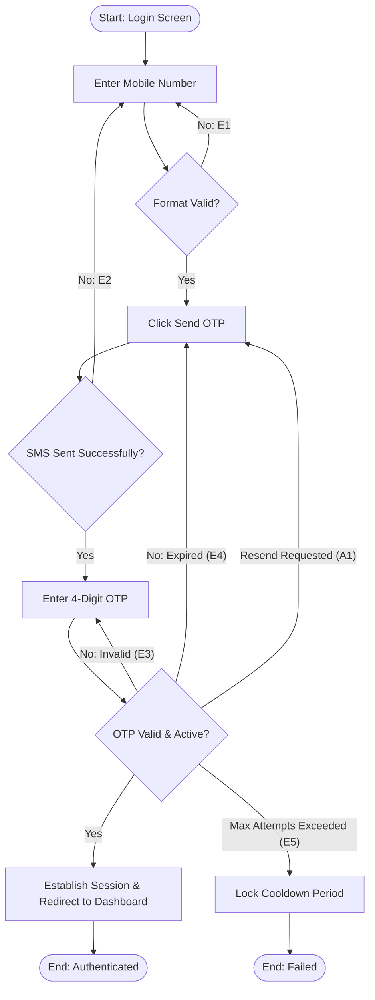

## Main Flow

| # | Actor Action | System Response | Ref |
|---|--------------|-----------------|-----|
| 1 | Opens the app/web portal and enters mobile phone number. | Validates phone number format and enables "Send OTP" action. | SCR-AUTH-01, BR-01 |
| 2 | Clicks "Send OTP". | Generates a 4-digit OTP, dispatches it via SMS, and displays the OTP verification screen with an input countdown timer. | BR-01, FR-01 |
| 3 | Enters the received 4-digit OTP. | Validates the OTP against the mobile number. | BR-01, FR-01 |
| 4 | Submits or completes 4-digit entry. | Authenticates user, generates authentication token, establishes session, and redirects to Tender Owner dashboard ("My Tenders"). | BR-01, FR-01 |

## Alternatives & Errors

| ID | At Step | Condition | System Behavior | Resumes At |
|----|---------|-----------|-----------------|------------|
| E1 | 1       | Invalid mobile number format entered | Displays inline error message: "Please enter a valid mobile number." Disables submit. | Step 1 |
| E2 | 2       | SMS gateway failure or network timeout | Displays error message: "Failed to send verification code. Please check your network and try again." | Step 1 |
| A1 | 3       | OTP not received within countdown | Enables "Resend OTP" button. When clicked, generates and sends a new 4-digit OTP. | Step 3 |
| E3 | 4       | Incorrect 4-digit OTP entered | Displays error: "Invalid verification code. Please check and try again." Clears OTP input. | Step 3 |
| E4 | 4       | OTP code has expired | Displays error: "Verification code has expired. Please request a new code." | Step 2 |
| E5 | 4       | Max failed OTP attempts exceeded *(Assumption: standard security throttling applies)* | Temporarily locks OTP submission for cooldown period and displays throttle warning. | End (fail) |

## Diagram (optional: only if 3+ branches)

