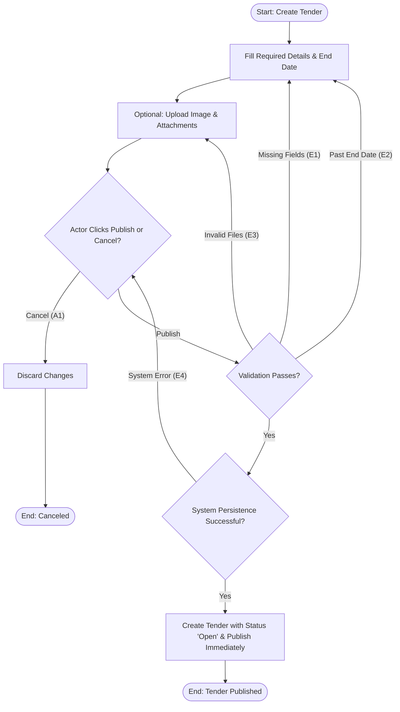

## Main Flow

| # | Actor Action                                                                                                                                                          | System Response                                                                                                                                                                                                       | Ref                 |
|---|--------------|-----------------|-----|
| 1   | Clicks "Create Tender" button.                                                                                                                                        | Presents the Tender Creation form with required fields (title, description, project type, city, district, coordinates, project area, budget, expiration date) and optional media uploads (tender image, attachments). | SCR-TND-01, BR-03   |
| 2   | Fills in required project details: title, description, project type, location (city, district, latitude, longitude), project area, budget, and end date (`end_date`). | Dynamically validates input formats and marks fields as complete.                                                                                                                                                     | BR-03, FR-04        |
| 3   | (Optional) Uploads tender cover image and supporting document attachments.                                                                                            | Validates file types and sizes; displays file upload previews.                                                                                                                                                        | BR-03, FR-04        |
| 4   | Clicks "Publish Tender".                                                                                                                                              | Validates all mandatory fields, confirms expiration date is in the future, and validates uploaded files.                                                                                                              | BR-03, FR-04        |
| 5   | Awaits system processing.                                                                                                                                             | Creates the tender record linked to `owner_id`, assigns status `Open`, sets creation timestamp, publishes it immediately to the public directory, and displays a success notification with a link to view the tender. | BR-03, FR-04, FR-14 |

## Alternatives & Errors

| ID | At Step | Condition                                                                                                          | System Behavior                                                                                                          | Resumes At     |
|----|---------|-----------|-----------------|------------|
| A1  | 2-3     | Actor decides to cancel tender creation                                                                            | Prompts confirmation: "Discard unsaved changes?"; on confirmation, discards input and redirects to My Tenders.           | End (canceled) |
| E1  | 4       | One or more mandatory fields are blank or invalid                                                                  | Highlights missing fields with inline validation errors (e.g., "Title is required", "Budget must be greater than zero"). | Step 2         |
| E2  | 4       | Tender expiration date (`end_date`) is set to the past or current time                                             | Displays error: "Expiration date must be a future date."                                                                 | Step 2         |
| E3  | 4       | Uploaded image or attachment exceeds size limit or invalid format *(Assumption: standard media constraints apply)* | Displays file validation error: "File format unsupported or file exceeds maximum size limit."                            | Step 3         |
| E4  | 5       | Network interruption or database persistence failure                                                               | Displays error: "Unable to create tender. Please try again." Form values remain intact.                                  | Step 4         |

## Diagram (optional: only if 3+ branches)

