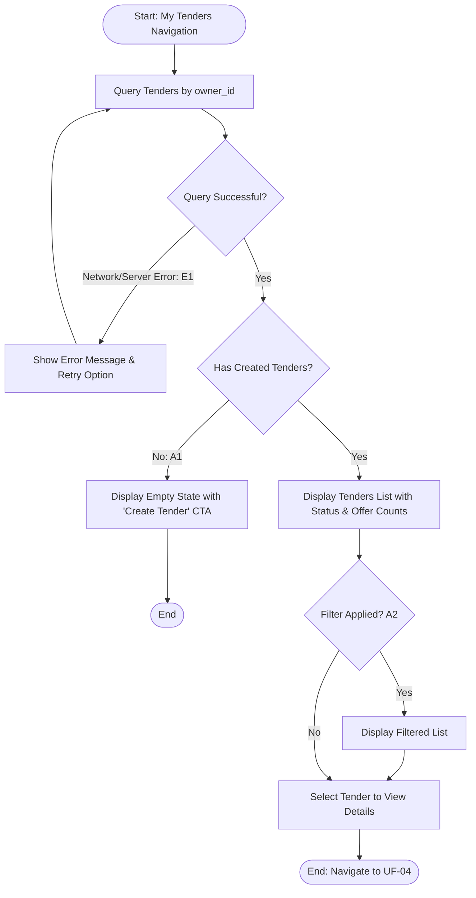

## Main Flow

| # | Actor Action | System Response | Ref |
|---|--------------|-----------------|-----|
| 1 | Selects "My Tenders" from navigation menu. | Validates owner session and initiates query for tenders associated with `owner_id`. | SCR-TND-02, BR-12 |
| 2 | Awaits system response. | Retrieves all matching tenders and displays them in a structured list/cards with title, project type, city, creation date, expiration date, status (`Open`, `Closed`, `Expired`, `Awarded`), and received offers count. | FR-05, BR-12 |
| 3 | Reviews listed tenders. | System provides interactive controls to click any tender card to navigate to its details (UF-04). | FR-05 |

## Alternatives & Errors

| ID | At Step | Condition | System Behavior | Resumes At |
|----|---------|-----------|-----------------|------------|
| A1 | 2       | Authenticated owner has not created any tenders yet | Displays empty state: "You have not created any tenders yet." Displays prominent "Create Tender" button (UF-02). | End (success) |
| A2 | 3       | Actor applies status filter (e.g., Open, Closed, Expired, Awarded) *(Assumption: standard list filtering capability)* | Filters displayed tenders list based on selected status. | Step 3 |
| E1 | 2       | Network error or backend query failure | Displays error message: "Unable to load your tenders. Please check your internet connection and try again." Provides a "Retry" button. | Step 1 |

## Diagram (optional: only if 3+ branches)

