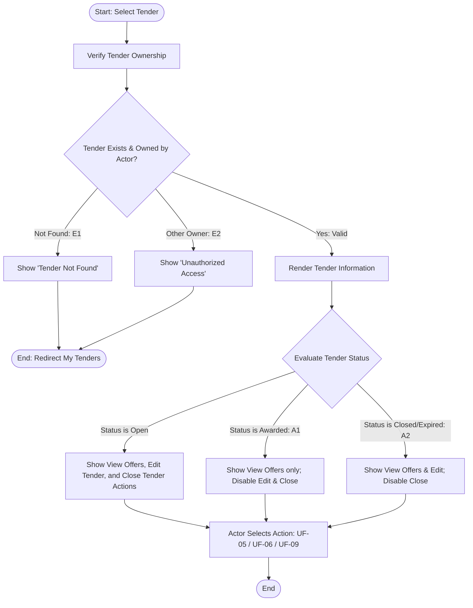

## Main Flow

| # | Actor Action | System Response | Ref |
|---|--------------|-----------------|-----|
| 1 | Selects a specific tender from the "My Tenders" list. | Validates user session and verifies that `owner_id` of the tender matches the authenticated user. | SCR-TND-03, BR-12 |
| 2 | Awaits system response. | Loads and renders complete tender information: title, description, project type, city, district, coordinates, project area, budget, expiration date (`end_date`), cover image, attachments, and current status (`Open`, `Closed`, `Expired`, `Awarded`). | FR-06, BR-12 |
| 3 | Reviews tender details. | System presents contextual action controls based on tender status: "View Offers" (shows count), "Edit Tender" (enabled if status != Awarded), and "Close Tender" (enabled only if status == Open). | BR-05, BR-06, BR-10 |
| 4 | Chooses an available action (e.g., View Offers, Edit Tender, Close Tender). | Navigates the actor to the corresponding user flow (UF-05, UF-06, or UF-09). | FR-06 |

## Alternatives & Errors

| ID | At Step | Condition | System Behavior | Resumes At |
|----|---------|-----------|-----------------|------------|
| E1 | 1       | Requested tender ID does not exist | Displays error: "Tender not found." Redirects to My Tenders list. | End (fail) |
| E2 | 1       | Tender belongs to a different owner | Enforces ownership boundary: returns access denied error ("Unauthorized access") and redirects to My Tenders. | End (fail) |
| A1 | 3       | Tender status is `Awarded` | Displays status badge "Awarded". Hides/disables "Edit Tender" (BR-05) and "Close Tender" buttons; preserves "View Offers" button. | Step 3 |
| A2 | 3       | Tender status is `Closed` or `Expired` | Displays corresponding status badge. Hides/disables "Close Tender" button (BR-06); preserves "View Offers" and "Edit Tender" (if unawarded). | Step 3 |
| A3 | 3       | Actor downloads an attached document | Serves the requested tender attachment file for download or preview. | Step 3 |

## Diagram (optional: only if 3+ branches)

