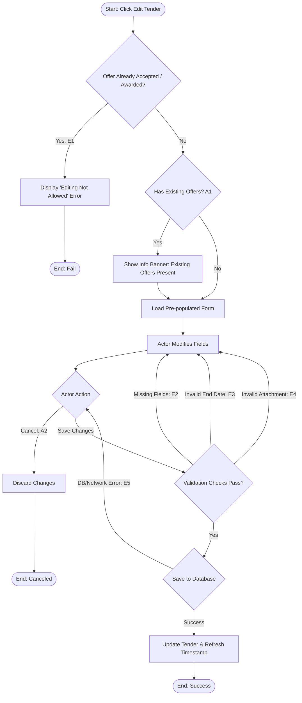

## Main Flow

| # | Actor Action | System Response | Ref |
|---|--------------|-----------------|-----|
| 1 | Clicks "Edit Tender" button on Tender Details screen. | Validates ownership and verifies that the tender has not had an offer accepted (status != `Awarded`). | SCR-TND-04, BR-05, BR-12 |
| 2 | Awaits system response. | Loads the Edit Tender form pre-populated with existing tender data (title, description, project type, city, district, coordinates, project area, budget, expiration date, image, and attachments). | FR-07, BR-05 |
| 3 | Modifies desired fields (e.g., updates description, adjusts budget, modifies expiration date, adds or removes attachments). | Validates field entries in real-time. | FR-07, BR-05 |
| 4 | Clicks "Save Changes". | Validates all mandatory fields, confirms new expiration date is in the future, and validates file attachments. | FR-07, BR-05 |
| 5 | Awaits system response. | Updates the tender record in the database, updates `updated_at` timestamp, displays a success notification ("Tender updated successfully"), and redirects to Tender Details. | FR-07, BR-05 |

## Alternatives & Errors

| ID | At Step | Condition | System Behavior | Resumes At |
|----|---------|-----------|-----------------|------------|
| E1 | 1       | An offer has already been accepted for this tender (status == `Awarded`) | Rejects edit attempt with error: "Editing is not allowed after an offer has been accepted." Redirects to Tender Details. | End (fail) |
| A1 | 2       | Tender already has received offers, but none accepted | Allows editing per BR-05; displays an informational notice: "This tender has existing offers. Editing details will update the tender specifications for all bidders." | Step 3 |
| A2 | 3-4     | Actor cancels editing | Prompts confirmation to discard changes; if confirmed, discards changes and navigates back to Tender Details. | End (canceled) |
| E2 | 4       | Mandatory field cleared or invalid format | Highlights affected fields with validation errors (e.g., "Title cannot be empty", "Budget must be greater than zero"). | Step 3 |
| E3 | 4       | Expiration date (`end_date`) is set to past or current time | Displays error: "Expiration date must be a future date." | Step 3 |
| E4 | 4       | New attachment exceeds file size or unsupported format *(Assumption: standard media constraints apply)* | Displays file error message and highlights invalid attachment. | Step 3 |
| E5 | 5       | Database or network error during persistence | Displays error: "Unable to save changes. Please try again." Form values remain intact. | Step 4 |

## Diagram (optional: only if 3+ branches)

