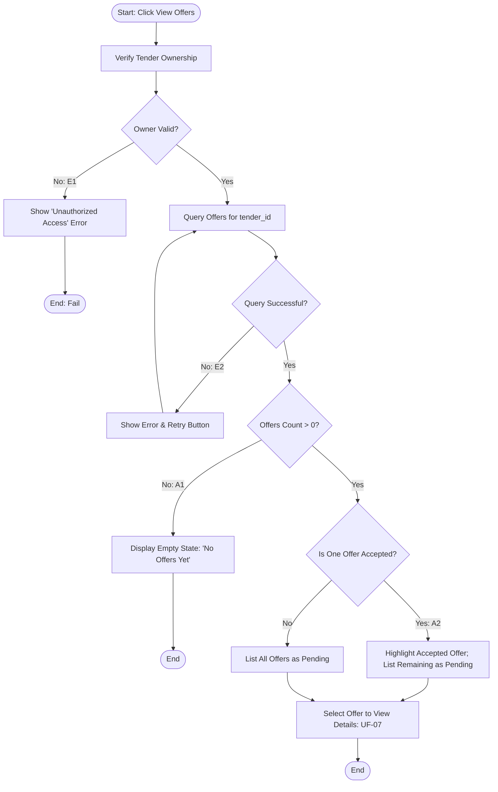

## Main Flow

| # | Actor Action | System Response | Ref |
|---|--------------|-----------------|-----|
| 1 | Clicks "View Offers" on the Tender Details screen. | Verifies tender ownership against authenticated session. | SCR-OFF-01, BR-12 |
| 2 | Awaits system response. | Queries and retrieves all offers linked to `tender_id`. | FR-09, BR-10 |
| 3 | Reviews the offers listing. | Displays the offers cards showing professional name, proposed price, execution duration, submission timestamp, and status (`Pending` or `Accepted`). | FR-09, BR-10 |
| 4 | Clicks an offer card to view full proposal. | Directs the actor to the Offer Details screen (UF-07). | FR-10 |

## Alternatives & Errors

| ID | At Step | Condition | System Behavior | Resumes At |
|----|---------|-----------|-----------------|------------|
| E1 | 1       | Tender belongs to another owner | Blocks access, logs security violation, and displays unauthorized error message. | End (fail) |
| A1 | 2       | No offers have been submitted yet for this tender | Displays empty state: "No offers have been submitted for this tender yet." Displays current tender status. | Step 3 |
| A2 | 3       | An offer has already been accepted for this tender | Displays the accepted offer prominently marked with "Accepted" badge, while continuing to list all other offers with status "Pending" per BR-10. | Step 3 |
| A3 | 3       | Multiple offers submitted by the same professional (BR-08) | Displays each submitted offer distinctly with its respective submission date, price, and proposal details. | Step 3 |
| E2 | 2       | Network failure or backend query timeout | Displays error message: "Unable to load offers. Please try again." Shows a "Retry" button. | Step 1 |

## Diagram (optional: only if 3+ branches)

