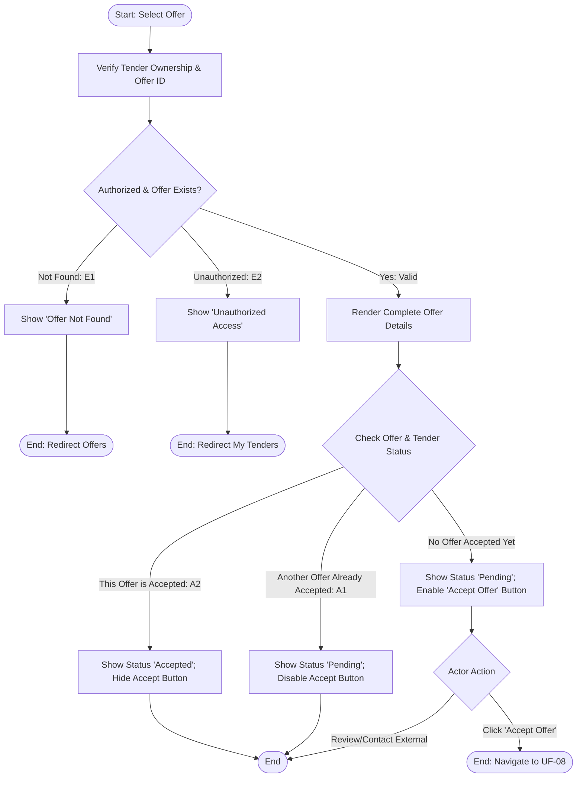

## Main Flow

| # | Actor Action | System Response | Ref |
|---|--------------|-----------------|-----|
| 1 | Clicks on a specific offer from the Received Offers list. | Validates owner session and verifies ownership of the parent tender. | SCR-OFF-02, BR-12 |
| 2 | Awaits system response. | Retrieves and displays full offer data: professional name, phone number, WhatsApp number (if provided), proposed price, execution duration, detailed description, attachments, creation timestamp, and offer status (`Pending` or `Accepted`). | FR-10, BR-10 |
| 3 | Reviews offer details and professional credentials. | System displays contextual actions: "Accept Offer" (displayed/enabled if no offer has been accepted yet for this tender) and external contact links (Call, WhatsApp). | BR-10, FR-11 |
| 4 | (Optional) Clicks "Accept Offer". | Navigates to the offer acceptance flow (UF-08). | FR-11 |

## Alternatives & Errors

| ID | At Step | Condition | System Behavior | Resumes At |
|----|---------|-----------|-----------------|------------|
| E1 | 1       | Offer does not exist or invalid offer ID | Displays error: "Offer not found." Redirects to Received Offers list. | End (fail) |
| E2 | 1       | Offer belongs to a tender owned by a different user | Blocks access ("Unauthorized access") per BR-12; redirects to My Tenders. | End (fail) |
| A1 | 3       | Another offer has already been accepted for this tender | Hides or disables "Accept Offer" button and displays informational badge: "Another offer has already been accepted for this tender" per BR-10. | Step 3 |
| A2 | 3       | This specific offer has already been accepted | Displays status badge "Accepted" and hides "Accept Offer" button. | Step 3 |
| A3 | 3       | Offer does not contain a WhatsApp number (optional field) | Displays phone number for direct contact; omits or disables WhatsApp link. | Step 3 |
| A4 | 3       | Actor downloads or previews an offer attachment | Serves the requested file attachment. | Step 3 |

## Diagram (optional: only if 3+ branches)

