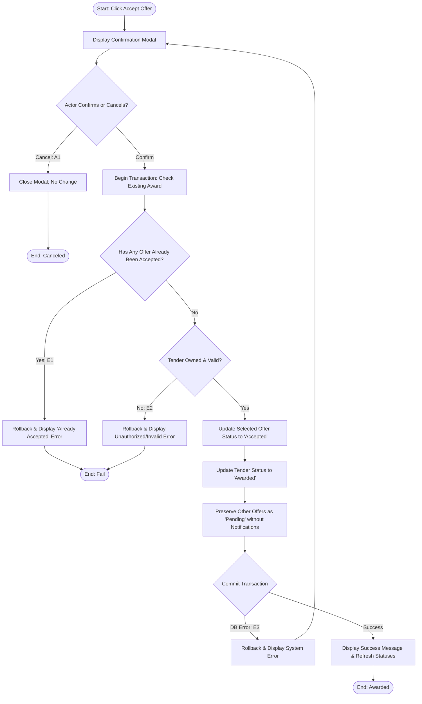

## Main Flow

| # | Actor Action | System Response | Ref |
|---|--------------|-----------------|-----|
| 1 | Clicks "Accept Offer" on the desired offer's detail screen. | Displays a confirmation modal: "Accept this offer? You can only accept one offer per tender. This action cannot be undone." | SCR-OFF-03, BR-10 |
| 2 | Confirms the action by clicking "Confirm Acceptance". | Initiates an atomic transaction; verifies ownership and re-checks that no other offer has been accepted for this tender. | BR-10, FR-11 |
| 3 | Awaits system processing. | Updates the selected offer's status from `Pending` to `Accepted`. | BR-10, FR-11 |
| 4 | Awaits system processing. | Updates the parent tender's status to `Awarded`. Preserves all other submitted offers in `Pending` status under the tender (no automatic deletion). Enforces no notifications dispatched per BR-11. | BR-05, BR-10, BR-11 |
| 5 | Awaits completion. | Displays success message: "Offer accepted successfully. Tender has been awarded." Refreshes UI showing offer marked as `Accepted` and tender as `Awarded`. | FR-11 |

## Alternatives & Errors

| ID | At Step | Condition | System Behavior | Resumes At |
|----|---------|-----------|-----------------|------------|
| A1 | 1-2     | Actor decides not to accept and clicks "Cancel" | Closes confirmation modal without making changes. | Step 1 |
| E1 | 2       | Another offer was already accepted (concurrent request or prior session) | Aborts transaction; displays error: "An offer has already been accepted for this tender." | End (fail) |
| E2 | 2       | Target tender is invalid, closed, or belongs to another user | Blocks operation with unauthorized or invalid state error. | End (fail) |
| E3 | 3-4     | Database transaction or persistence failure | Rolls back all modifications; preserves original statuses; displays error: "Failed to accept offer. Please try again." | Step 1 |

## Diagram (optional: only if 3+ branches)

