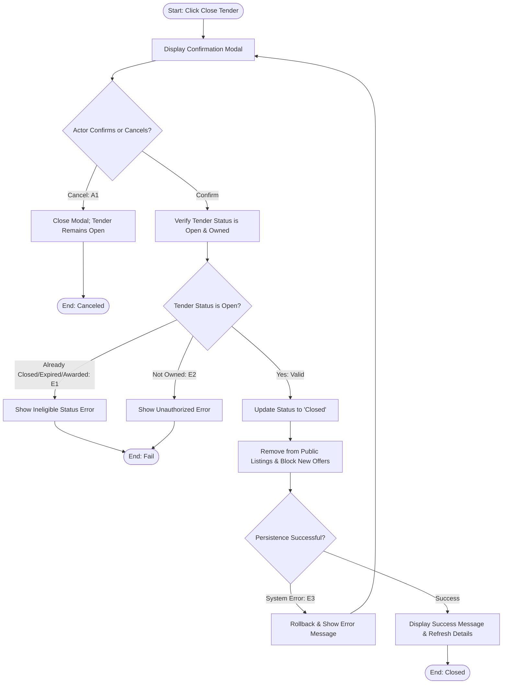

## Main Flow

| # | Actor Action | System Response | Ref |
|---|--------------|-----------------|-----|
| 1 | Clicks "Close Tender" button on the Tender Details screen. | Displays confirmation dialog: "Are you sure you want to close this tender? No new offers will be accepted, and it will be hidden from professionals." | SCR-TND-05, BR-06 |
| 2 | Confirms the closure by clicking "Confirm Close". | Verifies ownership and verifies that tender is currently in `Open` status. | BR-06, BR-12, FR-12 |
| 3 | Awaits system processing. | Updates tender status to `Closed` and records update timestamp. | BR-06, FR-12 |
| 4 | Awaits system processing. | De-indexes the tender from public professional listings immediately and blocks any in-flight offer submissions against it. | BR-04, BR-06, FR-14 |
| 5 | Awaits completion. | Displays success message: "Tender closed successfully." Updates Tender Details screen to reflect status `Closed` and hides the "Close Tender" action button. | FR-12, BR-06 |

## Alternatives & Errors

| ID | At Step | Condition | System Behavior | Resumes At |
|----|---------|-----------|-----------------|------------|
| A1 | 1-2     | Actor cancels confirmation dialog | Closes dialog; tender remains Open. | Step 1 |
| E1 | 2       | Tender is already Closed, Expired, or Awarded | Aborts operation; displays message: "Tender cannot be closed as it is already closed, expired, or awarded." | End (fail) |
| E2 | 2       | Tender belongs to another owner | Blocks access with unauthorized error per BR-12. | End (fail) |
| E3 | 3-4     | Database or system failure during status update | Reverts changes; displays error: "Failed to close tender. Please try again." Tender remains Open. | Step 1 |

## Diagram (optional: only if 3+ branches)

