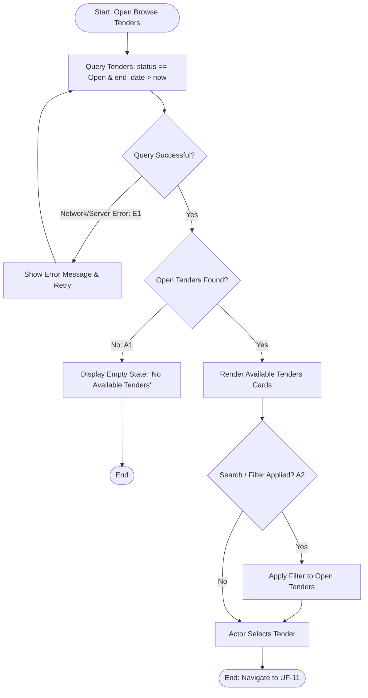

## Main Flow

| # | Actor Action | System Response | Ref |
|---|--------------|-----------------|-----|
| 1 | Opens the application or navigates to the public "Browse Tenders" page. | Acknowledges public request without prompting for login or phone verification. | SCR-PUB-01, BR-02 |
| 2 | Awaits catalog loading. | Queries published tenders filtering strictly by `status = 'Open'` and `end_date > CURRENT_TIMESTAMP`. Excludes all Closed, Expired, and Awarded tenders. | BR-04, FR-14 |
| 3 | Reviews the list of available tenders. | Displays tender cards showing cover image, project title, project type, city, district, project area, budget, and remaining time until expiration. | FR-02, BR-04 |
| 4 | Clicks on a specific tender card to see full specifications. | Navigates to the public Tender Details screen (UF-11). | FR-03 |

## Alternatives & Errors

| ID | At Step | Condition | System Behavior | Resumes At |
|----|---------|-----------|-----------------|------------|
| A1 | 2       | No tenders currently meet the active Open criteria | Displays empty state: "No available tenders at the moment. Please check back later." | End (success) |
| A2 | 3       | Actor applies search keywords or filters (e.g. by city, project type, budget) *(Assumption: standard browse filtering capability)* | Applies filter criteria on top of `status = 'Open'` and updates the displayed tender list. | Step 3 |
| E1 | 2       | Network failure or backend retrieval error | Displays error notification: "Unable to load tenders. Please check your internet connection and try again." Provides a "Retry" button. | Step 1 |

## Diagram (optional: only if 3+ branches)

