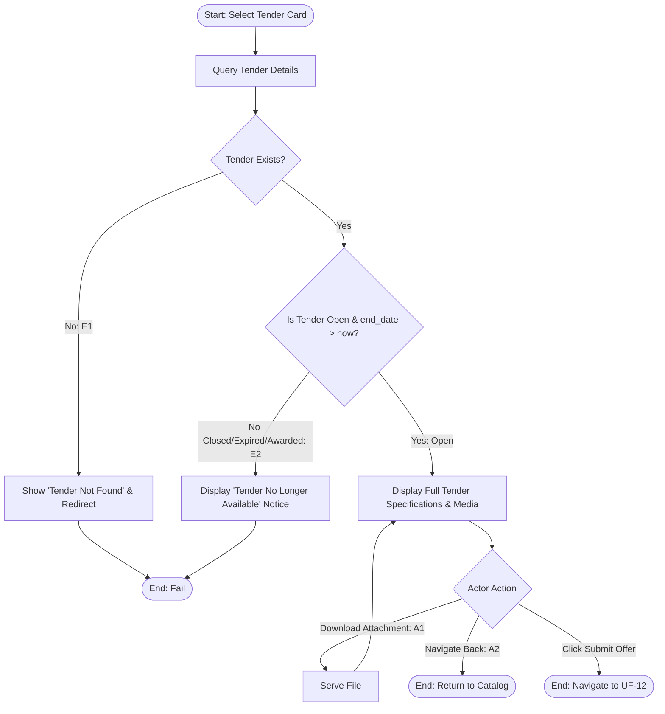

## Main Flow

| # | Actor Action | System Response | Ref |
|---|--------------|-----------------|-----|
| 1 | Clicks on a tender card from the public browse listing. | Receives request without requiring authentication token or credentials. | SCR-PUB-02, BR-02 |
| 2 | Awaits system response. | Validates that target tender exists, has status `Open`, and has not expired (`end_date > CURRENT_TIMESTAMP`). | BR-04, FR-03 |
| 3 | Awaits data rendering. | Displays full tender details: title, description, project type, city, district, coordinates, project area, budget, expiration date, cover image, and downloadable attachments. | FR-03, BR-04 |
| 4 | Reviews tender specifications. | Displays prominent "Submit Offer" action button. | BR-04, FR-08 |
| 5 | Clicks "Submit Offer". | Navigates to the offer submission form (UF-12). | FR-08 |

## Alternatives & Errors

| ID | At Step | Condition | System Behavior | Resumes At |
|----|---------|-----------|-----------------|------------|
| E1 | 2       | Tender does not exist or invalid tender ID | Displays error: "Tender not found." Redirects to Browse Tenders catalog. | End (fail) |
| E2 | 2       | Tender status is `Closed`, `Expired`, or `Awarded` | Blocks access for unauthenticated professional; displays notice: "This tender is no longer available or is closed." Hides details and disables offer submission per BR-04. | End (fail) |
| A1 | 3       | Actor views or downloads an attachment | Serves the requested project attachment file without requiring authentication. | Step 3 |
| A2 | 4       | Actor decides not to submit an offer | Clicks back navigation to return to the public tender catalog. | End (success) |

## Diagram (optional: only if 3+ branches)

