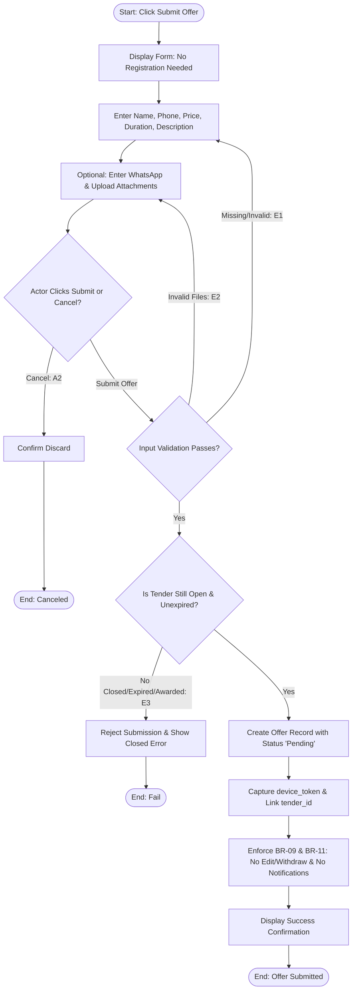

## Main Flow

| # | Actor Action | System Response | Ref |
|---|--------------|-----------------|-----|
| 1 | Clicks "Submit Offer" on the Tender Details screen. | Displays the Offer Submission form directly without asking for login, registration, or phone OTP. | SCR-OFF-04, BR-02, BR-08 |
| 2 | Enters required professional details: name (`professional_name`) and phone number (`professional_phone`). | Validates name and phone number format. | BR-08, FR-08 |
| 3 | (Optional) Enters WhatsApp number (`professional_whatsapp`). | Validates WhatsApp number format if provided. | BR-08, FR-08 |
| 4 | Enters commercial proposal details: proposed price (`professional_price`), execution duration (`duration`), and project execution description (`description`). | Validates that price and duration are positive numeric values and description is not empty. | BR-08, FR-08 |
| 5 | (Optional) Uploads supporting documentation or proposal attachments. | Validates file size and permitted file extensions. | BR-08, FR-08 |
| 6 | Clicks "Submit Offer". | Verifies all mandatory fields, confirms tender is still `Open` and not expired, captures client `device_token` (if available), and creates the offer record with status `Pending`. | BR-08, BR-09, FR-08 |
| 7 | Awaits system response. | Displays success confirmation dialog: "Your offer has been submitted successfully." Notes that submitted offers cannot be edited or withdrawn (BR-09). Enforces no notifications sent per BR-11. | BR-09, BR-11, FR-08 |

## Alternatives & Errors

| ID | At Step | Condition | System Behavior | Resumes At |
|----|---------|-----------|-----------------|------------|
| A1 | 1-5     | Actor has already submitted an offer for this tender previously | Allows submission; system treats it as an independent additional offer per BR-08 ("The same professional can submit multiple offers for the same tender"). | Step 6 |
| A2 | 1-5     | Actor decides to cancel submission | Prompts: "Discard offer?"; upon confirmation, clears form and returns to Tender Details. | End (canceled) |
| E1 | 6       | Mandatory fields missing or invalid format (e.g., negative price, invalid phone) | Highlights errors inline: "Please provide valid contact and proposal information." | Step 2 |
| E2 | 6       | Uploaded attachment exceeds maximum allowed size or format is unsupported *(Assumption: standard media constraints apply)* | Displays file upload error: "File exceeds maximum size or format not supported." | Step 5 |
| E3 | 6       | Tender was closed, expired, or awarded by the owner during form fill | Rejects submission with error: "This tender is no longer accepting offers." Prevents record creation per BR-04, BR-06, BR-07. | End (fail) |
| E4 | 6       | Server or database persistence failure | Displays error: "Unable to submit your offer. Please try again." Preserves entered data. | Step 6 |

## Diagram (optional: only if 3+ branches)

