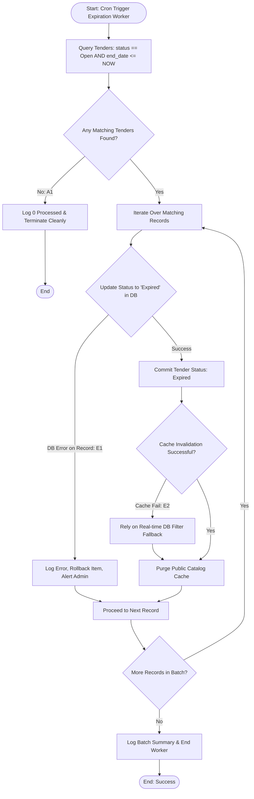

## Main Flow

| # | Actor Action | System Response | Ref |
|---|--------------|-----------------|-----|
| 1 | Cron scheduler triggers the expiration worker job at designated intervals *(Assumption: worker runs at regular periodic intervals)*. | Initiates batch query for tenders meeting expiration criteria. | BR-07, FR-13 |
| 2 | System scans tender database records. | Queries all tenders where `status = 'Open'` AND `end_date <= CURRENT_TIMESTAMP`. | BR-07, FR-13 |
| 3 | System iterates through identified expiring tenders. | Sets each eligible tender record's `status` to `Expired` and updates `updated_at` timestamp. | BR-07, FR-13 |
| 4 | System updates listing index and cache layers. | Invalidates public tender listings and search cache, immediately excluding expired tenders from professional visibility. | BR-04, BR-07, FR-14 |
| 5 | System concludes execution. | Commits transactions, records execution metrics in system logs, and transitions to idle state. | FR-13 |

## Alternatives & Errors

| ID | At Step | Condition | System Behavior | Resumes At |
|----|---------|-----------|-----------------|------------|
| A1 | 2       | No tenders currently meet the expiration criteria (`end_date <= CURRENT_TIMESTAMP`) | System logs zero records processed and terminates job cleanly until next scheduled cycle. | End (success) |
| E1 | 3       | Database update failure on a specific tender record | Rolls back failed record, logs error details with `tender_id`, increments failure counter, and proceeds with remaining batch records. | Step 3 (next record) |
| E2 | 4       | Cache invalidation failure | Real-time database query fallback (`WHERE status = 'Open' AND end_date > CURRENT_TIMESTAMP`) guarantees that professionals cannot view or bid on expired tenders even if cache purge lags. | Step 5 |

## Diagram (optional: only if 3+ branches)

