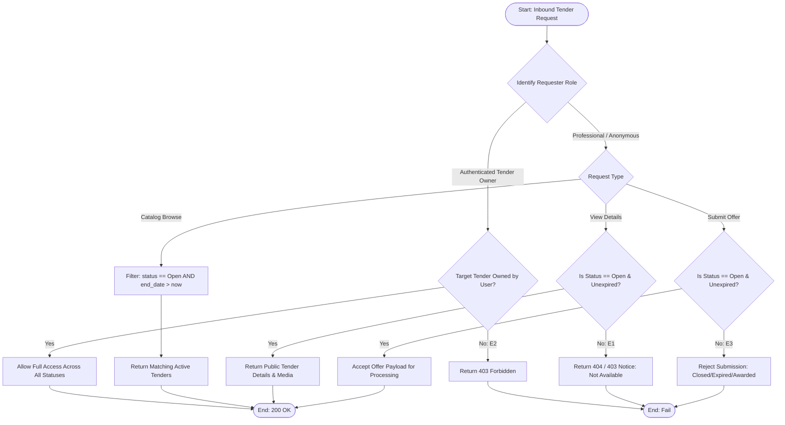

## Main Flow

| # | Actor Action | System Response | Ref |
|---|--------------|-----------------|-----|
| 1 | Client issues a request (e.g., browse tenders, retrieve tender details, or submit offer). | Intercepts request at gateway/controller level to evaluate context and actor identity. | BR-04, FR-14 |
| 2 | System evaluates actor context. | Identifies requester as either an Anonymous/Professional user or an Authenticated Tender Owner. | BR-01, BR-02, BR-12 |
| 3 | System checks the action type: **Catalog Listing**. | For Professionals: applies mandatory query predicate `status = 'Open' AND end_date > CURRENT_TIMESTAMP`. For Tender Owners: scopes query to `owner_id = current_user_id` across all statuses. | BR-04, BR-12, FR-14 |
| 4 | System checks the action type: **Tender Details Access**. | For Professionals: returns 200 OK only if tender is `Open` and unexpired; returns 404/403 if `Closed`, `Expired`, or `Awarded`. For Tender Owners: returns 200 OK if `owner_id = current_user_id`. | BR-04, BR-06, BR-07, BR-12 |
| 5 | System checks the action type: **Offer Submission**. | Evaluates target tender status; strictly permits submission only if `status = 'Open'` and `end_date > CURRENT_TIMESTAMP`. Blocks all submissions for `Closed`, `Expired`, or `Awarded` tenders. | BR-04, BR-06, BR-07, BR-08 |
| 6 | System returns response. | Serves permitted data payload or proceeds with valid transaction. | FR-14 |

## Alternatives & Errors

| ID | At Step | Condition | System Behavior | Resumes At |
|----|---------|-----------|-----------------|------------|
| E1 | 3-4     | Professional attempts to access a tender with status `Closed`, `Expired`, or `Awarded` | Returns 404 Not Found / 403 Forbidden with message: "Tender is no longer available" per BR-04, BR-06, BR-07. | End (fail) |
| E2 | 4       | Tender Owner attempts to access private tender data belonging to another owner | Returns 403 Forbidden ("Unauthorized access to tender") per BR-12. | End (fail) |
| E3 | 5       | Professional attempts to submit an offer to a `Closed`, `Expired`, or `Awarded` tender | Rejects submission with 422/400 error: "Cannot submit offers to closed, expired, or awarded tenders" per BR-04, BR-06, BR-07. | End (fail) |
| A1 | 3-4     | Newly created tender is submitted by owner | Immediately publishes record to public directory without manual review or staging delay per BR-03, FR-14. | Step 6 |

## Diagram (optional: only if 3+ branches)

