# User Flows: Customer Service Request Life Cycle

| ID | Flow | Actor |
| --- | --- | --- |
| UF-01 | Browse and Select Service | Customer |
| UF-02 | Create Instant Service Request | Customer |
| UF-03 | Create Scheduled Service Request | Customer |
| UF-04 | Publish Request and Match Providers | Customer / System |
| UF-05 | Handle No Offers Received | Customer / System |
| UF-06 | Receive and Compare Offers | Customer |
| UF-07 | Chat and Negotiate | Customer / Provider |
| UF-08 | Accept Offer | Customer |
| UF-09 | Pay for Service | Customer / System |
| UF-10 | Handle Payment Failure | Customer / System |
| UF-11 | Confirm Service Appointment | Customer / System |
| UF-12 | Track Provider and Service Execution | Customer / Provider |
| UF-13 | Approve Additional Cost | Customer / Provider |
| UF-14 | Reject Additional Cost | Customer |
| UF-15 | Confirm Service Completion | Customer / Provider |
| UF-16 | Automatic Service Completion | System |
| UF-17 | Report a Problem and Open Dispute | Customer / Admin |
| UF-18 | Cancel Service Request | Customer / Provider |
| UF-19 | Refund Processing | System / Admin |
| UF-20 | View Invoice | Customer |
| UF-21 | Rate Provider and Platform | Customer |
| UF-22 | View Request History | Customer |
| UF-23 | Submit Warranty Claim | Customer / Admin / Provider |
| UF-24 | Reschedule Service Appointment | Customer / Provider |

---

# UF-01: Browse and Select Service

**Actor:** Customer  
**Goal:** Find the required service  
**Entry Point:** Home (CUS-010)  
**Preconditions:** App is accessible  
**Postconditions:** Service selected

## Main Flow

| # | User Action | System Response |
| --- | --- | --- |
| 1 | Open Home | Display categories, search and popular services |
| 2 | Select category | Display its services |
| 3 | Select service | Display service details and price range |
| 4 | Request service | Open request creation |

## Alternative / Error Flows

| ID | At Step | Condition | Result |
| --- | --- | --- | --- |
| A1 | 4 | Guest attempts a protected action | Request login and return to the same point |

## Diagram
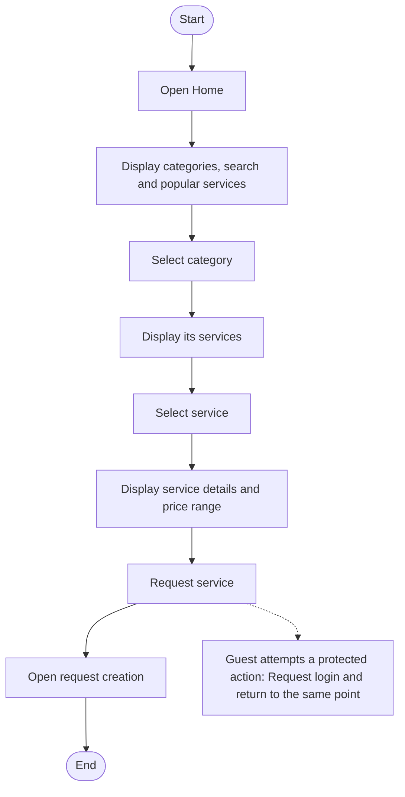

## Notes

- Related requirements: Sections 3–4; CUS-010–013.

---

# UF-02: Create Instant Service Request

**Actor:** Customer  
**Goal:** Request service as soon as possible  
**Entry Point:** Service details / Request Now  
**Preconditions:** Customer authenticated  
**Postconditions:** Request ready for publication

## Main Flow

| # | User Action | System Response |
| --- | --- | --- |
| 1 | Select category and service | Record selection |
| 2 | Enter short title and detailed description | Record problem details |
| 3 | Add photos or attachments | Associate evidence with request |
| 4 | Specify expected materials and notes | Record materials preference |
| 5 | Select ASAP | Record requested timing |
| 6 | Choose golden warranty if enabled | Record optional warranty choice |
| 7 | Select address, map pin and access notes | Record service location |
| 8 | Review and submit | Continue to UF-04 |

## Alternative / Error Flows

| ID | At Step | Condition | Result |
| --- | --- | --- | --- |
| A1 | 5 | Customer selects a future appointment | Go to UF-03 |
| E2 | 7 | Location permission denied | Provide manual alternative |
| E3 | 3 | Upload fails | EC-005; recovery details open |
| A4 | 7 | Map unavailable | EC-004; recovery details open |

## Diagram
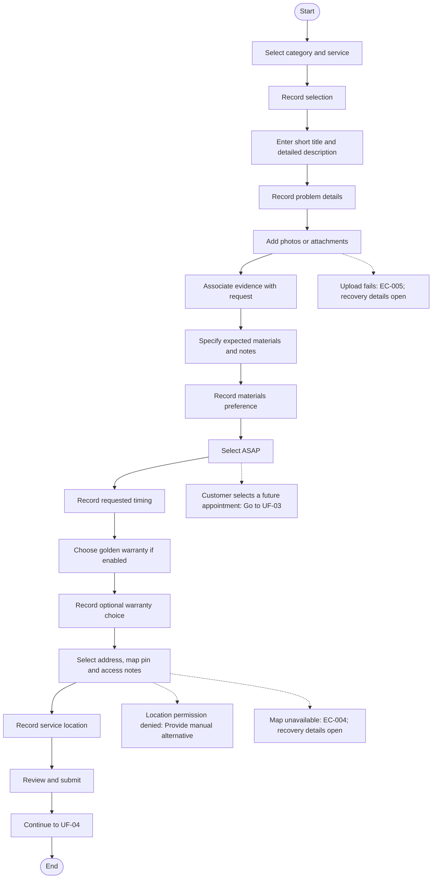

## Notes

- Related requirements: Section 8; 17B; CUS-020–026. Required fields and attachment limits need confirmation.

---

# UF-03: Create Scheduled Service Request

**Actor:** Customer  
**Goal:** Request service at a future time  
**Entry Point:** Schedule Appointment / request timing  
**Preconditions:** Customer authenticated  
**Postconditions:** Scheduled request ready for publication

## Main Flow

| # | User Action | System Response |
| --- | --- | --- |
| 1 | Select service and enter problem details, photos and materials | Record request details |
| 2 | Choose date | Apply configured minimum and maximum advance booking |
| 3 | Choose time slot or specific hour | Apply configured working hours |
| 4 | Review location and request | Display summary |
| 5 | Submit | Go to UF-04 |

## Alternative / Error Flows

| ID | At Step | Condition | Result |
| --- | --- | --- | --- |
| A1 | 2–3 | Date or time outside configured limits | Reject invalid appointment |
| A2 | 3 | Request previous provider first | Proposed option, DEC-041 |

## Diagram
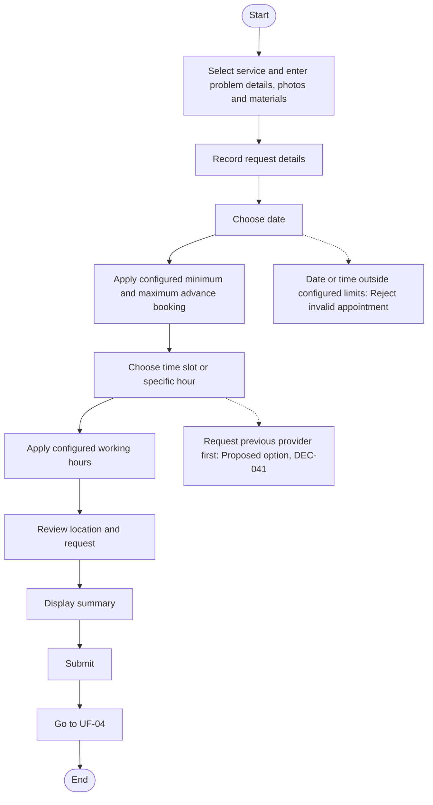

## Notes

- Related requirements: Section 8A; SCH-01–10. Proposed values: minimum 2h, maximum 30 days, 8 AM–10 PM, 2h slots, offers end 12h before appointment, travel buffer 60 minutes. Previous-provider exclusive window 30 minutes is proposed. Payment timing DEC-042 remains open.

---

# UF-04: Publish Request and Match Providers

**Actor:** Customer / System  
**Goal:** Distribute request to eligible providers  
**Entry Point:** Submit request  
**Preconditions:** Request details complete  
**Postconditions:** PENDING until first offer

## Main Flow

| # | User Action | System Response |
| --- | --- | --- |
| 1 | Submit request | Set PENDING and notify customer |
| 2 | n/a | Find approved, active, online, matching, non-blocked providers within radius |
| 3 | n/a | Rank by distance and distribute in proximity waves |
| 4 | Open request | Display radar, notified provider count and remaining time |
| 5 | n/a (first offer) | Set OFFERS_RECEIVED and notify customer |
| 6 | n/a (more offers) | Append offers without changing status |
| 7 | Compare offers | Go to UF-06 |

## Alternative / Error Flows

| ID | At Step | Condition | Result |
| --- | --- | --- | --- |
| A1 | 3 | No offer in first wave | Expand according to settings |
| A2 | 4 | Window expires without offers | Go to UF-05 |
| A3 | 4 | Customer cancels while PENDING | Go to UF-18; free cancellation |
| E4 | 3 | Provider goes offline after distribution | EC-009; handling open |

## Diagram
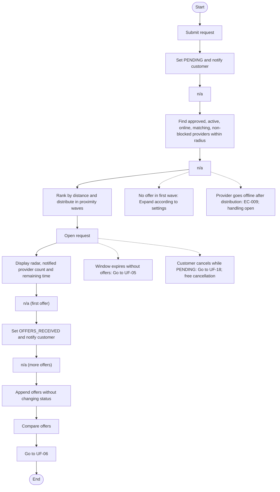

## Notes

- Related requirements: Sections 7–8; BR-005–007, BR-039–040, BR-050. Company distance uses nearest active available technician, live location during work or base otherwise. Offer submission itself is provider acceptance.

---

# UF-05: Handle No Offers Received

**Actor:** Customer / System  
**Goal:** Provide alternatives when no offer arrives  
**Entry Point:** Offer window expires  
**Preconditions:** No offer received  
**Postconditions:** Customer chooses next action

## Main Flow

| # | User Action | System Response |
| --- | --- | --- |
| 1 | n/a | Set NO_OFFERS |
| 2 | Open request | Display no-offers message and available options |
| 3 | Choose extend, modify, schedule or cancel | Allow selected action |

## Alternative / Error Flows

| ID | At Step | Condition | Result |
| --- | --- | --- | --- |
| A1 | 3 | Schedule | Go to UF-03 |
| A2 | 3 | Cancel | Go to UF-18 |
| A3 | 3 | Extend or modify | Redistribution and extension limits need clarification |

## Diagram
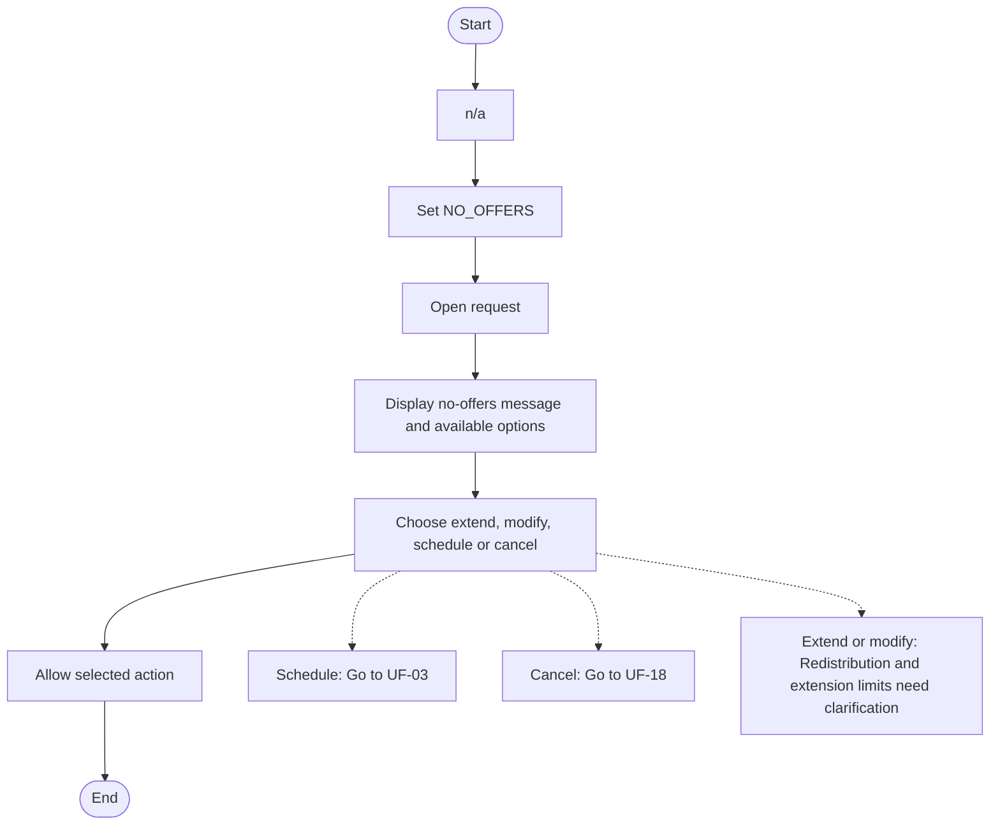

## Notes

- Related requirements: Section 8; CUS-028; EC-010–011.

---

# UF-06: Receive and Compare Offers

**Actor:** Customer  
**Goal:** Compare available offers  
**Entry Point:** Offer notification / Compare Offers  
**Preconditions:** OFFERS_RECEIVED  
**Postconditions:** Offer chosen for review or acceptance

## Main Flow

| # | User Action | System Response |
| --- | --- | --- |
| 1 | Open offers | Display price, provider name/type, photo/logo, rating, completed jobs, proximity, ETA and notes |
| 2 | Review offer | Display expected work duration only if provider supplied it |
| 3 | View profile or compare offers | Display provider and offer information |
| 4 | Choose chat or accept | Go to UF-07 or UF-08 |

## Alternative / Error Flows

| ID | At Step | Condition | Result |
| --- | --- | --- | --- |
| A1 | 1 | New offer arrives | Append and notify |
| A2 | 2 | Scheduled request | Show availability at appointment instead of ETA |
| E3 | 2 | Offer expired or withdrawn | Cannot accept invalid offer |
| A4 | 2 | Offer revised | Revalidate current offer; display behavior open |

## Diagram
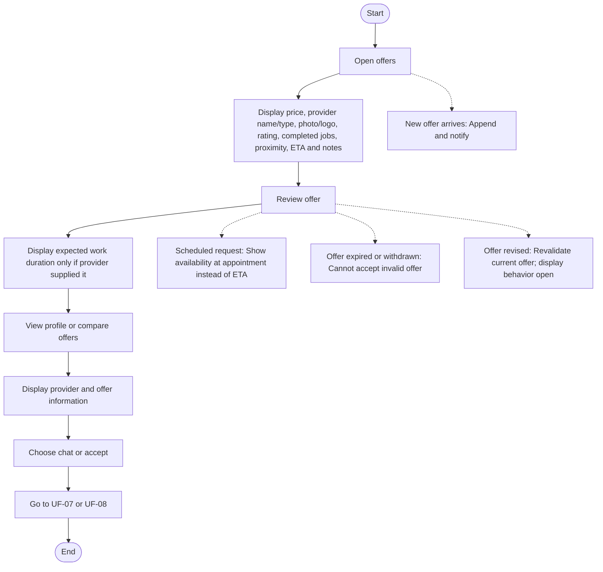

## Notes

- Related requirements: Section 9; CUS-030–033; BR-008–009, CR-004. Offer states: SUBMITTED, UPDATED, WITHDRAWN, EXPIRED, REJECTED, ACCEPTED.

---

# UF-07: Chat and Negotiate

**Actor:** Customer / Provider  
**Goal:** Discuss scope and price  
**Entry Point:** Chat from offer  
**Preconditions:** Offer exists, subject to chat policy  
**Postconditions:** Agreement remains formalized through offer

## Main Flow

| # | User Action | System Response |
| --- | --- | --- |
| 1 | Open chat | Display request-bound conversation |
| 2 | Send text, images or permitted attachments | Record messages and evidence |
| 3 | Discuss revised price | Do not silently change financial agreement |
| 4 | Review formal revised offer if allowed | Use formal offer revision before payment |

## Alternative / Error Flows

| ID | At Step | Condition | Result |
| --- | --- | --- | --- |
| E1 | 2 | Attachment fails or abusive content | EC-031/032; handling open |
| A2 | 3 | No agreement | Customer may compare other offers |

## Diagram
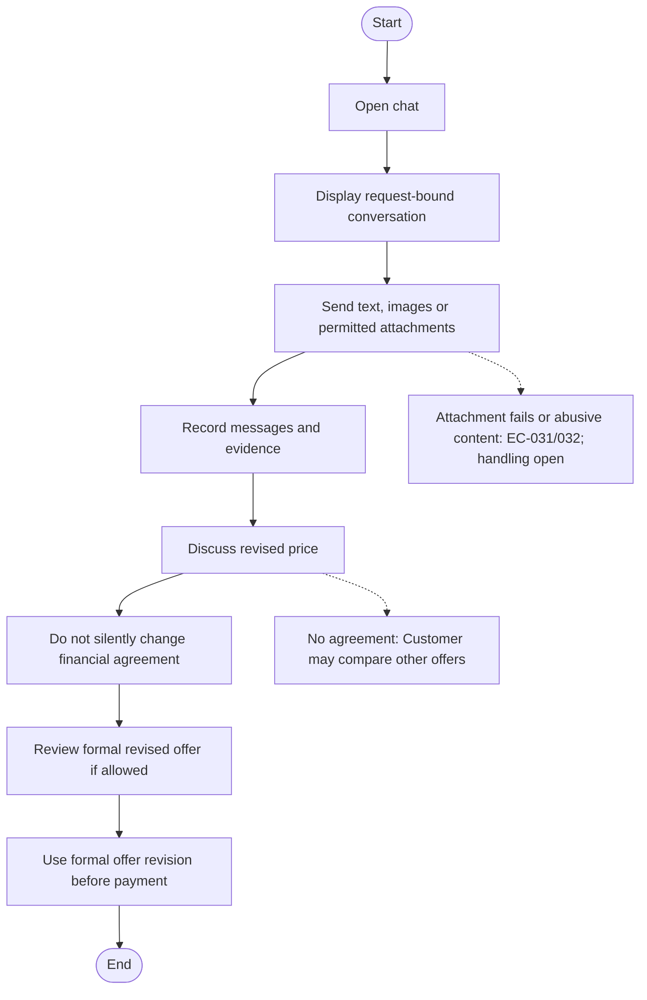

## Notes

- Related requirements: Section 10; BR-012–013, BR-023. Chat start and retention policy require approval; admin access permission-based and audited.

---

# UF-08: Accept Offer

**Actor:** Customer  
**Goal:** Select exactly one offer  
**Entry Point:** Accept Offer  
**Preconditions:** Valid offer exists  
**Postconditions:** OFFER_SELECTED then AWAITING_PAYMENT

## Main Flow

| # | User Action | System Response |
| --- | --- | --- |
| 1 | Select offer | Display offer details |
| 2 | Accept offer | Lock offer and revalidate request |
| 3 | n/a | Mark selected offer ACCEPTED; other offers no longer acceptable |
| 4 | n/a | Set OFFER_SELECTED then AWAITING_PAYMENT and notify provider |
| 5 | Open checkout | Go to UF-09 |

## Alternative / Error Flows

| ID | At Step | Condition | Result |
| --- | --- | --- | --- |
| E1 | 2 | Offer expired, withdrawn or revised | Revalidate; invalid offer cannot be accepted |
| A2 | 2 | Attempt to accept two offers including concurrent devices | Enforce one accepted offer |

## Diagram
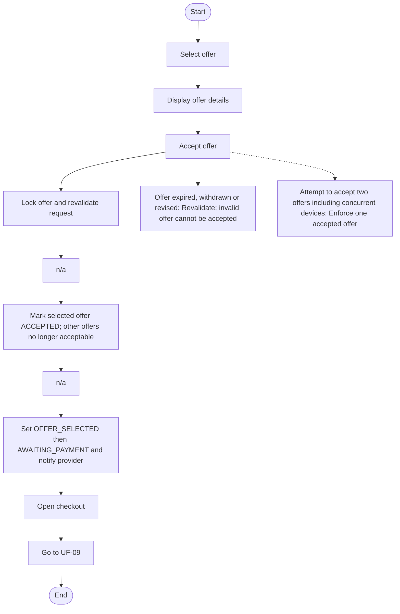

## Notes

- Related requirements: Sections 8–11; BR-009–010; EC-012–015.

---

# UF-09: Pay for Service

**Actor:** Customer / System  
**Goal:** Pay and confirm order  
**Entry Point:** Checkout  
**Preconditions:** Accepted offer  
**Postconditions:** Verified payment and order confirmation

## Main Flow

| # | User Action | System Response |
| --- | --- | --- |
| 1 | Review checkout | Show service price, applicable charges, VAT, golden warranty and total |
| 2 | Choose available payment method and pay | Send payment to gateway |
| 3 | n/a | Verify success server-side and record transaction |
| 4 | n/a | Confirm order, record PAID and snapshot guarantee settings |
| 5 | n/a | Assign provider and notify both parties |
| 6 | Open order | Display confirmed order |

## Alternative / Error Flows

| ID | At Step | Condition | Result |
| --- | --- | --- | --- |
| E1 | 2 | Payment fails or captured but uncertain | Go to UF-10 |
| A2 | 3 | Duplicate callback | Do not duplicate financial transaction |
| A3 | 5 | Company provider | Assign technician through company workflow |
| A4 | 5 | Scheduled request | Go to UF-11 |

## Diagram
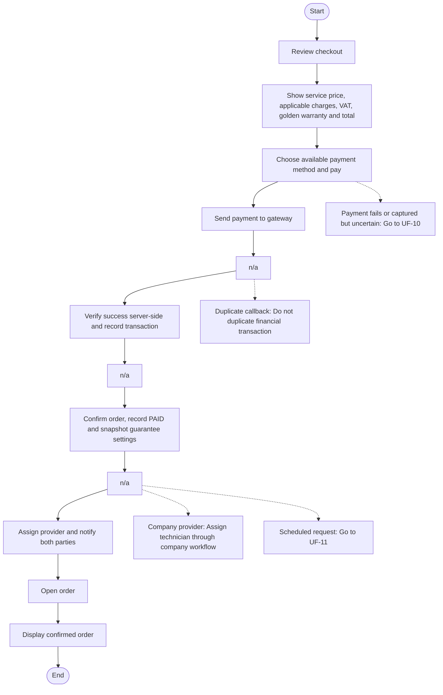

## Notes

- Related requirements: Section 11, 17, 17B/C; BR-010–011, BR-067. Golden warranty cannot be added after payment; basic guarantee adds no customer charge.

---

# UF-10: Handle Payment Failure

**Actor:** Customer / System  
**Goal:** Recover unsuccessful or uncertain payment  
**Entry Point:** Payment attempt  
**Preconditions:** Payment not verified  
**Postconditions:** Retry or reconcile/refund

## Main Flow

| # | User Action | System Response |
| --- | --- | --- |
| 1 | n/a (payment fails) | Keep order unconfirmed |
| 2 | Retry payment | Start new payment attempt |
| 3 | n/a (verified success) | Go to UF-09 |

## Alternative / Error Flows

| ID | At Step | Condition | Result |
| --- | --- | --- | --- |
| E1 | 1 | Money captured but confirmation failed | Reconcile; confirm if safe or initiate refund |
| A2 | 2 | Offer expires during retry | Policy needs clarification |

## Diagram
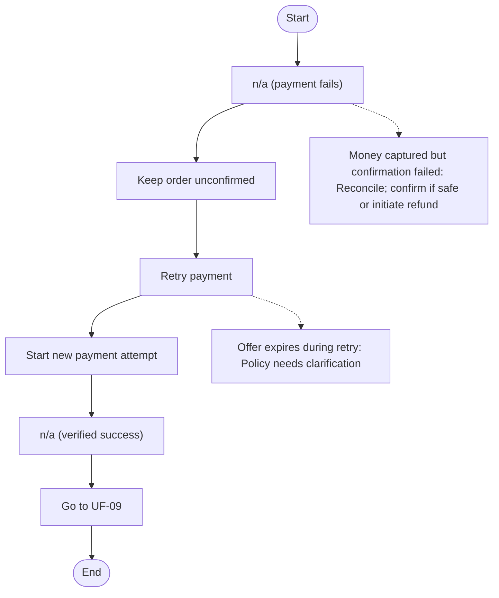

## Notes

- Related requirements: Section 11; EC-016/017/033; CUS-044.

---

# UF-11: Confirm Service Appointment

**Actor:** Customer / System  
**Goal:** Confirm scheduled service  
**Entry Point:** Verified payment  
**Preconditions:** Scheduled request accepted and paid under applicable policy  
**Postconditions:** SCHEDULED

## Main Flow

| # | User Action | System Response |
| --- | --- | --- |
| 1 | Open confirmed appointment | Display appointment card and calendar option |
| 2 | n/a | Remind both parties 24 hours and one hour before appointment |
| 3 | n/a (appointment day) | Continue to UF-12 |

## Alternative / Error Flows

| ID | At Step | Condition | Result |
| --- | --- | --- | --- |
| A1 | 1 | Change appointment | Go to UF-24 |
| A2 | 1 | Cancel | Go to UF-18 |
| A3 | 3 | Provider unavailable before appointment | Reopen offers with priority and refund or alternative |
| A4 | 3 | Provider late or customer absent | No-show policy pending |

## Diagram
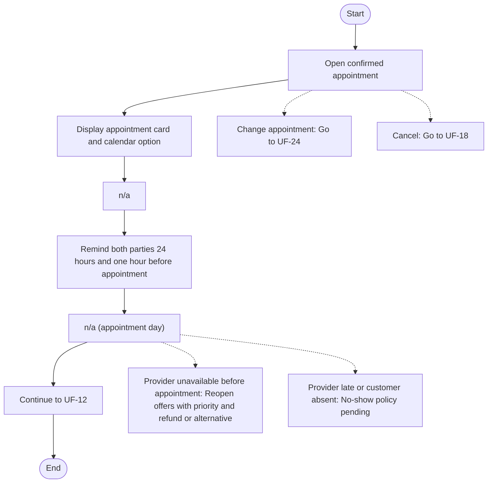

## Notes

- Related requirements: Section 8A; CUS-078; EC-038–041; DEC-042 payment timing open.

---

# UF-12: Track Provider and Service Execution

**Actor:** Customer / Provider  
**Goal:** Track execution milestones  
**Entry Point:** Confirmed order  
**Preconditions:** Payment verified and provider assigned  
**Postconditions:** COMPLETION_REQUESTED

## Main Flow

| # | User Action | System Response |
| --- | --- | --- |
| 1 | Open confirmed order | Display provider details |
| 2 | Provider starts travel | Set PROVIDER_ON_THE_WAY; record time and elapsed travel |
| 3 | Provider arrives | Set PROVIDER_ARRIVED; record arrival time |
| 4 | Provider starts work | Set IN_PROGRESS; record start and elapsed work |
| 5 | Review tracking | Show estimated duration only if supplied in offer |
| 6 | Provider requests completion | Record end time and actual duration; go to UF-15 |

## Alternative / Error Flows

| ID | At Step | Condition | Result |
| --- | --- | --- | --- |
| A1 | 1 | Company order | Owner/dispatcher or automatic assignment; technician accepts; show name, photo and vehicle |
| E2 | 1 | Technician rejects or times out | Return task to owner for reassignment |
| A3 | 4 | Additional work needed | Go to UF-13 or UF-14 |
| A4 | 3–4 | No-show or unable to perform | EC-020–022; policy open |
| E5 | 2–6 | Connectivity lost | EC-037; recovery open |

## Diagram
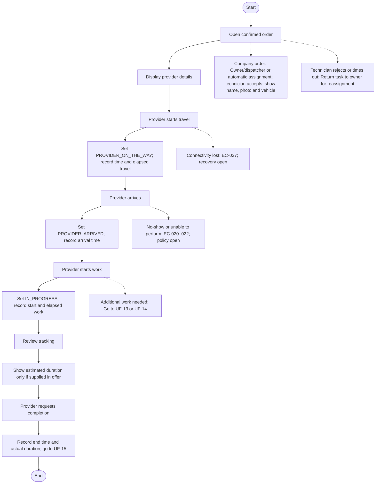

## Notes

- Related requirements: Sections 6, 12, 14; CR-003/004. No admin-defined expected work duration.

---

# UF-13: Approve Additional Cost

**Actor:** Customer / Provider  
**Goal:** Approve additional scope explicitly  
**Entry Point:** Additional cost notification  
**Preconditions:** IN_PROGRESS  
**Postconditions:** Paid addition included in total

## Main Flow

| # | User Action | System Response |
| --- | --- | --- |
| 1 | Provider submits reason, item/work description, amount and optional attachment | Record request and notify customer |
| 2 | Review additional cost | Display details |
| 3 | Approve | Record explicit approval |
| 4 | Pay if required | Verify payment |
| 5 | n/a | Add paid amount to order total and notify provider |
| 6 | Continue service | Resume execution |

## Alternative / Error Flows

| ID | At Step | Condition | Result |
| --- | --- | --- | --- |
| E1 | 3 | Customer rejects | Go to UF-14 |
| E2 | 4 | Payment fails | Do not treat amount as paid; recovery open |

## Diagram
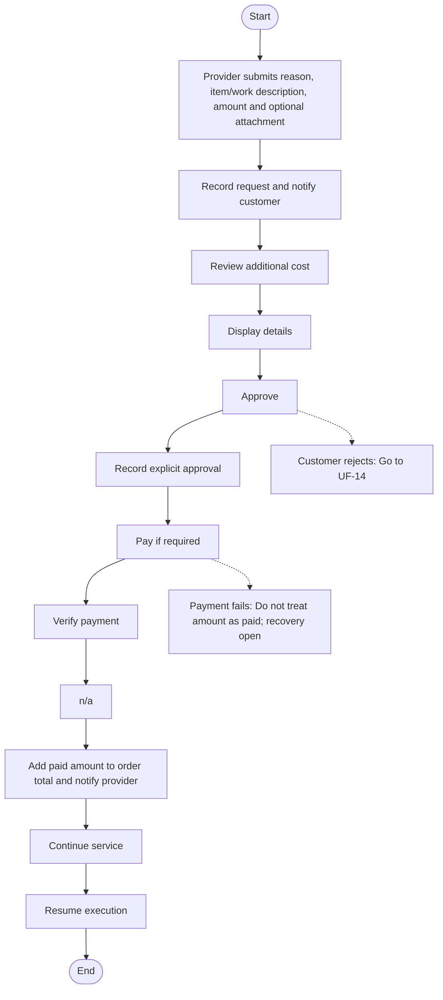

## Notes

- Related requirements: Section 13; BR-014–016; CUS-054/055.

---

# UF-14: Reject Additional Cost

**Actor:** Customer  
**Goal:** Reject unagreed additional work  
**Entry Point:** Additional cost request  
**Preconditions:** Pending customer decision  
**Postconditions:** Original scope remains

## Main Flow

| # | User Action | System Response |
| --- | --- | --- |
| 1 | Review request | Display reason and amount |
| 2 | Reject | Record rejection and notify provider |
| 3 | Continue original scope if possible | Keep original financial agreement |

## Alternative / Error Flows

| ID | At Step | Condition | Result |
| --- | --- | --- | --- |
| A1 | 3 | Original work cannot continue | Escalate or cancel according to policy; financial outcome open |

## Diagram
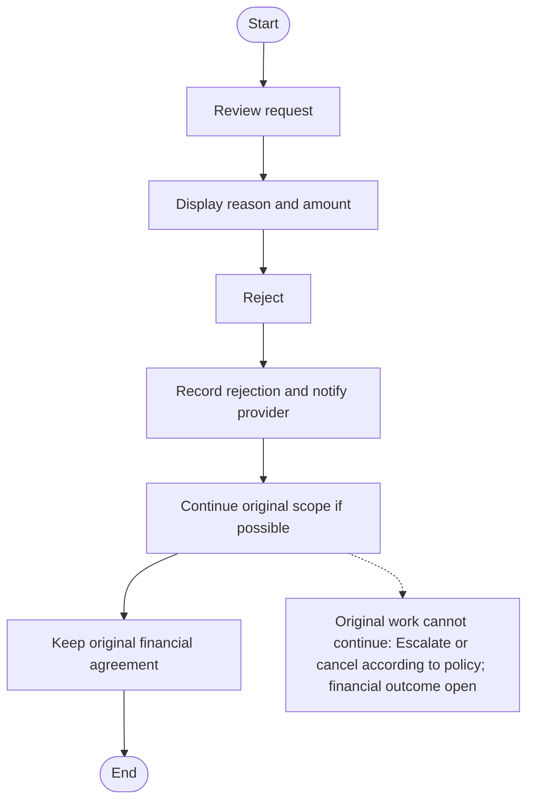

## Notes

- Related requirements: Section 13; EC-023. No silent change to settled total.

---

# UF-15: Confirm Service Completion

**Actor:** Customer / Provider  
**Goal:** Confirm completed work  
**Entry Point:** Completion notification / pending confirmation card  
**Preconditions:** Provider finished work  
**Postconditions:** COMPLETED

## Main Flow

| # | User Action | System Response |
| --- | --- | --- |
| 1 | Provider submits completion notes, available evidence and approved additions | Set COMPLETION_REQUESTED; notify customer; start confirmation and basic guarantee timers |
| 2 | Open order | Display actual start/end/duration separately from confirmation countdown, progress and automatic closing date |
| 3 | Tap Yes, work is done | Set COMPLETED and stop confirmation countdown |
| 4 | n/a | Release eligible earnings subject to guarantee holds; notify provider |
| 5 | Open completed order | Enable invoice and rating; start purchased golden warranty period |

## Alternative / Error Flows

| ID | At Step | Condition | Result |
| --- | --- | --- | --- |
| A1 | 3 | Report problem | Go to UF-17 |
| A2 | 3 | No response | Go to UF-16 |
| A3 | 4 | Basic guarantee still held | Keep held amount subject to guarantee rules |

## Diagram
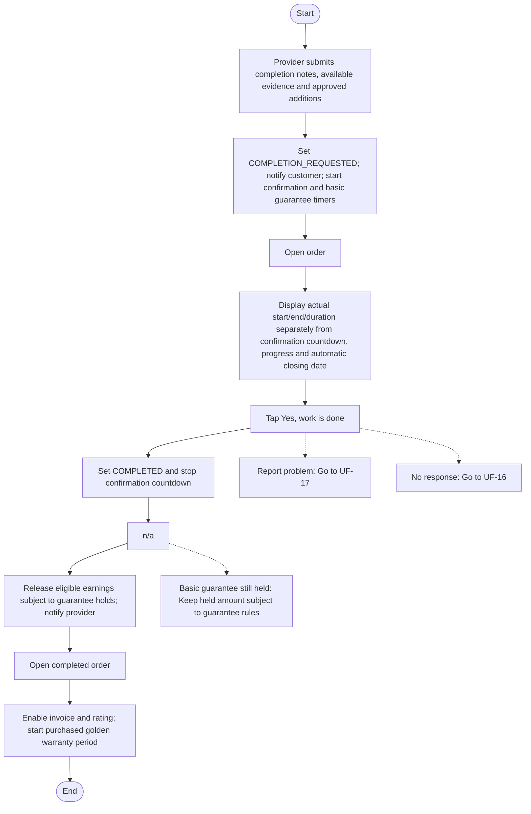

## Notes

- Related requirements: Sections 14, 17C; BR-041–045. Basic guarantee begins at provider completion request, not customer confirmation.

---

# UF-16: Automatic Service Completion

**Actor:** System  
**Goal:** Close unanswered completion request  
**Entry Point:** Completion requested  
**Preconditions:** No confirmation or open dispute  
**Postconditions:** COMPLETED; completed_by = SYSTEM

## Main Flow

| # | User Action | System Response |
| --- | --- | --- |
| 1 | n/a | Start configured confirmation window |
| 2 | n/a (midpoint) | Send first reminder |
| 3 | n/a (two hours before expiry by default) | Send second reminder |
| 4 | n/a (expiry) | Verify no confirmation or dispute; complete automatically |
| 5 | n/a | Release eligible earnings and notify customer |
| 6 | Open completed order | Show automatically completed badge and rating option |
| 7 | n/a (rating window expires) | Close rating if not submitted |

## Alternative / Error Flows

| ID | At Step | Condition | Result |
| --- | --- | --- | --- |
| A1 | 1–4 | Customer confirms | Go to UF-15 |
| A2 | 1–4 | Customer disputes | Stop timer; go to UF-17 |

## Diagram
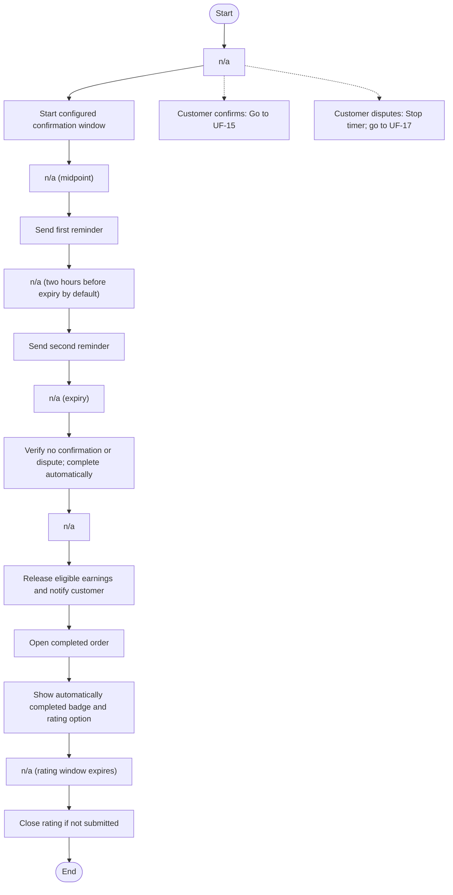

## Notes

- Related requirements: Section 14; BR-041–045. Example window 48h; default post-auto-completion rating window 7 days; settings configurable.

---

# UF-17: Report a Problem and Open Dispute

**Actor:** Customer / Admin  
**Goal:** Resolve service complaint  
**Entry Point:** Report a Problem  
**Preconditions:** Order linked to complaint  
**Postconditions:** Dispute decision and closure

## Main Flow

| # | User Action | System Response |
| --- | --- | --- |
| 1 | Select reason, describe issue and attach evidence | Record dispute |
| 2 | Submit | Set DISPUTED for completion objection; stop timer; lock order if required |
| 3 | n/a | Freeze applicable funds |
| 4 | Admin reviews | Show order, payments, timeline, completion evidence and full chat |
| 5 | Admin decides | Refund, partial refund, provider release or other resolution |
| 6 | n/a | Close dispute and notify customer |

## Alternative / Error Flows

| ID | At Step | Condition | Result |
| --- | --- | --- | --- |
| A1 | 2 | Complaint within basic guarantee period | Freeze guarantee amount and period until decision |
| E2 | 2 | Basic guarantee expired but confirmation window remains | Handle from pending earnings |
| A3 | 4 | Concurrent golden warranty claim | Dispute first |

## Diagram
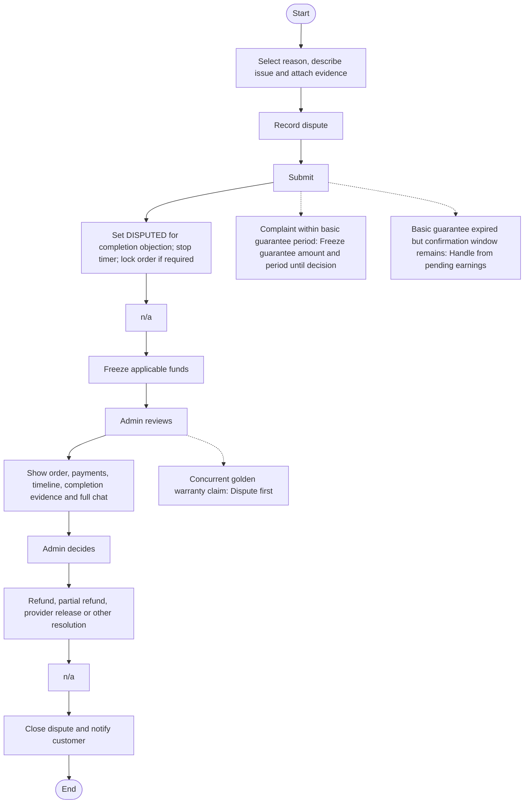

## Notes

- Related requirements: Sections 14, 17C, 20; BR-025/063. Basic guarantee example 24h; provider may return to fix or admin assigns alternative using held amount.

---

# UF-18: Cancel Service Request

**Actor:** Customer / Provider  
**Goal:** Cancel according to current stage  
**Entry Point:** Order cancellation  
**Preconditions:** Existing request  
**Postconditions:** Cancellation recorded with financial effect

## Main Flow

| # | User Action | System Response |
| --- | --- | --- |
| 1 | Open request and choose cancellation | Display applicable cancellation flow |
| 2 | Provide reason and submit | Record actor, reason and timestamp |
| 3 | n/a | Apply stage-specific policy and record refund, compensation and commission effect |

## Alternative / Error Flows

| ID | At Step | Condition | Result |
| --- | --- | --- | --- |
| A1 | 3 | PENDING | CANCELLED; free |
| A2 | 3 | Scheduled before free cancellation cutoff | Free under SCH-07; proposed cutoff 24h |
| A3 | 3 | Other stages | DEC-021 policy not finalized |

## Diagram
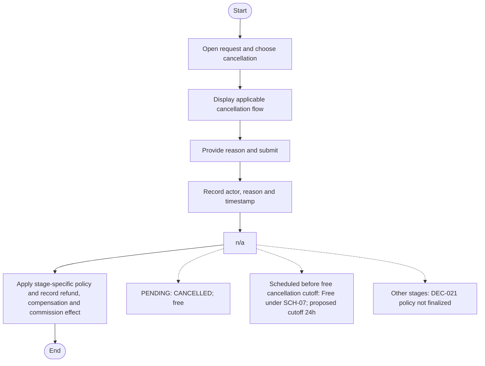

## Notes

- Related requirements: Section 19; CUS-077. Separate policies before acceptance, before payment, after payment before travel, on way, arrived, work started, after additional cost and dispute. No-show DEC-022; partial refund DEC-023.

---

# UF-19: Refund Processing

**Actor:** System / Admin  
**Goal:** Return approved amount  
**Entry Point:** Cancellation, dispute or payment reconciliation  
**Preconditions:** Refund entitlement established  
**Postconditions:** Refund result recorded

## Main Flow

| # | User Action | System Response |
| --- | --- | --- |
| 1 | n/a | Determine approved refund amount |
| 2 | n/a | Initiate refund workflow and record financial reference |
| 3 | n/a | Record result and notify customer |
| 4 | Open order | View refund update |

## Alternative / Error Flows

| ID | At Step | Condition | Result |
| --- | --- | --- | --- |
| E1 | 2 | Partial refund failure | EC-027; recovery open |
| A2 | 1 | Partial refund | Calculation policy DEC-023 open |

## Diagram
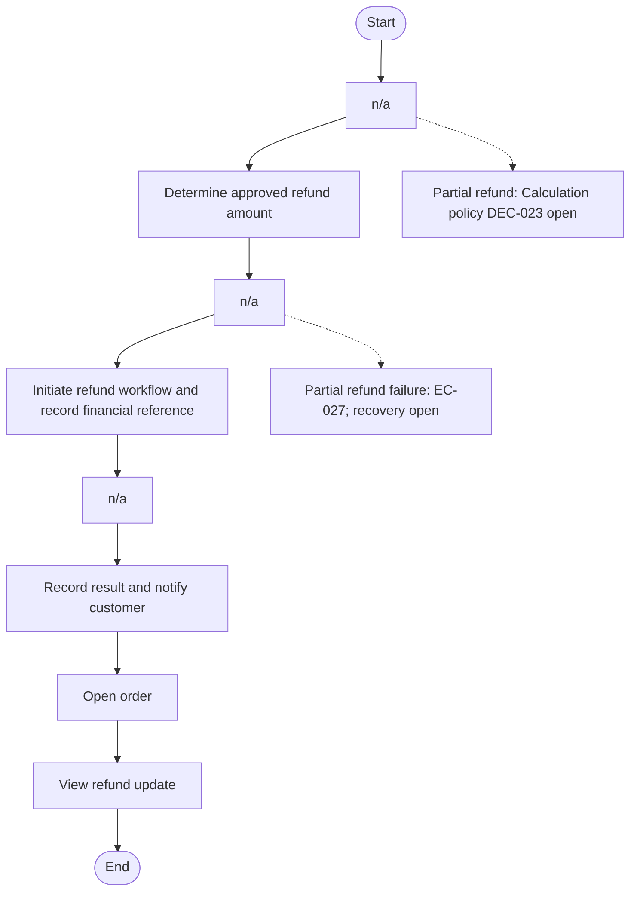

## Notes

- Related requirements: Sections 11, 16, 19–20. REFUND_PENDING and REFUNDED exist; detailed partial-refund transitions open. Credit note required; original invoices not deleted.

---

# UF-20: View Invoice

**Actor:** Customer  
**Goal:** Review paid transaction  
**Entry Point:** Order details  
**Preconditions:** Paid transaction exists  
**Postconditions:** Invoice displayed

## Main Flow

| # | User Action | System Response |
| --- | --- | --- |
| 1 | Open invoice | Show invoice/receipt number, order ID, customer, provider and service |
| 2 | Review amounts | Show base amount, approved additions, applicable taxes/fees, future discounts if any and total paid |
| 3 | Review payment | Show reference, date and status; separate golden warranty line if purchased; basic guarantee information |

## Alternative / Error Flows

| ID | At Step | Condition | Result |
| --- | --- | --- | --- |
| A1 | 3 | Refund issued | Credit note; preserve original invoice |

## Diagram
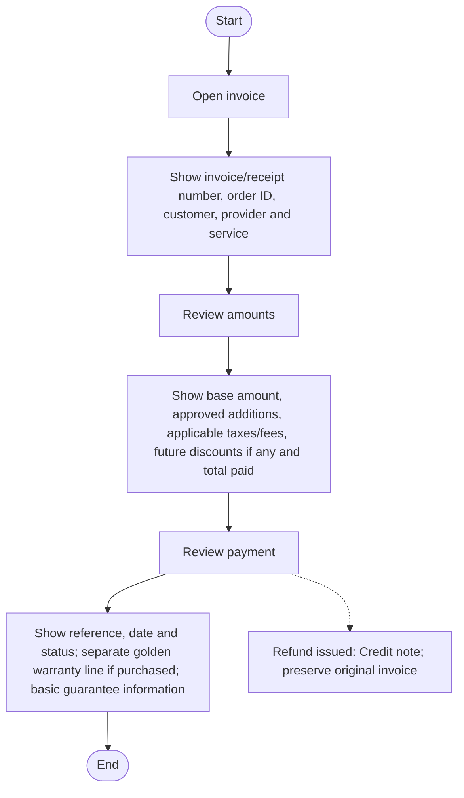

## Notes

- Related requirements: Section 16, 17B/C; CUS-061. Invoice per paid transaction; bilingual simplified tax invoice and QR specified; tax model pending DEC-014/045/046.

---

# UF-21: Rate Provider and Platform

**Actor:** Customer  
**Goal:** Rate completed service and app  
**Entry Point:** Completed order  
**Preconditions:** COMPLETED  
**Postconditions:** Ratings recorded

## Main Flow

| # | User Action | System Response |
| --- | --- | --- |
| 1 | Open rating | Display provider rating option |
| 2 | Select 1–5 and enter comment | Record provider rating |
| 3 | Rate app experience | Record separate platform rating |

## Alternative / Error Flows

| ID | At Step | Condition | Result |
| --- | --- | --- | --- |
| A1 | 1 | Order not completed | Provider rating not allowed |
| A2 | 1 | Automatically completed | Rating available for configured period, default 7 days |
| E3 | 1 | Rating period expired after auto-completion | Rating closed |
| A4 | 3 | Rating reported | Admin may moderate report |

## Diagram
```mermaid
flowchart TD
    S([Start]) --> N1["Open rating"]
    N1 --> R1["Display provider rating option"]
    R1 --> N2["Select 1–5 and enter comment"]
    N2 --> R2["Record provider rating"]
    R2 --> N3["Rate app experience"]
    N3 --> R3["Record separate platform rating"]
    R3 --> Z([End])
    N1 -.-> A1["Order not completed: Provider rating not allowed"]
    N1 -.-> A2["Automatically completed: Rating available for configured period, default 7 days"]
    N1 -.-> A3["Rating period expired after auto-completion: Rating closed"]
    N3 -.-> A4["Rating reported: Admin may moderate report"]
```

## Notes

- Related requirements: Section 15; BR-024/045; CUS-062/063. Edit/delete and comment requirements open.

---

# UF-22: View Request History

**Actor:** Customer  
**Goal:** Review current and past requests  
**Entry Point:** My Requests  
**Preconditions:** Authenticated customer  
**Postconditions:** Order details accessible

## Main Flow

| # | User Action | System Response |
| --- | --- | --- |
| 1 | Open My Requests | Display customer requests |
| 2 | Select request | Display details and current status |
| 3 | Open pending completion | Display countdown and confirmation/problem actions |
| 4 | Open completed request | Display completion information and applicable invoice, rating or warranty options |

## Alternative / Error Flows

| ID | At Step | Condition | Result |
| --- | --- | --- | --- |
| A1 | 4 | Automatically completed | Show automatic completion badge |

## Diagram
```mermaid
flowchart TD
    S([Start]) --> N1["Open My Requests"]
    N1 --> R1["Display customer requests"]
    R1 --> N2["Select request"]
    N2 --> R2["Display details and current status"]
    R2 --> N3["Open pending completion"]
    N3 --> R3["Display countdown and confirmation/problem actions"]
    R3 --> N4["Open completed request"]
    N4 --> R4["Display completion information and applicable invoice, rating or warranty options"]
    R4 --> Z([End])
    N4 -.-> A1["Automatically completed: Show automatic completion badge"]
```

## Notes

- Related requirements: CUS-070/071; Section 14 and 17B.

---

# UF-23: Submit Warranty Claim

**Actor:** Customer / Admin / Provider  
**Goal:** Repair same fault under purchased golden warranty  
**Entry Point:** Completed order with active warranty  
**Preconditions:** Paid in app; same fault; within warranty period  
**Postconditions:** Claim resolved or rejected

## Main Flow

| # | User Action | System Response |
| --- | --- | --- |
| 1 | Open warranty claim | Display claim form |
| 2 | Enter issue type, description and photos | Record claim evidence |
| 3 | Submit | Send for admin review |
| 4 | Admin reviews chat and before/after evidence | Determine same or new fault |
| 5 | Admin approves | Request free visit by original technician |
| 6 | Technician repairs | Close claim |

## Alternative / Error Flows

| ID | At Step | Condition | Result |
| --- | --- | --- | --- |
| A1 | 4 | New fault | Reject with written reason |
| E2 | 5 | Original technician refuses or fails to attend | Admin assigns alternative paid from held warranty |
| A3 | 5 | Alternative cost exceeds held amount | DEC-047 open |
| E4 | 6 | Alternative fails | Full or partial refund per admin decision |
| A5 | 3 | Concurrent dispute | Resolve dispute first |
| E6 | 1 | Warranty expired or not purchased | Not eligible |

## Diagram
```mermaid
flowchart TD
    S([Start]) --> N1["Open warranty claim"]
    N1 --> R1["Display claim form"]
    R1 --> N2["Enter issue type, description and photos"]
    N2 --> R2["Record claim evidence"]
    R2 --> N3["Submit"]
    N3 --> R3["Send for admin review"]
    R3 --> N4["Admin reviews chat and before/after evidence"]
    N4 --> R4["Determine same or new fault"]
    R4 --> N5["Admin approves"]
    N5 --> R5["Request free visit by original technician"]
    R5 --> N6["Technician repairs"]
    N6 --> R6["Close claim"]
    R6 --> Z([End])
    N4 -.-> A1["New fault: Reject with written reason"]
    N5 -.-> A2["Original technician refuses or fails to attend: Admin assigns alternative paid from held warranty"]
    N5 -.-> A3["Alternative cost exceeds held amount: DEC-047 open"]
    N6 -.-> A4["Alternative fails: Full or partial refund per admin decision"]
    N3 -.-> A5["Concurrent dispute: Resolve dispute first"]
    N1 -.-> A6["Warranty expired or not purchased: Not eligible"]
```

## Notes

- Related requirements: Section 17B; BR-031–038, 064–067; EC-042–045. Default 30 days after completion; acceptance window 48h. Unused amount distributed per snapshotted settings: provider, platform, half, percentage or fixed provider share.

---

# UF-24: Reschedule Service Appointment

**Actor:** Customer / Provider  
**Goal:** Change confirmed appointment  
**Entry Point:** Appointment details  
**Preconditions:** Confirmed appointment  
**Postconditions:** New appointment agreed

## Main Flow

| # | User Action | System Response |
| --- | --- | --- |
| 1 | Request new appointment | Validate schedule and conflicts |
| 2 | Submit change | Request other party approval |
| 3 | Other party approves | Apply agreed appointment change |

## Alternative / Error Flows

| ID | At Step | Condition | Result |
| --- | --- | --- | --- |
| E1 | 1 | Conflicting appointment | Do not approve conflict |
| A2 | 2 | Other party refuses | No agreed change |
| A3 | 3 | Outside free change period | Financial policy open |

## Diagram
```mermaid
flowchart TD
    S([Start]) --> N1["Request new appointment"]
    N1 --> R1["Validate schedule and conflicts"]
    R1 --> N2["Submit change"]
    N2 --> R2["Request other party approval"]
    R2 --> N3["Other party approves"]
    N3 --> R3["Apply agreed appointment change"]
    R3 --> Z([End])
    N1 -.-> A1["Conflicting appointment: Do not approve conflict"]
    N2 -.-> A2["Other party refuses: No agreed change"]
    N3 -.-> A3["Outside free change period: Financial policy open"]
```

## Notes

- Related requirements: Section 8A; SCH-05/06; EC-039. Proposed free change cutoff 24h; travel buffer 60 minutes.

---

