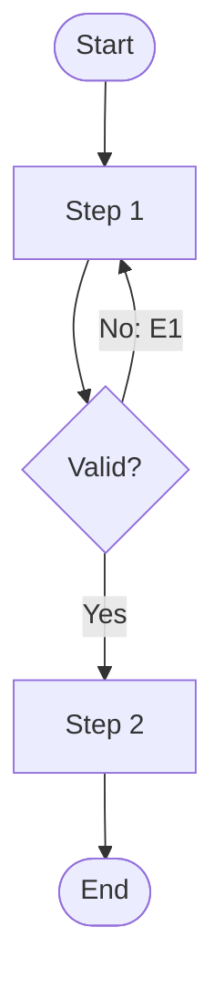

## Main Flow

| # | Actor Action | System Response | Ref |
|---|--------------|-----------------|-----|
| 1 |              |                 | SCR-xx |
| 2 |              |                 | BR-xx  |

## Alternatives & Errors

| ID | At Step | Condition | System Behavior | Resumes At |
|----|---------|-----------|-----------------|------------|
| A1 | 2       |           |                 | Step 3     |
| E1 | 3       |           |                 | End (fail) |

## Diagram (optional: only if 3+ branches)

